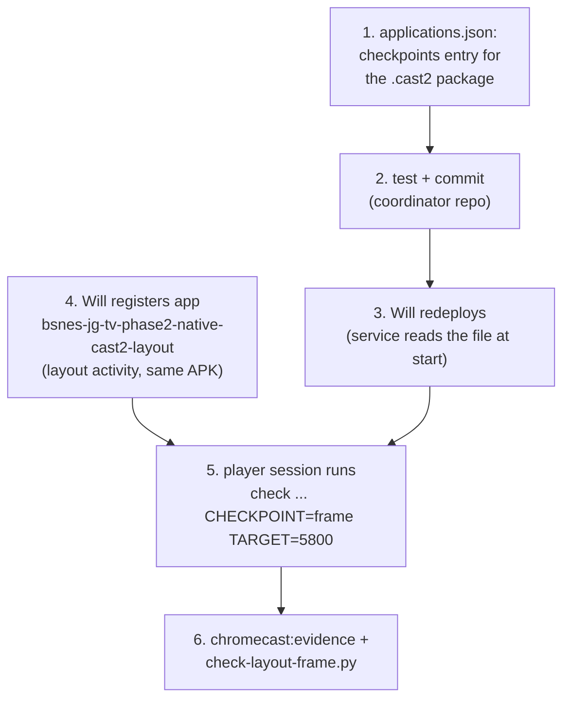

# Handoff: declare a `frame` checkpoint for the Cast2 build (coordinator repo)

**To:** the agent working in `~/chromecast-coordinator`. **From:** the bsnes‑jg‑player session, 2026‑11‑01. **Requested by:** Will.

## Why

bsnes‑jg‑player's TODO item `[T3] Device coverage` needs a frozen frame‑5800 capture on `chromecast-test-02` (Cast2) to prove the displayed pixels there. Cast1 got it with `CHECKPOINT=frame TARGET=5800`. Cast2 cannot, for two reasons that both live in the coordinator:

1. The `frame` checkpoint is declared per **package** in `scripts/wf_device/plugins/android/applications.json` (`checkpoints`, keyed by package), and only `org.bsnesjg.tv.native.phase2` has one. Cast2 carries the package `org.bsnesjg.tv.native.phase2.cast2`. Why: a stale copy of the original package, signed with another key, survived a factory reset and blocked four installs, so the Cast2 build uses a different package id. Today a check with `CHECKPOINT=frame TARGET=5800` is refused: `chromecast: app bsnes-jg-tv-phase2-native-cast2 registers no checkpoint named frame (registered: none)`.
2. The capture has to coincide with a frozen app. Only the activity `org.bsnesjg.tv.MandelbrotLayoutBenchmarkActivity` (it sets the `layoutProof` extra) freezes emulation at frame 5800. The currently registered Cast2 app launches `MandelbrotBenchmarkActivity`, which keeps running.



## What you do (steps 1 and 2 only)

### 1. Add the checkpoint entry

In `scripts/wf_device/plugins/android/applications.json`, under `checkpoints`, add a key for the Cast2 package whose `frame` definition is a copy of the existing one for `org.bsnesjg.tv.native.phase2` (read that entry first and copy it byte for byte rather than retyping it; the pattern contains escaped quotes). At the time of writing it is:

```json
"org.bsnesjg.tv.native.phase2.cast2": {
  "frame": {"source": "logcat", "tag": "BJG_TV_METRIC",
            "pattern": "\"event\":\"playback_window\".*?\"rom_frames\":(?P<value>\\d+)",
            "field": "rom_frames"}
}
```

Keep the file's existing key order, indentation and trailing newline. Check whether anything else keys on the original package and needs the same treatment for the new one (search the plugin for `org.bsnesjg.tv.native.phase2`: for example `applications` entries, validators and `context_loss`; the first search found only `checkpoints`, but confirm).

### 2. Test and commit

- Add or extend a test next to `tests/device_coordinator/test_long_validation.py` (it already references the original package) so that a `frame` checkpoint is resolved for `org.bsnesjg.tv.native.phase2.cast2` and a package without an entry is still refused. Mirror how the existing tests exercise the original package.
- Run the coordinator's tests for that area and the JSON validity check the repo uses; paste the raw output.
- Commit **only** the files you changed with `git commit --only <paths>`. The repo has unrelated uncommitted files (`docs/transcripts/…`, `docs/proof/`, `.claude/`); do not stage or commit them. Follow the repo's own conventions (its CLAUDE.md, release notes or version rules: the last release commit was `Release 0.1.28`). Do not push unless the repo's rules say commits are pushed routinely.

## What you do NOT do

- Do not restart or redeploy the coordinator service, and do not run any `task chromecast:*` command that submits, registers, readds or modifies anything. Deployment is Will's call: the service reads `applications.json` at start, so the new entry takes effect only after a redeploy.
- Do not register apps. Step 4 above is a shared-registry change that Will runs himself.
- Do not touch devices (no adb).

## What Will does afterwards

1. Redeploy the coordinator so the new entry is read.
2. Register a second Cast2 app that launches the freezing activity, with the same APK the first Cast2 app uses (sha256 `be5e60a7c97a8136ac199c747e32a43ede9cf7d33700336f606dd925d3a0e73f`, file `/tmp/claude-1000/-home-will-bsnes-jg-player/687a04d2-7b89-4f18-8371-e45efa1374c5/scratchpad/apk/cast2-id-release.apk` while the session scratchpad lasts; it is also registered under the first app):

   ```
   task chromecast:app:register APP=bsnes-jg-tv-phase2-native-cast2-layout APK=<that apk> ACTIVITY=org.bsnesjg.tv.native.phase2.cast2/org.bsnesjg.tv.MandelbrotLayoutBenchmarkActivity
   ```

   Cast1's frozen run launched `org.bsnesjg.tv.native.phase2/org.bsnesjg.tv.MandelbrotLayoutBenchmarkActivity`; look at how that app was registered and mirror it if the descriptor needs more than package and activity.
3. Tell the player session. It then runs the check with `CHECKPOINT=frame TARGET=5800 DURATION=480` on `chromecast-test-02`, downloads the evidence, and runs `android/tools/check-layout-frame.py`.

## Hand back

The commit hash in the coordinator repo, the raw test output, the exact diff of `applications.json`, any other place that needed the new package, and anything you did not verify.
