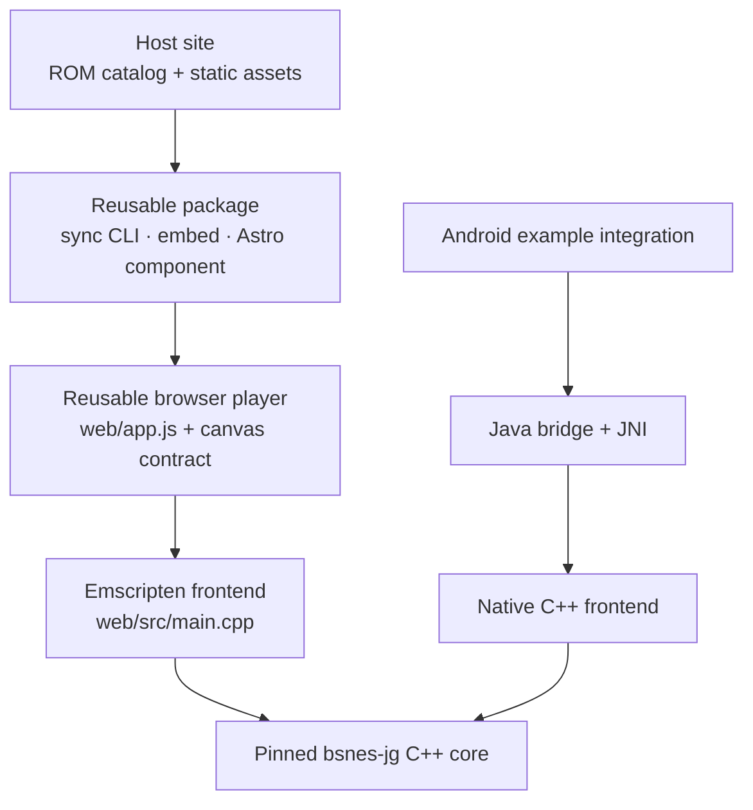

# Integrate the bsnes-jg player

The reusable player is the product: a pinned cycle-accurate bsnes-jg core, its frontend contracts, and integration tools. WebAssembly is the browser integration. The Android APKs are example Native host applications, not the project’s SDK or primary product.

This repository is `bsnes-jg-player`: it owns the reusable SNES player integration, including its browser WebAssembly runtime, package sync CLI, framework-agnostic embed, and Astro component. The product page is `https://indri.studio/apps/bsnes-jg-player/`. Keep the APK delivery prefix `https://downloads.biohack.net/bsnes-jg/` separate; it is a stable download location and does not need to mirror the source repository name.

The Native Android frontend is an upstream candidate for [`libretro/bsnes-jg`](https://github.com/libretro/bsnes-jg), since it adapts that core for Android rather than for the browser. It remains an example integration in this repository until an upstream proposal is reviewed and accepted. The browser WASM frontend and web package stay in this fork because they are the fork’s web product.

## Integration map



The browser build and Android Native example compile the same core source for different runtimes. Both frontends register ROM loading, database-file, controller-input, video, and audio callbacks. The browser path calls the core through Emscripten exports; the Android Native path calls it through JNI. In these examples, audio is sent to a discard sink and save-data writes are discarded; a production host that needs sound or persistent saves must provide those services. WebAssembly is the web-browser integration; Native is the Android integration. An Android WASM comparison flavor exists for controlled measurements, but is not a recommended Android host: it is less efficient and too slow on Chromecast.

## Browser integration

### Install and sync the reusable package

The package currently ships from this repository’s `npm-package` branch:

```sh
npm install github:wbniv/bsnes-jg-player#npm-package
npx bsnes-jg-player sync public/play
```

`sync` copies the engine, loader, and provenance into `public/play/`, then writes an `ENGINE_VERSION` stamp. It does not overwrite the host site’s ROMs or preview art. Use `--demo` to add the package’s selected one-ROM sample (currently Raycaster Maze, 32 KiB); the npm package does not contain the full ROM suite:

```sh
npx bsnes-jg-player sync public/play --demo
npx bsnes-jg-player sync --check public/play
```

The `--check` form is suitable for CI: it fails if the copied player differs from the installed package.

### Astro component sample

```astro
---
import SnesPlayer from '@wbniv/bsnes-jg-player/SnesPlayer.astro';
---

<SnesPlayer
  slug="raycaster"
  title="Raycaster Maze"
  keys="Arrows: D-pad · Z/X: B/A · Enter: Start."
/>
```

The ROM belongs to the host site at `public/play/roms/raycaster.sfc`, with its entry in `roms/manifest.json`. The Astro component renders the canvas and controls, hashes the served player files for cache busting, and boots the selected ROM. Add the optional drift guard to `astro.config.mjs`:

```js
import bsnesPlayer from '@wbniv/bsnes-jg-player/integration';

export default defineConfig({
  integrations: [bsnesPlayer({ playDir: 'play', mode: 'error' })],
});
```

### Framework-agnostic embed sample

For a static site or a framework without Astro, sync the files and provide the boot globals before loading the player:

```html
<section id="bjg-embed" class="rp-player" aria-label="SNES player">
  <div class="rp-screen">
    <canvas id="screen" width="256" height="224"></canvas>
  </div>
  <p id="status">Loading…</p>
  <span id="checkresult" class="rp-badge"></span>
  <button id="verify" disabled>Verify fidelity</button>
  <button id="fullscreen">Fullscreen</button>
  <p id="banner"></p>
</section>
<link rel="stylesheet" href="/play/player.css">
<script>
  window.BJG_BASE = '/play/';
  window.BJG_DEFAULT_ROM = 'raycaster';
</script>
<script src="/play/app.js"></script>
```

`#screen` is required. The status, verification, fullscreen, and banner elements are optional. `window.BJG_BASE` must end with `/`; `window.BJG_DEFAULT_ROM` names a manifest ID. The full snippet and styles are in [`embed/snippet.html`](../../embed/snippet.html) and [`embed/player.css`](../../embed/player.css).

For a host that owns its own JavaScript controls, the loaded runtime exposes `window.BJGTV`. For example:

```js
async function playExampleRom() {
  const player = window.BJGTV;
  if (!player || !player.isReady()) return false;
  const loaded = await player.play('raycaster'); // true or false
  if (loaded) {
    player.pause();
    player.resume();
  }
  return loaded;
}
```

The stable embedding contract is the markup, boot globals, and package integrations above. `window.BJGTV` is the runtime control surface used by this repository’s app wrappers; pin the package version if an integration depends on its methods.

## Core frontend contract

`web/src/main.cpp` is the small Emscripten frontend around the C++ core. It registers callbacks for ROM loading, game database files, controller input, video, and audio; powers the core; then exposes a C ABI to JavaScript. The main exported calls are:

```c
int      bjg_load(const uint8_t *rom, int len);
void     bjg_run(void);          // advance one SNES frame
void     bjg_reset(void);
void     bjg_set_input(int port, int buttons);
uint32_t *bjg_video(void);
uint8_t  *bjg_wram(void);
```

The WebAssembly glue is generated from this frontend and the pinned bsnes-jg source. Use `task build` to rebuild the core and `npm run stage-dist` to refresh the package payload; sites should consume the package rather than copy `web/app.js` or core files by hand.

## Android Native example integration

The Android sample shows how a host app can adapt the same core API without Emscripten:

1. The ROM selector passes a manifest slug to `window.BJGTV.play(slug)`.
2. `engine-adapter.js` calls the JavaScript bridge `BjgAndroid.playRom(slug, callbackId)`.
3. `MainActivity` loads `assets/roms/<slug>.sfc` and queues core work on the GL thread.
4. `NativeEngine.load(...)` crosses JNI into `libbjg.so`; the C++ frontend registers the core callbacks and powers the machine.
5. The renderer steps frames, copies pixels to a direct buffer, and draws them through the GLES surface. Host buttons are mapped to the gamepad mask supplied to the core.

The Java bridge in the example has this shape:

```java
@JavascriptInterface
public void playRom(String slug, int callbackId) {
    new Thread(() -> {
        final byte[] rom;
        try {
            rom = NativeEngine.read(getAssets().open("roms/" + slug + ".sfc"));
        } catch (IOException e) {
            resolve(callbackId, false);
            return;
        }
        if (glView == null) {
            resolve(callbackId, false);
            return;
        }
        glView.queueEvent(() -> {
            boolean ok = NativeEngine.load(getAssets(), rom, slug + ".sfc");
            resolve(callbackId, ok);
        });
    }, "rom-loader").start();
}
```

The JNI-facing engine calls used by the sample are:

```java
NativeEngine.load(assets, romBytes, romName);
NativeEngine.step();
NativeEngine.setPad(buttonMask);
NativeEngine.width();
NativeEngine.height();
NativeEngine.copyPixels(rgbaBuffer);
NativeEngine.wramWord(0x580); // example fidelity check
```

These classes are package-private example code, not a published Android SDK. A different host can reuse the approach, but must provide its own Android lifecycle, audio/video output, input mapping, save-data policy, database assets, and thread ownership. The app variants are built with `task android:build` for controlled testing; public APKs are signed example integrations and must never be used as a substitute for the reusable package.

## ROM manifest sample

The browser loader identifies ROMs by slug and reads files under `roms/`. A small manifest entry looks like this:

```json
{
  "roms": [
    {
      "id": "raycaster",
      "title": "Raycaster Maze"
    }
  ]
}
```

`selfcheck` is optional. When present, the player powers the ROM, runs the requested frame count, reads little-endian bytes from WRAM, and compares them with `want`. Only use a check value produced by a trusted reference run of that ROM.

## Example integration APKs

The APKs are runnable Android host examples. They bundle demo ROM assets for offline demonstration, while the reusable package remains the versioned integration surface. The `native` and `nativeplayer` APKs demonstrate a multi-ROM library and a single-ROM player respectively; their filenames and download page identify them as example builds. The Android `wasm` flavor is a controlled comparison build, not a recommended Android integration.
