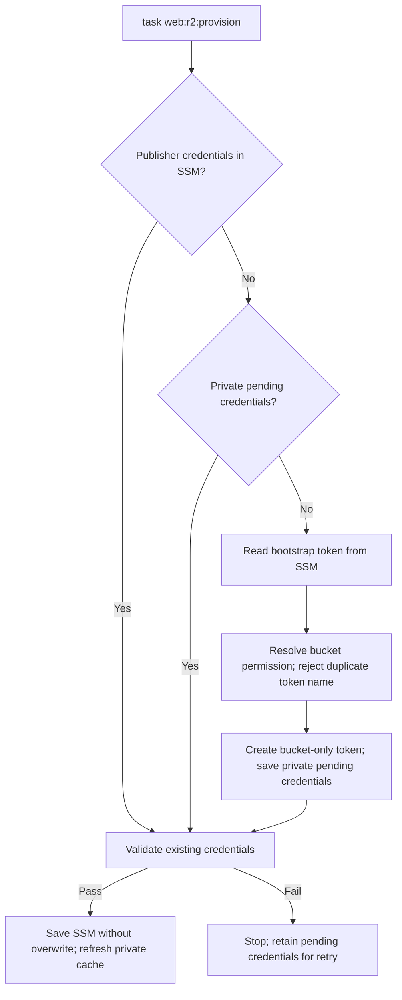

# Prepare and publish a player release

The publisher builds a local candidate, verifies both Native APKs, and publishes only after an explicit destination/prune confirmation. Ordinary build tasks never publish. Android WASM comparison APKs are excluded. Browser npm publication and consumer-site deployment remain separate operations.

## Credentials and signing

`task android:release-secrets-pull` restores the existing durable Android key from SSM. Do not bootstrap another signing identity. `task web:release:signing-recovery` verifies a temporary recovery against the retained signing certificate and removes the temporary key afterward.

R2 publication uses `/indri-studio/bsnes-jg/release/r2` in SSM. Provision the publisher credentials through the Cloudflare account-token API:

```sh
task web:r2:provision BOOTSTRAP_PARAMETER=/path/to/authorized/bootstrap_token
```

Select a verified account-token administrator by SSM **parameter name**, never by token value. No default bootstrap source is configured. The target account comes from `/indri-studio/cloudflare/account_id`. Once SSM or local pending publisher credentials exist, `task web:r2:provision` can validate/resume them without selecting a bootstrap source.

Live read-only checks on 2026-10-31 returned HTTP 403 / Cloudflare code 9109 from both account and user token-permission endpoints for `/biz/cloudflare/api_token`, `/cloudyak/cloudflare/api_token`, `/indri-studio/cloudflare/api_token`, `/sharedpair/cloudflare/api_token`, `/sharedpair/cloudflare/bootstrap_token`, `/wald3n/cloudflare/api_token`, and `/wf-org/cloudflare/api_token`. This establishes failure of those requests, not failure of the projects’ ordinary R2 operations. A working token-administration source remains unresolved. The Shared Pair default previously used here was removed.

The task creates `bsnes-jg-downloads-publisher` with bucket item write permission on **bsnes-jg-downloads only**, deriving the S3 secret as SHA-256 of the returned token value. It tests object listing, byte readback, create-only and ETag conditional writes, and deletion in a unique validation prefix before saving a new SSM SecureString. It uses the existing bucket; no bucket/domain creation or artifact publication occurs. The bootstrap token stays in memory and is never stored in the publisher configuration.



Example terminal progress:

```text
Provisioning bsnes-jg-downloads-publisher for bsnes-jg-downloads; bootstrap source: /path/to/authorized/bootstrap_token
Checking list/read/write/delete and conditional writes with one disposable object.
R2 publisher credentials provisioned and verified; saved to /indri-studio/bsnes-jg/release/r2
```

That is an example, not a live verification receipt. Existing SSM credentials are validated and reused without requesting the bootstrap token or minting a replacement. Failed validation never rotates them automatically. New credentials survive failed validation or SSM storage in mode-0600 `.private/release/r2-provision-pending.json`; rerun the same task to resume. Keep that file until completion. A token name already present without SSM/pending credentials stops provisioning for recovery rather than creating a duplicate. A lost API creation response can require manual recovery because Cloudflare exposes the token value only once. A local file lock prevents concurrent provisioning in this checkout; SSM writes refuse replacement across checkouts.

`task secrets-pull` restores the ignored mode-0600 `.private/release/r2.json` cache. For credentials created separately in the dashboard, `task secrets-bootstrap` remains the manual import command; it does not provision a token. The publisher reads JSON directly rather than sourcing shell dotenv content. Neither path passes secrets in command arguments. Rotation requires a separately reviewed replacement.

`task web:r2:setup` checks access to the existing bucket; it does not create domains or grant broader permissions. `task web:r2:probe` writes, reads and deletes one disposable object under `bsnes-jg/_validation/`. Review the provider's bucket scope as well: successful object access does not prove least privilege. Account-level setup credentials are separate from publication credentials.

## Candidate preparation

Commit the source changes first. Choose the next Android version name and a version code above every previously reserved/published code. The browser npm version remains independent and is recorded in the candidate.

```sh
task web:release:test
task web:release:prepare VERSION=0.1.10 VERSION_CODE=11
task web:release:preview CANDIDATE="$PWD/.private/release/candidates/0.1.10"
```

Preparation builds both signed Native APKs against their retained validated fixture, rebuilds the web core with Emscripten 6.0.4, stages the npm payload in an isolated temporary package tree, checks browser WRAM fidelity and package sync, verifies certificate/package/version/ABI/ROM assets and freezes the candidate in `.private/release/candidates/`. The manifest records exact hashes, catalog hash and source inputs. The committed `dist/` fixture is left intact; only the candidate contains the freshly staged browser payload. Do not modify candidate files to retry a failed gate.

## Publication and recovery

```sh
task web:release CANDIDATE="$PWD/.private/release/candidates/0.1.10"
task web:release:check
```

The command re-inspects the candidate, prints bucket/current/previous/deletion candidates, and asks for `PUBLISH`. It holds a remote lock through upload, manifest commit, alias repair and pruning. Every public APK is downloaded back and hashed before promotion. Only current/previous remain after a successful run. Browser tarballs stay in the candidate for the separate consumer/npm release; they are not uploaded as APKs.

An upload/hash failure leaves the old manifest authoritative. A failure after pointer publication can mean **published but cleanup/alias repair incomplete**; inspect the canonical manifest and remote journal, then resume the *same* candidate:

```sh
task web:release:resume CANDIDATE="$PWD/.private/release/candidates/0.1.10"
```

Journals are under `bsnes-jg/_release/journals/`; the permanent version-code high-water record is under the same control prefix. Neither is in the pruned release prefix. Resume cannot advance previous twice or replace immutable bytes. An unknown object in the release prefix stops pruning for review.

A crashed process can leave `bsnes-jg/_release/lock.json`. Confirm its owner has stopped, inspect its token through the authenticated object client, and use `task web:release:unlock TOKEN=<token>`. There is deliberately no automatic stale-lock expiry that could allow two publishers to overlap. All publishing tools must honor this lock; the manifest also uses a conditional ETag write to reject outside changes.

Changing the download pointer to an older version does not downgrade an installed Android app. Ship a corrective APK with a higher versionCode for an in-place update.

## Device proof and pages

Use only `task chromecast:*` coordinator sessions to install/navigate/capture Cast1 or Pixel. On TV, Share app APK offers **Local transfer QR** and **Public download QR** when the release URL is configured. Public QR points to the stable product entry, includes a readable URL, and does not upload the installed APK. The published release can differ from the sender's app. Quick Share requires a second Android device and real recipient confirmation; a renderer capture is not transfer proof.

The Indri listing implementation reads current/previous through its Worker proxy, validates the manifest and renders both APK variants. Its source changes and the wald3n source listing must be deployed separately before claiming live-page validation. Attach real captures and compact receipts inline in the [release implementation plan](../plans/2026-10-31-repeatable-release-tooling.md).

The remote lock/manifest implementation relies on R2's documented atomic conditional writes: [R2 S3 compatibility](https://developers.cloudflare.com/r2/api/s3/api/). Credential scopes follow [R2 authentication](https://developers.cloudflare.com/r2/api/tokens/).
