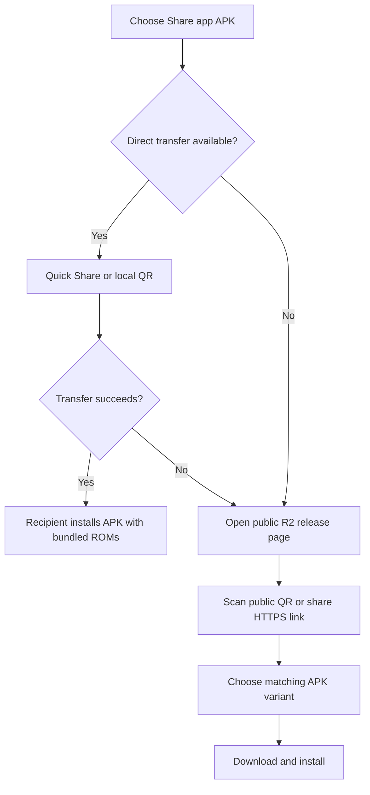
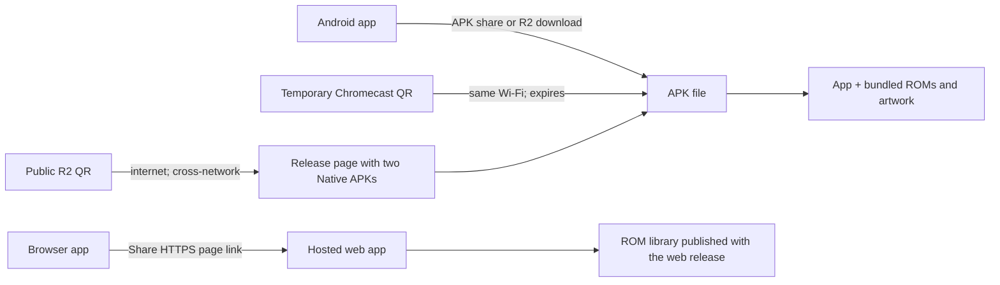
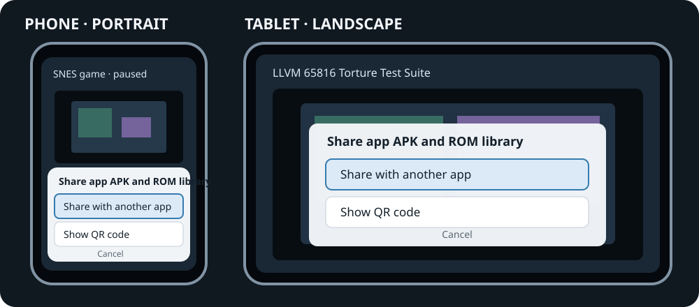
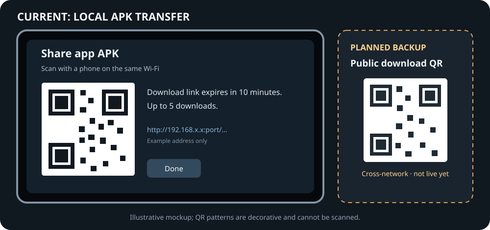
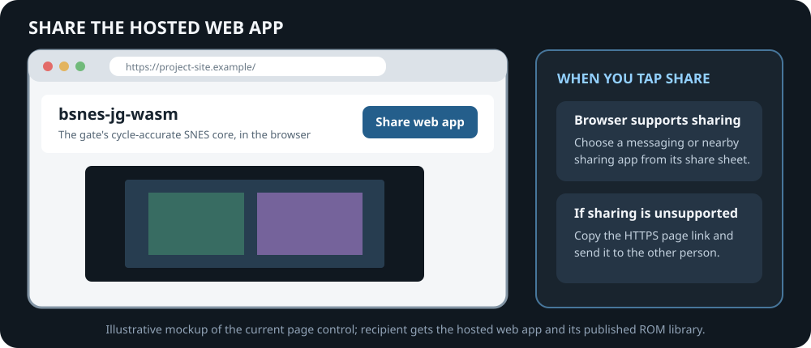

# How to share the SNES app

This guide covers sending the Android app package (APK) to another Android user and sharing the browser version. The ROM-library APK builds bundle the app together with their ROM catalog, ROM files, and preview images, so sharing that APK shares the bundled library too. A single-ROM player build contains only the ROM bundled with that build. Device-local preferences, such as favorites, are not copied.

**Version note:** These controls are in the current source and become available after the updated APK is built and installed; the web button appears after the updated web page is published. The public R2 download page and its QR fallback are planned, but are not live yet. Quick Share is the direct phone-to-phone option; it does not use cellular data. The public QR is a backup: the recipient downloads the already-published APK from R2 and needs internet or mobile data; the sender does not upload the APK. **Share web app** uses the browser share feature or copies the page link.

## Choose a sharing method

### Android APK: direct transfer, then public fallback

Quick Share discovers nearby devices with Bluetooth and sends the APK directly
over local Wi-Fi. It needs Wi-Fi and Bluetooth enabled on both devices, but it
does not need internet or the same Wi-Fi network, and the sender does not
upload the APK. If Wi-Fi is off, turning on the Wi-Fi radio for Quick Share
does not require joining an internet network. The in-app QR uses a temporary
local-network URL, so both devices must be on the same network. If direct
transfer is unavailable or fails, the public QR lets the recipient download
the already-published APK from R2; only the recipient needs internet/mobile
data, and the sender does not upload the file.

| Sender | Share the Android APK | Share the browser version |
|---|---|---|
| Android phone | Use **Share with another app** for direct Quick Share, or the local QR. If direct transfer is unavailable or fails, use the public download QR when published. | Send the web app's HTTPS link from the browser; the recipient accesses the ROMs hosted with that web release. |
| Android tablet | Same as phone; the public R2 page is the fallback when direct transfer is unavailable or fails. | Send the web app's HTTPS link from the browser; the recipient accesses the ROMs hosted with that web release. |
| Chromecast / Google TV | Use local QR when connected to the same network. If local transfer fails, show the public download QR when published. | Send the web app's HTTPS link from a phone or computer. |
| Web browser | Download an APK from the public R2 release page, when published, then share that file or page link. A browser cannot extract an APK installed on an Android device. | Use the browser's Share action, or copy and send the page URL. This shares access to the hosted web app and its published ROM library, not an offline APK bundle. |

Quick Share is a direct device-to-device transfer: Bluetooth discovers nearby devices and local Wi-Fi transfers the file. It does not use internet or cellular data and does not require both devices to join the same Wi-Fi network. The built-in QR transfer uses a temporary local URL and does require both devices on the same network. The public R2 QR is a fallback; it points the recipient to an APK already on R2, so the sender does not upload anything. The recipient needs internet access or mobile data.

### What travels with each share method

If direct Android transfer is unavailable or unsuccessful, use the project's public Android downloads page at `https://downloads.biohack.net/bsnes-jg/` once it is published. Its QR code works across networks and opens a page with the current Native library and Native player APKs. Choose the app type you need. The sender does not upload the APK; the recipient downloads it from R2 and needs internet access or mobile data. Android WASM APKs are excluded from public distribution because playback performance is unusable; browser WASM remains available as the web app. The public page and QR are not live yet; until then, use Quick Share with Wi-Fi and Bluetooth enabled or the local QR when both devices share a network.

## Android phone or tablet: send the APK

These are illustrative UI mockups, not device screenshots. Both layouts show the same two choices: **Share with another app** or **Show QR code**.

1. Open the SNES app and open its pause menu.
2. Select **Share app APK**.
3. Choose **Share with another app** to open Android's share sheet and select Quick Share, or choose **Show QR code** for a phone on the same local network. Quick Share is direct device-to-device transfer; it does not upload the APK.
4. Quick Share requires Bluetooth and Wi-Fi enabled on both devices, but not internet or a shared Wi-Fi network. The local QR requires both devices on the same network. If direct transfer is unavailable or fails, use **Public download QR** once the release page is live; the recipient downloads the APK from R2 over internet/mobile data. A ROM-library build includes the catalog's bundled ROMs and preview art in the APK.

If the share sheet reports that no app can handle the request, use a receiving app that accepts files or use the public download QR when it is live. The APK is shared read-only; the app does not install anything on the recipient's device.

## Chromecast / Google TV: send the APK by QR

The left screen represents the current temporary local transfer. The right-hand public-download QR is a planned cross-network backup and is not available in the app yet. Both sample QR patterns are decorative and cannot be scanned.

1. Connect the Chromecast and the recipient's phone to the same Wi-Fi network. Turn off VPNs that prevent devices on the local network from reaching each other.
2. In the app's pause menu, select **Share app APK**. The TV displays a QR code and a download address.
3. Scan the QR code with the recipient's phone camera and open the link. If scanning is unavailable, type the displayed address into the phone's browser.
4. Download the APK before the transfer screen closes or expires. The link is temporary and serves only this app's APK, which includes the ROM assets bundled in that build.
5. Open the downloaded APK and follow Android's installer prompts. Android may ask the recipient to allow installs from the browser or file manager used to open it.

Keep the TV transfer screen open until the download finishes. If the phone cannot reach the address, check that both devices are on the same Wi-Fi (not guest Wi-Fi with client isolation), disable the VPN, and create a fresh QR transfer.

If local transfer cannot connect, use the public-download fallback once the app offers it: choose **Public download QR** on the TV and scan it. The recipient opens the release page and selects the correct APK variant. The sender does not upload the APK; the recipient needs internet access or mobile data to download the published copy. The phone and TV do not need to share a Wi-Fi network.

## Share the browser version

This is an illustrative mockup of the current page control and browser behavior, not a screenshot.

Select **Share web app** in the page header. A supported browser opens its share sheet; otherwise the page copies the HTTPS address or offers it in a copy prompt. The recipient opens that link in a supported browser and can use the ROM library published with the site. This shares access to the hosted web app and its ROMs; it does not download an offline copy to the recipient's device or produce an Android APK.

To send an APK from a browser, open the public R2 release page, choose the correct APK variant, and share either the download link or downloaded file. Do not use a third-party APK mirror. The browser cannot read the installed APK from a phone, tablet, or Chromecast.

## Receive and install an APK

1. Accept the incoming file and confirm its name ends in `.apk`.
2. Open it from the receiving app or the device's Downloads/Files app.
3. If Android asks, allow that source to install unknown apps, then return to the installer.
4. Review the app name and install. Android still requires the recipient to approve installation.

If Android says the app conflicts with an existing installation, the APK may be signed with a different key or may be a different build variant. Do not uninstall an existing copy unless you are willing to lose its app data. Ask the sender for an update-compatible APK signed with the same key as the installed version.

## Before sharing broadly

Only share APKs from a source you trust. Android treats APK installation as installing software, so recipients should verify who sent the file and what app they are installing. For release distribution, provide the release version and SHA-256 hash alongside the download, and keep the signing key stable so later updates install over earlier versions.

The Chromecast QR transfer is a temporary local-network link, not a public download URL. Do not post its QR code or address publicly. For sharing across different networks, use an official HTTPS release download instead.
