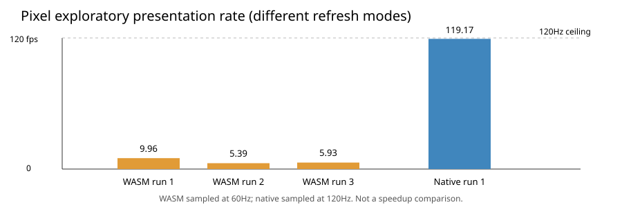
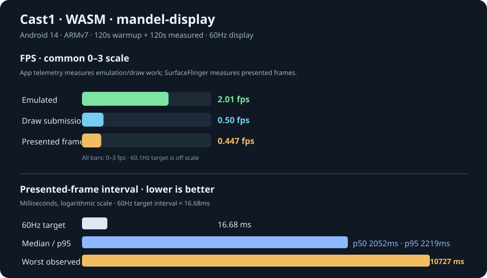
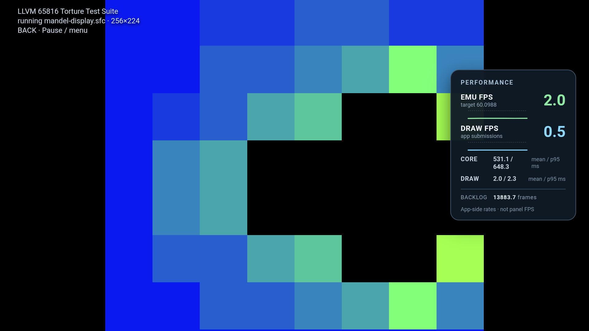
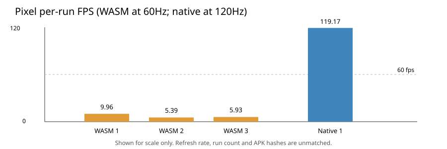
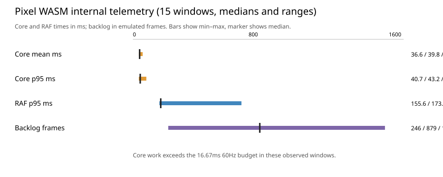

# bsnes-jg Android: WASM vs native comparison

**31 October follow-up:** [repeated Cast1 measurements, correctness fixes and hardware proof](../../2026-10-31/comparison.html). The historical report below is retained; its outstanding gates are superseded only where that follow-up has explicit evidence.

**Status: preliminary; one matched Cast1 profile pair is now available.** The ARMv7 native crash was caused by libco restoring a Thumb-compiled coroutine entry point through an ARM `ldmia ... {pc}` switch. Compiling the native library in ARM state for `armeabi-v7a` fixes launch and playback on Cast1. The first native profile completed, but repeated pairs and the frame-5800 correctness gate are still outstanding. Pixel data remains exploratory because its WASM and native runs used different refresh modes and older APKs.

The workload is the single bundled `mandel-display` ROM (SHA-256 `6c13c9042ca68be06f42650862ad7e116cc782e3a433ceaf9f760f090b430353`). The shared 152-ROM selector/catalog is present in both app variants but is not part of this workload. Core version is bsnes-jg 2.1.0; release builds use NDK 26.2.11394342 and CMake 3.22.1.

## Executive results

| Finding | Result | Interpretation |
| --- | ---: | --- |
| Pixel WASM SurfaceFlinger | 3 runs; median 5.93 presented frames/s | Severe missed-refresh behavior at 60Hz; all sampled intervals missed at least one 60Hz refresh. |
| Pixel native SurfaceFlinger | 1 run; 119.17 presented frames/s | Near the Pixel's 120Hz refresh, but only one run and two sampling holes. |
| Pixel comparison | 60Hz WASM vs 120Hz native | Not a valid speedup comparison; different refresh modes and run counts. |
| Cast1 WASM, current APK | 0.447 presented FPS; app HUD 2.01 emu / 0.50 draw FPS | 120s warmup + 120s measured; no sampling holes; 100% of intervals missed at least one 60Hz refresh. |
| Cast1 native, ARMv7 fix | 3.859 presented FPS; app HUD 15.50 emu / 3.87 draw FPS | 120s warmup + 120s measured; no sampling holes; 100% of intervals missed at least one 60Hz refresh. |
| Render completion | Visually confirmed | The ten-minute continuous WASM recording reached 961 emulated frames and shows the full animated Mandelbrot output. |
| Correctness gate | Not captured | No frame-5800 WRAM or framebuffer comparison yet. |
| Current Cast1 access | Coordinator ready between jobs | All device access uses coordinator-owned sessions. |

## Measurement provenance

| Device | Engine | Job | Installed APK SHA-256 | Runs | Status/evidence |
| --- | --- | --- | --- | ---: | --- |
| Pixel 8 Pro, Android 17, arm64-v8a | WASM | `J‑7a4b7a0072ca` | `b2bfe5ed6eab03da8e3847ee2c65a5ff1d890c73ca972a22f0a7ca738d8556fa` | 3 | Completed; `evidence/pixel-wasm/`; installed hash verified. |
| Pixel 8 Pro, Android 17, arm64-v8a | Native | `J‑dab401a8e077` | `22b5561185bccd46ea517b0916873d17e3ddfe88a6cd527f7807bf8b8bf9643e` | 1 | Completed; `evidence/pixel-native/`; two SurfaceFlinger sampling holes. |
| Cast1 Chromecast HD, Android 14, armeabi-v7a | WASM | `J‑b47d61f35ce8` | `b2bfe5ed6eab03da8e3847ee2c65a5ff1d890c73ca972a22f0a7ca738d8556fa` | 1 attempt | Mandelbrot screenshot captured; sampler had too few timestamps. |
| Cast1 Chromecast HD, Android 14, armeabi-v7a | Native | `J‑c374ebe393bb` | `22b5561185bccd46ea517b0916873d17e3ddfe88a6cd527f7807bf8b8bf9643e` | 1 attempt | Benchmark activity left foreground; no timing samples. |

The Pixel APK hashes above precede the current telemetry build. The 2026-10-27 Cast1 WASM profile uses SHA-256 `708f1bd7…`; the fixed native build uses SHA-256 `b27a10d5…`. Both completed 120-second warmup and measurement windows on Cast1. Pixel results remain tied to older APK hashes and are not a controlled comparison.

## Cast1 current-build run (2026-10-27)

The same Cast1, ROM, and nominal 60Hz display were used for both release APKs. Both completed a 120-second warmup and 120-second SurfaceFlinger measurement. This is one matched pair; it is descriptive until repeated runs and the fixed-frame correctness gate are complete.

| Measurement | WASM | Native | Source / interpretation |
| --- | ---: | --- | --- |
| Device / OS / ABI | Chromecast HD / Android 14 / armeabi-v7a | Same | Cast1 coordinator facts |
| APK SHA-256 | `708f1bd787f98b037a6ba1e547e3f41dabcaa921a7fbd93c959abb60ee7221fc` | `b27a10d51ee6dbc7aa805d2e8eb3abda3e44ae36346b4f4abfe41c817a6f4a8a` | WASM and fixed native release artifacts |
| Warmup / measured span | 120s / 120s | 120s / 120s | Coordinator profile jobs `J‑d8dad3cd3989` / `J‑cccde460b47d` |
| SurfaceFlinger intervals / presented FPS | 53 / 0.447 | 464 / 3.859 | 120s observed spans; no sampling holes |
| SurfaceFlinger p50 / p90 / p95 / p99 | 2052.1 / 2152.2 / 2218.9 / 2936.3 ms | 250.3 / 266.9 / 266.9 / 283.6 ms | Presented-frame intervals, not SNES frame intervals |
| Worst presentation interval | 10727.4 ms | 283.6 ms | WASM has one long gap in its sample |
| Missed 60Hz refresh intervals | 100% | 100% | 60Hz budget is 16.68ms |
| App HUD emulated FPS / draw FPS | 2.01 / 0.50 | 15.50 / 3.87 | Median of 250 native app telemetry windows |
| Core step mean / p95 | 531.1 / 648.3 ms | 63.8 / 70.7 ms | Median of app-side telemetry windows |
| Draw submit mean / p95 | 2.04 / 2.30 ms | 1.43 / 1.54 ms | Median of app-side telemetry windows |
| Peak emulation backlog | 13883.66 frames | 11040.96 frames | Peak reported during the measurement window |
| Launch result | Running; progressive ROM output | Running; screenshot and metrics captured | Native ARMv7 launch no longer crashes in libco |

The in-game HUD screenshot shows the loading indicator has cleared, both FPS values and sparkline traces are visible inside the game surface, and the ROM is producing progressive output. The six-minute screen recording `J‑fe78ffeb82e2` reached 481 emulated frames but ended during image upload. The ten-minute continuous capture `J‑2ad207f5cdf5` reached 961 emulated frames and shows the fully rendered, animated Mandelbrot. This confirms visual completion; the separate frame-5800 correctness check is still outstanding. The completed frame and clip are in `evidence/cast1-wasm-record-2026-10-27-full/`. Native failure logs and profile evidence are in `evidence/cast1-native-profile-2026-10-27/` and `evidence/cast1-native-inspect-2026-10-27/`.

The fixed Cast1 native APK launched successfully after installation (`J‑4779d0958348`) and completed the matched 120-second profile (`J‑cccde460b47d`). Its screenshot and verified coordinator artifacts are in `evidence/cast1-native-armfix-check-pass-2026-10-27/` and `evidence/cast1-native-profile-armfix-2026-10-27/`. The profile reports 3.859 presented FPS, while app-side telemetry reports median 15.50 emulated FPS and 3.87 draw FPS. Two coordinator record attempts returned `plugin-error` before capture, so the frame-5800 gate remains unmeasured; Cast1 recovered to ready after each failure.

## Pixel SurfaceFlinger results

Each WASM run sampled approximately 12 seconds of playback. Pixel WASM was at 60Hz; Pixel native was at 120Hz. `frames` below means sampled presentation intervals, not emulated SNES frames.

| Engine | Run | Refresh | Present intervals | FPS | p50 interval | p95 interval | p99 interval | Worst interval | Missed refreshes | Sampling holes |
| --- | ---: | ---: | ---: | ---: | ---: | ---: | ---: | ---: | ---: | --- |
| WASM | 1 | 60Hz | 163 | 9.96 | 100.00ms | 116.75ms | 133.33ms | 133.39ms | 100.00% | 0 |
| WASM | 2 | 60Hz | 126 | 5.39 | 175.01ms | 225.06ms | 225.14ms | 941.88ms | 100.00% | 0 |
| WASM | 3 | 60Hz | 133 | 5.93 | 174.87ms | 191.70ms | 191.75ms | 750.26ms | 100.00% | 0 |
| Native | 1 | 120Hz | 1,458 | 119.17 | 8.34ms | 8.39ms | 8.45ms | 58.34ms | 0.14% | 2 (41.6ms, 58.3ms) |

| Engine | Run count | Median FPS | Range | Median run p95 interval | Median run worst interval |
| --- | ---: | ---: | ---: | ---: | ---: |
| WASM | 3 | 5.93 | 5.39–9.96 | 191.70ms | 750.26ms |
| Native | 1 | 119.17 | n=1 | 8.39ms | 58.34ms |

This difference is descriptive only. Refresh rates, run counts, and likely device display policy differ. It must not be reported as a native/WASM speedup ratio.

## WASM application-side telemetry

The Pixel WASM logs contain 15 `playback_window` events across three runs. Values below summarize those windows; they are independent of the SurfaceFlinger interval calculations and are not available for the native run because that older native APK did not emit matching structured telemetry.

| Metric across 15 windows | Minimum | Median | Maximum | Unit |
| --- | ---: | ---: | ---: | --- |
| Core step mean | 36.587 | 39.812 | 67.631 | ms |
| Core step p95 | 40.7 | 43.2 | 79.3 | ms |
| Core step maximum | 43.2 | 45.4 | 589.1 | ms |
| Canvas submit mean | 0.540 | 0.667 | 1.281 | ms |
| Canvas submit p95 | 0.7 | 0.8 | 11.8 | ms |
| RAF interval p95 | 155.6 | 173.6 | 759.8 | ms |
| Emulation backlog | 245.60 | 879.15 | 1,487.63 | frames |

These Pixel figures are from the older APKs and remain exploratory. The current Cast1 WASM run, reported above, shows a much larger core-step cost and backlog on the ARMv7 Chromecast. A current-build native telemetry window is still unavailable because the native process crashes during `co_swap_function` before the overlay can report metrics.

## Current build artifacts

| Engine | Variant | Application ID | Current APK SHA-256 | APK bytes | ABIs |
| --- | --- | --- | --- | ---: | --- |
| WASM | WasmRelease | `org.bsnesjg.tv.phase2` | `708f1bd787f98b037a6ba1e547e3f41dabcaa921a7fbd93c959abb60ee7221fc` | 14,803,255 | armeabi-v7a, arm64-v8a |
| Native | NativeRelease | `org.bsnesjg.tv.native.phase2` | `b27a10d51ee6dbc7aa805d2e8eb3abda3e44ae36346b4f4abfe41c817a6f4a8a` | 13,850,612 | armeabi-v7a, arm64-v8a |

Both variants use the shared selector. WASM runs the Emscripten core in Android WebView; native runs the C++ shared library through JNI. The container build completed successfully. The latest telemetry instrumentation emits core, canvas, RAF, backlog, ROM-load, and first-live-frame metrics for the native engine.

## Cast1 status and launch attempts

| Job | Engine | Outcome |
| --- | --- | --- |
| `J‑b47d61f35ce8` | WASM | Direct Mandelbrot launch rendered the expected Mandelbrot image; SurfaceFlinger sampling produced only 7 distinct timestamps in 14.46s, insufficient for FPS. |
| `J‑c374ebe393bb` | Native | Direct benchmark activity returned to Home; startup was not a successful playback measurement. |
| `J‑cea8e67c8b3b` | Home key | Coordinator-owned foreground cleanup job remained accepted while Cast1 showed recovery-required. |
| `J‑fbd2a700a1c1` | WASM | Current Phase 2 APK installed; exact registered hash verified; launcher verification completed. |
| `J‑27d1ee0d5da3` | Native | Current Phase 2 APK installed; exact registered hash verified; launcher verification completed. |
| `J‑465cd70b2af6` | WASM | Current hash installed/reused. Screenshot shows black SNES canvas behind the overlay; EMU/DRAW FPS are placeholders. Only 5 valid presentation timestamps; sampler then stalled and the profile failed `plugin-error`. |
| `J‑d04e6c326f4a` | Native | Current hash installed/reused. Benchmark activity left foreground and Cast1 returned to Home; no playback sample. |
| `J‑1533a2deb8a6` | WASM launcher check | Normal `MainActivity` launch check completed and screenshot shows the 152-ROM selector. This confirms the ordinary launcher opens, but does not test game playback. |
| `J‑d8dad3cd3989` | WASM profile | Current APK completed 120s warmup + 120s measured run; 53 SurfaceFlinger intervals, 0.447 FPS; HUD reached 2.01 emu / 0.50 draw FPS. Progressive output visible; not a completed-image/correctness run. |
| `J‑85f6adb7394f` | Native profile | Previous APK crashed in ARMv7 `co_swap_function`; retained as historical failure evidence. |
| `J‑4779d0958348` | Native launch check | Fixed APK completed the check; screenshot shows Mandelbrot output and live native HUD metrics. |
| `J‑cccde460b47d` | Native profile | Fixed APK completed 120s warmup + 120s measurement; 464 intervals, 3.859 presented FPS, no sampling holes. |
| `J‑fe78ffeb82e2` | WASM long recording | Completed a 360s capture; final frame remained in progressive output at 481 emulated frames. |
| `J‑2ad207f5cdf5` | WASM long recording | Completed 600s continuous run; reached 961 emulated frames and captured the fully rendered animation. |

Current Cast1 status: last coordinator check reports ready between jobs. The benchmark alias is registered to `MandelbrotBenchmarkActivity`; the fixed native APK launches and profiles successfully. A repeated paired profile and frame-5800 correctness capture remain outstanding. Older failure evidence remains under `evidence/cast1-wasm-failed/` and `evidence/cast1-native-failed/`.

## Correctness, startup, and remaining coverage

| Gate/metric | Status | Notes |
| --- | --- | --- |
| Mandelbrot visual output | Visually complete on Cast1 WASM; also observed on Pixel WASM/native | Full Cast1 frame and continuous clip are included in the evidence directory. |
| Fixed-frame correctness | Not measured | No frame-5800 capture, expected WRAM `0x204F` comparison, or canonical framebuffer diff; coordinator record attempts returned `plugin-error` before capture. |
| First-live-frame latency | Captured in per-job startup files | Pixel WASM runs include load/first-frame telemetry. These timings are tied to the prior APKs; this report does not use ActivityManager `am start` duration as first-frame time. |
| Native structured playback metrics | Captured | One fixed-build Cast1 profile has 250 rolling app telemetry windows and valid SurfaceFlinger timing. |
| Cast1 paired profile | Preliminary | One matched 120s WASM/native pair is available; repeat runs and correctness remain outstanding. |
| Memory / thermal | Partially captured on Pixel native only | Raw supporting evidence is in `evidence/pixel-native/`; conditions were not matched, so no cross-engine conclusion. |
| Audio, sleep/resume, remote controls, long-run stability | Not measured | Outside these initial short profiles. |

## Next measurement protocol

Repeat the matched Cast1 WASM/native profiles with the fixed native build, then capture frame-5800 WRAM/framebuffer correctness evidence after the coordinator record workflow is available. Keep device, display mode, ROM, and run order matched. Pixel remains a useful optional second device.

No engine recommendation is supported yet. The Pixel samples identify a large exploratory performance gap, but they are not paired at the same refresh rate, use different replication counts, and lack the correctness gate.
