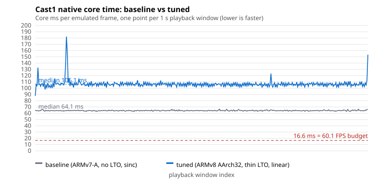

# Cast1 native build tuning: bisect of the compiler flags (2026-10-31)

**Result: no compiler-flag change helps Cast1, and `-O3` with thin LTO makes the core 0.64× as fast.** The ARMv8 code-generation flags change nothing measurable. All three were left out of `CMakeLists.txt`. The framebuffer-size fix and the linear resampler are kept; neither moved the Cast1 timing.

Device: `chromecast-test-01`, Chromecast HD (Cortex-A35, 32-bit userspace, Android 14). Every APK is release-signed (`1bc3d058…`), 0.1.10 / code 11, and ran the same frame-5800 checkpoint job on the same registered app.

| Build | Flags added over the baseline build | `libbjg.so` | `sdiv`/`udiv` | Job | Median core time | Emulation speed | Checkpoint |
|---|---|---|---|---|---|---|---|
| Baseline | none | 3,068,816 B | 0 | `J‑fee4970467a4` | 64.14 ms | 15.41 FPS | frame 5841 at 378 s; WRAM `0x204F` pass |
| A | `-march=armv8-a -mfpu=neon-fp-armv8` | 3,068,160 B | 76 | `J‑e9c77d56da69` | 64.42 ms (0.996×) | 15.32 FPS | frame 5841 at 380 s; WRAM `0x204F` pass |
| B | `-O3`, `-flto=thin` | 3,596,736 B | 0 | `J‑11546e56ba60` | 100.09 ms (0.641×) | 9.91 FPS | frame 4769 at 480 s; not reached |
| Full | A and B together | 3,595,656 B | 75 | `J‑5f612b5220da` | 106.14 ms (0.604×) | 9.34 FPS | frame 4497 at 480 s; not reached |

APK sha256 prefixes: baseline `8811ca04`, A `88c11c51`, B `bc847ac1`, full `640288de`. Paced windows after 3 warm-up: 281, 364, 396, 375.

## What the numbers say

- **Hardware divide does not matter here.** A has 76 `sdiv`/`udiv` and runs at the baseline's speed. The core's hot paths do not divide often enough to show.
- **`-O3` and/or thin LTO is the regression.** B has no ARMv8 flags and is as slow as the full set. Both builds grew by about 0.5 MB. The likely mechanism is instruction-cache pressure from inlined code on a small-cache core, but that is an inference: no cache counters were collected.
- **Not separated:** `-O3` from thin LTO. Two more builds would split them. Neither is worth shipping on this evidence, so it was not run.
- **Not thermal throttling.** Every run reports thermal status 0 with the same SoC temperatures.
- **The resampler and framebuffer changes are in all three non-baseline builds.** A matches the baseline, so they cost nothing on Cast1. The host profile still shows the sinc resampler at about 0.9% of instructions and the linear one at 0.05%.

## Catch-up clamp build (2026-10-31)

Job J‑12d2458f0664 ran the release APK built from commit `9132eae` (the credit cap, no compiler-flag changes) on Cast1: frame 5809 at 377 s, WRAM `0x204F` gate passes, median core time 64.24 ms (0.999× the baseline). `emulation_backlog_frames` stays at 0.0 in all 366 windows; the baseline's rose from 3,739.74 to 16,219.70.

## Failed first attempt

Job `J‑5f612b5220da`'s first submission (the debug-signed tuned APK) was refused with `INSTALL_FAILED_UPDATE_INCOMPATIBLE`: Cast1 had the frozen release-signed APK installed. Release-signed builds installed over it without trouble.

## Support position

This does not change it. Cast1 stays a correctness-and-layout device; the 60 FPS target applies to Pixel-class and future big-core TV hardware. About 15 FPS is what this core does on this hardware.
