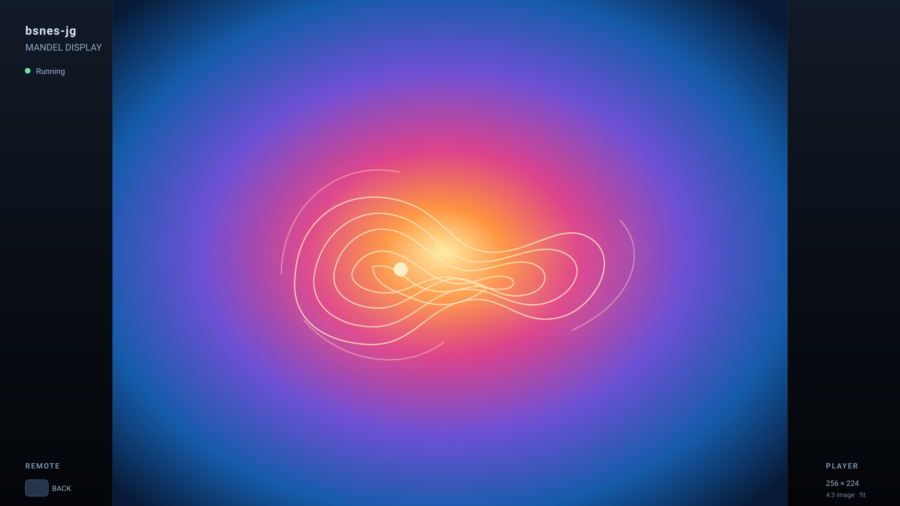
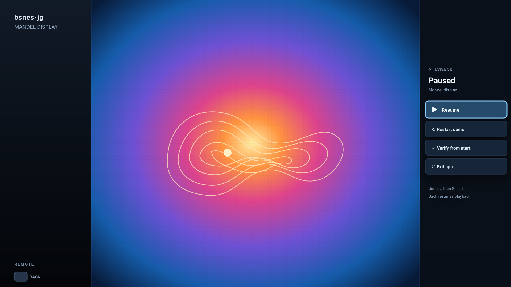
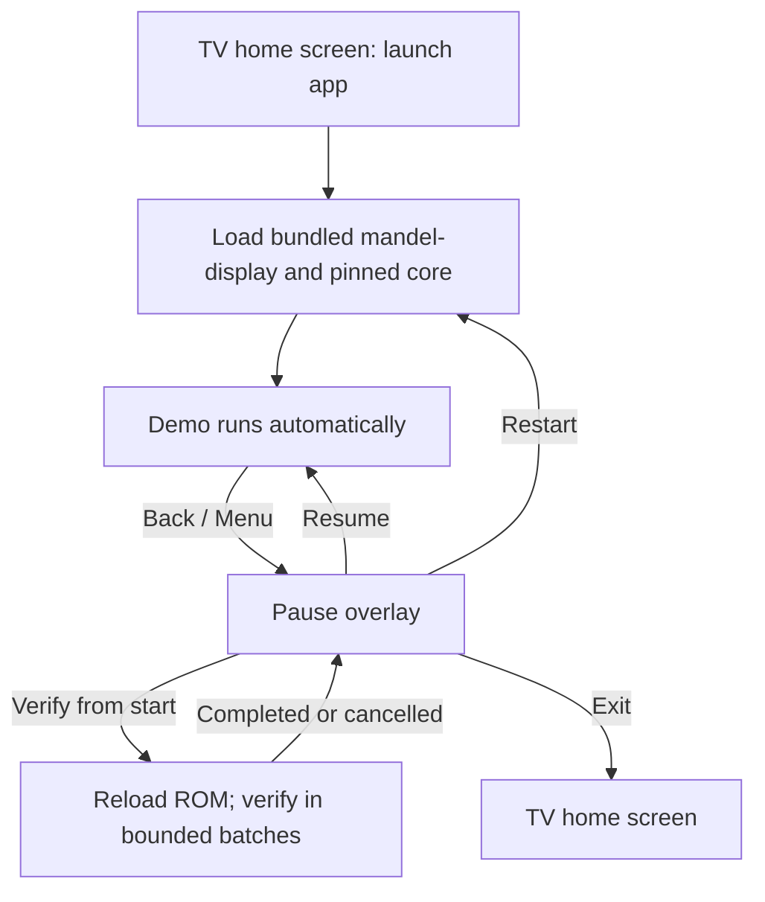
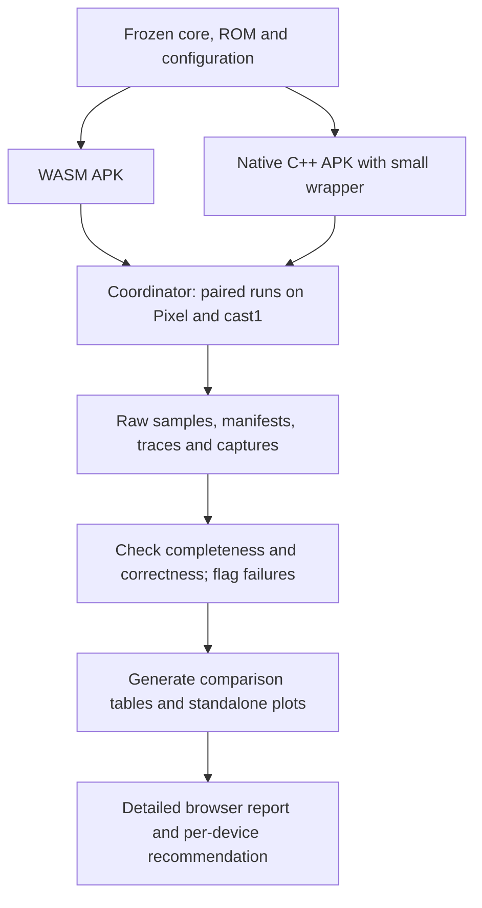

# Plan — bsnes-jg on Chromecast with Google TV

**Status:** Phase 2 still builds the WASM and Native ROM-library apps as separate packages. The standalone Phase 1 Native Mandelbrot player is rebuilt as `nativeplayer`, using package `org.bsnesjg.tv.native`, and boots `mandel-display` on Pixel. For the Phase 2 native app, Cast1's ARMv7 libco crash was fixed by compiling the native library in ARM state for `armeabi-v7a`. The new APK launched and completed a matched 120-second profile on Cast1 (`J‑4779d0958348`, `J‑cccde460b47d`). One matched profile pair is now available; repeat runs and the frame-5800 correctness check remain open. The coordinator record workflow returned `plugin-error` before capture on two attempts and recovered Cast1 automatically. Cast2 coordinator access remains unavailable.

**Artifact count:** Phase 2 produces two APKs, `wasm` and `native`, with separate package IDs and the same selector/catalog. The existing Phase 1 APK remains a separate install. Paired Phase 2 measurements compare these two same-shell builds, so the engine is the intended build-time difference.

## Goal and target

Ship two installable, offline-capable Android TV / Google TV builds: **Phase 1 uses WASM; Phase 2 implements the native C++ core with a small Android wrapper and compares both builds in detail.** Native implementation and the comparison report are required even if WASM performs well. Phase 1 compatibility targets remain `cast1`, `cast2`, and the enrolled Pixel 8 Pro. Phase 2 pairs WASM and native on Pixel and cast1 when available, reporting each target separately. The performance and correctness workload is the single bundled Mandelbrot demo ROM (`mandel-display`) launched directly for controlled checks. The 152-ROM library is packaged and browsable, but is not the benchmark workload. Pixel results are phone-form-factor evidence and must be labeled separately from Google TV evidence. Both apps share the published SNES quick-launch selector/catalog; a `?rom=<slug>` launch boots a bundled ROM directly. Keep the browser player and npm package working.

The coordinator currently maps `cast1` to `chromecast-test-01` (Chromecast HD, Android 14, 32-bit ARM ABI) and `cast2` to `chromecast-test-02` (Chromecast, Android 12, 32-bit ARM ABI); these differ from the earlier recalled Android 13/11 versions. The enrolled Pixel 8 Pro is Android 17 with arm64. The coordinator currently reports cast1 ready; cast2 control is unavailable; Pixel transport is ready but its latest app check ran while locked. The coordinator allows background APK install during a personal-use hold; its foreground launcher-verification continuation waits for the hold to clear. Some of the wider Android 7–14 inventory has not arrived, and Android 16 is a future purchase. Those devices are follow-up coverage. Keep the candidate `minSdk=24` for possible later Android 7 testing, but publish support only for actual tested device/runtime combinations.

Phase 1 delivers the WASM APK, the coordinator's APK-registration capability, a repeatable coordinator test job, Chromecast baselines for `cast1` and `cast2`, and a Pixel install/launch compatibility result. Registration is a Phase 1 feature: the GUI provides **Register & Install APK**, and the CLI provides register-only followed by install, both backed by the same coordinator service logic. Phase 2 delivers two same-shell APKs (WASM and native) and a detailed report with raw data, extensive tables, charts, and graphs. Current comparison targets are Pixel and cast1; include cast2 when coordinator access returns. Report incompatibilities explicitly; a failure in one implementation does not remove the other implementation from the test program.

### Phase 1 progress

- Implemented the Android TV project, one-ROM offline WebView player, bundled frozen fixture and WASM assets, SNES-controller launcher artwork, remote pause/restart/verify/cancel/exit actions, and sleep/background pause handling.
- `task android-tv:build` runs JS syntax checks, scheduler/metrics-report tests, the npm package sync smoke check, and both Gradle variants inside the rootless container with network disabled. Latest build passed on 2026-10-26: Debug APK is 2,042,686 bytes (SHA-256 `82f2b67b15280ce472b9737531e17a2f4f8704b2aabd9234aed1757ebb4f54f8`); optimized, non-debuggable, profileable Release APK is 1,937,439 bytes (SHA-256 `77b99f0b070faa7b4568827cf1c3f2ba40907631b0fe55b874a10a9f7e9abf97`). Both artifact gates verify the exact ROM/core/player hashes and offline asset set.
- The TV scheduler preserves the 60.0988 Hz SNES clock across simulated 50, 59.94, 60, and 120 Hz output; tests pass bounded four-frame catch-up and one-second stall recovery. TV metrics report per-frame core cost, canvas submission, RAF intervals, initial 5800-frame reference readiness, backlog, lifecycle, and verification events. These are not display-presentation timestamps.
- The frozen fixture passes native `jgxcheck` in the LLVM-MOS container: `SMOKE: PASS off=0x580 len=2 got=0x204F (ran 5800 frames, bsnes-jg)`. The deterministic 256×224 reference PNG is pinned at SHA-256 `7acaa3825b82b7e61fe641ca950508d58e8aeb0cb2ff7849547d17eacaab4abe`.
- Coordinator APK registration is implemented, container-tested and deployed. The coordinator-side design and rollout notes are in [the coordinator APK-registration plan](../../../chromecast-coordinator/docs/plans/2026-10-26-coordinator-apk-registration.md). Registration ID `bsnes-jg-tv` is pinned to Release APK SHA-256 `77b99f0b070faa7b4568827cf1c3f2ba40907631b0fe55b874a10a9f7e9abf97`. Cast1 job `J‑f04d582a0ef6` verified the install hash, then its launcher-verification continuation returned `plugin-error`; automatic recovery `J‑eae507403aba` completed. Capture `J‑ff2d8a553b9c` shows Google TV Home, so launcher visibility and app launch are unverified on cast1. Coordinator readd `J‑de6d6e0e70a4` restored cast1 to ready, but retry install `J‑5ac62824954d` is queued behind active KDE tray streaming job `J‑7c7bfb8c3590`. Pixel job `J‑bc3500dd5dc4` completed install and verify-launch; capture `J‑49d7e21f74d4` shows the bundled Mandel ROM running at 256×224 with the on-screen remote-control hints, confirming Pixel launch and capture compatibility. Cast2 install job `J‑0940ffde3c9d` remains queued because coordinator control is unavailable; it is not blocked by a personal-use hold.
- Device install and playback checks have not run. All device-facing actions use the coordinator CLI through `task chromecast:*`; each submitted job owns its full device session. The first cast1 install request was rejected locally because `bsnes-jg-tv` was unregistered, before job creation or device contact. Today the tray's **Advanced workflow → Install → Choose APK** form accepts registered apps, and **Screensaver → Install screensaver APK** auto-matches registered screensaver packages; neither path can register a new package. The coordinator's current static registry lives in `scripts/wf_device/plugins/android/applications.json`.

  **End-user flow requirement:** the tray offers one **Register & Install APK** action: inspect the selected APK, show package, launcher activity, proposed app ID and signing-certificate identity for review, register it, then run the ordinary owned install plus launcher-verification workflow. The CLI additionally offers a register-only command for scripts, testing and staged workflows; a caller can follow it with the existing install command. Both paths use the same coordinator-side registration API and validation. Derive safe generic-app metadata and reject ambiguous or unsupported manifests. Persist approved registrations in coordinator-owned state, bind each to its package and signer, and audit it. Repeating an identical registration should report that it is already registered; never silently replace an existing package or signer. Updates require the pinned identity or an explicit reviewed replacement path. Specialized registrations such as screensavers or app-specific validators retain their extra reviewed metadata.
- The test project uses a small HTTPS-origin asset interceptor with local APK assets and rejects all other origins. It does not use the AndroidX `WebViewAssetLoader` dependency proposed below; the exact implementation keeps Internet permission absent and network loads blocked. Validate local WebView fetch/wasm behavior on a registered device before deciding whether to switch mechanisms.

## Current starting point

- `web/cores/bsnes_jg.{js,wasm}` already contains the pinned bsnes-jg core and a C ABI; `web/app.js` handles ROM loading, video, keyboard input, and a WRAM fidelity check.
- The general browser page remains mouse/touch/keyboard oriented. The Phase 1 TV page has a D-pad remote menu and a TV-only monotonic frame scheduler; the shared browser player's existing refresh-driven loop is unchanged.
- `web/src/main.cpp` configures audio but discards it in `audioFrame`; SRAM writes are discarded too. Those are real gaps for a general game player.
- The committed `dist/engine` payload can seed the app, but the initial APK needs only the selected ROM and its fidelity metadata. The Android wrapper should consume generated assets from the canonical `web/` source rather than acquire a second edited `app.js`.
- The sibling checkout currently has `build/mandel-display.sfc` (SHA-256 `6c13c9042ca68be06f42650862ad7e116cc782e3a433ceaf9f760f090b430353`). Its `build/mandel-display.map` places `corpus_result` at WRAM `$0580`, and `examples/snes/mandel-display.c` documents the current expected CRC `0x204F`. The `web/roms/mandel-display.sfc` snapshot has a different hash. Use the sibling build artifact for this milestone and record its exact hash; do not silently substitute the existing snapshot.
- This ROM computes its image once, then animates rotation, zoom, and palette changes. It does not read controller input. Its compute and animation phases need separate measurements, and this milestone cannot establish general game compatibility or SNES gamepad correctness.
- The shipped core provenance names Emscripten 6.0.4, while CI specifies 6.0.1 and `build.sh` defaults to `latest` or the existing `emcc`. Resolve this mismatch as part of the build contract below.

## Proposed architecture

**First implementation candidate: the existing WASM core in an Android TV APK.** Build a small app with one full-screen Activity and a WebView. Package the TV page, the single `mandel-display.sfc` ROM, its generated fidelity metadata, provenance, JS glue, and wasm as app assets. Serve those assets at a fixed HTTPS origin so the existing `fetch()` and wasm loading paths retain normal same-origin behavior and the app starts without network access. Android's [local-content guidance](https://developer.android.com/develop/ui/views/layout/webapps/load-local-content) recommends this approach over `file://` assets. The current Phase 1 prototype implements this using a restrictive local asset interceptor; compare it with AndroidX `WebViewAssetLoader` during device validation.

**Phase 1 baseline:** test `cast1` and `cast2`. Check the actual WebView provider/version, JS glue and wasm instantiation, fidelity, and performance. Classify a failure as packaging, runtime compatibility, core correctness, or performance before choosing a remedy. Fix packaging or frontend defects and rerun the affected checks before attributing a failure to WASM. The build's browser requirements must be explicit: the inspected Emscripten configuration has a Chromium 85 minimum; `minSdk=24` alone says nothing about that runtime requirement. Test the installed provider as found and record any later provider update as a separate configuration. See [Emscripten browser settings](https://emscripten.org/docs/tools_reference/settings_reference.html#min-chrome-version) and [WebView provider identification](https://developer.android.com/develop/ui/views/layout/webapps/managing-webview).

**Shared application shell and selectable engine:** keep one catalog, selector, search/favorites flow, pause menu, remote mapping, lifecycle contract, and metrics interface for both builds. Build flavor chooses the engine adapter at compile time: WASM uses the WebView module; native uses JNI plus the GLES framebuffer surface. Both adapters implement the same operations (`openRom(slug)`, pause/resume, restart, verify, exit, and metrics) and receive the same selected catalog record/ROM bytes. The selector never loads or configures an engine directly. Keep engine-specific code behind the adapter boundary so changing the flavor does not fork app navigation or ROM selection.

Compile the pinned bsnes-jg C++ source for Android using a locked NDK/CMake toolchain. Use a small Activity for the shared shell, remote actions, and lifecycle, with JNI for native commands and diagnostics and a native renderer for the emulator framebuffer. Start with a simple OpenGL ES 2.0 texture renderer; match the WASM crop, pixel conversion, aspect ratio, and scaling. The native renderer occupies the shared game viewport while the same shell provides selection and actions. Select `arm64-v8a` and/or `armeabi-v7a` from each device's supported process ABIs, not its marketing CPU description. Pin the NDK and CMake versions after checking the inventory and record all compiler/optimization flags. See [Android native builds](https://developer.android.com/ndk/guides/cmake), [JNI guidance](https://developer.android.com/ndk/guides/jni-tips), and [OpenGL ES setup](https://developer.android.com/develop/ui/views/graphics/opengl/environment).

Reuse the existing C++ frontend's core setup, ROM/database callbacks, video/audio configuration, WRAM access, and frame-stepping contract through a small platform adapter. Isolate Emscripten attributes and MEMFS loading from native asset handling. Build native libco for the selected ABI and validate its coroutine lifecycle; the WASM fibers/Asyncify implementation remains WASM-specific. Give the native core one owning emulation thread and queue UI commands to it, with explicit framebuffer ownership between emulation and rendering. Keep bulk pixel transfer out of repeated JNI calls. Match lifecycle and verification behavior in both apps. Audio, full gamepad mapping, and ROM selection remain later work.

Produce separate `wasm` and `native` build flavors with distinct application IDs and launcher labels so the coordinator can install both without overwriting app data. Both flavors launch the same selector and pass the same selected ROM to their compile-time engine adapter. The initial curated/testing selection may highlight the Mandel fixture, but the selector/catalog stays engine-agnostic. Keep both artifacts and test jobs after the comparison. The report recommends which to use on each device; it does not predetermine a winner.

Use one TV-specific page and selector around the shared engine interface. The Activity owns launcher metadata, the compile-time engine adapter, the renderer host, Back key, and sleep/wake lifecycle. The shared page owns catalog browsing, selection, pause actions, and status presentation; WASM uses its canvas, while native mounts its GLES surface into the matching game viewport. Keep the bridge narrow and typed: selected ROM slug, app actions, lifecycle, and metrics. Avoid arbitrary JavaScript interfaces or external navigation. Both flavors must pass the same selector and control-flow checks.

The manifest needs a `LEANBACK_LAUNCHER` activity, TV banner/icon, and touchscreen declared optional; Android's [TV app guidance](https://developer.android.com/training/tv/get-started/create) specifies these for home-screen visibility. The TV interface needs D-pad navigation and visible focus, consistent with [TV hardware guidance](https://developer.android.com/training/tv/get-started/hardware).

The icon designs have since been updated to distinguish the Mandelbrot-only player from the full ROM suite; WASM and native flavors share the suite icon because they are engine variants of one product. Follow the current [SNES app icon plan](2026-10-26-snes-app-icons.md) for source artwork and resource mapping. The container build regenerates the Android and browser/mobile suite icons from the updated artwork; the earlier Mandelbrot icon is not the suite icon.

## Build and fixture contract

- Pin the candidate WASM toolchain to **Emscripten 6.0.4**, revision `fe5be6afdff43ad58860d821fcc8572a23f92d19`, matching the shipped provenance. Pin bsnes-jg 2.1.0 to the existing source SHA-256 in `build.sh`. Reject an unexpected compiler on `PATH`; align the relevant CI configuration and verify the browser package when resolving its older 6.0.1 pin. Capture all compile/link flags, including browser targets and Asyncify settings.
- Lock Gradle, Android Gradle Plugin, JDK, SDK/build-tools, and AndroidX dependency versions when creating the Android project. Record exact versions in the build report. Generate JS/wasm as one matching pair from canonical source; never combine glue from one build with wasm from another.
- In Phase 2, also lock NDK/CMake, native ABI flags, libco backend, and bundled dependencies. Build both flavors from one recorded repository revision and the same frozen core/ROM inputs. Capture their differences explicitly: toolchains, coroutine backends, renderer, process architecture, and runtime dependencies.
- Import the sibling ROM and map once into a versioned fixture with their hashes. Run the existing native `jgxcheck` harness against those exact ROM bytes and the map-derived offset before using the pair for device verification. Record the 2-byte `0x204F` oracle, its host-reference evidence, and the existing 5800-frame gate budget. Treat the source revision that originally produced the prebuilt ROM as **unverified** unless a build record establishes it; the current sibling checkout commit is only an observation. If a source-rebuilt ROM is needed, produce a fresh ROM/map pair from a recorded revision and repin both together.
- Subsequent APK builds consume the frozen fixture without silently reading new bytes from the sibling build directory. An explicit fixture refresh reruns the native reference check and updates hashes, metadata, and expected image captures together. APK reproducibility from the frozen inputs and the original ROM's source-build provenance are distinct claims.
- Build debug APKs for diagnosis and an **optimized, non-debuggable measurement APK** from the same source for performance evidence. Enable profileable instrumentation where the device supports it; on older devices use coordinator-supported sampling and app timing. Record instrumentation and build variant on every run. Android recommends a release variant for [performance profiling](https://developer.android.com/studio/profile).

## Screen mockups

The player uses the largest centered **8:7 image that fits the TV** (the source frame is 256×224). On a 1920×1080 display this is 1234×1080; the remaining 343-pixel gutters carry status and remote hints. These measurements preserve the source image's square-pixel aspect ratio without cropping or stretching. The gameplay canvas is not reduced to make room for a permanent toolbar. The menu uses the right gutter on widescreen TVs, keeping the full game image visible; only narrow screens fall back to a temporary centered overlay.

### Playing: image area at maximum size

### Paused: remote actions in the unused side gutter

The shipped layout follows these mockups: no permanent bottom bar or translucent HUD over the SNES picture. Branding, running status, source dimensions, and the Back hint stay in the unused side gutters on widescreen output. Back pauses or resumes; the pause menu is reachable from the remote and keeps focus visible. The verification state replaces the Verify action with progress and Cancel, using the same side card. On narrower displays, status pills and the card move over the picture because no side gutter is available; this does not change the 8:7 scaling rule.

The app launches directly into the self-running ROM. Back opens the pause overlay; D-pad and Select navigate its actions. Back from that overlay resumes playback. Initial input work is limited to these app actions. Keep core/ROM provenance in the report or an unobtrusive information view.

During verification, replace the actions with progress and a Cancel action. Label it “Verify from start” because verification reloads the ROM. Completion or cancellation returns to the paused overlay at the resulting emulated frame; Resume is explicit. This does not preserve the pre-verification ROM state. Use time-bounded batches (yield after at most roughly 8 ms, or one slow emulated frame) so remote events can be handled between batches. Backgrounding cancels verification and leaves the app paused; process recreation boots the ROM from the beginning. Do not reuse the existing unconditional resume and 120-frame synchronous batch behavior.

## Flow

## Implementation sequence

### Phase 1 — WASM app and compatibility baseline

- [x] **Initial inventory and coordinator access.** Mapped `cast1`/`cast2` to `chromecast-test-01`/`02`; Pixel 8 Pro is also enrolled. Latest available inventory: cast1 Android 14, ready; cast2 Android 12, personally held by KDE tray and previously observed transport unavailable; Pixel Android 17, ready. Cast2 background APK installation is permitted during the hold, while foreground verification and other device tests wait for control to return. The first cast1 install submission was rejected locally because `bsnes-jg-tv` was not registered; no job was created. Remaining inventory data (WebView provider/version, refresh modes, memory, telemetry) and device tests are pending. Use coordinator-owned `task chromecast:*` workflows for each complete session. No raw ADB fallback.
- [x] **Frozen build inputs.** Imported exactly one ROM and matching map into `android-tv/fixture/`; the map-derived WRAM gate passes at 5800 frames (`0x204F`). The deterministic entropy-zero reference frame and ROM/map/core/player hashes are pinned and checked by the APK build.
- [x] **Initial TV APK.** Added `android-tv/` with `minSdk=24`, leanback launcher, TV banner and suite icon, full-screen Activity, restrictive HTTPS-origin local asset serving, and the shared ROM selector. Frozen fixture and committed matching WASM assets are staged from canonical sources. Debug and optimized profile Release variants pass inside the JDK container. On-device WebView validation remains.
- [x] **Initial remote controls and lifecycle.** Added D-pad focusable Resume, Restart, Verify from start, Cancel verification, and Exit actions; Back opens/resumes the menu; backgrounding pauses the demo and returns to the menu. Device validation, process-recreation evidence, and visible error handling need follow-up. Full SNES gamepad mapping is deferred.
- [x] **Initial measurement and correctness hooks.** Added TV-only monotonic frame pacing, a four-step catch-up cap, oracle-ready frame marker, verification result, lifecycle events, and rolling core/canvas/RAF samples. Scheduler tests cover four refresh rates and stall recovery. `android-tv/tools/metrics-report.mjs` converts coordinator logcat into preserved events, rolling-window CSV, summary tables, and SVG pacing plots; parser/report tests pass in the build container. Native reference capture is checked in. Actual app capture, WebView behavior, timing, and separate pause/resume run evidence still need Chromecast validation.
- [x] **Coordinator APK registration command and GUI/CLI parity.** Implemented a CLI register-only command (`task chromecast:app:register APK=... APP=...`) and tray **Register & Install APK** action. Both call the shared manifest inspection and persistence service; registration is durable, idempotent for an identical APK and explicitly replaceable for the same package. Dynamic app IDs are admitted by client and coordinator schema validation. Registration and tray parity tests passed (6 tests), and the reviewed coordinator release was deployed. The app is registered as `bsnes-jg-tv`. See [the coordinator plan](../../../chromecast-coordinator/docs/plans/2026-10-26-coordinator-apk-registration.md).
- [ ] **Install and verify Phase 1 on cast1, cast2 and Pixel.** Cast1 install job `J‑f04d582a0ef6` recorded the expected hash, but its launcher-verification continuation returned `plugin-error`; automatic recovery completed. The follow-up capture `J‑ff2d8a553b9c` shows Google TV Home. Coordinator readd `J‑de6d6e0e70a4` restored cast1; install retry `J‑5ac62824954d` is waiting behind active KDE tray stream `J‑7c7bfb8c3590`. When that owner session ends, diagnose and retry launch/launcher verification. Pixel job `J‑bc3500dd5dc4` completed install and verify-launch; capture `J‑49d7e21f74d4` shows the ROM running at 256×224 with remote-control hints. Record this as Pixel compatibility evidence, including the landscape phone layout. Cast2 install job `J‑0940ffde3c9d` remains queued because coordinator control is unavailable; personal-use hold is not the blocker. After cast2 and cast1 are available, run offline launch, remote/lifecycle, fidelity and performance checks on both Chromecasts. Keep specialized screensaver/validator registrations on their reviewed metadata paths.
- [ ] **Packaging and delivery.** Deliver the APK checksum, license/source/provenance, frozen-input manifest, build/install commands, coordinator job, raw evidence, graph-generation script, and rendered report. A production support claim requires passing results on its named targets; delivery of the feasibility report includes documented failures.

### Phase 2 — native C++ app and required comparative study

- [x] **Native core build.** NDK/CMake targets build the pinned C++ core and dependencies for supported 32/64-bit ABIs. Both flavors share the frozen fixture and database. Native WRAM/frame comparison gates are implemented; device parity remains to be recorded.
- [x] **Small native wrapper.** Kotlin/JNI shell, GLES2 renderer, single emulation owner, remote actions and lifecycle/verification hooks ship as the distinct offline `native` APK flavor booting the same ROM.
- [x] **Comparable instrumentation and report generator.** Both flavors have bounded unpaced benchmarks and correctness/performance logging; the generator emits comparison tables and SVG charts from preserved measurements. Device samples and instrumentation-overhead measurements remain pending.
- [ ] **Matched coordinator runs.** Install both APKs on Pixel and cast1 and execute the paired protocol below; add cast2 when coordinator control returns. Earlier Cast1 jobs `J‑8dc30c849ee0` / `J‑d569f93db3b3` installed the right APKs but returned to Home. The Phase 2 native crash was fixed with ARM-state compilation on ARMv7; check `J‑4779d0958348` and profile `J‑cccde460b47d` now complete, with a first matched 120-second pair in the comparison report. Repeat the pair and complete frame-5800 correctness before drawing conclusions. Two record attempts failed `plugin-error` before capture, while Cast1 recovered automatically. Pixel job `J‑892bd1dd132a` installed the current WASM APK but timed out while the device was locked. Phase 1 results remain historical baselines, not substitutes for paired runs.
  - Pixel job `J‑7521b6d08a2a` (WASM) was refused at install: the previously installed Phase 1 package has a different signing certificate, so no package change occurred. Coordinator evidence: `/tmp/phase2-pixel-wasm-check`.
  - Pixel job `J‑f8bc7c55728f` (native) installed the expected APK hash, but the app returned to the launcher during the check (`target-left-foreground`). A second launch-only check, `J‑9a9fcb0173e8`, reproduced the failure. A coordinator-owned capture `J‑2ccb10aaa903` confirms the launcher is visible; app launch and runtime correctness remain unverified. Coordinator evidence: `/tmp/phase2-pixel-native-check`.
- [ ] **Detailed comparison report.** The report now names the single bundled Mandelbrot ROM (`mandel-display`) as the comparison workload; the 152-ROM catalog is not the benchmark. It includes current APK identities/sizes, coordinator launch ledger, explicit unavailable metrics, and SVGs for APK size, launch failures, startup latency and playback rate. Populate timing, correctness, resource, thermal and build/maintenance data after the apps stay foreground and produce frames.
- [ ] **Final delivery.** Deliver both APKs with hashes, locked builds, test job definitions, raw samples/traces, standalone plots, report-generation scripts, Markdown source, and a rendered browser report. Include a per-device recommendation backed by the data and keep both implementations available. Phase 2 is required even when Phase 1 passes every gate.

### Later expansion, outside Phases 1 and 2

- [ ] Add devices as they arrive, including the wider Android 7–14 inventory and the planned Android 16 purchase. Reuse both flavors and the same comparison protocol; their arrival is not a prerequisite for Phases 1 or 2.
- [x] Add the published ROM quick-launch library to the WASM app; keep `?rom=<slug>` direct boot usable for controlled testing. See the [selector implementation plan and published ROM list](2026-10-26-snes-rom-library-selector.md). Android document picker remains later work.
- [ ] Add full SNES gamepad mapping, additional controller ports, and disconnect/dead-zone tests with an interactive ROM that can demonstrate the mappings. The initial self-running ROM cannot validate them.
- [ ] Add audio playback and SRAM persistence when a ROM that uses them is in scope; then measure audio underruns and persistence across app restart. The initial `mandel-display` milestone should not wait on these unrelated features.

## Device test matrix

| Device class | Minimum checks | Test role |
|---|---|---|
| `cast1` → `chromecast-test-01` — Chromecast HD, Android 14, reported `armeabi-v7a,armeabi`; coordinator ready | Current: fixed native APK launches and profiles; one matched WASM/native profile pair is reported. Repeat paired runs and complete the frame-5800 correctness gate. Coordinator record attempts need diagnosis. | Phase 1 target and current Phase 2 Google TV target |
| `cast2` → `chromecast-test-02` — Chromecast, Android 12, reported `armeabi-v7a,armeabi`; coordinator control unavailable at last check | Install may queue; foreground verification and performance/correctness checks wait for coordinator control to return | Phase 1 and Phase 2 target |
| `phone-pixel-8-pro` — Pixel 8 Pro, Android 17, `arm64-v8a` | Phase 1 install/launch; Phase 2 matched WASM/native install, offline boot, correctness, input/lifecycle and profiling through coordinator-owned phone workflows | Required Phase 1 target and current Phase 2 comparison target; phone form factor is reported separately from TV results |
| Other Android 7–14 devices, some in transit | Full two-flavor checks once available | Follow-up coverage; not a current dependency |
| Android 16 device, planned purchase | Full two-flavor regression and comparison | Follow-up coverage after arrival |

Record actual device, ABI, provider, and refresh configuration beside results. Passing one Android version does not establish support for every device on that version; a missing measurement is not a pass. Keep the candidate OS floor and the proven device list separate. The [Android compatibility guidance](https://developer.android.com/guide/app-compatibility) calls for testing behavior changes on newer platform versions. Pin `compileSdk` and `targetSdk` in the candidate build; check the [Android TV distribution requirements](https://developer.android.com/google/play/requirements/target-sdk) again if Play distribution becomes part of delivery. Initial delivery is an APK installed through the coordinator.

## Profiling and report deliverables

Keep raw CSV/JSON samples, trace/capture links, a graph-generation script, and rendered SVG/PNG plots with a Markdown report under `docs/performance/<date>/<run-id>/`. The report must link every verdict and graph to its input data. Identify the device, OS/API, ABI, WebView provider/version, APK hash/build variant, core/toolchain and ROM hashes, output refresh, instrumentation, duration, and run conditions. Audio output is disabled in both phases; the core's audio work remains identical.

### What each measurement means

| Measurement | Collection method | Interpretation |
|---|---|---|
| Core execution cost | Monotonic timing around each core frame step (`_bjg_run()` for WASM and its native counterpart), with completed-frame counts | Elapsed step cost, including scheduling delays; report median, p95, p99, and maximum. CPU time comes from separate process telemetry |
| Emulation speed | Completed emulated frames / wall time, normalized to the declared ROM/core target frame rate | Actual speed, including missed deadlines; do not infer it from display callbacks |
| Render submission | Time framebuffer conversion and `putImageData` for WASM; conversion/upload/submission for native; record scheduling intervals separately | Application pipeline costs, not proof of TV presentation; renderer differences are reported |
| Display presentation | Coordinator-supported compositor/presentation traces, where available | Label the trace's actual scope; if unavailable, mark display pacing unmeasured rather than relabel JS timestamps |
| Startup and ROM phases | Launch, core-ready, first live frame, CRC-ready, and steady-animation markers | Separate app startup from ROM computation and animation; a baked preview is not a live frame |
| CPU, memory, and thermal behavior | Coordinator-supported process sampling, including the WebView renderer where separate | Name included processes and units; show unavailable sensors explicitly |

### Run protocol and performance gates

Use an optimized measurement APK with the same frozen ROM/core on all devices. Record the native reference result first. Keep unpaced fidelity verification, screenshot/video capture, and timed playback as separate coordinator sessions so verification bursts and capture overhead do not contaminate playback statistics. The coordinator owns session ordering and device isolation.

For Phase 1 on each of `cast1` and `cast2`, record three cold app launches (process restart, with OS/WebView cache state disclosed). Preserve the full startup and image-compute phase in the report. Then measure a 10-minute steady-animation run after a fixed 30-second settling period following CRC-ready. Repeat the sustained run three times; stop early on a reproducible incompatibility or correctness failure. Compare per-run results instead of hiding a bad run in a pooled average. Phase 2 extends this with the paired protocol below.

Proposed gates for ordinary playback on a 60 Hz output are listed below. Apply them to both the image-compute phase and steady animation after core startup; label their results separately. Pauses, cancellation, and explicit verification are separate functional tests.

- [ ] **Correctness:** native and device WRAM checks pass for the exact fixture, and deterministic reference-frame comparisons pass.
- [ ] **Emulation speed:** every complete 10-second playback window stays within 1% of the declared emulation rate. Report the whole-run mean as supporting data, not as the sole gate.
- [ ] **Responsiveness:** no app frame-submission stall exceeds 250 ms during ordinary playback. Record maximum stalls and every breach; a long freeze cannot pass through averaging.
- [ ] **Presentation:** where actual presentation telemetry exists, fewer than 1% of intervals exceed two display periods, and none exceeds 250 ms. Express thresholds using the measured refresh period rather than a rounded 33.3 ms boundary. When unavailable, report this gate as unmeasured; screenshots/video can show visual behavior but do not supply precise frame-timing evidence.
- [ ] **Stability:** no crash, renderer loss, or out-of-memory exit; report memory growth and thermal changes over the run. Any automatic restart is a failure for that run.

For other output modes, report emulation speed independently and use that mode's refresh period for display intervals. Skipping a presentation must not skip emulated frames or change the ROM's simulation rate. Keep these proposed thresholds fixed for a comparison; any revision needs a recorded rationale and re-evaluation of all affected runs.

- [ ] **Baseline and build report:** exact core/toolchain pins, source ROM path and hash, map-derived WRAM offset and expected value, APK size, asset sizes, device inventory, WebView capability result, and the command or task that produced the APK.
- [ ] **Frame pacing graphs:** core time, rolling emulation speed, render submission intervals, and actual presentation intervals where measured. Include distributions, p95/p99, maximum stalls, and phase markers. Give every series its measurement source; do not infer dropped displayed frames from app callbacks.
- [ ] **Resource graphs:** startup-to-first-frame, process memory over time and peak, CPU use, and available thermal/battery indicators during the same runs. Note when a metric is unavailable on a device rather than inventing a value.
- [ ] **Functional report:** table of install/launcher, direct offline boot, fidelity, reference image, remote actions, verification cancellation, pause/restart/exit, background/sleep/resume, process recreation, and failures, with links to captures and logs. Generate reference framebuffer captures at fixed emulated frame counts from the exact native fixture; compare canonical pixel buffers on device. Also inspect a TV screen capture for blank output, color errors, cropping, scaling, and overlay focus, which a WRAM checksum cannot detect.
- [ ] **Engine comparison report:** compare both implementations on the Pixel 8 Pro and cast1 using the single Mandelbrot demo ROM and the detailed specification below; add cast2 when coordinator access returns. Keep Pixel phone results separate from Google TV results. Record each gate's result, diagnosed failures, per-device recommendation, and unresolved limitations. An unmeasured gate stays unmeasured, and a WASM pass does not cancel the native work.
- [ ] **Release report:** summarize the final build's per-device pass/fail status, regressions from the baseline, plots, known limitations, APK checksum, and installation instructions. Add an Android 16 report when that device arrives.

## Phase 2 comparison protocol and report specification

The comparison must answer: which build works on each device, how much emulation headroom it has, how smoothly it presents the demo, what resources it consumes, how quickly it starts, and what complexity or dependencies each build adds. The benchmark ROM is the bundled Mandelbrot ROM; the 152-ROM library is outside this performance comparison. Run paired measurements on Pixel and cast1 when the apps launch. Conclusions apply to this ROM and tested devices; OS version and chipset differences cannot be separated causally from these observations.

### Controlled paired runs

Use the same core revision, ROM/database bytes, emulation settings, initial state, and target emulation rate for both flavors. Keep core audio synthesis/resampling and discard behavior identical even though audible playback is disabled. Match logical resolution, crop, aspect ratio, scaling, output mode, optimization intent, and instrumentation. Record actual process bitness; if WebView runs 32-bit while native runs 64-bit, label that difference and add a matched-ABI native run where supported before attributing a result solely to WASM versus native code.

Run both engines sequentially on each device under coordinator ownership, alternating WASM/native order between pairs with a recorded schedule. Hold display mode, background workload, power arrangement, and provider versions constant. Start pairs at comparable thermal conditions using telemetry when available or a documented fixed cooldown when unavailable. Record all deviations and failed attempts. Cold process launch, first-install/cache-empty launch, and warm resume are separate states; never claim caches were cleared unless the coordinator actually did it.

| Test mode | Workload and repetitions per device | Purpose |
|---|---|---|
| Correctness and lifecycle | Both flavors, exact frame-count checkpoints and the same remote/lifecycle sequence | Establish equal results before comparing speed; include CRC, framebuffer, and TV capture evidence |
| Startup | At least five paired process-cold launches, plus five paired warm resumes; first-install behavior reported separately | Distributions of launch-to-core-ready, first live frame, and resume latency, with all samples shown |
| Unpaced compute | Five paired runs from power-on through the frozen 5800-frame reference checkpoint | Compare core headroom and compute-phase costs with no display-rate cap |
| Unpaced animation | Five paired runs, each reset and advanced to frame 5800, then timed over the same next 3600 frames | Compare steady-state core costs independently of display refresh and initial computation |
| Real-time playback | Three paired runs covering the full compute phase, the fixed settling period, and ten minutes of animation | Compare actual user experience, speed stability, resources, and sustained thermal behavior |
| Diagnostic profiling | Separate sampled CPU/trace captures for representative and failing cases where supported | Explain hotspots without mixing profiler overhead into headline timing runs |

In the unpaced modes, suppress frontend framebuffer conversion/upload/presentation in both flavors while keeping the core's internal rendering and audio work unchanged. Use bounded batches to preserve app responsiveness. Report completed frames divided by summed core-step time **and** total elapsed benchmark throughput including yields, with scheduling overhead separated. These tests compare the core plus its runtime/coroutine backend, not just compiler code generation. In playback mode, report the whole application pipeline: WebView/canvas and native texture rendering are different implementations, and their costs must remain visible. A 60 FPS cap is not evidence that both cores have equal headroom.

Use independent runs as the unit of replication. Show each run, median, minimum/maximum, and spread; do not treat thousands of frames from one run as thousands of independent experiments. Report sample count and any exclusions with reasons. Do not claim statistical significance from small samples. Define speedup as `WASM elapsed / native elapsed` for equal work, so values above 1 favor native; label the direction of every other percentage or ratio and show absolute units beside it. Failed/unsupported tests have a status, not a numeric zero.

### Required data tables

| Table | Required contents |
|---|---|
| Device inventory | Pixel 8 Pro now; at least one Chromecast in follow-up. Record model/SoC, verified Android/API, CPU/process ABIs, RAM, WebView provider/version where applicable, output mode, telemetry availability |
| Build and configuration | APK/core/ROM/database hashes, toolchains and flags, coroutine backend, renderer, bitness, optimization, instrumentation, runtime dependencies |
| Run ledger | Run and pair IDs, engine, device, workload, order, start conditions, duration/frame counts, completion status, failure/exclusion reason, raw-data links |
| Correctness and compatibility | CRC and fixed-frame comparisons, launch/offline behavior, remote actions, lifecycle/cancellation, per-device pass/fail/unmeasured |
| Startup breakdown | Every launch/resume sample plus core-ready and first-live-frame latency summaries; distinguish process-cold, first-install, and warm states |
| Core workload results | Per-phase/per-run elapsed time, core-step distributions, unpaced throughput, scheduling overhead, real-time headroom, native/WASM paired ratios |
| Playback and presentation | Per-run emulation speed, worst rolling window, p50/p95/p99/max step and submission intervals, stall counts, actual presentation metrics where available |
| Resources and sustained behavior | Whole-app plus renderer CPU/memory, peaks, growth, thermal/frequency observations, early-versus-late performance; unavailable metrics explicitly marked |
| Size and build costs | APK download size, installed size, core asset/library sizes, per-ABI and universal-native packaging differences, measured clean/incremental build times on a named host |
| Engineering and recommendation | Wrapper/source footprint, dependencies, build/runtime failure modes observed, measured strengths and limitations, recommended build per device with evidence links |

The WASM APK benefits from a separately installed WebView runtime. Report that dependency alongside package size; do not count it as zero runtime cost or assume its full installed size belongs exclusively to this app. Keep overlapping memory figures separate rather than summing WASM heap, process RSS, and PSS into a false total.

### Required charts and graphs

| Visualization | Comparison shown |
|---|---|
| Device × engine result heatmap | Correctness, compatibility, and performance-gate status with unknowns visibly distinct |
| Startup dot plots and stage bars | All cold/warm samples by engine/device, plus measured startup stages without double-counting overlapping durations |
| Paired throughput/speedup plot | Compute and animation headroom, raw paired points and medians; clear 1× reference line |
| Core-step distribution plots | ECDFs or histograms with p50/p95/p99/max annotations for both engines and ROM phases |
| Rolling speed time series | Complete playback runs, thresholds, phase transitions, and every slow window |
| Submission/presentation interval plots | Separate app submission and measured compositor presentation series, distributions, and stall markers |
| CPU utilization time series | App and WebView-renderer contributions where measurable, with the same sampling interval and units |
| Memory time series and peak comparisons | Consistently defined whole-app memory, growth, and clearly separated runtime-specific counters |
| Thermal/frequency versus performance plots | Early/late slowdown and available sensor/frequency data; missing sensors disclosed |
| Frame-cost breakdown plots | Measured core, conversion, upload/submission, and scheduling costs, with non-overlapping boundaries specified |
| Artifact-size and build-time charts | Per-engine sizes, ABI packaging, clean/incremental build observations, and external-runtime context |
| Correctness image panels | Matched reference/WASM/native frames and difference images, plus TV captures demonstrating scaling and crop |
| Annotated hotspot views, where supported | Native/WASM sampled profiles or flame graphs explaining expensive paths; identify unresolved symbols and profiler limitations |

Use consistent engine colors, units, axes, and phase labels across devices. Show variability and sample counts instead of decorative bars. Every graph links to its input table and raw run IDs. If telemetry is unavailable, retain its table row and explain the gap in the report rather than fabricating a chart.

### Report package and workflow

Deliver `comparison.md` plus its rendered browser view, machine-readable summary tables, run manifests, per-frame and resource samples, linked traces/captures, and standalone SVG/PNG plots. Store these under `docs/performance/<date>/wasm-vs-native/`; preserve Phase 1 baselines separately. A pinned plotting script must regenerate all tables and figures from saved data without reconnecting to a device. Document the exact generation command after implementing it. Open the rendered comparison in the browser when Phase 2 is complete.

## Acceptance criteria

1. Phase 1 delivers the WASM APK and baseline reports for `cast1` and `cast2`, with their actual OS versions verified. On each passing configuration, the APK appears on the TV launcher, opens the offline ROM selector, and launches the selected ROM. Devices still in transit and Android 16 are follow-up coverage.
2. The remote can pause, resume, restart, verify, cancel verification, and exit. The defined paused/background/process-recreation behavior is tested. Full SNES controller support is outside this milestone.
3. The exact frozen ROM/map pair passes the native reference harness and the on-device `0x204F` check at its recorded offset and frame budget. Canonical framebuffer comparisons and an on-TV visual check also pass for a supported configuration. Refreshing the fixture reruns these checks.
4. Phase 2 delivers the native C++ engine adapter and a detailed comparative study on the Pixel 8 Pro. Both flavors use the same selector/catalog, selected ROM, visible controls, and lifecycle contract; only the engine adapter and renderer change at compile time. Follow-up Google TV validation runs both builds on at least one Chromecast before drawing a Google TV recommendation. Pixel phone results are not presented as Google TV validation.
5. Both APKs rebuild from locked toolchain/dependency inputs and the frozen fixture. Deliver their checksums, provenance, license/source information, repeatable coordinator jobs, graph-generation command, and build/install instructions. State any unverified original-ROM build provenance accurately.
6. The comparison includes every applicable table/chart above, the paired run ledger and raw data, phase-specific speed/stall/resource results, variability, and gate status. Correctness failures and missing metrics remain visible. Recommendations distinguish core headroom from end-to-end application performance and are made per device.
7. Both APKs and all comparison tables/plots can be regenerated from their recorded inputs. The final rendered report is opened for Will's review; unavailable future hardware does not block these deliverables.

## Review choices

| Choice | Proposal | Alternative / trigger |
|---|---|---|
| Device | Phase 1: `cast1`, `cast2`, and Pixel compatibility; Phase 2: Pixel and cast1 paired comparison; cast2 when coordinator access returns | Pixel and cast1 are current targets. Add other devices after arrival as follow-up coverage. |
| Core | Phase 1: WASM; Phase 2: required native C++ implementation and full comparison | Recommend per-device defaults from the report; retain both builds. |
| First playable experience | Published ROM quick-launch library; `?rom=<slug>` boots one ROM for controlled checks | The library membership and exact 152-ROM inventory are documented in the [selector plan](2026-10-26-snes-rom-library-selector.md). Android document picker is separate later work. |
| Controls | Remote for app actions; the ROM plays automatically | Full gamepad mapping follows with an interactive ROM. |

## Sources

- Local: [`README.md`](../../README.md), [`web/app.js`](../../web/app.js), [`web/src/main.cpp`](../../web/src/main.cpp), [`build.sh`](../../build.sh), [`CI configuration`](../../.github/workflows/ci.yml), [`shipped core provenance`](../../dist/engine/cores/PROVENANCE.json), sibling `../llvm-mos-65816/build/mandel-display.{sfc,map}`, `../llvm-mos-65816/examples/snes/mandel-display.c`, and `../llvm-mos-65816/dev/mandel-shot.sh`.
- Platform: [Create and run a TV app](https://developer.android.com/training/tv/get-started/create), [Handle TV hardware](https://developer.android.com/training/tv/get-started/hardware), [Load in-app content](https://developer.android.com/develop/ui/views/layout/webapps/load-local-content), [WebView provider identification](https://developer.android.com/develop/ui/views/layout/webapps/managing-webview), [Performance profiling](https://developer.android.com/studio/profile), [App compatibility](https://developer.android.com/guide/app-compatibility), [Play target API policy](https://developer.android.com/google/play/requirements/target-sdk), [Emscripten browser settings](https://emscripten.org/docs/tools_reference/settings_reference.html#min-chrome-version).
