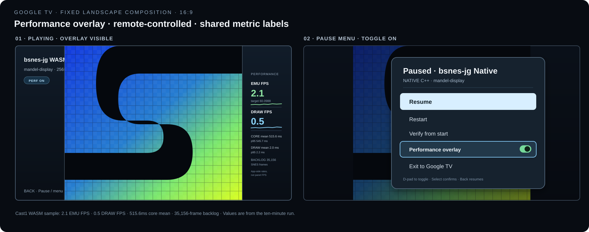
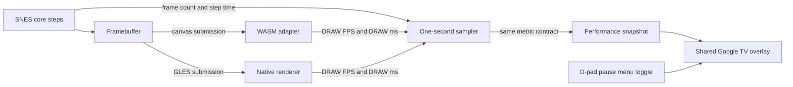

# Plan — Google TV performance overlay for SNES apps

**Status:** Implementation in progress. All four APK variants build and Cast1 Native/WASM profile captures show live overlay values. Landscape Pixel layout and the hardware remote-toggle check remain open.

## Goal

Show comparable live performance data while developing and comparing the Google TV builds. The same compact overlay and remote controls should work in the standalone Mandelbrot player and the 152-ROM library, with both WASM and Native engines. It should help answer whether an engine is keeping pace with the SNES clock without implying that Android has exposed physical display presentation timing.

## Apps in scope

| App | Engine | Package | Start screen |
|---|---|---|---|
| Mandelbrot player | WASM | `org.bsnesjg.tv` | Boots `mandel-display` |
| Mandelbrot player | Native C++ | `org.bsnesjg.tv.native` | Boots `mandel-display` |
| ROM library | WASM | `org.bsnesjg.tv.phase2` | Library; selected ROM plays |
| ROM library | Native C++ | `org.bsnesjg.tv.native.phase2` | Library; selected ROM plays |

The overlay is for the Google TV app experience. Keep a fixed landscape composition designed for a TV screen; do not add width-dependent layouts or web page breakpoints. The overlay may be hidden during normal play with the remote, but should start visible in the current development and comparison APKs.

## Overlay mockups

The playing view keeps the 8:7 SNES picture at maximum size and places unboxed profiling meters entirely in the right side gutter. The left gutter carries the app name, engine badge, ROM, and pause hint. The mockup uses current Cast1 WASM values (2.1 emulated FPS, 0.5 draw FPS, 515.6 ms core mean, and a 35,156-frame backlog); these are not native/WASM paired measurements. The pause view shows the Native C++ name and D-pad toggle.

## Metrics and labels

Show these values in every app, with the same definitions and rolling one-second sampling window:

| Label | Definition | Notes |
|---|---|---|
| **EMU FPS** | SNES core frames completed per elapsed second | Compare with the NTSC target, **60.0988 FPS**. The value measures core progress, not how often the TV refreshes. |
| **DRAW FPS** | Completed app-side framebuffer submissions per elapsed second | WASM counts successful canvas submissions; Native counts completed GLES draw submissions. It is not a display/compositor presentation rate. |
| **CORE ms** | Mean and p95 time spent stepping one SNES frame | Same rolling window. Excludes renderer work. |
| **DRAW ms** | Mean and p95 app-side image conversion/submission work per draw | WASM measures framebuffer conversion plus `putImageData`; Native measures framebuffer copy plus GLES submission. Keep this difference documented in exported measurements. |
| **BACKLOG** | SNES frames due but not yet stepped | Existing scheduler credit for WASM; equivalent frame credit for Native. Zero means the core is keeping up with its target. |

Use fixed one-decimal FPS, one-decimal milliseconds, and one-decimal backlog. If no ROM is active, show `EMU —` and `DRAW —`. Do not label either app-side number as “display FPS.” Android display timing can be added later as a separate metric only if the same presentation source is available and validated for both engines.

## Controls and behavior

- The overlay starts visible in the development and comparison builds so launch checks show performance immediately.
- A **Performance overlay** toggle in the pause menu turns it on or off. The menu entry displays its current state.
- Pressing **Back** continues to open the existing pause menu. Do not assign Back or a held key as a second hidden toggle.
- Preserve overlay visibility when changing ROMs, resuming from pause, or returning from Android backgrounding. Store the preference locally per app, using the existing Android preference bridge where available; default to visible when unset.
- Keep keyboard input out of the required control path. All toggle and menu actions must be reachable by D-pad and Select on a Google TV remote.
- When disabled, stop DOM refreshes and rolling-window aggregation while retaining the engine’s existing instrumentation required for profile logs. Toggling back on should populate on the next sample window rather than show stale values.

## Measurement flow

## Implementation outline

1. **Define a shared metric snapshot.** Use stable fields for `emuFps`, `drawFps`, `coreMeanMs`, `coreP95Ms`, `drawMeanMs`, `drawP95Ms`, `backlogFrames`, and `windowMs`. Add a monotonic one-second accumulator that accepts frame counts, elapsed time, durations, and backlog.
2. **Feed WASM statistics.** Extend the TV-mode instrumentation in `web/app.js` to publish the snapshot after each window. Count actual successful canvas submissions separately from requestAnimationFrame callbacks. Keep the existing console metrics for coordinator/profile evidence and source their shared values from the same measured window where possible.
3. **Feed Native statistics.** In `MainActivity.NativeRenderer`, accumulate actual `NativeEngine.step()` calls and elapsed nanoseconds, completed GLES submissions, submission duration, and frame credit. Publish one immutable snapshot to the WebView once per second on the UI thread; do not call through JNI every frame or update WebView DOM from the GL thread.
4. **Add a shared overlay component.** Create one shared script and style for the four Android variants. It reads snapshots, formats values, exposes a toggle entry to the pause-menu controller, and avoids layout changes based on screen width. The two standalone and library HTML pages mount the same component.
5. **Persist and initialize visibility.** Default to on for current comparison builds. Read/write the choice through the existing preference bridge, and keep the state stable across pause, resume, ROM selection, and activity backgrounding.
6. **Verify both engines and both app shapes.** Build all four APK variants, compare their labels and units, then use coordinator-owned launch/profile jobs on a Chromecast and Pixel. Capture the visible values and logs for the same ROM and duration. Pixel data remains phone-form-factor evidence; use Google TV hardware for TV conclusions.

## Visual placement

- Keep the game image centered at its maximum 8:7 aspect and leave the pixels unobscured.
- Place unboxed profiling meters directly in the right side gutter. The gutter is already dark; use clear labels, readable numerals, sparklines, and thin separators without adding a panel background or border.
- The left gutter retains ROM identity and existing status. Performance meters should not displace pause controls or shrink the game.
- Show a small `PERF ON` indicator only while the overlay is visible. Hide it with the overlay.
- Label the launcher apps `bsnes-jg WASM` and `bsnes-jg Native`; show a matching `WASM` or `NATIVE C++` badge in the selector and gameplay HUD.
- Keep the shared layout identical across app variants. Only the engine badge and live meter values change.

## 27 October gutter correction

The first Cast1 profile capture put the performance overlay over the right edge of
the SNES image. Its CSS width had a 205 px minimum, while the 16:9 WebView's
right gutter beside a maximum-height 8:7 picture was only about 171 CSS px.
The playing title and status could also extend from the left gutter into the
image. Will reports the overlap is worse on the phone. The mockup above already
shows the intended layout, but the implementation did not enforce it.

Compute each side gutter as half the viewport width minus the displayed 8:7
picture width. Keep the picture centered and at its present maximum size. Bound
all performance labels and sparklines by the right gutter with an inner gap,
and bound the playing title and status by the left gutter. Stack detail labels
inside the narrow TV gutter; use the larger available gutter on a landscape phone. The same
shared CSS serves all four APK variants. No profiler text or meter may intersect
the picture rectangle.

Verification: capture both WASM and Native playing screens on Cast1 and the
landscape Pixel, and compare the pixel bounds of the picture, left status, and
right-gutter meters. Check legibility and the pause toggle on hardware. A desktop-sized
layout check is useful but does not replace either device capture.

The shared CSS passed a headless geometry check at both target landscape
viewports. At 960×540 CSS px (16:9 TV), the picture ends at x=788.6 and the
right-gutter meter bounds begin at x=803.0; the left HUD ends where the picture
begins at x=171.4. At 1200×540 CSS px (landscape phone), the picture ends at
x=908.6 and meter bounds begin at x=942.0; the left HUD ends at x=291.4.
The picture remains 617.1×540 in both cases. Physical capture and readability
remain open.

The full Android build verified Debug and Release artifacts for WASM library,
WASM player, Native library, and Native player. ROM/card inputs were hash
validated without recapture.

Cast1 profile screenshots on 27 October show the shared overlay entirely in the
right gutter at 1920×1080. The Native library profile reported EMU 15.6 FPS,
DRAW 3.9 FPS, CORE 63.5/72.9 ms, DRAW 1.4/1.5 ms, and backlog 839.5 frames.
The current WASM library profile reported EMU 2.7 FPS, DRAW 0.0 FPS, CORE
4450.2/17467.3 ms, DRAW 0.0/0.0 ms, and backlog 340.9 frames. Its live metrics
confirm that WASM now publishes on elapsed one-second windows even when it has
completed far fewer than 60 core frames. The low DRAW rate and loading indicator
reflect the very slow core and the existing first-frame reveal gate. Evidence:
[Cast1 Native profile](../performance/2026-10-26/wasm-vs-native/evidence/cast1-native-overlay-profile-2026-10-27/)
and [Cast1 WASM profile](../performance/2026-10-26/wasm-vs-native/evidence/cast1-wasm-overlay-profile-fixed-2026-10-27/).

## 27 October device-sized layout

The Native C++ `GLSurfaceView` now measures the available Android window and
occupies a centered 8:7 rectangle. The WebView derives its game rectangle and
side gutters from its own current viewport, so panel width follows the device
resolution instead of assuming Chromecast pixel dimensions. Portrait layouts
use top and bottom gutters. The root surface behind the native renderer uses
the shared dark background.

The full build passed, and a new Cast1 Native profile completed with the game
surface centered and the metrics in the right gutter. See [Cast1 responsive
Native capture](../performance/2026-10-26/wasm-vs-native/evidence/cast1-native-responsive-layout-2026-10-27/).
The Pixel landscape profile remains unverified: its screen was locked, so the
queued coordinator job was cancelled without touching the device.

## Acceptance criteria

- All four apps expose the same overlay, metric names, precision, and toggle behavior.
- WASM and Native EMU FPS agree within one frame per second over a stable 60-second run of the same ROM on the same device, unless a logged backlog explains the difference.
- DRAW FPS counts actual app-side submissions, not just scheduled callbacks.
- Each core and draw timing statistic is collected from a rolling one-second window, with the window duration included in machine-readable logs.
- The overlay does not cover the active SNES picture, steal D-pad focus during gameplay, or break ROM selection and pause/resume.
- Overlay disabled means no visible overlay and no recurring WebView metric DOM update.
- No metric or UI text claims physical display presentation FPS without a validated presentation timestamp source.
- Coordinator evidence includes launch captures and same-ROM comparison logs for WASM and Native on Google TV hardware.
- The Pixel landscape capture confirms the wide-gutter layout, and the Google TV remote can switch the overlay off and on from the pause menu.

## Out of scope

- Changing the emulator frame scheduler or target SNES clock.
- Collecting Android SurfaceFlinger presentation timestamps or claiming display refresh rate as app FPS.
- A desktop browser performance dashboard or mouse/keyboard-only controls.
- Persisting historical sessions inside the apps; coordinator evidence remains the record for comparison runs.
