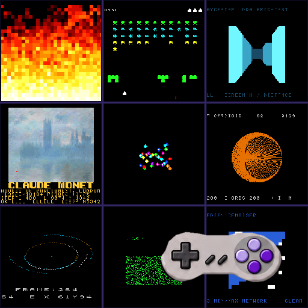
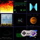
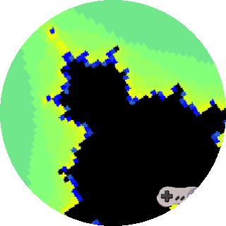
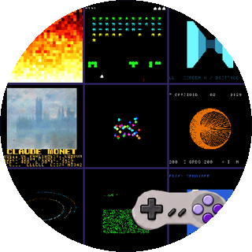
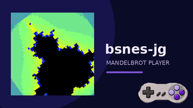
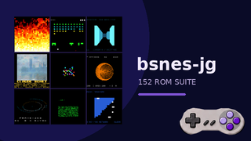
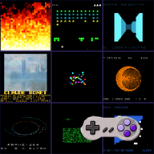
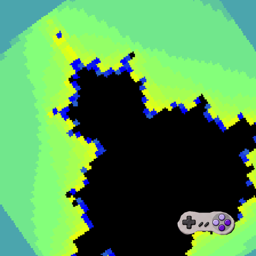

# Two SNES app icons: Mandelbrot and the full ROM suite

## Goal

Create two distinct app-wide icons that share the realistic North American SNES controller badge: one for the Mandelbrot-only player and one for the full LLVM 65816 ROM suite. The two products have different ROM content, so their main artwork should differ. WASM and native engine builds retain the icon for their corresponding product. Do not create installable icons per ROM; the library continues to show each ROM's own screenshot only as its in-app thumbnail and focus preview.

## App and ROM inventory

| App identity | ROM content | Icon artwork |
|---|---|---|
| Mandelbrot player | The single `mandel-display.sfc` ROM. WASM and native builds are engine variants of this player. | The actual Mode 7 Mandelbrot frame from `android/fixture/reference-5800.png`, with the shared SNES controller badge. |
| LLVM 65816 torture-test suite | The 152 published SNES ROMs in the quick-launch library. WASM and native builds remain variants of the suite where available. | A visual mosaic made from actual published ROM preview frames, with the same controller badge. |

The app distinction is by ROM content, not by engine. The browser player (`web/`) can load multiple demos and arbitrary ROMs; its favicon and mobile home-screen art should follow the product identity of the page hosting it rather than create a third ROM catalog app.

## Visual direction

- Make ROM output the dominant field. The Mandelbrot icon uses its single ROM's recognizable frame; the suite icon uses a balanced selection of actual frames from the collection, not a generic game or console background.
- Use a consistent SNES controller badge near the lower-right. Use the real controller's light-gray shell and lavender/violet controls, keeping its silhouette legible at launcher sizes and giving it enough contrast against varied artwork. Preserve the controller's source aspect ratio in every output; never stretch it to fit a target box.
- On 16:9 Google TV banners, place the controller badge at the lower-right of the overall banner, separate from the square ROM artwork tile.
- Keep the ROM scene and badge inside Android TV's adaptive-icon safe region; review both square and round masks. Preserve the WorldFoundry reference's corner placement and visual hierarchy without copying its logo artwork.
- Avoid tiny text and fine detail. Test artwork at actual launcher icon sizes and against TV launcher backgrounds.
- Build layered Android adaptive foreground/background assets from vector or reproducible source art. Generate raster sizes from those sources rather than maintaining hand-edited size variants.
- Add standard web favicon/touch-icon assets from the same identity artwork. Keep the browser icon crisp at small sizes.

## The two app icons

The controller treatment uses the realistic North American SNES palette: light-gray shell, dark-gray D-pad, and four face buttons in two shades of purple/lavender. It has no visible L/R shoulder buttons and no Super Famicom red, green, blue, or yellow face-button colors.

| Mandelbrot-only player | Full LLVM 65816 ROM suite |
|---|---|
|  |  |

The suite mosaic is generated from the published previews for `doom-fire`, `space-invaders`, `raycaster`, `lzss-gallery`, `boids`, `cardioid`, `n-body`, `life`, and `medfilt` by [`generate-suite-icon.py`](../../android/tools/generate-suite-icon.py). N-body adds orbit geometry in the bottom-left tile. The Median Denoiser frame sits bottom-right: its strong blue field fills the left while the mostly black right side leaves the controller badge clear space. The Mandelbrot source is a 1254 × 1254 PNG; the suite mosaic is 512 × 512. Both are square master artwork for platform-specific sizes.

## Actual-size icon renders

The files below are exported at the target pixel dimensions, so opening an image directly shows the actual resource size. The generator creates every density variant in [`actual-size-renders/`](assets/actual-size-renders/) using [`generate-icon-review-renders.py`](../../android/tools/generate-icon-review-renders.py).

| Target resource | Mandelbrot-only | Full ROM suite |
|---|---|---|
| Google TV launcher, mdpi 80 × 80 |  |  |
| Google TV launcher, xxxhdpi 320 × 320, round mask |  |  |
| Google TV banner, xhdpi 320 × 180 |  |  |
| Android / web home screen, 192 × 192 |  |  |
| iPhone / iPad touch icon, 180 × 180 |  |  |
| High-resolution web app icon, 512 × 512 |  |  |

The complete Google TV density exports are 80, 120, 160, 240, and 320 px square launcher icons and 160 × 90, 240 × 135, 320 × 180, 480 × 270, and 640 × 360 banners. Web/mobile exports also include 16, 32, and 48 px favicons. Round-mask review renders are included alongside square launcher renders. The standalone transparent controller source is `assets/snes-controller-badge.png`; `icon_art.py` applies it to the masters and generated variants. `generate-app-icons.py` refreshes both Android resource sets and the web/mobile assets from the suite icon master.

## Proposed implementation

1. Keep the Mandelbrot-only and full-suite app identities distinct in Android launcher resources and labels; keep engine variants within each identity visually consistent.
2. Generate actual-size launcher and banner resources for Chromecast / Google TV, plus favicon and mobile home-screen resources for the browser player.
3. Review each app's icon at small launcher sizes and under square and round masks, with the controller badge visible and the ROM content identifiable.
4. Document the artwork inputs, regeneration commands, dimensions, safe zones, and app-to-icon mapping.

## Review criteria

- The Mandelbrot icon identifies the Mandelbrot output; the suite icon reads as a collection of different SNES programs.
- The purple controller badge is clearly visible, consistently placed, and does not obscure the ROM image.
- Adaptive masks do not clip the badge or the recognizable subject.
- The same controller badge ties both app identities together; WASM and native builds of each identity use matching artwork.
- Every app icon can be regenerated from documented source assets.

## Decisions

- Use one stable app-wide icon for each of the two products; selecting another ROM does not change the icon.
- Do not create separate installable apps or icons for the 152 ROMs.
- Use actual published ROM screenshots inside the Google TV library rows and focused preview pane. Use the actual Mandelbrot frame for the single-ROM app, and a curated mosaic of suite screenshots for the full-library app.

## Current design update

The icon compositions distinguish the Mandelbrot-only player from the full ROM suite. Review of the Cast1 Google TV launcher screenshot found that its circular mask clipped most of the small controller badge. The shared badge is now larger and inset at the lower-right; generated main and library Android launcher icons, banners, and web/mobile icons have been refreshed from the corrected suite master. The 80 px and 320 px round-mask renders now show the complete controller. App-identity-specific artwork wiring remains separate work.

## Checklist

- [x] Confirm the two ROM-content identities and ROM-to-app mapping.
- [x] Compose a Mandelbrot-only icon from its actual captured frame.
- [x] Compose a full-suite icon from nine actual published ROM previews.
- [x] Apply the realistic North American SNES controller badge to both.
- [x] Review both icons at actual launcher sizes and Android TV masks, including round-mask previews.
- [ ] Wire each app identity to its own platform-sized icon resources.
