# Published SNES ROM library: complete inventory

**152 ROMs · 44,630,016 bytes (42.6 MiB)**

Each row includes the same gameplay screenshot shown on the biohack.net SNES gallery card. The TV library copies these images byte-for-byte from `/play/preview/<slug>.png`; ROMs and images share the slug mapping in `library.json`.

| # | Screenshot | ROM | Slug | Category | Size | Image source |
|---:|:---:|---|---|---|---:|---|
| 151 | 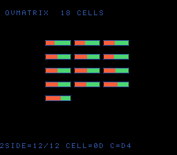 | Overflow Family Matrix | `ovmatrix` | Big Numbers | 32,768 B | `/play/preview/ovmatrix.png` |
| 150 | 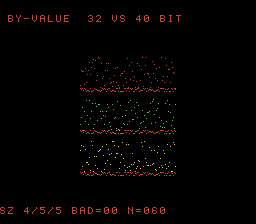 | By-Value Boundary Trio | `byvaledge` | Algorithms & Data | 32,768 B | `/play/preview/byvaledge.png` |
| 149 | 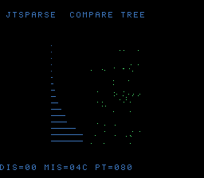 | Sparse Switch Ladder | `jtsparse` | Algorithms & Data | 32,768 B | `/play/preview/jtsparse.png` |
| 148 | 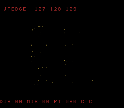 | Jump-Table Boundary Sweep | `jtedge` | Algorithms & Data | 32,768 B | `/play/preview/jtedge.png` |
| 147 | 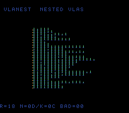 | Nested VLA Pyramid | `vlanest` | Algorithms & Data | 32,768 B | `/play/preview/vlanest.png` |
| 146 | 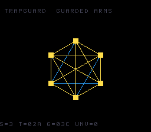 | Unreachable Sentinel | `trapguard` | Algorithms & Data | 32,768 B | `/play/preview/trapguard.png` |
| 145 | 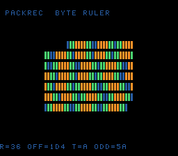 | Unaligned Record Reader | `packrec` | Algorithms & Data | 32,768 B | `/play/preview/packrec.png` |
| 144 | 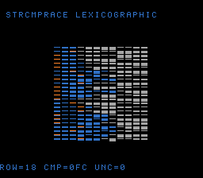 | Lexicographic Race | `strcmprace` | Algorithms & Data | 32,768 B | `/play/preview/strcmprace.png` |
| 143 | 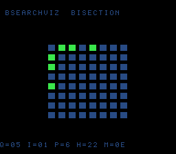 | Bisection Oracle | `bsearchviz` | Algorithms & Data | 32,768 B | `/play/preview/bsearchviz.png` |
| 142 | 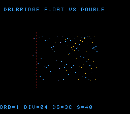 | Precision Bridge | `dblbridge` | Big Numbers | 65,536 B | `/play/preview/dblbridge.png` |
| 141 | 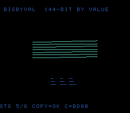 | Affine Stage Pipeline | `bigbyval` | Rendering & Graphics | 32,768 B | `/play/preview/bigbyval.png` |
| 140 | 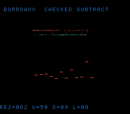 | Reservoir Ladder | `borrowov` | Algorithms & Data | 32,768 B | `/play/preview/borrowov.png` |
| 139 | 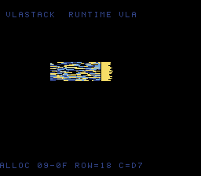 | Run-Length Scanline Decoder | `vlastack` | Rendering & Graphics | 32,768 B | `/play/preview/vlastack.png` |
| 138 | 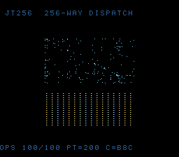 | ISA-256 Bytecode Machine | `jt256` | Algorithms & Data | 32,768 B | `/play/preview/jt256.png` |
| 137 | 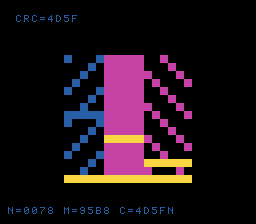 | Bank/Direct-Page Windows | `dpbank` | Signals & Audio | 32,768 B | `/play/preview/dpbank.png` |
| 136 | 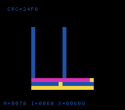 | IRQ Gate | `irqgate` | Signals & Audio | 32,768 B | `/play/preview/irqgate.png` |
| 135 | 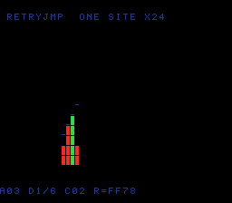 | Retry-On-Fault Ladder | `retryjmp` | Algorithms & Data | 32,768 B | `/play/preview/retryjmp.png` |
| 134 | 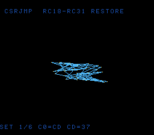 | Callee-Saved Restore Curve | `csrjmp` | Motion & Curves | 32,768 B | `/play/preview/csrjmp.png` |
| 133 | 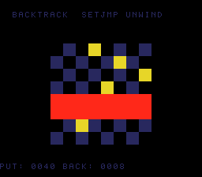 | Backtracking Solver | `backtrack` | Algorithms & Data | 32,768 B | `/play/preview/backtrack.png` |
| 132 | 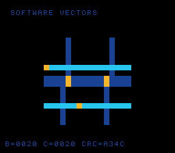 | Software Vectors | `brkcop` | Signals & Audio | 32,768 B | `/play/preview/brkcop.png` |
| 131 | 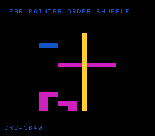 | Far-Pointer Order Shuffle | `farptrcmp` | Algorithms & Data | 524,288 B | `/play/preview/farptrcmp.png` |
| 130 | 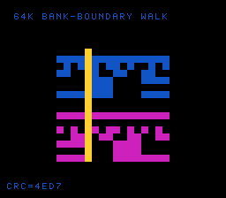 | 64K Bank-Boundary Walk | `bankwalk` | Signals & Audio | 524,288 B | `/play/preview/bankwalk.png` |
| 129 | 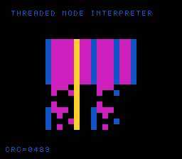 | Threaded Mode Interpreter | `modethread` | Algorithms & Data | 32,768 B | `/play/preview/modethread.png` |
| 128 | 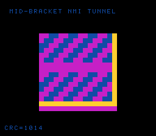 | Mid-Bracket NMI Tunnel | `isrbracket` | Signals & Audio | 32,768 B | `/play/preview/isrbracket.png` |
| 127 | 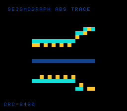 | Seismograph Absolute Trace | `llabs64` | Signals & Audio | 32,768 B | `/play/preview/llabs64.png` |
| 126 | 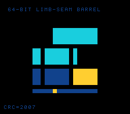 | 64-Bit Limb-Seam Barrel | `shift64seam` | Ciphers & Bit Tricks | 32,768 B | `/play/preview/shift64seam.png` |
| 125 | 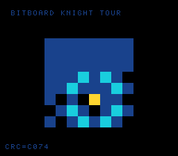 | Bitboard Knight Tour | `bitboard64` | Algorithms & Data | 32,768 B | `/play/preview/bitboard64.png` |
| 124 | 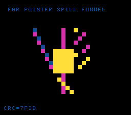 | Far-Pointer Spill Funnel | `farspill` | Signals & Audio | 65,536 B | `/play/preview/farspill.png` |
| 123 | 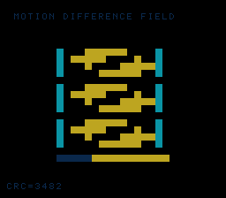 | Motion-Detect Difference Field | `absdiff` | Signals & Audio | 32,768 B | `/play/preview/absdiff.png` |
| 122 | 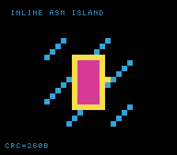 | Inline-Asm Island | `asmisland` | Signals & Audio | 32,768 B | `/play/preview/asmisland.png` |
| 121 | 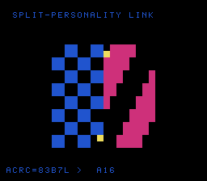 | Split-Personality Link | `mixedwidth` | Signals & Audio | 32,768 B | `/play/preview/mixedwidth.png` |
| 120 | 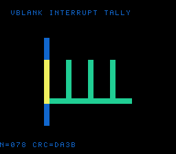 | VBlank Interrupt Tally | `nmitally` | Signals & Audio | 32,768 B | `/play/preview/nmitally.png` |
| 119 | 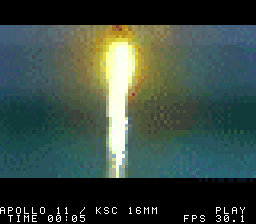 | Apollo 11 Daylight Launch | `apollo-daylight` | Video Playback | 4,194,304 B | `/play/preview/apollo-daylight.png` |
| 118 | 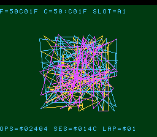 | Seam Demo — Three-Act Boundary Cartridge | `seamdemo` | Cartridge & Mapping Tests | 6,291,456 B | `/play/preview/seamdemo.png` |
| 117 | 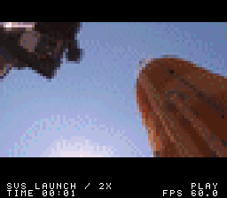 | SVX2 60 FPS FastROM Video | `svx2-fastrom-video` | Video Playback | 8,388,608 B | `/play/preview/svx2-fastrom-video.png` |
| 116 |  | ExHiROM 64 Mbit Cartridge Test | `cartsize-exhirom-8m` | Cartridge & Mapping Tests | 8,388,608 B | `/play/preview/cartsize-exhirom-8m.png` |
| 115 |  | ExHiROM 48 Mbit Cartridge Test | `cartsize-exhirom-6m` | Cartridge & Mapping Tests | 6,291,456 B | `/play/preview/cartsize-exhirom-6m.png` |
| 114 | 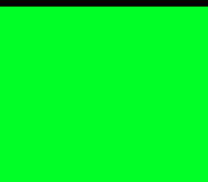 | HiROM 32 Mbit Cartridge Test | `cartsize-hirom-4m` | Cartridge & Mapping Tests | 4,194,304 B | `/play/preview/cartsize-hirom-4m.png` |
| 113 | 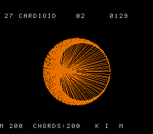 | Times-table Cardioid | `cardioid` | Motion & Curves | 32,768 B | `/play/preview/cardioid.png` |
| 112 | 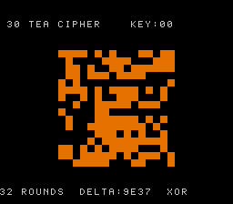 | TEA Cipher Avalanche | `tea` | Ciphers & Bit Tricks | 32,768 B | `/play/preview/tea.png` |
| 111 | 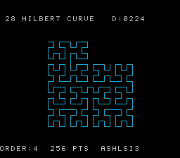 | Hilbert Curve | `hilbert` | Motion & Curves | 32,768 B | `/play/preview/hilbert.png` |
| 110 | 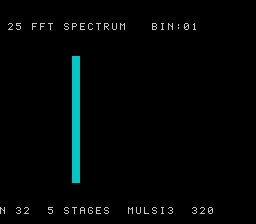 | FFT Spectrum Analyser | `fft` | Signals & Audio | 32,768 B | `/play/preview/fft.png` |
| 109 | 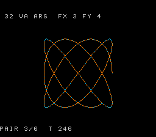 | VA_ARG Formatter | `vaprintf` | Motion & Curves | 32,768 B | `/play/preview/vaprintf.png` |
| 108 | 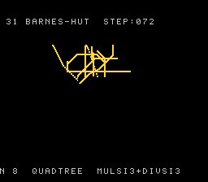 | Barnes-Hut Galaxy | `bhut` | Physics & Simulation | 32,768 B | `/play/preview/bhut.png` |
| 107 | 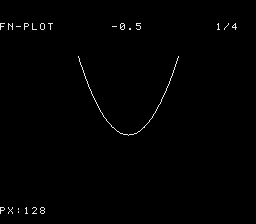 | Function Plotter | `fn-plot` | Fractals | 32,768 B | `/play/preview/fn-plot.png` |
| 106 | 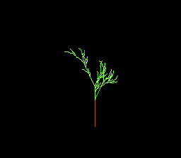 | L-System Plant | `lsystem` | Fractals | 32,768 B | `/play/preview/lsystem.png` |
| 105 | 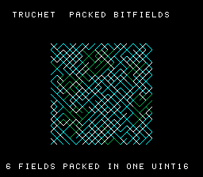 | Truchet · Packed Bitfields | `truchet` | Ciphers & Bit Tricks | 32,768 B | `/play/preview/truchet.png` |
| 104 | 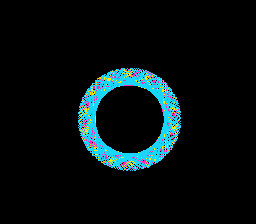 | Bytecode-VM Turtle | `turtle-vm` | Games & Classics | 32,768 B | `/play/preview/turtle-vm.png` |
| 103 | 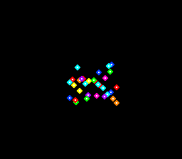 | Boids Flock | `boids` | Physics & Simulation | 32,768 B | `/play/preview/boids.png` |
| 102 | 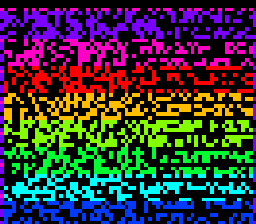 | 64-Bit Avalanche | `avalanche` | Big Numbers | 32,768 B | `/play/preview/avalanche.png` |
| 101 | 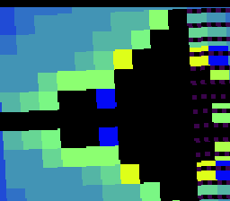 | Double-Precision Mandelbrot | `mandel-double` | Fractals | 65,536 B | `/play/preview/mandel-double.png` |
| 100 | 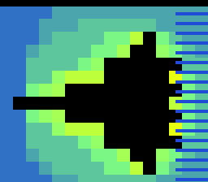 | Soft-Float Mandelbrot | `mandel-float` | Fractals | 32,768 B | `/play/preview/mandel-float.png` |
| 99 |  | Burning Ship Fractal | `burning-ship` | Fractals | 32,768 B | `/play/preview/burning-ship.png` |
| 98 |  | Raycaster Maze | `raycaster` | Physics & Simulation | 32,768 B | `/play/preview/raycaster.png` |
| 97 |  | Julia Set Explorer | `julia` | Fractals | 32,768 B | `/play/preview/julia.png` |
| 96 |  | Lissajous Harmonograph | `harmonograph` | Motion & Curves | 32,768 B | `/play/preview/harmonograph.png` |
| 95 |  | Conway's Game of Life | `life` | Cellular Automata | 32,768 B | `/play/preview/life.png` |
| 94 |  | Fourier Epicycles | `epicycles` | Motion & Curves | 32,768 B | `/play/preview/epicycles.png` |
| 93 |  | Maze Generate + Solve | `maze` | Algorithms & Data | 32,768 B | `/play/preview/maze.png` |
| 92 |  | Sorting Race | `sort-race` | Algorithms & Data | 32,768 B | `/play/preview/sort-race.png` |
| 91 |  | Doom Fire | `doom-fire` | Cellular Automata | 32,768 B | `/play/preview/doom-fire.png` |
| 90 |  | CORDIC Rotator | `cordic` | Motion & Curves | 32,768 B | `/play/preview/cordic.png` |
| 89 |  | Buddhabrot | `buddhabrot` | Fractals | 32,768 B | `/play/preview/buddhabrot.png` |
| 88 |  | Newton's Fractal | `newton` | Fractals | 32,768 B | `/play/preview/newton.png` |
| 87 |  | Bignum Factorial | `factorial` | Big Numbers | 32,768 B | `/play/preview/factorial.png` |
| 86 |  | Reaction-Diffusion | `rdiff` | Cellular Automata | 32,768 B | `/play/preview/rdiff.png` |
| 85 |  | N-body Orbits | `n-body` | Physics & Simulation | 32,768 B | `/play/preview/n-body.png` |
| 84 |  | 1-D Cellular Automaton | `1d-ca` | Cellular Automata | 32,768 B | `/play/preview/1d-ca.png` |
| 83 |  | Double Pendulum (Chaos) | `double-pendulum` | Physics & Simulation | 32,768 B | `/play/preview/double-pendulum.png` |
| 82 |  | π Spigot + Monte-Carlo | `spigot` | Big Numbers | 32,768 B | `/play/preview/spigot.png` |
| 81 |  | Wireframe 3-D Solid | `3d-wireframe` | Physics & Simulation | 32,768 B | `/play/preview/3d-wireframe.png` |
| 80 |  | Spirograph | `spirograph` | Motion & Curves | 32,768 B | `/play/preview/spirograph.png` |
| 79 |  | Space Invaders | `space-invaders` | Games & Classics | 32,768 B | `/play/preview/space-invaders.png` |
| 78 |  | Blossom | `blossom` | Games & Classics | 32,768 B | `/play/preview/blossom.png` |
| 77 |  | Brainfuck Threaded-Code VM | `bf-vm` | Games & Classics | 32,768 B | `/play/preview/bf-vm.png` |
| 76 |  | HDR Additive Bloom | `hdr-bloom` | Rendering & Graphics | 32,768 B | `/play/preview/hdr-bloom.png` |
| 75 |  | IIR Resonant-Filter Scope | `iir-scope` | Signals & Audio | 32,768 B | `/play/preview/iir-scope.png` |
| 74 |  | Polygon Scanline Fill (VLA) | `polyfill` | Rendering & Graphics | 32,768 B | `/play/preview/polyfill.png` |
| 73 |  | Step-Sequencer VM (Sparse Switch) | `seqvm` | Signals & Audio | 32,768 B | `/play/preview/seqvm.png` |
| 72 |  | Division Clock + Odometer | `divclock` | Games & Classics | 32,768 B | `/play/preview/divclock.png` |
| 71 |  | CRC32 Hash-Marble Texture | `crctex` | Rendering & Graphics | 32,768 B | `/play/preview/crctex.png` |
| 70 |  | Free-List Pool Allocator | `poolfx` | Games & Classics | 32,768 B | `/play/preview/poolfx.png` |
| 69 |  | Duff Dissolve | `duff` | Algorithms & Data | 32,768 B | `/play/preview/duff.png` |
| 68 |  | Signed 64-bit Odometer | `sodo` | Big Numbers | 32,768 B | `/play/preview/sodo.png` |
| 67 |  | Type-Pun Metaballs | `metaball` | Rendering & Graphics | 32,768 B | `/play/preview/metaball.png` |
| 66 |  | qsort Sort Visualizer | `qsortviz` | Algorithms & Data | 32,768 B | `/play/preview/qsortviz.png` |
| 65 |  | Newton Reciprocal Floor | `nrecip` | Rendering & Graphics | 32,768 B | `/play/preview/nrecip.png` |
| 64 |  | LZ77 Decompress Reveal | `lzdec` | Algorithms & Data | 32,768 B | `/play/preview/lzdec.png` |
| 63 |  | Many-Arg Color Grade | `cgrade` | Rendering & Graphics | 32,768 B | `/play/preview/cgrade.png` |
| 62 |  | Protothread Critters | `critters` | Games & Classics | 32,768 B | `/play/preview/critters.png` |
| 61 |  | Cross-Byte Bitfields | `disbits` | Ciphers & Bit Tricks | 32,768 B | `/play/preview/disbits.png` |
| 60 |  | Bit-Census Field | `bitcensus` | Ciphers & Bit Tricks | 32,768 B | `/play/preview/bitcensus.png` |
| 59 |  | Funnel-Shift Kaleidoscope | `funnelkal` | Rendering & Graphics | 32,768 B | `/play/preview/funnelkal.png` |
| 58 |  | Perfect-Shuffle Transition | `bitshuffle` | Ciphers & Bit Tricks | 32,768 B | `/play/preview/bitshuffle.png` |
| 57 |  | GF(2⁸) Galois Field | `gf256` | Ciphers & Bit Tricks | 32,768 B | `/play/preview/gf256.png` |
| 56 |  | Rotozoom | `rotozoom` | Rendering & Graphics | 32,768 B | `/play/preview/rotozoom.png` |
| 55 |  | Median Denoiser | `medfilt` | Rendering & Graphics | 32,768 B | `/play/preview/medfilt.png` |
| 54 |  | Domain Colouring | `domcol` | Fractals | 32,768 B | `/play/preview/domcol.png` |
| 53 |  | Cosmic Zoom Ruler | `cosmzoom` | Big Numbers | 32,768 B | `/play/preview/cosmzoom.png` |
| 52 |  | Multi-Base Clock | `multibase` | Big Numbers | 32,768 B | `/play/preview/multibase.png` |
| 51 |  | Diffie-Hellman Colour-Mixer | `dhmix` | Big Numbers | 32,768 B | `/play/preview/dhmix.png` |
| 50 |  | Union-Find Percolation | `percol` | Cellular Automata | 32,768 B | `/play/preview/percol.png` |
| 49 |  | Fenwick Tree | `fenwick` | Algorithms & Data | 32,768 B | `/play/preview/fenwick.png` |
| 48 |  | Radix Sort | `radix` | Algorithms & Data | 32,768 B | `/play/preview/radix.png` |
| 47 |  | Convex Hull | `hull` | Algorithms & Data | 32,768 B | `/play/preview/hull.png` |
| 46 |  | Edit-Distance DP | `editdist` | Algorithms & Data | 32,768 B | `/play/preview/editdist.png` |
| 45 |  | Huffman Decode | `huffman` | Algorithms & Data | 32,768 B | `/play/preview/huffman.png` |
| 44 |  | Perlin Noise | `perlin` | Rendering & Graphics | 32,768 B | `/play/preview/perlin.png` |
| 43 |  | Gouraud Triangle | `gouraud` | Rendering & Graphics | 32,768 B | `/play/preview/gouraud.png` |
| 42 |  | Floyd-Steinberg Dither | `dither` | Rendering & Graphics | 32,768 B | `/play/preview/dither.png` |
| 41 |  | Marching Squares | `msquares` | Cellular Automata | 32,768 B | `/play/preview/msquares.png` |
| 40 |  | 3-D Grid Voxel Life | `grid3d` | Cellular Automata | 32,768 B | `/play/preview/grid3d.png` |
| 39 |  | Fabs Ridgeline | `fabsridge` | Rendering & Graphics | 32,768 B | `/play/preview/fabsridge.png` |
| 38 |  | Copysign Compass | `compass` | Motion & Curves | 32,768 B | `/play/preview/compass.png` |
| 37 |  | Fmin/Fmax Speed Cap | `speedcap` | Physics & Simulation | 32,768 B | `/play/preview/speedcap.png` |
| 36 |  | Truncation Staircase | `truncstair` | Algorithms & Data | 32,768 B | `/play/preview/truncstair.png` |
| 35 |  | Montgomery Orbit | `montorbit` | Ciphers & Bit Tricks | 32,768 B | `/play/preview/montorbit.png` |
| 34 |  | Ulam Prime Sieve | `ulam` | Algorithms & Data | 32,768 B | `/play/preview/ulam.png` |
| 33 |  | Range Coder | `rangecode` | Algorithms & Data | 32,768 B | `/play/preview/rangecode.png` |
| 32 |  | Sobelscope | `sobel` | Rendering & Graphics | 32,768 B | `/play/preview/sobel.png` |
| 31 |  | DCT Bloom | `dctbloom` | Signals & Audio | 32,768 B | `/play/preview/dctbloom.png` |
| 30 |  | ADPCM Waverider | `adpcm` | Signals & Audio | 32,768 B | `/play/preview/adpcm.png` |
| 29 |  | Scope-Guard Ripple Tank | `scopeguard` | Algorithms & Data | 32,768 B | `/play/preview/scopeguard.png` |
| 28 |  | Matrix Cascade | `matcascade` | Rendering & Graphics | 32,768 B | `/play/preview/matcascade.png` |
| 27 |  | PlyOracle | `plyoracle` | Games & Classics | 32,768 B | `/play/preview/plyoracle.png` |
| 26 |  | Signed Multiply-Overflow Orbit | `smulorbit` | Motion & Curves | 32,768 B | `/play/preview/smulorbit.png` |
| 25 |  | Saturating Comet Trails | `satcomet` | Motion & Curves | 32,768 B | `/play/preview/satcomet.png` |
| 24 |  | Rotate-Register Kaleidoscope | `rotkal` | Rendering & Graphics | 32,768 B | `/play/preview/rotkal.png` |
| 23 |  | Saturating-Cast Kaleidoscope | `satcast` | Rendering & Graphics | 32,768 B | `/play/preview/satcast.png` |
| 22 |  | Signed-Bitfield Terrain | `sbitfld` | Algorithms & Data | 32,768 B | `/play/preview/sbitfld.png` |
| 21 |  | Memmove Scroll Slabs | `mvscrl` | Algorithms & Data | 32,768 B | `/play/preview/mvscrl.png` |
| 20 |  | Borrow-Ladder Odometer | `borrowlad` | Big Numbers | 32,768 B | `/play/preview/borrowlad.png` |
| 19 |  | 64-bit Multiply-Overflow | `mulov64` | Big Numbers | 32,768 B | `/play/preview/mulov64.png` |
| 18 |  | 256-bit Modular Exponentiation | `modexp256` | Algorithms & Data | 32,768 B | `/play/preview/modexp256.png` |
| 17 |  | Pressure-Cooker Fixed-Point Evaluator | `pcooker` | Algorithms & Data | 32,768 B | `/play/preview/pcooker.png` |
| 16 |  | Odd-Width Mask Sculptor | `oddmask` | Algorithms & Data | 32,768 B | `/play/preview/oddmask.png` |
| 15 |  | 64-bit Multi-Key Record Sort | `keycmp64` | Algorithms & Data | 32,768 B | `/play/preview/keycmp64.png` |
| 14 |  | Three-Way Merge Diff | `trimerge` | Algorithms & Data | 32,768 B | `/play/preview/trimerge.png` |
| 13 |  | Unsigned Rank Percentile Field | `ucmprank` | Algorithms & Data | 32,768 B | `/play/preview/ucmprank.png` |
| 12 |  | Gap-Buffer Rope Editor | `ropeedit` | Algorithms & Data | 32,768 B | `/play/preview/ropeedit.png` |
| 11 |  | Gather-Scatter Permutation | `permscat` | Algorithms & Data | 32,768 B | `/play/preview/permscat.png` |
| 10 |  | In-Place Block Rotate | `rotslab` | Algorithms & Data | 32,768 B | `/play/preview/rotslab.png` |
| 9 |  | Overlap-Move Mosaic | `ovmove` | Algorithms & Data | 32,768 B | `/play/preview/ovmove.png` |
| 8 |  | Width-Sweep Sort Gallery | `spaceship` | Algorithms & Data | 32,768 B | `/play/preview/spaceship.png` |
| 7 |  | Bit-Banged UART Eye | `uarteye` | Ciphers & Bit Tricks | 32,768 B | `/play/preview/uarteye.png` |
| 6 |  | Serial Bit-Reversal Weave | `bitweave` | Ciphers & Bit Tricks | 32,768 B | `/play/preview/bitweave.png` |
| 5 |  | Dual-LFSR Scrambler | `lfsr2` | Ciphers & Bit Tricks | 32,768 B | `/play/preview/lfsr2.png` |
| 4 |  | Bit-Serial CRC Wall | `crcwall` | Ciphers & Bit Tricks | 32,768 B | `/play/preview/crcwall.png` |
| 3 |  | 6502 CPU Simulator | `cpu6502` | Games & Classics | 32,768 B | `/play/preview/cpu6502.png` |
| 2 |  | Mode 7 Mandelbrot (OOP) | `mandel-oop` | Fractals | 32,768 B | `/play/preview/mandel-oop.png` |
| 1 |  | Mode 7 Mandelbrot | `mandel-display` | Fractals | 32,768 B | `/play/preview/mandel-display.png` |
| 0 |  | LZSS Mode 7 Gallery | `lzss-gallery` | Algorithms & Data | 1,048,576 B | `/play/preview/lzss-gallery.png` |

Source: the published catalog and ROM assets from `biohack.net` and `llvm-mos-65816`. The comparison benchmark uses only `mandel-display`; this full list documents the offline library packaged by the separate library flavor.
