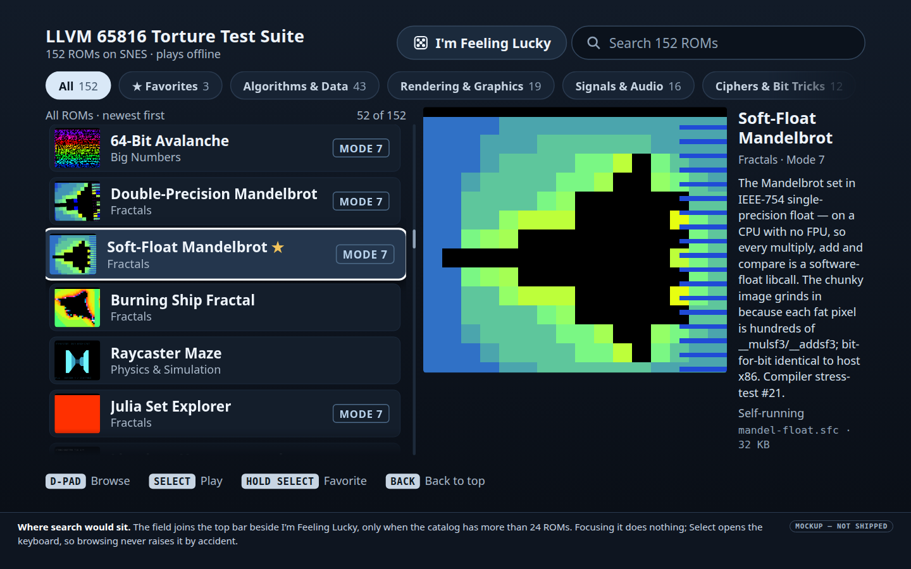
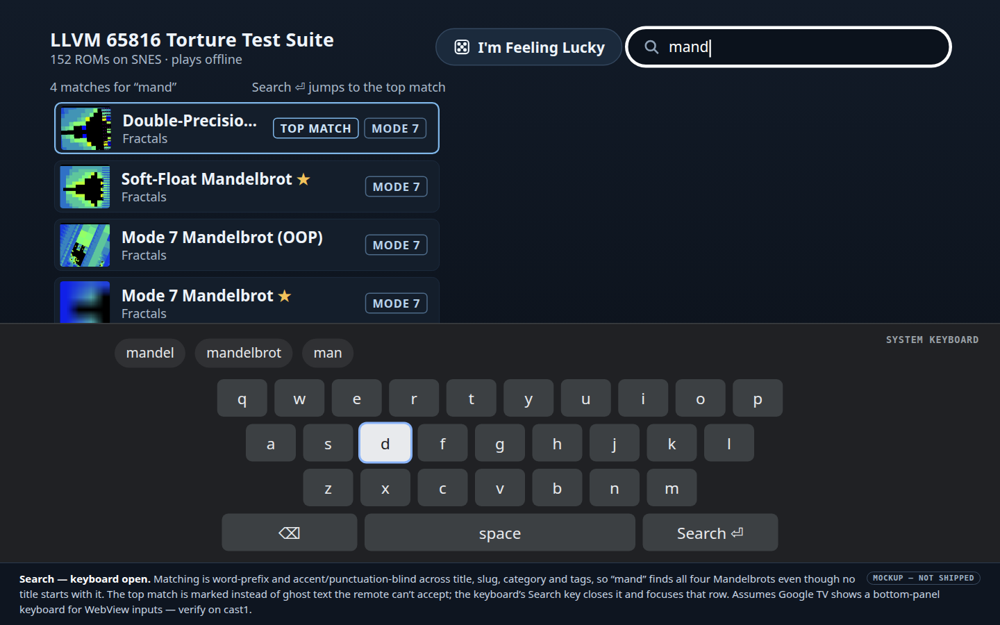
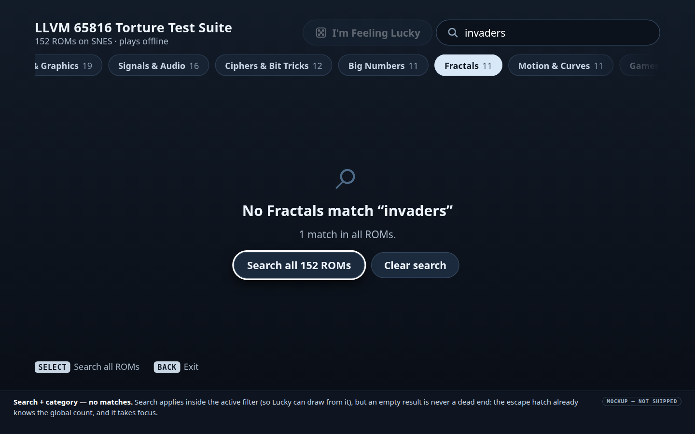
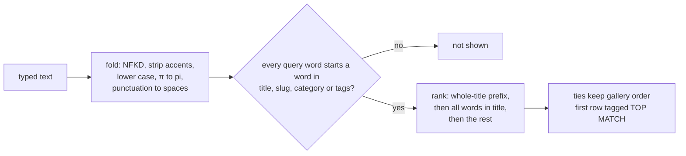
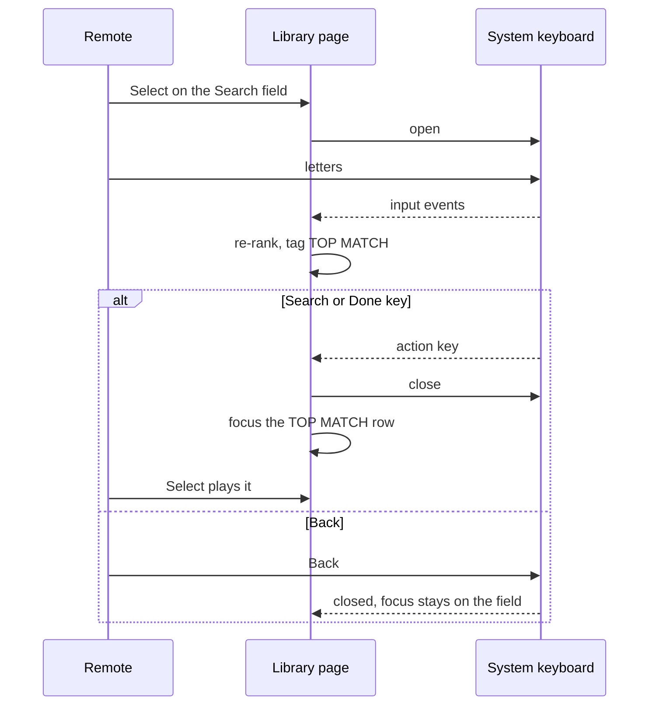

# Search for the Google TV ROM library

**Status:** Deferred (Will, 2026‑10‑26). Search is not in the first release of the [ROM library](2026-10-26-snes-rom-library-selector.md). A working version already exists in `android-tv/app/src/main/assets/library.js`. It was built before the deferral and is still on in the current build; the library plan's decision 3 switches it off. It follows the TOP MATCH design below, so picking this plan up starts from that code, not from scratch.

## Goal

Let someone on the sofa reach a ROM they already have in mind without scrolling the whole list. Filters and scrolling cover today's 152 ROMs. Search earns its cost only when the list gets long, because typing on a TV costs 3–6 D‑pad presses per letter.

**When to pick this up:** when the catalog approaches about 1,000 ROMs, or when "I know which one I want, but it takes too long to get there" becomes a real complaint.

## Open decision: how search suggests a result

1. **TOP MATCH (recommended; this is what the built code does).** The best result is the first row, tagged TOP MATCH. The keyboard's action key (Search or Done) closes the keyboard and moves focus to that row, and Select then plays it. Nothing launches from the keyboard.
2. **Ghost text, from the original plan.** The best title-prefix completion appears greyed out after the typed text. The remote can't accept it: while the on-screen keyboard is open, the D‑pad drives the keyboard, and there is no Tab or → key. A title prefix also rarely matches. For example, "mand" is not the start of any of the four Mandelbrot titles, so the ghost text would stay empty while the list below already shows all four.

## Design

### Mockups

These reuse the library's layout; [`generate-tv-library-mockups.py`](tools/generate-tv-library-mockups.py) produces them alongside the library's own set.

| | |
|---|---|
|  |  |
| **Placement:** the field in the top bar | **Typing:** keyboard open, top match marked |
|  | |
| **Empty result:** an escape hatch to all ROMs | |

### Where it sits

- **Field:** in the top bar, to the right of I'm Feeling Lucky, only when the catalog has more than 24 ROMs. Below that, scrolling is cheaper than typing.
- **Focus:** focusing the field does nothing; **Select** opens the system keyboard. Initial focus never lands on the field, because focusing an input can raise the keyboard.
- **Typing from a hardware keyboard** (Pixel, desktop testing): any letter focuses the field.

### Matching and ranking

- **Matching:** words are matched on prefixes. The slug is split on `-`, and the tags include `mode 7` and `interactive`. For example, `mand` finds all four Mandelbrots, `gf28` finds GF(2⁸) and `pi` finds the π Spigot.
- **Live results:** results update as letters arrive, debounced by 100 ms. The field holds only typed text, so Backspace removes only what was typed.
- **Scope:** search applies within the active filter, so I'm Feeling Lucky draws from the search results. An empty result is never a dead end. It offers **Search all N ROMs**, which takes focus and already shows the global match count, and **Clear search**.

### Keyboard, Back and returning

- **Back:** with the keyboard open, Back closes it. This becomes the first rule of the library's Back ladder.
- **Returning:** after Choose another ROM from the pause menu, the library also restores the search text.
- **Still to verify:** whether Google TV shows the keyboard for a WebView input as a bottom panel (as in the mockup) or in full-screen extract mode. If it is full-screen, the live list is hidden while typing. The flow from the action key to the top match works either way.

## Implementation outline

Rank: **T2**. The code exists in one module; the work is switching it back on, testing it and settling the open decision. Choosing ghost text instead would make it **T3**, because it needs a new way to accept the suggestion.

| File | Change |
|---|---|
| `android-tv/app/src/main/assets/library.js` | Switch the search UI back on above 24 ROMs; check that it matches this plan |
| `android-tv/test/library-ui.test.mjs` | Add the search cases below |
| [Library plan](2026-10-26-snes-rom-library-selector.md) | Restore the Search rows in its catalog-size table, the keyboard rule in its Back ladder, and the Keyboard state in its state diagram |

## Verification

1. Run `node --test android-tv/test/library-ui.test.mjs`. The search cases must pass:
    - `mand` returns 4 results with TOP MATCH on the first;
    - `gf28` finds GF(2⁸) and `pi` finds the π Spigot;
    - Enter in the field focuses the TOP MATCH row without launching it;
    - an empty result inside a filter offers Search all N ROMs with the right count;
    - I'm Feeling Lucky draws only from the search results;
    - the field is hidden at 24 ROMs and shown at 25.
2. On cast1, press Select on the field and take a coordinator screen capture. Record whether the keyboard is a bottom panel or full-screen, and update "Still to verify" above.
3. On cast1, type `mand`, press the keyboard's action key, then Select. Double-Precision Mandelbrot starts: all four Mandelbrots tie on rank, and it comes first in gallery order. Back closes the keyboard without leaving the library.
