# SNES ROM quick-launch library for Google TV

**Status:** Implementation in progress (2026‑10‑26). Catalog staging, the shared UI, the persistence bridge and the updated suite launcher assets are implemented, and both APK builds pass. Device launch and runtime checks remain open. **Two decisions changed after implementation started** (Will, 2026‑10‑26):

- Card art now comes from the site's own gallery images instead of frame‑600 captures.
- Search is out of this release, deferred to its own [search plan](2026-10-26-snes-rom-library-search.md).

The built capture step and search UI still need switching over; see resolved decisions 2 and 3.

**Back/return behavior update (2026-10-29):** the later [launcher views plan](2026-10-28-google-tv-launcher-views.md) supersedes this original Back ladder for library builds. Back during gameplay pauses and returns to the same selector state; its primary action becomes Resume for the loaded ROM and Play for another selection. Back from the selector exits the app. The pause menu no longer includes “Choose another ROM.”

## Goal

Ship two Phase 2 Google TV app variants, **LLVM 65816 Torture Test Suite on SNES**: one selects the WASM engine and one selects the native C++ engine at compile time. Both open the same remote-friendly library of every SNES ROM published on biohack.net and play the chosen ROM offline. The current Phase 1 APK remains separately installable.

Membership and display metadata come from `../biohack.net/src/content/snes/*.json`. ROM bytes come from `../llvm-mos-65816/build/<slug>.sfc`, falling back to the published site asset (today only `lzss-gallery.sfc` needs it). That makes 152 ROMs totalling 44,630,016 bytes (42.6 MiB). Other build artifacts are excluded.

The audience is one household TV: Will, about 3 m from the screen with the Google TV remote, often showing the suite to someone else. Two jobs dominate. The first is **play a specific ROM**, by filter and scrolling (search is deferred). The second is **show something good**, by browsing pictures or pressing I'm Feeling Lucky.

## Resolved decisions

1. **Keep the selector independent of the engine.** Ship two Phase 2 APKs with separate package ids (`org.bsnesjg.tv.phase2` and `org.bsnesjg.tv.native.phase2`) and the same selector, catalog, ROMs and card art. The existing Phase 1 package remains separate. Select the WASM or native adapter at compile time.
    - **Why:** the comparison should vary the engine while keeping the user-facing selector and selected ROM consistent. A third library-only APK would not compare the two Phase 2 engines and would let their product behavior drift.
    - **Decision:** the library UI/assets are shared by both engine variants; there is no standalone `library` APK flavor.
    - **Confirmed** (Will, 2026‑10‑26): a separate app with its own icon, the suite icon from the [app icon plan](2026-10-26-snes-app-icons.md).
2. **Use the site's card images** (changed by Will, 2026‑10‑26; replaces frame‑600 capture). Each ROM's card art is `/play/preview/<slug>.png` from the biohack.net checkout. That is the image the ROM's card shows in the [SNES gallery](https://biohack.net/snes/) (`src/pages/snes/index.astro:86`). The path comes from the slug; no JSON field holds it. Copy the images unchanged, and drop the frame‑600 capture, `cardFrame` and the generated title cards.
    - **Why:** the app should match the site. The capture step existed only because of an overstated review finding (finding 3, now corrected).
    - **Weak cards:** 8 of 152 are uninformative:
        - `julia` (flat orange)
        - `compass` (flat green)
        - `newton` (a progress bar only)
        - `sobel` (all black)
        - `mandel-display` (its 4×4 px first pass)
        - the three `cartsize-*` tests (solid green)

        Fix these on biohack.net so the site gallery improves too. That work is outside this plan.
3. **No search in this release** (changed by Will, 2026‑10‑26). Ship without the Search field. The search design and its open question (TOP MATCH or ghost text) move to the deferred [search plan](2026-10-26-snes-rom-library-search.md). Switch off the search code already in `library.js` rather than deleting it, so the search plan can start from it.

The complete published ROM list, with one small inline card screenshot per row, is in the [ROM inventory](2026-10-26-snes-rom-library-rom-inventory.md). Regenerate it after catalog staging, and again after the card-art switch in decision 2, with `python3 android-tv/tools/generate-rom-inventory-doc.py`.

## UX review: 2026‑10‑26

This review covers the original text, its [v1 mockup](assets/snes-rom-library-tv-selector.svg), the [design-direction packet](snes-rom-ui-alternatives/index.html), the Android TV project and the 152 content records. Findings are ordered by severity.

| # | Finding | Why it matters | Resolution in this revision |
|---|---|---|---|
| 1 | **The status was wrong.** The plan said the library had shipped. It has not, and the APK gate forbids a catalog. | A false status turns review into rubber-stamping and hides the build conflict. | The status is corrected and the build check is unticked. |
| 2 | **The library would reuse the measurement app's package id.** | Installing the library would replace `org.bsnesjg.tv` on the devices the Chromecast plan measures. | Decision 1: separate Phase 2 packages; Phase 1 is unchanged. |
| 3 | ~~**The artwork is mostly blank.** `/play/preview/` holds first-paint placeholders that match each ROM's *first* frame. Of the 152, 73 are at least 90 % one colour, `mandel-display`'s is 4×4 px, and only 11 are visually rich.~~ **Corrected 2026‑10‑26:** the review's test counted any mostly-black frame as blank, but most of these demos are line art on black. Checked by eye, only 8 are uninformative (listed in decision 2). The rest are real screenshots, and they are what the site's gallery cards show. | The original concern was overstated. | Decision 2: use the site's card images, and fix the 8 weak ones on biohack.net. |
| 4 | **Several controls look focused at once.** I'm Feeling Lucky and Favorites have gold borders, and "All categories" uses the same blue as the focused row. | On a TV, the focus treatment is the only cursor. When two items look focused, the D-pad feels random. | There is one focus treatment (a white ring and a lift). Selected chips use a solid fill, and gold means Favorites only. |
| 5 | **The text is about half TV size.** At 1080p, the v1 secondary lines come out at about 14 px (≈7 sp) and the titles at about 19 px. Android TV designs on a 960×540 dp canvas, with body text at 12 sp (24 px) or more. Designer notes ("ONE SUITE APP ICON…") appear inside the UI, and a decorative bezel uses up the overscan margin. | Filenames and categories become unreadable from 3 m. | Text is at least 24 px at 1080p, the UI keeps a 5 % safe area, and the designer notes move to captions. |
| 6 | **The two-column paged grid has no navigation model.** It is unclear whether Left and Right move between the columns or to the preview. The reading order is undefined, and there is no page control. The label "12 RESULTS · PAGE 1 OF 13" conflicts with the count of 152. | Paging is a desktop idiom. A TV user holds Down and expects the list to keep going. | A single column scrolls continuously (virtualized) and shows "52 of 152", with a preview pane beside it. EmulationStation's "detailed" view, long the standard retro launcher layout on TVs, works the same way. |
| 7 | **The ghost-text autocomplete can't be accepted.** While the on-screen keyboard is open, the D-pad drives the keyboard, so there is no Tab or → key to accept a suggestion. A title prefix also rarely matches: "mand" is not the start of any of the four Mandelbrot titles. | The feature shows text the user can't act on. | Moved to the deferred [search plan](2026-10-26-snes-rom-library-search.md), where it is the open question (decision 3). |
| 8 | **The footer names keys the remote doesn't have.** It shows STAR and SEARCH. The cast1/cast2 remote has a D-pad, Select, Back, Home, Assistant, YouTube, Netflix, input, power, mute and volume, and the system owns Home, Assistant and the app keys. | The favorite action has no real trigger. | Favorites toggle with Hold Select (≥ 500 ms) or the preview's ★ button. Hints name only D-pad, Select, Hold Select and Back. |
| 9 | **The filters are ambiguous.** Favorites sits in the category row, and both it and "All categories" look active. Only 5 of the 12 categories are visible, with no overflow, and "Algorithms" is truncated. | Users can't tell whether filters combine, and 7 categories can't be reached. | Chips sit in one single-select row with counts. The row scrolls, keeps the active chip in view and fades at the edges. |
| 10 | **Key states are undefined.** These include the initial focus, focus on return, empty Favorites, no search results, loading, and what Select does on the paused ROM (restart or resume). The error flow even resumes a game *behind* the open library. | These are the states a remote user hits first. | Every one is specified below, each with a mockup. |
| 11 | **Back is underspecified** for the keyboard, the preview, loading and a scrolled list. | Back is the most-pressed key on a TV remote. | A Back ladder and a state diagram define it. |
| 12 | **Favorites can't persist as written.** DOM storage is disabled (`MainActivity.java:67`). | Stars would vanish on restart. | Favorites persist through the `BjgAndroid` bridge to SharedPreferences. |
| 13 | **A failed load can't always resume the previous game.** `bjg_load` unloads the running game before it validates the new one (`web/src/main.cpp:77`). | "Resume the previously running ROM" is false when the core rejects the new ROM. | Resume is offered only for failures before the core call; otherwise the error offers Restart. |
| 14 | **The badges miss what a viewer needs.** MODE 7 is the loudest element on 11 rows. Meanwhile the records' `desc` (142–330 characters), `keys` (7 ROMs need input) and `compilerBug` (13 ROMs) fields go unused, and every row shows a filename. | Choosing from 3 m, people need to know what a ROM is and whether it needs a controller, not its filename. | Tags are quiet, and INTERACTIVE is added. The preview shows the description and controls, and only the preview shows the filename. |
| 15 | **I'm Feeling Lucky repeats itself and doesn't say what it picked.** A uniform draw from a 4-ROM filter repeats the last pick 25 % of the time, and nothing shows which ROM was drawn. | Lucky feels broken in small sets. | A shuffle bag excludes the last-played ROM, and a loading card names the pick. |
| 16 | **The size thresholds are vague** ("compact direct list" at 1–10 ROMs). Typing costs 3–6 D-pad presses per letter. | On a tiny catalog, search is all cost. | The table below gives explicit thresholds. Search itself is deferred (decision 3). |
| 17 | **The pause menu is a 2-column grid.** "Choose another ROM" is not near the top, and the menu doesn't name the ROM. | Two-dimensional menus slow the D-pad down. | The menu is a vertical list in likelihood order, under a header that names the ROM. |
| 18 | **The plan breaks house rules.** It has no diagrams. The mockup is a 1.2 MB SVG outside the bundle directory, and it shows only the happy path. The packet's external CSS renders blank in `md-to-html.sh`. The 145‑row inventory took up 75 % of the document, and verification was one compound checkbox. | The plan can't be reviewed. | Mockups move into the bundle, four diagrams are added, the inventory moves to an appendix, and verification has numbered steps. |

A minor point: "I'm Feeling Lucky" is the label of Google's search button. That is fine for a sideloaded personal build, but rename it (for example, to "Surprise me") before any Play Store listing.

## Design

**2026‑10‑27 preview sizing update:** the first Browse mockup showed a 4:3 SNES display at 512×384 px inside a 668 px pane, leaving 78 px of unused space on each side. Enlarge it to 640×480 px in a 640 px image stage, and put the title, category, Mode 7 status, favorite action, description, controls and file details in a compact rail alongside it. This uses almost all of the available preview width while preserving the complete 4:3 television picture: no crop or distortion. The raw 256×224 sample grid (8:7) is aspect-corrected for display. The list narrows to keep the image and details legible within the same safe area.

**2026‑10‑27 details fit update:** the selected ROM description and controls must wrap in full; do not replace their endings with ellipses while there is unused space in the rail. Keep the favorite and Play actions at the rail's bottom. If a particularly long description cannot fit, scroll the details rail independently while keeping the large screenshot visible. The revised mockups below illustrate this behavior.

### Mockups

Each mockup shows a 1920×1080 TV screen at 0.75 scale on the 1440×900 canvas, with a caption below. Every title, description, controls line and image is real catalog data, and the card art is each ROM's biohack.net gallery image. There is no search field (decision 3). The search states are in the [search plan](2026-10-26-snes-rom-library-search.md). [`generate-tv-library-mockups.py`](tools/generate-tv-library-mockups.py) regenerates both sets from the biohack.net checkout.

| | |
|---|---|
| [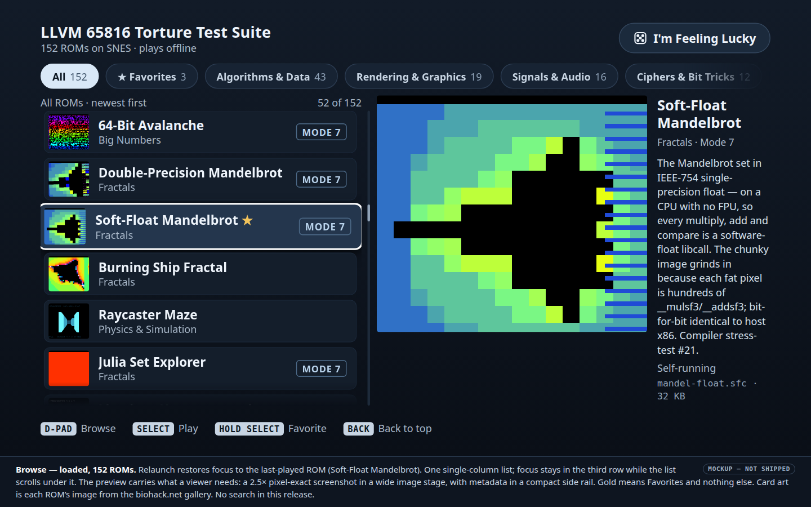](2026-10-26-snes-rom-library-selector/01-browse.html) | [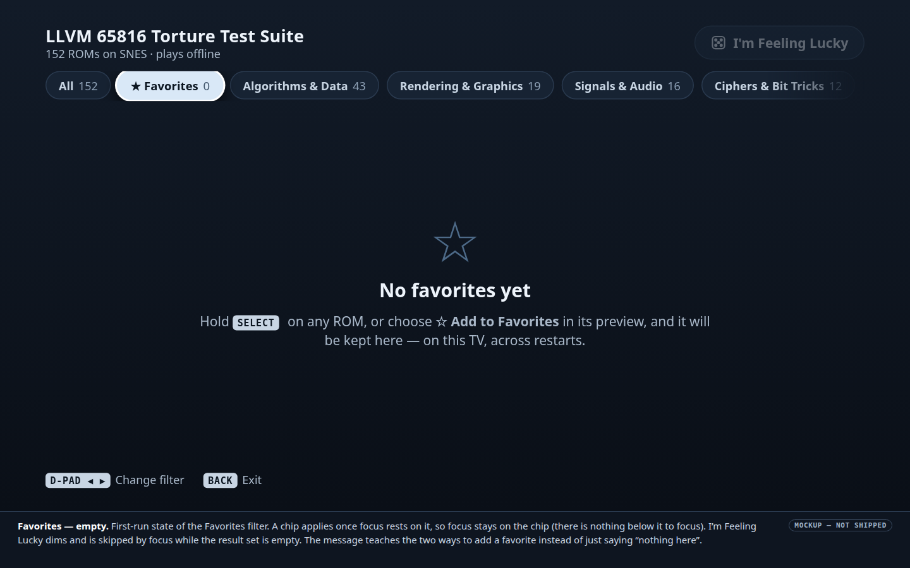](2026-10-26-snes-rom-library-selector/02-favorites-empty.html) |
| **Browse:** loaded, with focus restored to the last-played ROM | **Empty:** no favorites yet |
| [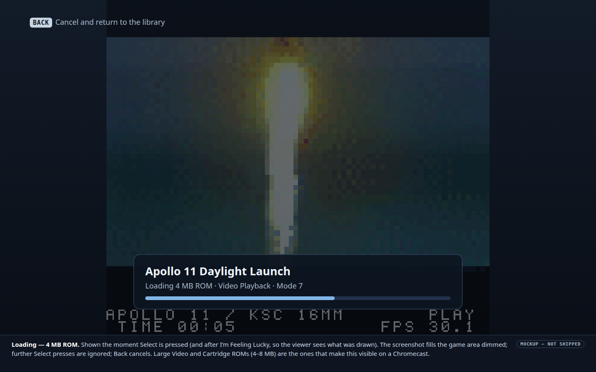](2026-10-26-snes-rom-library-selector/03-loading.html) | [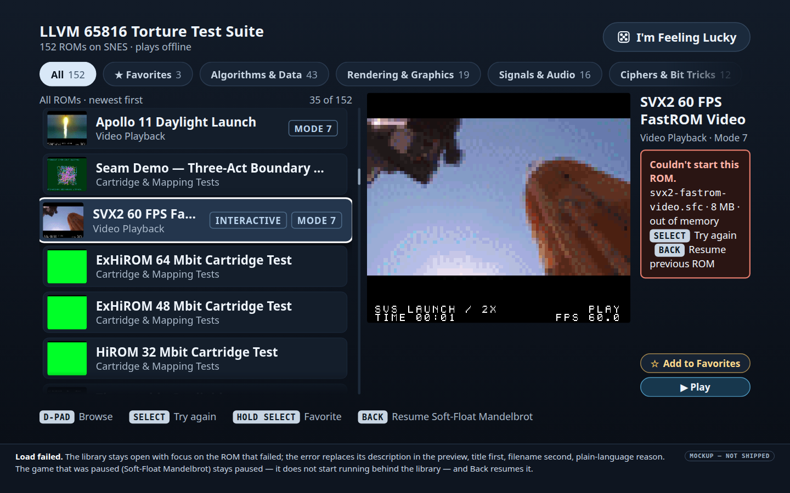](2026-10-26-snes-rom-library-selector/04-load-error.html) |
| **Loading:** a 4 MB ROM | **Error:** out of memory, previous game still paused |
| [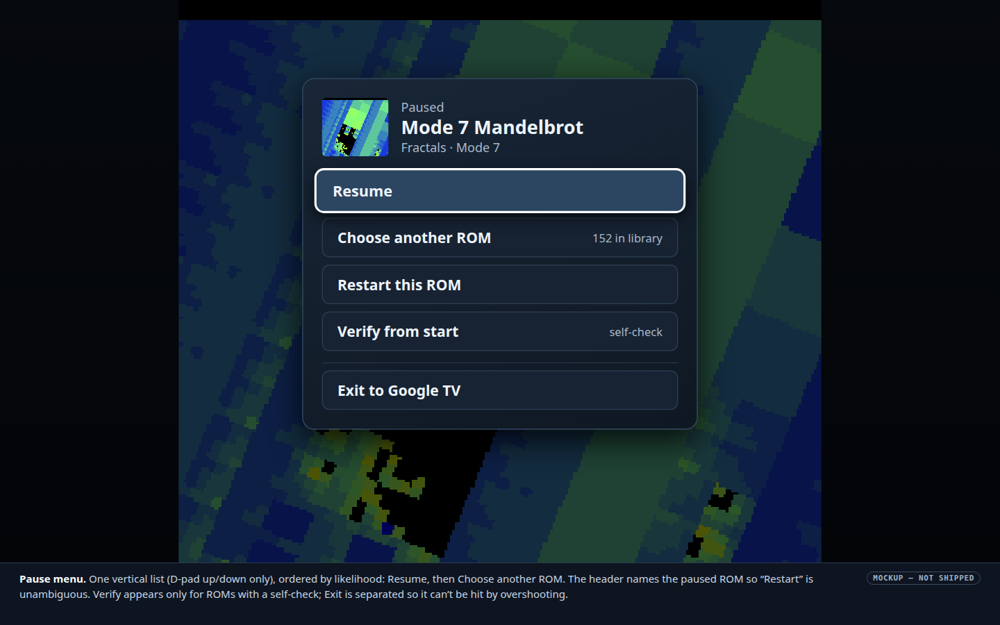](2026-10-26-snes-rom-library-selector/05-pause-menu.html) | [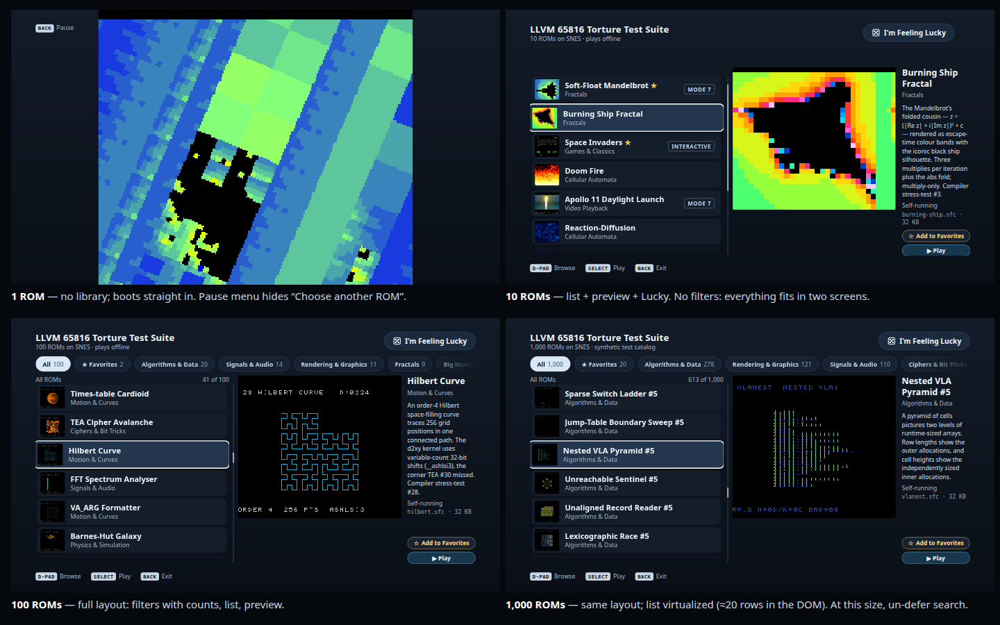](2026-10-26-snes-rom-library-selector/06-catalog-scale.html) |
| **Pause menu** | **Catalog scale:** 1 / 10 / 100 / 1,000 ROMs |

#### Pause menu across orientations

**Mockup update · 2026‑10‑28:** the pause menu now needs to show the newer random-ROM and app-sharing actions while keeping test controls visually separate from game navigation. These are proposed shell mockups, not device captures. The landscape version keeps the D-pad list centered over a dimmed game shell; the portrait version uses a near-full-width card with large rows and safe-area margins. “Cancel verification” replaces “Verify from start” while a run is active.

**Implementation update · 2026‑10‑28:** the shared Android pause-menu CSS now changes card width, text size, button targets, safe-area padding, and the action-list scroll limit in portrait. Landscape retains the compact centered card and scrolls its actions if a short viewport cannot fit them. Orientation changes are handled by CSS without restarting the activity. Hardware checks in both orientations remain pending.

**Pause-menu follow-up · 2026‑10‑28:** the portrait/landscape treatment is now applied to the library and standalone player variants. Player menus use the same SVG action icons and Diagnostics grouping; sharing is separated from Diagnostics and Exit. While verification is active, “Verify from start” is replaced by “Cancel verification,” and focus follows the active action. Build and device screenshots remain to be recorded in the proof section below.

| Landscape | Portrait |
|---|---|
| 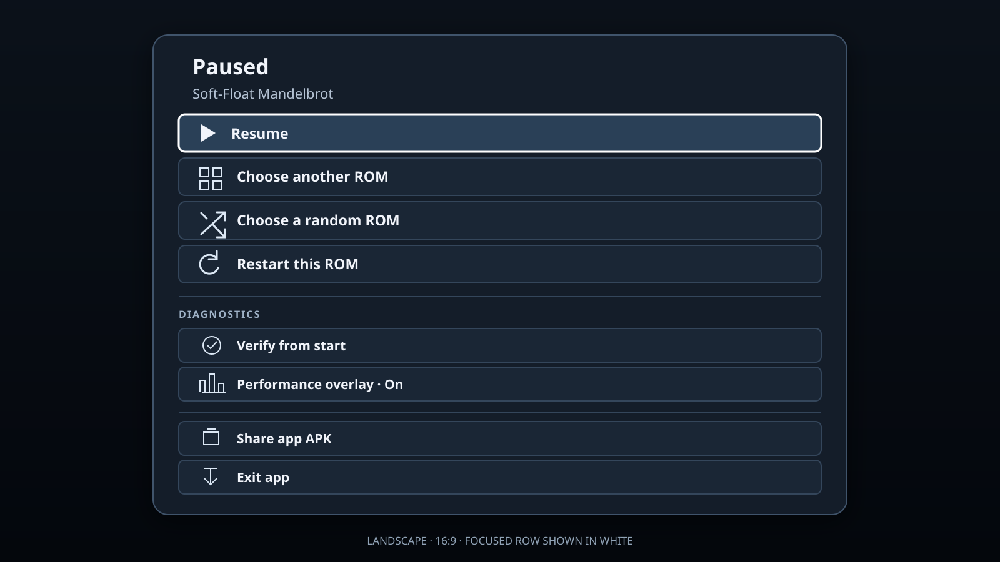 | 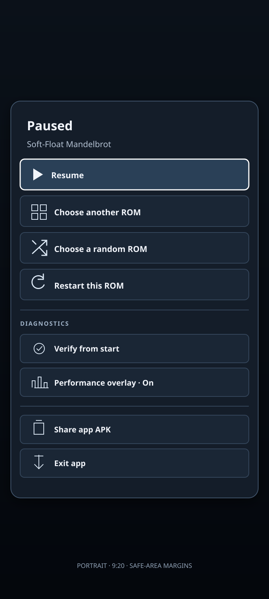 |

### Screen layout and visual rules

- **Canvas:** 1920×1080 px (960×540 dp). The safe area is 96 px left and right and 54 px top and bottom, and nothing interactive sits outside it.
- **Top bar:** the title and catalog count on the left, and the **I'm Feeling Lucky** button on the right.
- **Filter chips:** All, then ★ Favorites, then the categories from largest to smallest, each chip with its count.
- **List (left, 760 px wide):** each row is 100 px tall. It holds the card art (96×84 px), the title (30 px) and a 24 px secondary line, with tags on the right. The secondary line shows the category, or the first clause of the description when a category filter makes the category redundant. "N of M" sits above the list and a slim scroll bar runs beside it. The top of the next row shows below the last full row.
- **Preview (right, 932 px wide):** a 640×560 px image stage shows the full 256×224 screenshot at exactly 2.5× using nearest-neighbour scaling. The image fills the stage, with no crop, distortion or wide blank margins. A 268 px details rail beside it holds the title (34 px), category and Mode 7 status, description and controls with natural wrapping and no ellipsis, `slug.sfc · size` in monospace, and favorite/Play actions at the bottom. The rail scrolls independently only when a ROM's full details exceed its height.
- **Footer:** key hints that change with context and name only keys the remote has.
- **Type sizes:** no text below 24 px at 1080p (12 sp); titles are 30–36 px. In the mockups, secondary text measures 8.3:1 contrast on rows and 6.1:1 on the focused row.
- **Colour roles:**
    - There is exactly one focus treatment: a 4 px white ring, a lighter fill and a 3 % lift.
    - A selected chip has a solid light fill and no ring.
    - Gold means Favorites and nothing else.
    - Tags are neutral outlines: MODE 7, INTERACTIVE and ▶ PAUSED.
    - One optional addition is worth considering later: a BUG FOUND tag on the 13 `compilerBug` ROMs, which suits a torture-test suite.

### Input model

| Input | Library | Playing | Pause menu |
|---|---|---|---|
| D-pad | Moves focus (see the focus map below) | SNES D-pad | Moves |
| Select (tap) | Plays the focused ROM, or resumes it if it is the paused one | Unchanged (player `KEYMAP`) | Activates |
| Select (hold ≥ 500 ms) | Toggles the focused row's favorite without launching it | — | — |
| Back | Follows the Back ladder (below) | Opens the pause menu | Resumes |
| Gamepad, if paired (optional) | A = Select, B = Back, Y = favorite, L/R = previous/next filter | SNES pad | A/B |
| Keyboard (Pixel, desktop test) | Arrows, Enter and Esc | Existing `KEYMAP` | Arrows, Enter |

Gamepad support needs `MainActivity` to translate `KEYCODE_BUTTON_*` key events; the first release does not need it. The library layout is responsive across TV, phone, and tablet viewports in both supported orientations. Touch controls remain the same, while the library's list, filters, search, and preview reflow to fit the viewport.

### Focus and navigation

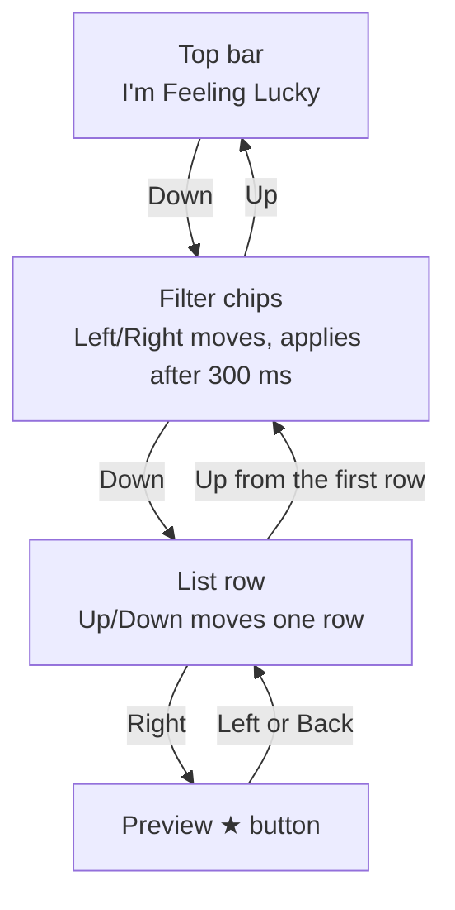

- **Initial focus:** on first launch, the first row. After that, the last-played ROM, with the filter reset to All.
- **List movement:** Up and Down move one row. Focus settles in the third visible row and the list scrolls under it. Holding a key repeats at the system rate, and the list does not wrap.
- **Moving between the list and the chips:** Up from the first row goes to the active chip. Down from the chips returns to the row that was focused last.
- **Chips:** Left and Right move between chips. A chip applies once focus has rested on it for 300 ms, as Google TV's own tabs do. Select on a chip moves focus into the list.
- **Preview button:** Right from a row goes to that ROM's ★ button, and Left or Back returns to the same row. The preview doesn't change while its button has focus.
- **Returning from the pause menu:** the library restores the previous filter and focused row (the paused ROM).

### Back ladder

Each Back press applies the first rule that matches:

1. If focus is on the preview's ★ button, focus returns to its row.
2. If a ROM is loading, the load is cancelled and focus returns to that row.
3. If a game is paused behind the library, the game resumes.
4. If the list is scrolled past its first screen, focus returns to the first row. The footer then reads "BACK Exit".
5. Otherwise the app exits to Google TV.

In a game, Back opens the pause menu, and in the pause menu, Back resumes the game. Both are unchanged.

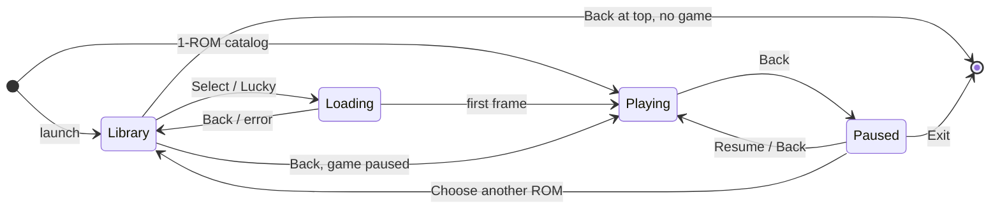

### Search

Not in this release (decision 3). The design, its mockups and the open question are in the deferred [search plan](2026-10-26-snes-rom-library-search.md).

### Favorites

- **Toggling:** hold Select on a row, or press the preview's ★ button. A 2 s toast confirms "Added to Favorites" or "Removed from Favorites".
- **Display:** a gold ★ follows the title on each favorite row, and the Favorites chip shows a count. If a star is removed while the Favorites filter is active, the row stays (with a hollow star) until the filter changes, so focus doesn't jump.
- **Storage:** `BjgAndroid.getPrefs()` and `setPrefs(json)` store `{ "favorites": [slug…], "lastPlayed": slug }` in SharedPreferences, and DOM storage stays off.
    - Slugs no longer in the catalog are kept but not counted, so a star comes back if its ROM returns.
    - Clearing the app's data resets them.

### I'm Feeling Lucky

- **Draw:** it picks from the active filter's ROMs using a shuffle bag. Nothing repeats until the set is exhausted, and the last-played ROM is skipped whenever at least two ROMs are available.
- **Edge cases:** with one result, it plays that ROM. With no results, the button is dimmed and focus skips it.
- **Feedback:** the loading card names the pick before the ROM starts.

### Launch, loading and failure

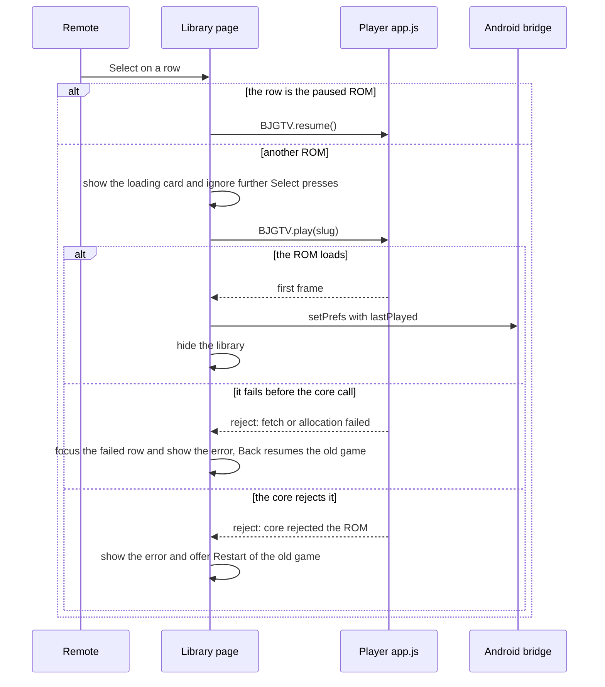

- **While the library is open:** any game stays paused and silent. Its row carries **▶ PAUSED**, and Select on that row resumes the game rather than restarting it. (Restart is in the pause menu.)
- **Loading:** Select shows the loading card at once, with the card art dimmed, the title, the size and a progress bar. Further Select presses are ignored, and Back cancels.
- **Failure:** the library returns with focus on the failed row. The preview reads *Couldn't start this ROM*, followed by the filename, the size and a plain-language reason.
    - If the load failed before the core call (fetch or memory allocation), the paused game is intact and Back resumes it.
    - If the core rejected the ROM, the previous game is already unloaded (`main.cpp:77`). The error then offers **Restart ⟨previous title⟩** instead, and the ▶ PAUSED tag is removed.

### Pause menu

The menu is a vertical list under a header that shows the card art, "Paused", the title, and the category with Mode 7 status. In order, it offers:

1. **Resume**
2. **Choose another ROM**
3. **Restart this ROM**
4. **Verify from start**, only for ROMs that have a self-check

**Exit to Google TV** sits below a divider. Back resumes the game. Choose another ROM opens the library on the paused ROM, with the previous filter kept.

### Catalog size

The catalog loaded at runtime decides the layout.

| ROMs | Library | Filter chips | I'm Feeling Lucky |
|---:|---|---|---|
| 1 | None: the ROM boots directly, and the pause menu hides Choose another ROM | — | — |
| 2–12 | List and preview | Hidden | Shown |
| 13+ (152 today) | Full layout | Shown if there are ≥ 2 categories | Shown |
| 1,000 | Full layout, with about 20 rows in the DOM at once | Shown | Shown |

Without search, about 1,000 ROMs is where scrolling becomes the bottleneck; that is the trigger to pick up the [search plan](2026-10-26-snes-rom-library-search.md).

Categories with no entries are hidden. For testing, a `?catalog=synthetic-N` dev parameter builds N records from the real ones.

### Performance on the Chromecast

- **Focus moves:** the title, tags and description update on every focus move. The large card art swaps only after focus rests for 120 ms, and the art for the 3 rows on either side is preloaded. Holding Down never queues a backlog of image decodes.
- **Rendering:** rows are virtualized, with about 20 in the DOM.
- **Timing to record on cast1:** time to the loading card (target: the same frame as the keypress), and time to the first frame for a 32 KB ROM and an 8 MB ROM. The 8 MB Video and Cartridge ROMs are the ones where loading will be visible.

### Accessibility

- The list is a `listbox` of `option` elements. Each option's accessible name reads like "Soft-Float Mandelbrot, Fractals, Mode 7, favorite, self-running".
- Result counts and toasts are `aria-live`.
- Focus is shown by a ring and a lift, not by colour alone.
- Run a TalkBack spot-check on cast1.

## Catalog sync, card art and APK

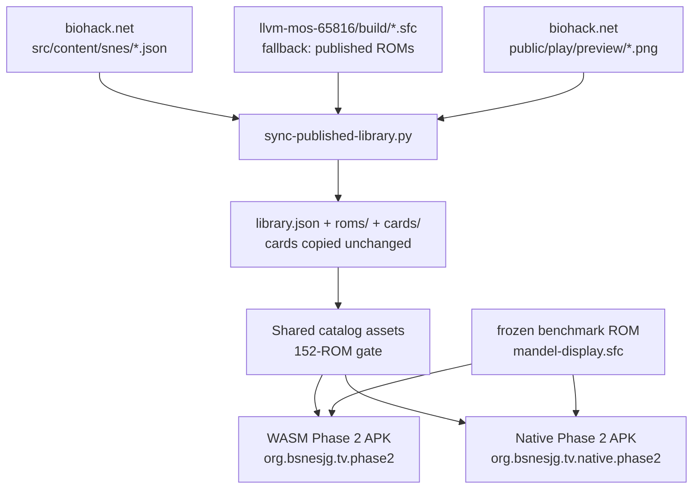

- **Sync script:** `android-tv/tools/sync-published-library.py` keeps its current behaviour: it is deterministic, prefers the llvm-mos bytes and rejects unsafe slugs. Each `library.json` record gains these fields:
    - `desc`, `keys` and `compilerBug`, copied from the content record.
    - `interactive`, which is true when `keys` starts with neither "Self-running" nor "No controls".
    - The card-art path and its SHA-256.
- **Card art:** copy `/play/preview/<slug>.png` from the biohack.net checkout to `cards/<slug>.png` without changing it. These are the images the site's gallery cards show. The sync fails if any is missing, as it does today. The frame‑600 capture, `cardFrame` and the title-card fallback are removed (decision 2).
- **Gradle:** both Phase 2 flavors stage the same catalog and have the same content gate:
    - 152 `.sfc` files, 152 `library.json` records and 152 cards.
    - Every ROM's SHA matches its record.
    - Nothing else under `assets/roms/`.

    The Release APKs are `wasm/release/bsnes-jg-wasm.apk` and `native/release/llvm-65816-torture-test-suite-snes.apk`. They differ by the engine adapter/core and native renderer while sharing UI and catalog.
- **Size:** both Phase 2 APKs include the 152-ROM library (42.6 MiB raw ROM data before compression) and card art. Record both actual download sizes; include the WASM/WebView versus native-library distinction in the comparison.
- **Direct boot for testing:** `MainActivity` accepts the `rom` intent extra and appends `?rom=<slug>`, so the coordinator can boot the same selected ROM in either engine.

## App icon decision

The LLVM compiler test ROMs are one grouped library inside one installable app. Provide **one launcher icon for the suite**, not a separate installable icon or app for each ROM. Individual ROMs appear as selectable entries only within the app. Each ROM's card art is in-app preview artwork shown when that entry has D-pad focus; card art is never an installable icon.

## Implementation outline

Rank: **T3**; implementation is in progress. The two decision changes add a **T2** follow-up: bounded edits to `sync-published-library.py` (copy the site's card images) and `library.js` (switch search off).

| File | Change |
|---|---|
| `android-tv/app/build.gradle.kts` | Stages the same sync output into both Phase 2 variants and verifies identical catalog/ROM/card hashes; keeps engine-specific core checks |
| `android-tv/tools/sync-published-library.py` | Adds the extra record fields, copies the site's card images unchanged, and adds a `--check` mode |
| `android-tv/app/src/main/assets/` | Holds the shared selector and stylesheet, with search switched off; the WASM and native assets provide different engine adapters |
| `android-tv/app/src/main/assets/tv.js` | Reworks the pause menu: vertical order, a header, Choose another ROM and the Restart path after a core failure |
| `android-tv/app/src/main/java/org/bsnesjg/tv/MainActivity.java` | Adds the `getPrefs`/`setPrefs` bridge and the `rom` intent extra, plus optional gamepad key translation |
| `android-tv/test/library-ui.test.mjs` (new) | Drives the library in headless Chromium at 1920×1080 with arrow keys and synthetic catalogs |

`BJGTV.play` already returns `playUrl`'s promise. It needs at most a rejection reason that says whether the core was reached.

## Verification

1. Run the library UI in headless Chromium: `node --test android-tv/test/library-ui.test.mjs`. The test must cover:
    - focus starts on row 1 on first launch, and is restored to `lastPlayed` on later launches;
    - no Search field is shown;
    - every Back-ladder rule;
    - Hold Enter toggles a favorite without launching;
    - I'm Feeling Lucky draws 4 distinct ROMs in 4 draws from a 4-ROM set;
    - the empty-Favorites state;
    - the 1/10/100/1,000 layout thresholds;
    - at most 30 rows in the DOM with 1,000 ROMs.
2. Check sync and card art: `python3 android-tv/tools/sync-published-library.py --output /tmp/lib --check` reports 152 records and 152 cards. Each card is byte-identical to `../biohack.net/public/play/preview/<slug>.png`.
3. Build with `task android-tv:build`. Both Phase 2 APK artifact gates must verify all 152 ROM files, 152 cards, the same catalog, and the direct-boot fixture. Record both APK sizes.
4. Register both APKs with the coordinator and install them side by side. Confirm the separate package IDs and launcher artwork; test app launch separately because an icon does not prove the runtime works.
5. Walk through the UI on cast1 with coordinator-owned input and capture workflows. Preserve screenshots for each mockup state; do not use raw device commands.
6. Check persistence: star 2 ROMs, use the coordinator to stop and relaunch each engine variant. Both stars survive, and focus returns to the last-played ROM.
7. Check offline play: disable Wi-Fi on cast1, launch, and play a 32 KB ROM, an 8 MB ROM and an I'm Feeling Lucky pick.
8. Check that every ROM boots: loop over all 152 slugs with the `rom` intent extra and assert a non-blank frame after 120 frames. Record the time to the first frame for `mandel-display` and `svx2-fastrom-video`.
9. Spot-check TalkBack on cast1: a row, a chip and the pause menu read correctly.

## Appendix: published ROM inventory (snapshot 2026‑10‑26)

The complete 152-row inventory, with one small inline card screenshot per ROM, is in the [published ROM inventory](2026-10-26-snes-rom-library-rom-inventory.md). After decision 2, the images are the site's gallery card images, not app screenshots. The inventory is generated from the staged `library.json` with `python3 android-tv/tools/generate-rom-inventory-doc.py`.

The generated inventory records title, slug, category and ROM size for each card. `MODE 7` is included in the catalog record when `displayMode: 7`.

<!-- Inventory rows are maintained in the linked generated document. -->

<!--
| ROM file | Published title | Category | Size | Badge |
|---|---|---|---:|---|
| `ovmatrix.sfc` | Overflow Family Matrix | Big Numbers | 32,768 B |  |
| `byvaledge.sfc` | By-Value Boundary Trio | Algorithms & Data | 32,768 B |  |
| `jtsparse.sfc` | Sparse Switch Ladder | Algorithms & Data | 32,768 B |  |
| `jtedge.sfc` | Jump-Table Boundary Sweep | Algorithms & Data | 32,768 B |  |
| `vlanest.sfc` | Nested VLA Pyramid | Algorithms & Data | 32,768 B |  |
| `trapguard.sfc` | Unreachable Sentinel | Algorithms & Data | 32,768 B |  |
| `packrec.sfc` | Unaligned Record Reader | Algorithms & Data | 32,768 B |  |
| `strcmprace.sfc` | Lexicographic Race | Algorithms & Data | 32,768 B |  |
| `bsearchviz.sfc` | Bisection Oracle | Algorithms & Data | 32,768 B |  |
| `dblbridge.sfc` | Precision Bridge | Big Numbers | 65,536 B |  |
| `bigbyval.sfc` | Affine Stage Pipeline | Rendering & Graphics | 32,768 B |  |
| `borrowov.sfc` | Reservoir Ladder | Algorithms & Data | 32,768 B |  |
| `vlastack.sfc` | Run-Length Scanline Decoder | Rendering & Graphics | 32,768 B |  |
| `jt256.sfc` | ISA-256 Bytecode Machine | Algorithms & Data | 32,768 B |  |
| `dpbank.sfc` | Bank/Direct-Page Windows | Signals & Audio | 32,768 B |  |
| `irqgate.sfc` | IRQ Gate | Signals & Audio | 32,768 B |  |
| `retryjmp.sfc` | Retry-On-Fault Ladder | Algorithms & Data | 32,768 B |  |
| `csrjmp.sfc` | Callee-Saved Restore Curve | Motion & Curves | 32,768 B |  |
| `backtrack.sfc` | Backtracking Solver | Algorithms & Data | 32,768 B |  |
| `brkcop.sfc` | Software Vectors | Signals & Audio | 32,768 B |  |
| `farptrcmp.sfc` | Far-Pointer Order Shuffle | Algorithms & Data | 524,288 B |  |
| `bankwalk.sfc` | 64K Bank-Boundary Walk | Signals & Audio | 524,288 B |  |
| `modethread.sfc` | Threaded Mode Interpreter | Algorithms & Data | 32,768 B |  |
| `isrbracket.sfc` | Mid-Bracket NMI Tunnel | Signals & Audio | 32,768 B |  |
| `llabs64.sfc` | Seismograph Absolute Trace | Signals & Audio | 32,768 B |  |
| `shift64seam.sfc` | 64-Bit Limb-Seam Barrel | Ciphers & Bit Tricks | 32,768 B |  |
| `bitboard64.sfc` | Bitboard Knight Tour | Algorithms & Data | 32,768 B |  |
| `farspill.sfc` | Far-Pointer Spill Funnel | Signals & Audio | 65,536 B |  |
| `absdiff.sfc` | Motion-Detect Difference Field | Signals & Audio | 32,768 B |  |
| `asmisland.sfc` | Inline-Asm Island | Signals & Audio | 32,768 B |  |
| `mixedwidth.sfc` | Split-Personality Link | Signals & Audio | 32,768 B |  |
| `nmitally.sfc` | VBlank Interrupt Tally | Signals & Audio | 32,768 B |  |
| `apollo-daylight.sfc` | Apollo 11 Daylight Launch | Video Playback | 4,194,304 B | MODE 7 |
| `seamdemo.sfc` | Seam Demo — Three-Act Boundary Cartridge | Cartridge & Mapping Tests | 6,291,456 B |  |
| `svx2-fastrom-video.sfc` | SVX2 60 FPS FastROM Video | Video Playback | 8,388,608 B | MODE 7 |
| `cartsize-exhirom-8m.sfc` | ExHiROM 64 Mbit Cartridge Test | Cartridge & Mapping Tests | 8,388,608 B |  |
| `cartsize-exhirom-6m.sfc` | ExHiROM 48 Mbit Cartridge Test | Cartridge & Mapping Tests | 6,291,456 B |  |
| `cartsize-hirom-4m.sfc` | HiROM 32 Mbit Cartridge Test | Cartridge & Mapping Tests | 4,194,304 B |  |
| `cardioid.sfc` | Times-table Cardioid | Motion & Curves | 32,768 B |  |
| `tea.sfc` | TEA Cipher Avalanche | Ciphers & Bit Tricks | 32,768 B |  |
| `hilbert.sfc` | Hilbert Curve | Motion & Curves | 32,768 B |  |
| `fft.sfc` | FFT Spectrum Analyser | Signals & Audio | 32,768 B |  |
| `vaprintf.sfc` | VA_ARG Formatter | Motion & Curves | 32,768 B |  |
| `bhut.sfc` | Barnes-Hut Galaxy | Physics & Simulation | 32,768 B |  |
| `fn-plot.sfc` | Function Plotter | Fractals | 32,768 B |  |
| `lsystem.sfc` | L-System Plant | Fractals | 32,768 B |  |
| `truchet.sfc` | Truchet · Packed Bitfields | Ciphers & Bit Tricks | 32,768 B |  |
| `turtle-vm.sfc` | Bytecode-VM Turtle | Games & Classics | 32,768 B |  |
| `boids.sfc` | Boids Flock | Physics & Simulation | 32,768 B |  |
| `avalanche.sfc` | 64-Bit Avalanche | Big Numbers | 32,768 B | MODE 7 |
| `mandel-double.sfc` | Double-Precision Mandelbrot | Fractals | 65,536 B | MODE 7 |
| `mandel-float.sfc` | Soft-Float Mandelbrot | Fractals | 32,768 B | MODE 7 |
| `burning-ship.sfc` | Burning Ship Fractal | Fractals | 32,768 B |  |
| `raycaster.sfc` | Raycaster Maze | Physics & Simulation | 32,768 B |  |
| `julia.sfc` | Julia Set Explorer | Fractals | 32,768 B | MODE 7 |
| `harmonograph.sfc` | Lissajous Harmonograph | Motion & Curves | 32,768 B |  |
| `life.sfc` | Conway's Game of Life | Cellular Automata | 32,768 B |  |
| `epicycles.sfc` | Fourier Epicycles | Motion & Curves | 32,768 B |  |
| `maze.sfc` | Maze Generate + Solve | Algorithms & Data | 32,768 B |  |
| `sort-race.sfc` | Sorting Race | Algorithms & Data | 32,768 B |  |
| `doom-fire.sfc` | Doom Fire | Cellular Automata | 32,768 B |  |
| `cordic.sfc` | CORDIC Rotator | Motion & Curves | 32,768 B |  |
| `buddhabrot.sfc` | Buddhabrot | Fractals | 32,768 B | MODE 7 |
| `newton.sfc` | Newton's Fractal | Fractals | 32,768 B |  |
| `factorial.sfc` | Bignum Factorial | Big Numbers | 32,768 B |  |
| `rdiff.sfc` | Reaction-Diffusion | Cellular Automata | 32,768 B |  |
| `n-body.sfc` | N-body Orbits | Physics & Simulation | 32,768 B |  |
| `1d-ca.sfc` | 1-D Cellular Automaton | Cellular Automata | 32,768 B |  |
| `double-pendulum.sfc` | Double Pendulum (Chaos) | Physics & Simulation | 32,768 B |  |
| `spigot.sfc` | π Spigot + Monte-Carlo | Big Numbers | 32,768 B |  |
| `3d-wireframe.sfc` | Wireframe 3-D Solid | Physics & Simulation | 32,768 B |  |
| `spirograph.sfc` | Spirograph | Motion & Curves | 32,768 B |  |
| `space-invaders.sfc` | Space Invaders | Games & Classics | 32,768 B |  |
| `blossom.sfc` | Blossom | Games & Classics | 32,768 B | MODE 7 |
| `bf-vm.sfc` | Brainfuck Threaded-Code VM | Games & Classics | 32,768 B |  |
| `hdr-bloom.sfc` | HDR Additive Bloom | Rendering & Graphics | 32,768 B |  |
| `iir-scope.sfc` | IIR Resonant-Filter Scope | Signals & Audio | 32,768 B |  |
| `polyfill.sfc` | Polygon Scanline Fill (VLA) | Rendering & Graphics | 32,768 B |  |
| `seqvm.sfc` | Step-Sequencer VM (Sparse Switch) | Signals & Audio | 32,768 B |  |
| `divclock.sfc` | Division Clock + Odometer | Games & Classics | 32,768 B |  |
| `crctex.sfc` | CRC32 Hash-Marble Texture | Rendering & Graphics | 32,768 B |  |
| `poolfx.sfc` | Free-List Pool Allocator | Games & Classics | 32,768 B |  |
| `duff.sfc` | Duff Dissolve | Algorithms & Data | 32,768 B |  |
| `sodo.sfc` | Signed 64-bit Odometer | Big Numbers | 32,768 B |  |
| `metaball.sfc` | Type-Pun Metaballs | Rendering & Graphics | 32,768 B |  |
| `qsortviz.sfc` | qsort Sort Visualizer | Algorithms & Data | 32,768 B |  |
| `nrecip.sfc` | Newton Reciprocal Floor | Rendering & Graphics | 32,768 B |  |
| `lzdec.sfc` | LZ77 Decompress Reveal | Algorithms & Data | 32,768 B |  |
| `cgrade.sfc` | Many-Arg Color Grade | Rendering & Graphics | 32,768 B |  |
| `critters.sfc` | Protothread Critters | Games & Classics | 32,768 B |  |
| `disbits.sfc` | Cross-Byte Bitfields | Ciphers & Bit Tricks | 32,768 B |  |
| `bitcensus.sfc` | Bit-Census Field | Ciphers & Bit Tricks | 32,768 B |  |
| `funnelkal.sfc` | Funnel-Shift Kaleidoscope | Rendering & Graphics | 32,768 B |  |
| `bitshuffle.sfc` | Perfect-Shuffle Transition | Ciphers & Bit Tricks | 32,768 B |  |
| `gf256.sfc` | GF(2⁸) Galois Field | Ciphers & Bit Tricks | 32,768 B |  |
| `rotozoom.sfc` | Rotozoom | Rendering & Graphics | 32,768 B |  |
| `medfilt.sfc` | Median Denoiser | Rendering & Graphics | 32,768 B |  |
| `domcol.sfc` | Domain Colouring | Fractals | 32,768 B |  |
| `cosmzoom.sfc` | Cosmic Zoom Ruler | Big Numbers | 32,768 B |  |
| `multibase.sfc` | Multi-Base Clock | Big Numbers | 32,768 B |  |
| `dhmix.sfc` | Diffie-Hellman Colour-Mixer | Big Numbers | 32,768 B |  |
| `percol.sfc` | Union-Find Percolation | Cellular Automata | 32,768 B |  |
| `fenwick.sfc` | Fenwick Tree | Algorithms & Data | 32,768 B |  |
| `radix.sfc` | Radix Sort | Algorithms & Data | 32,768 B |  |
| `hull.sfc` | Convex Hull | Algorithms & Data | 32,768 B |  |
| `editdist.sfc` | Edit-Distance DP | Algorithms & Data | 32,768 B |  |
| `huffman.sfc` | Huffman Decode | Algorithms & Data | 32,768 B |  |
| `perlin.sfc` | Perlin Noise | Rendering & Graphics | 32,768 B |  |
| `gouraud.sfc` | Gouraud Triangle | Rendering & Graphics | 32,768 B |  |
| `dither.sfc` | Floyd-Steinberg Dither | Rendering & Graphics | 32,768 B |  |
| `msquares.sfc` | Marching Squares | Cellular Automata | 32,768 B |  |
| `grid3d.sfc` | 3-D Grid Voxel Life | Cellular Automata | 32,768 B |  |
| `fabsridge.sfc` | Fabs Ridgeline | Rendering & Graphics | 32,768 B |  |
| `compass.sfc` | Copysign Compass | Motion & Curves | 32,768 B |  |
| `speedcap.sfc` | Fmin/Fmax Speed Cap | Physics & Simulation | 32,768 B |  |
| `truncstair.sfc` | Truncation Staircase | Algorithms & Data | 32,768 B |  |
| `montorbit.sfc` | Montgomery Orbit | Ciphers & Bit Tricks | 32,768 B |  |
| `ulam.sfc` | Ulam Prime Sieve | Algorithms & Data | 32,768 B |  |
| `rangecode.sfc` | Range Coder | Algorithms & Data | 32,768 B |  |
| `sobel.sfc` | Sobelscope | Rendering & Graphics | 32,768 B |  |
| `dctbloom.sfc` | DCT Bloom | Signals & Audio | 32,768 B |  |
| `adpcm.sfc` | ADPCM Waverider | Signals & Audio | 32,768 B |  |
| `scopeguard.sfc` | Scope-Guard Ripple Tank | Algorithms & Data | 32,768 B |  |
| `matcascade.sfc` | Matrix Cascade | Rendering & Graphics | 32,768 B |  |
| `plyoracle.sfc` | PlyOracle | Games & Classics | 32,768 B |  |
| `smulorbit.sfc` | Signed Multiply-Overflow Orbit | Motion & Curves | 32,768 B |  |
| `satcomet.sfc` | Saturating Comet Trails | Motion & Curves | 32,768 B |  |
| `rotkal.sfc` | Rotate-Register Kaleidoscope | Rendering & Graphics | 32,768 B |  |
| `satcast.sfc` | Saturating-Cast Kaleidoscope | Rendering & Graphics | 32,768 B |  |
| `sbitfld.sfc` | Signed-Bitfield Terrain | Algorithms & Data | 32,768 B |  |
| `mvscrl.sfc` | Memmove Scroll Slabs | Algorithms & Data | 32,768 B |  |
| `borrowlad.sfc` | Borrow-Ladder Odometer | Big Numbers | 32,768 B |  |
| `mulov64.sfc` | 64-bit Multiply-Overflow | Big Numbers | 32,768 B |  |
| `modexp256.sfc` | 256-bit Modular Exponentiation | Algorithms & Data | 32,768 B |  |
| `pcooker.sfc` | Pressure-Cooker Fixed-Point Evaluator | Algorithms & Data | 32,768 B |  |
| `oddmask.sfc` | Odd-Width Mask Sculptor | Algorithms & Data | 32,768 B |  |
| `keycmp64.sfc` | 64-bit Multi-Key Record Sort | Algorithms & Data | 32,768 B |  |
| `trimerge.sfc` | Three-Way Merge Diff | Algorithms & Data | 32,768 B |  |
| `ucmprank.sfc` | Unsigned Rank Percentile Field | Algorithms & Data | 32,768 B |  |
| `ropeedit.sfc` | Gap-Buffer Rope Editor | Algorithms & Data | 32,768 B |  |
| `permscat.sfc` | Gather-Scatter Permutation | Algorithms & Data | 32,768 B |  |
| `rotslab.sfc` | In-Place Block Rotate | Algorithms & Data | 32,768 B |  |
| `ovmove.sfc` | Overlap-Move Mosaic | Algorithms & Data | 32,768 B |  |
| `spaceship.sfc` | Width-Sweep Sort Gallery | Algorithms & Data | 32,768 B |  |
| `uarteye.sfc` | Bit-Banged UART Eye | Ciphers & Bit Tricks | 32,768 B |  |
| `bitweave.sfc` | Serial Bit-Reversal Weave | Ciphers & Bit Tricks | 32,768 B |  |
| `lfsr2.sfc` | Dual-LFSR Scrambler | Ciphers & Bit Tricks | 32,768 B |  |
| `crcwall.sfc` | Bit-Serial CRC Wall | Ciphers & Bit Tricks | 32,768 B |  |
| `cpu6502.sfc` | 6502 CPU Simulator | Games & Classics | 32,768 B |  |
| `mandel-oop.sfc` | Mode 7 Mandelbrot (OOP) | Fractals | 32,768 B | MODE 7 |
| `mandel-display.sfc` | Mode 7 Mandelbrot | Fractals | 32,768 B | MODE 7 |
| `lzss-gallery.sfc` | LZSS Mode 7 Gallery | Algorithms & Data | 1,048,576 B | MODE 7 |
-->
