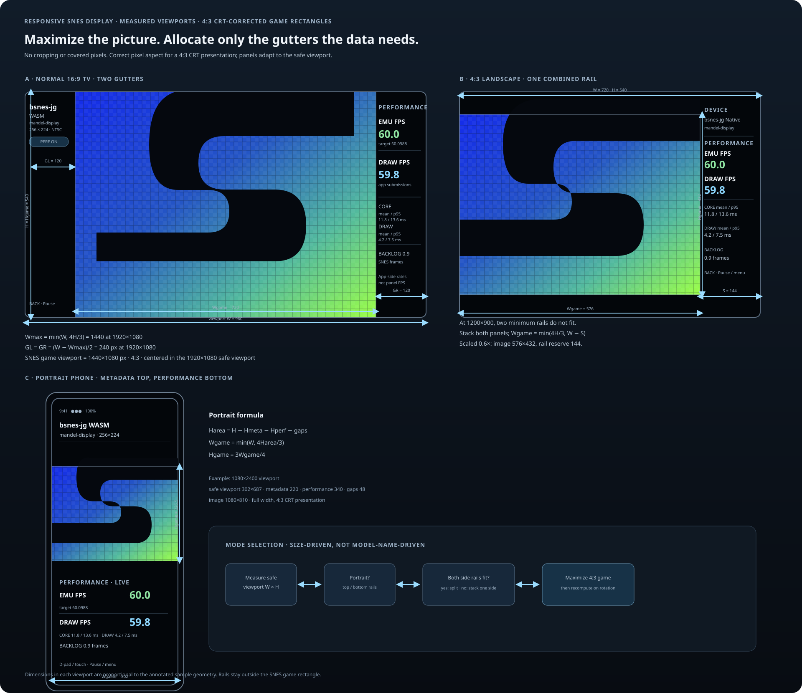
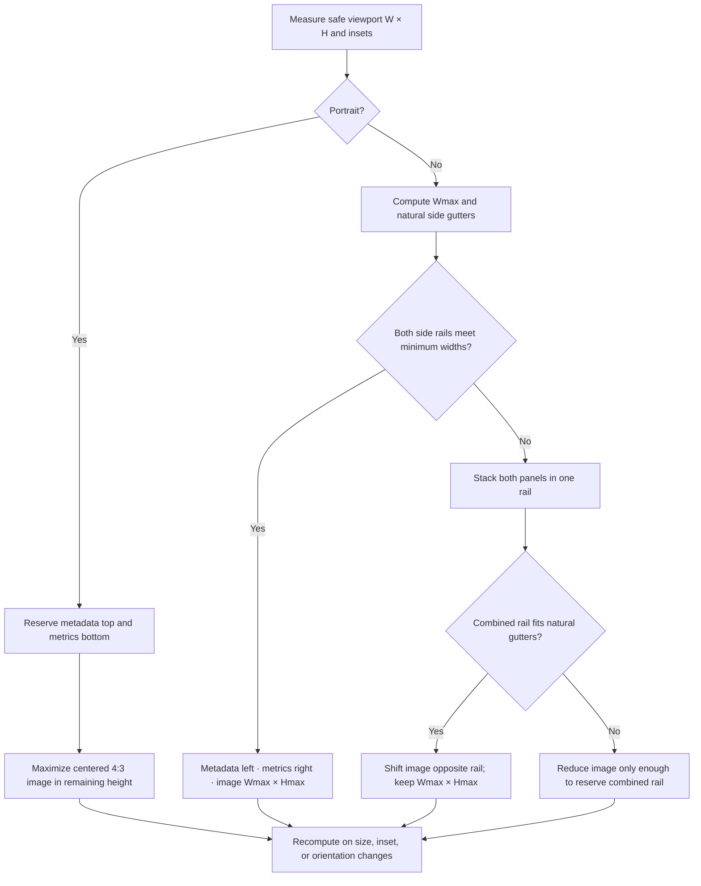

# Plan — Resolution-adaptive SNES display and side panels

**Status:** Implementation and viewport review in progress. Android WASM and Native share the same responsive CSS and layout calculation; the Native surface receives the same normalized game rectangle as the WASM canvas. Browser WASM has a separate browser page and must follow the same 4:3 game geometry and device/orientation review matrix.

## Goal

Show the complete SNES picture as large as the device permits, with the horizontal pixel-aspect correction needed for its traditional 4:3 presentation and without cropping or covering source pixels. Reserve only the space required for ROM metadata and performance metrics. Use both side gutters on a normal 16:9 screen; on ratios where two rails would make the game smaller than necessary, stack metadata and metrics in one rail. Phones and tablets must also have a portrait layout.

## High-fidelity mockups

The mockups show three calculated layouts: a 1920×1080 TV with two gutters, a 1200×900 landscape device with one combined rail, and a 1080×2400 portrait phone with metadata above the game and metrics below it. Every game rectangle uses the 4:3 display aspect. Dimension arrows label viewport variables and the measured example sizes.



Open the [browser plan and mockups](2026-10-27-responsive-snes-display.html) for the annotated flowchart and larger diagrams.

## Geometry and formulas

All measurements use the app's **safe content viewport** after Android system insets. Let `W` and `H` be its width and height in CSS-independent layout units, and let `A = 4/3` be the intended SNES display aspect ratio.

### Sample grid and TV display aspect

The common SNES framebuffer has 256×224 samples, a raw grid ratio of `256/224 = 8/7`. An original Super Nintendo was normally viewed on a 4:3 CRT television. The CRT's non-square pixel display made the complete game picture appear 4:3; Nintendo's own SNES display options distinguish this original 4:3 look, with slight horizontal expansion, from square-pixel mode. Therefore the responsive target here is a 4:3 game rectangle. Keep all source samples visible and scale the full image to 4:3; this is aspect correction for the original display, not stretching to fit a modern device. The device aspect ratio determines only the picture size and surrounding gutters.

The largest possible picture before reserving panels is:

```text
Wmax = min(W, A × H)
Hmax = Wmax / A
Gtotal = W − Wmax
```

Do not crop or distort the picture away from the 4:3 target. Apply the horizontal pixel-aspect correction from the 8:7 sample grid to 4:3 output. Panel widths and heights are fluid, but each mode has a minimum readable size: `Mmin` for metadata, `Pmin` for performance, `Smin` for the combined rail, and `gap` for safe separation from the image. Those minima use text metrics and accessibility settings rather than device model or native pixel resolution.

### Landscape, two rails

Use this on normal 16:9 screens when both rails fit in the natural 4:3 side gutters. The game remains at `Wmax × Hmax` and centered.

```text
GL = GR = (W − Wmax) / 2
twoRails = (GL ≥ Mmin + gap) AND (GR ≥ Pmin + gap)
```

For 1920×1080:

```text
Wmax = min(1920, 4/3 × 1080) = 1440
Hmax = 1080
GL = GR = (1920 − 1440) / 2 = 240
```

Metadata occupies the left gutter; performance metrics occupy the right. Neither overlays or reduces the picture.

### Landscape, one combined rail

If either natural gutter is too narrow for its content, stack metadata and performance in one side rail. Prefer the side with more safe width; use the right side when the available widths are equal. This needs `max(Mmin, Pmin)` width rather than the sum of two independent rails.

```text
S = max(Mmin, Pmin) + 2 × gap
Wgame = min(Wmax, W − S)
Hgame = Wgame / A
```

For a 1200×900 landscape device, with `S = 240`:

```text
Wmax = min(1200, 4/3 × 900) = 1200
Gtotal = 1200 − 1200 = 0   # no natural side gutters for two readable rails
Wgame = min(1200, 1200 − 240) = 960
Hgame = 960 × 3/4 = 720
```

The game is shifted opposite the combined rail. If `Gtotal` is smaller than `S`, reduce the game only by the exact amount needed to make room. Preserve its center within the remaining game area.

### Portrait, top and bottom rails

Allow sensor-driven portrait orientation on phones and tablets. Put metadata in a compact top rail and performance metrics in a bottom rail. Center the largest 4:3 game rectangle in the remaining safe viewport.

```text
HgameArea = H − Hmetadata − Hperformance − 2 × gap
Wgame = min(W, A × HgameArea)
Hgame = Wgame / A
```

For a 1080×2400 portrait viewport, with 220 px of metadata, 340 px of metrics, and 24 px gaps:

```text
HgameArea = 2400 − 220 − 340 − 48 = 1792
Wgame = min(1080, 4/3 × 1792) = 1080
Hgame = 810
```

The image uses the full available width at 1080×810; remaining vertical space stays as safe spacing around the rails. For short portrait windows, reduce panel padding and type size to their readable minimums before reducing `Wgame`.

### Common resolution examples

These are representative panel resolutions, not promises about any specific model. Calculations assume the listed dimensions are the safe app viewport with no system insets; on a device, substitute the measured safe viewport. For landscape examples, the minimum panel width is 120 px and the image-to-panel gap is 24 px, so each separate rail needs 144 px and the combined rail reserve is `S = 120 + 2×24 = 168 px` (use `S=240 px` in the 1200×900 example above, whose panels need more room). TV examples maximize the 4:3 game image and split the remaining width equally. Phone and portrait-tablet examples use top/bottom rails scaled from the 1080×2400 illustration: metadata is 9.17% of viewport height, performance is 14.17%, and the two minimum gaps total 2%. The remaining vertical space is centered around the image. These rail values are geometric examples; actual readable panel minima come from density, text size, and accessibility settings.

| Device class | Aspect ratio (width / height, descending) | Layout thumbnail | Safe viewport (px) | Panel width minima / combined reserve (px) | SNES game viewport (px) | Primary gutter (px) | Secondary gutter (px) |
|---|---:|:---:|---:|---:|---:|---:|---:|
| HD TV, landscape | 16:9 (1.7778) |  | 1280 × 720 | 120 / 120 | 960 × 720 | 160 | 160 |
| Full HD TV, landscape | 16:9 (1.7778) |  | 1920 × 1080 | 120 / 120 | 1440 × 1080 | 240 | 240 |
| UHD TV, landscape | 16:9 (1.7778) |  | 3840 × 2160 | 120 / 120 | 2880 × 2160 | 480 | 480 |
| Tablet, landscape | 16:10 (1.6000) |  | 1280 × 800 | combined reserve 168 | 1067 × 800 | 191 (rail side) | 23 |
| Samsung Galaxy Tab A11+, landscape | 16:10 (1.6000) |  | 1920 × 1200 | 120 / 120 | 1600 × 1200 | 160 | 160 |
| Samsung Galaxy Tab S11, landscape | 16:10 (1.6000) |  | 2560 × 1600 | 120 / 120 | 2133 × 1600 | 213 | 213 |
| Apple 11-inch iPad Pro, landscape | 605:417 (1.4508) |  | 2420 × 1668 | combined rail 168 | 2224 × 1668 | 182 (rail side) | 14 |
| Apple iPad (A16), landscape | 59:41 (1.4390) |  | 2360 × 1640 | combined rail 168 | 2187 × 1640 | 171 (rail side) | 3 |
| Tablet, landscape | 4:3 (1.3333) |  | 2048 × 1536 | combined rail 168 | 1880 × 1410 | 168 (rail side) | 0 |
| Samsung Galaxy Tab S11, portrait | 10:16 (0.6250) |  | 1600 × 2560 | 235 / 363 | 1600 × 1200 | 355 (top) | 355 (bottom) |
| Phone, portrait | 195:422 (0.4621) |  | 1170 × 2532 | 232 / 359 | 1170 × 878 | 507 (top) | 507 (bottom) |
| Phone, portrait | 9:20 (0.4500) |  | 720 × 1600 | 147 / 227 | 720 × 540 | 327 (top) | 327 (bottom) |
| Phone, portrait | 9:20 (0.4500) |  | 1080 × 2400 | 220 / 340 | 1080 × 810 | 491 (top) | 491 (bottom) |
| Phone, portrait | 9:20 (0.4500) |  | 1440 × 3200 | 293 / 453 | 1440 × 1080 | 655 (top) | 655 (bottom) |

For every row, `Wgame / Hgame = 4/3` before rounding dimensions to whole pixels. Primary is left and secondary right in landscape when gutters are symmetric; when a combined rail is used, primary is the rail side and secondary is the opposite free gutter. In portrait, primary is the top gutter and secondary the bottom gutter. Portrait values are the extra spacing around the centered image beyond the panel rails and minimum gaps. Landscape tablet examples use 120 px panel minima and 24 px gaps. A 256×224 source maps to the full game viewport with an effective horizontal sample scale 7/6 of the vertical scale, compensating its 8:7 grid to the original 4:3 TV picture. Display-resolution references: [Apple iPad (A16)](https://support.apple.com/en-us/122240), [Apple 11-inch iPad Pro](https://www.apple.com/ipad-pro/specs/), and [Samsung Galaxy Tab comparison](https://www.samsung.com/us/tablets/compare/).

## Layout selection flow



## One geometry source

1. Measure the actual app content bounds and safe insets. Do not infer dimensions from Chromecast/phone model names, fixed 1920×1080 values, or density assumptions.
2. Implement a single layout decision contract that returns the mode, game rectangle, metadata rectangle, and performance rectangle. Android WASM applies it in CSS pixels; Android Native converts the same normalized rectangle into Android surface pixels. Browser WASM keeps its browser controls but uses the same 4:3 game aspect across inline and fullscreen views.
3. Keep the Android Native surface exactly at the returned game rectangle. Keep the WebView overlay root full-window but clip each panel to its returned panel rectangle. On WASM, use the same game rectangle for the canvas and the same panel rectangles for metadata and metrics.
4. Recompute after window size, orientation, display cutout, or system-inset changes. Animate geometry changes only after both the game surface and panel bounds have been updated, so no intermediate frame stretches the SNES image.
5. Leave TVs in their natural landscape orientation. Let phones and tablets rotate; retain the same remote, touch, and pause controls in either orientation.

## High-accuracy review views

- **16:9 TV:** two side gutters; game fills the available height at 4:3; metadata left and performance right. This is the preferred normal TV composition.
- **4:3 landscape device:** one combined rail; metadata and performance stack on one side; the game keeps its aspect and takes the remaining width.
- **Portrait phone/tablet:** metadata top, game in the center, performance bottom. No landscape-only lock; honor safe areas around cutouts and system bars.
- In every view, show actual bounding boxes and pixel/CSS-unit dimensions in the review mockup. Arrows point to `W`, `H`, `Wgame`, `Hgame`, gutters, and rail sizes. Include aspect ratios and sample numeric outputs beside the diagrams.

## Acceptance criteria

- The complete game image remains 4:3 in every layout, with all 256×224 source samples visible and aspect-corrected for the traditional CRT presentation.
- The game rectangle is the largest one that leaves readable, non-overlapping metadata and performance rails for the selected layout mode.
- At 16:9, use both side gutters whenever the two individual minimum rail sizes fit; do not needlessly move both panels to one side.
- At aspect ratios where two rails do not fit, stack both panels on one side before shrinking the game. Shrink it only enough to satisfy `Smin + gap`.
- Portrait layout is available on phones and tablets, with metadata above and performance below the game, and updates on rotation without relaunching.
- WASM canvas, Native GL surface, metadata, and performance panels use the same returned geometry. Their measured rectangles match within one physical pixel after density conversion.
- **Viewport proof:** synthetic captures cover the TV landscape case, phone portrait and landscape, and tablet portrait and landscape cases at representative 16:10, near-1.45, and 4:3 ratios. See the capture record below. Android WASM and Native use the shared geometry source; physical engine parity remains to be confirmed on-device.
- Hardware captures cover Cast1 and a phone/tablet after unlock. Browser WASM also retains its browser-specific controls while keeping the 4:3 game viewport in inline and fullscreen layouts.
- The D-pad, touchscreen, pause menu, ROM selection, and performance-toggle behavior remain reachable and unchanged.

## Verification record — 2026-10-28

Synthetic colored geometry and static sample-library content were used so the captures validate the shell without loading ROMs or showing game content. Captures are Chromium headless renders at the listed CSS viewport sizes, not physical-device screenshots.

The Android game-shell capture uses the actual shared `library.css`, `performance-overlay.js`, and `display-layout.js`. Android WASM and Native therefore share these viewport results: WASM applies the calculated rectangle to its canvas, while Native sends the same normalized rectangle to its Android surface. The browser WASM capture uses a synthetic shell harness following the browser page's responsive rules; browser-specific controls remain visible.

| Viewport example | CSS size | Android game shell (WASM and Native shared geometry) | Android library | Browser WASM shell |
|---|---:|---|---|---|
| TV, 16:9 landscape | 960 × 540 | [capture](../proof/responsive-layout-2026-10-28/captures/android-game-tv-16x9.png) | [capture](../proof/responsive-layout-2026-10-28/captures/android-library-tv-16x9.png) | [capture](../proof/responsive-layout-2026-10-28/captures/browser-wasm-tv-16x9.png) |
| Phone, 9:20 portrait | 360 × 800 | [capture](../proof/responsive-layout-2026-10-28/captures/android-game-phone-9x20-portrait.png) | [capture](../proof/responsive-layout-2026-10-28/captures/android-library-phone-9x20-portrait.png) | [capture](../proof/responsive-layout-2026-10-28/captures/browser-wasm-phone-9x20-portrait.png) |
| Phone, 20:9 landscape | 800 × 360 | [capture](../proof/responsive-layout-2026-10-28/captures/android-game-phone-9x20-landscape.png) | [capture](../proof/responsive-layout-2026-10-28/captures/android-library-phone-9x20-landscape.png) | [capture](../proof/responsive-layout-2026-10-28/captures/browser-wasm-phone-9x20-landscape.png) |
| Tablet, 10:16 portrait | 800 × 1280 | [capture](../proof/responsive-layout-2026-10-28/captures/android-game-tablet-16x10-portrait.png) | [capture](../proof/responsive-layout-2026-10-28/captures/android-library-tablet-16x10-portrait.png) | [capture](../proof/responsive-layout-2026-10-28/captures/browser-wasm-tablet-16x10-portrait.png) |
| Tablet, 16:10 landscape | 1280 × 800 | [capture](../proof/responsive-layout-2026-10-28/captures/android-game-tablet-16x10-landscape.png) | [capture](../proof/responsive-layout-2026-10-28/captures/android-library-tablet-16x10-landscape.png) | [capture](../proof/responsive-layout-2026-10-28/captures/browser-wasm-tablet-16x10-landscape.png) |
| Tablet, approx. 1.45:1 portrait | 828 × 1200 | [capture](../proof/responsive-layout-2026-10-28/captures/android-game-tablet-1-45-portrait.png) | [capture](../proof/responsive-layout-2026-10-28/captures/android-library-tablet-1-45-portrait.png) | [capture](../proof/responsive-layout-2026-10-28/captures/browser-wasm-tablet-1-45-portrait.png) |
| Tablet, approx. 1.45:1 landscape | 1200 × 828 | [capture](../proof/responsive-layout-2026-10-28/captures/android-game-tablet-1-45-landscape.png) | [capture](../proof/responsive-layout-2026-10-28/captures/android-library-tablet-1-45-landscape.png) | [capture](../proof/responsive-layout-2026-10-28/captures/browser-wasm-tablet-1-45-landscape.png) |
| Tablet, 3:4 portrait | 768 × 1024 | [capture](../proof/responsive-layout-2026-10-28/captures/android-game-tablet-4x3-portrait.png) | [capture](../proof/responsive-layout-2026-10-28/captures/android-library-tablet-4x3-portrait.png) | [capture](../proof/responsive-layout-2026-10-28/captures/browser-wasm-tablet-4x3-portrait.png) |
| Tablet, 4:3 landscape | 1024 × 768 | [capture](../proof/responsive-layout-2026-10-28/captures/android-game-tablet-4x3-landscape.png) | [capture](../proof/responsive-layout-2026-10-28/captures/android-library-tablet-4x3-landscape.png) | [capture](../proof/responsive-layout-2026-10-28/captures/browser-wasm-tablet-4x3-landscape.png) |

**Viewport review outcome:** the responsive library header reflows on narrow/portrait screens, category filters scroll horizontally, and the game remains in a 4:3 rectangle with metadata and performance panels around it. Review also found a stale centering transform that shifted the canvas a second time after layout; the shared calculator now clears that transform before applying its rectangle.

**Still pending:** runtime comparison of Android WASM and Native measured rectangles on devices, Cast1 and phone/tablet hardware captures, and checks for real system cutouts/insets. The captures above establish viewport rendering only.

## Work sequence

1. Finalize minimum panel sizes and safe-area rules against the mockups.
2. Add the shared geometry calculation and deterministic mode selection.
3. Remove the forced landscape lock where needed; confirm TVs remain landscape in practice.
4. Apply geometry to the WASM canvas, metadata panel, performance panel, and Native surface through the common layout contract.
5. Validate numeric bounds at all four reference viewports, including rotation and cutout/inset changes.
6. Capture Cast1, a landscape phone, and portrait phone/tablet hardware views; adjust only from measured clipping or legibility evidence.
