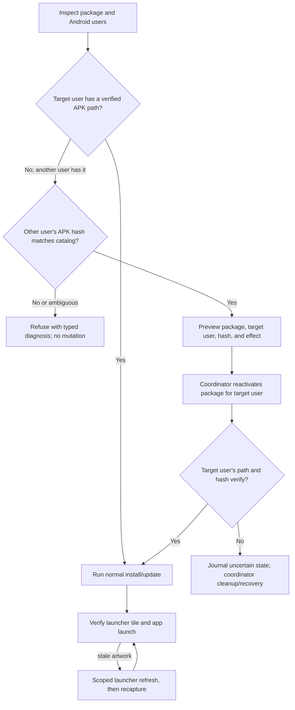

# Reliable Cast1 reinstall and launcher artwork refresh

Date: 2026-10-28  
Status: APK label fix is built and installed on Cast1; the coordinator's stale-tile refresh remains unresolved.

## Decision

Change the coordinator workflow. The repeated install refusals are not a build or operator-process problem: the coordinator correctly refuses to replace package bytes it cannot identify, but it treats Android's package listing as though the package were installed for the same Android user queried by `pm path`. Add a safe, user-aware reactivation operation and make the existing refusal explain the exact recovery action. Keep the normal install command fail-closed.

## Current Cast1 evidence

- The install attempt for `bsnes-jg-tv-responsive`, job `J‑69c31ed6816c`, failed with `installed-apk-path-unavailable` before changing the package.
- Read-only Inspect job `J‑6d3720893579` confirms `org.bsnesjg.tv.native.phase2.responsive` is registered for Android user 10 (`new_user`) and is not installed for user 0 (`Owner`). The APK path is available with `pm path --user 10`; the default/user-0 path query is empty.
- The package is therefore still present on Cast1 even though it was removed from the launcher-facing user. A global package listing can report it while a user-0 path query cannot resolve it. Repeating the same install request will repeat the refusal.
- Native suite APK `4052deb5b869452e075cc5666e8cbbc6ec95f3647a396158011a84f025b2e870` now declares the launcher label `LLVM 65816 Torture Test Suite on SNES`; its packaged icon includes the SNES controller. Cast1 install job `J‑c519fb63d67c` verified that APK hash, but the launcher hierarchy still reports the cached tile as `bsnes-jg Native Phase 2` and the old artwork. The coordinator searches for the new label exactly, so it never associates that stale tile with the installed package; the bounded launcher check ends `launcher-unverified` without refreshing it. Evidence is saved under `docs/proof/cast1-native-suite-label-icon-refresh-2026-10-28/`.
- Cast2 remains an independent coordinator-connectivity issue; this plan does not alter its state.

The coordinator already has a dedicated design for this Android state: [Reactivate a registered package for Android user 0](../../../chromecast-coordinator/docs/plans/2026-10-28-reactivate-package-workflow.md), alongside its [Cast1 package-path diagnosis](../../../chromecast-coordinator/docs/plans/2026-10-27-cast1-package-path-mismatch.md). Implement that coordinator-owned workflow and use its typed outcomes here.

## Intended operator flow

1. Inspect reports which users have the package and where its APK path resolves.
2. The operator selects **Reactivate package** for the registered app and target user 0. The preview shows package ID, target user, expected APK SHA-256, and the fact that this exposes the existing package to that user without clearing app data or replacing code.
3. The coordinator verifies the source user's APK hash against the registered catalog before calling `pm install-existing --user 0 <package>`.
4. The coordinator verifies the package path and APK hash for user 0, then runs the normal install/update workflow if the requested APK differs.
5. Verify launcher visibility and artwork from user 0. If Android TV Home still displays cached artwork, use an explicit, narrowly scoped launcher refresh and verify again; never clear the app's data as an icon-refresh shortcut.



```mermaid
sequenceDiagram
    participant O as Operator
    participant C as Coordinator
    participant D as Cast1 Package Manager
    O->>C: Inspect Cast1
    C->>D: Read package state and paths per Android user
    D-->>C: User 0 absent; user 10 present; source APK path
    O->>C: Reactivate registered app for user 0
    C->>D: Verify user 10 APK SHA-256 against catalog
    C->>D: pm install-existing --user 0 package
    C->>D: Verify user 0 APK path and SHA-256
    C-->>O: Reactivated and verified; no app data cleared
    O->>C: Install/update requested APK if hashes differ
    C->>D: Replace only after verified path/hash; verify installed hash
    O->>C: Capture launcher and launch app check
    C-->>O: Preserve screenshot and install/recovery receipts
```

## Coordinator changes

- Implement the registered-app `reactivate-package` workflow in the coordinator, with matching CLI and tray entry points, explicit target Android user, catalog-hash validation, a mutation journal, cancellation handling, and verified recovery. Use the coordinator's existing user-aware workflow proposal as the implementation specification.
- Improve Inspect and install refusal messaging to report package state per user, distinguish `not installed for this user` from `package/path state ambiguous`, and include the next safe workflow. Preserve command exit status and per-user `pm path` results in evidence.
- Before an APK update, retain its prior manifest launcher label and raster icon reference. During post-install verification, match either the new label or that prior label to locate a stale tile, compare the tile against the new APK artwork, and use the reviewed launcher's force-stop-and-HOME refresh. Record both labels, the selected tile bounds, before/after captures, and comparison result. Do not treat “new label not found” as a completed artwork check.
- Keep install replacement gated on a single verified installed APK path and hash. Do not silently run `install-existing`, uninstall, clear app data, or broaden package visibility as an install side effect.
- Add a narrowly scoped launcher-artwork refresh only if the reactivation + verified APK update still leaves stale artwork. It must target the affected package/user or the minimum launcher cache entry, journal its effect, and prove the refreshed tile with a capture.

## Recovery and cleanup rules

- `pm install-existing` is scoped to the requested user. It does not replace shared APK bytes or clear per-app data; verify this contract on supported Cast firmware before deployment.
- Journal the pre-state (`package absent for target user`), source user(s), package, user ID, APK path, catalog hash, and boot identity before the mutation.
- After the command, success requires exactly one target-user path and a hash equal to the registered APK. An interrupted command is resolved by re-querying the target user's path/hash; cleanup must not uninstall the package or clear data.
- If the source APK hash differs from the current catalog, stop before reactivation and report a typed mismatch. Do not expose unknown code to the target user.
- Launcher refresh is separate from package reactivation and APK installation. Capture before/after artwork and leave the app's data intact.

## Acceptance

- Cast1 Inspect identifies user 0 versus user 10 state and never mistakes a global package listing for an installed APK path for user 0.
- Repeated reinstall requests after app removal from the launcher-facing user provide a concrete recovery action instead of repeating an opaque refusal.
- A successful reactivation of `org.bsnesjg.tv.native.phase2.responsive` for user 0 is followed by a user-0 path and SHA-256 match before any update or launch.
- The updated APK's launcher tile displays the expected artwork after the scoped refresh; evidence includes the package/hash receipt and launcher capture.
- When Google TV still exposes a cached previous label, the coordinator identifies that tile using the pre-update APK metadata, refreshes it without clearing launcher data, and confirms both the new visible label and the SNES controller badge.
- Failure injection after the user-scoped mutation is recoverable from the journal without app-data deletion, package uninstall, or an unresolved coordinator fence.
- Cast2 connection failures remain reported independently and are not conflated with package installation state.

## Scope

This is a coordinator behavior change plus a one-time Cast1 repair. No project build dependency changes are required to solve the user-profile mismatch. Rebuild the app only if its desired icon artwork changes; the current APK install failed before it could refresh the launcher-facing user's app entry.
