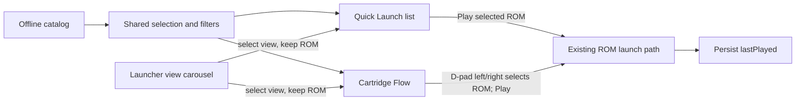

# Google TV launcher views: Quick Launch and Cartridge Flow

**Status:** Implemented. Cast1 installation and captures are complete. Pixel’s final APK launch check passed in portrait; landscape validation and the remaining Pixel chooser captures are pending phone rotation. The current ROM library is Quick Launch (#4). Cartridge Flow (#5) is view 2; ROM Treemap (#3) is now view 3 in the [treemap extension plan](2026-10-28-google-tv-rom-treemap-view.md). All three appear in the focusable launcher chooser carousel.

**Visual plan and mockups:** [Open the high fidelity plan in a browser](2026-10-28-google-tv-launcher-views.html).

## Goal

Let a Google TV user choose between the existing Quick Launch library and a new screenshot-first Cartridge Flow. Both views use the same offline catalog, filters, search, favorites, selection, and launch path. Switching views preserves the selected ROM and category/search state. The selected view persists on the device.

## Quick Launch (existing view)

Keep the current list, category chips, search, and large selected-ROM preview as view 1. Add a persistent view carousel in the header. D-pad left/right moves through the registered launcher views; Select opens the focused view. The selected view is indicated separately from focus. Keep this switcher data-driven for future views.

## Cartridge Flow (new view)

- Show one dominant center cartridge using the catalog screenshot as its cover, with smaller previous and next cartridges to suggest direction.
- Use D-pad left/right on the stage to select adjacent matching ROMs, wrapping at either end. The selected ROM remains the shared `selected` record.
- Keep category filters and search available above the stage. Filtering/search jumps to the first match and refreshes all three cards; no long sequential browsing is required.
- Show title, category, exact filename, byte size, description, controls, favorite state, and a high-contrast **Play** action for the center item.
- Preserve the browser list's last selection when switching views; do not launch a ROM on view change.
- For a one-item result, center the sole cartridge and omit neighbor cards. For an empty result, show the existing recoverable no-matches actions.

## Interaction and state

`prefs.launcherView` stores the active view id beside existing favorites and `lastPlayed`. Old preference JSON defaults to `quick`. The view switcher is registered from a list of `{id, label}` entries. Adding a future view means registering its surface and card; ROM loading, filters, search, and persistent preferences stay shared.

## Acceptance criteria

1. Both WASM and native Google TV library builds expose Quick Launch, Cartridge Flow, and ROM Treemap.
2. The view carousel is fully D-pad usable; changing views never launches a ROM.
3. Cartridge Flow shows real card art, neighboring matches, useful metadata, favorite state, and Play.
4. D-pad selection wraps among filtered matches; category/search changes reset selection to a valid match.
5. View changes preserve query, category, selected ROM, and favorites; the selected view survives app restart.
6. Empty and single-item result states remain legible and operable.
7. Direct `?rom=` launch remains intact. During playback, Back pauses and returns to the same selector view, preserving its filter, search, and selected ROM. The primary action reads Resume when that ROM is still loaded and Play for another selection; Back from the selector exits the app. The pause menu does not duplicate “Choose another ROM.”
8. On phone landscape, launcher chrome stays compact enough to leave most of the display for the selected view. Pause-menu focus outlines stay inside button edges, and verification diagnostics are absent from the menu.

## Implementation scope

- `android-tv/app/src/main/assets/index.html`: add the view carousel and Cartridge Flow surface.
- `android-tv/app/src/main/assets/library.css`: style both views at Google TV sizes and ensure D-pad focus remains visible.
- `android-tv/app/src/main/assets/library.js`: add view registry, persistence, rendering, and carousel navigation while keeping the existing launch path.
- Keep the library preview page in `android-tv/app/src/library/assets/` aligned with the shared UI.

## Verification plan

Exercise all three views with the remote on the Google TV app: switch views in both directions, move between cartridges and treemap tiles, filter/search, favorite, launch, return from the pause menu, and restart to verify persistence. Check one result, no results, and the full catalog. Compare WASM and native variants because they share the library UI.

The pause menu hides the verification diagnostics and keeps keyboard focus outlines inset within each action. Coordinator record attempts using BACK exited the activity before capturing the menu and produced no screenshot; automatic recovery returned Cast1 to Home. Device-level pause-menu proof remains pending.

### Device proof capture matrix

Install the native suite on Cast1 and Pixel. Capture every chooser view on Cast1 in landscape, and on Pixel in both portrait and landscape, after the treemap has recalculated for the visible map dimensions. Save full-resolution coordinator captures under `docs/proof/google-tv-launcher-views-2026-10-28/` using this matrix:

| Device / orientation | Quick Launch | Cartridge Flow | ROM Treemap |
| --- | --- | --- | --- |
| Cast1 · landscape | [Quick Launch](../proof/google-tv-launcher-views-2026-10-28/cast1-quick-launch.png) | [Cartridge Flow](../proof/google-tv-launcher-views-2026-10-28/cast1-cartridge-flow.png) | [ROM Treemap](../proof/google-tv-launcher-views-2026-10-28/cast1-rom-treemap.png) |
| Pixel · portrait | `pixel-portrait-quick-launch.png` | `pixel-portrait-cartridge-flow.png` | `pixel-portrait-rom-treemap.png` |
| Pixel · landscape | `pixel-landscape-quick-launch.png` | `pixel-landscape-cartridge-flow.png` | `pixel-landscape-rom-treemap.png` |

For the treemap captures, check that the tiles remain compact rather than being stretched from the previous orientation, and confirm that the screenshot reflects the actual device-sized map area. Keep the screenshots as committed proof artifacts and link them here when captured.

## Non-goals

No ROM or catalog preview-card changes, no catalog rebuild, and no new launch protocol.
