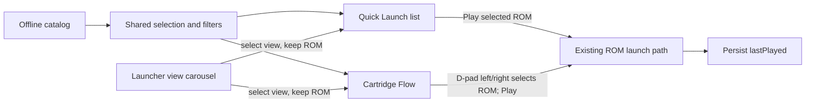

# Google TV launcher views: Quick Launch and Cartridge Flow

**Status:** Implemented; Google TV device validation pending. The current ROM library is Quick Launch (#4). Cartridge Flow (#5) is the second view, with a focusable view carousel. The view registry can accept additional launchers without changing ROM launch behavior.

**Visual plan and mockups:** [Open the high fidelity plan in a browser](2026-10-28-google-tv-launcher-views.html).

## Goal

Let a Google TV user choose between the existing Quick Launch library and a new screenshot-first Cartridge Flow. Both views use the same offline catalog, filters, search, favorites, selection, and launch path. Switching views preserves the selected ROM and category/search state. The selected view persists on the device.

## Quick Launch (existing view)

Keep the current list, category chips, search, and large selected-ROM preview as view 1. Add a persistent two-card view carousel in the header: **Quick Launch** and **Cartridge Flow**. D-pad left/right moves between views; Select opens the focused view. The selected view is indicated separately from focus. Keep this switcher data-driven for future views.

## Cartridge Flow (new view)

- Show one dominant center cartridge using the catalog screenshot as its cover, with smaller previous and next cartridges to suggest direction.
- Use D-pad left/right on the stage to select adjacent matching ROMs, wrapping at either end. The selected ROM remains the shared `selected` record.
- Keep category filters and search available above the stage. Filtering/search jumps to the first match and refreshes all three cards; no long sequential browsing is required.
- Show title, category, exact filename, byte size, description, controls, favorite state, and a high-contrast **Play** action for the center item.
- Preserve the browser list's last selection when switching views; do not launch a ROM on view change.
- For a one-item result, center the sole cartridge and omit neighbor cards. For an empty result, show the existing recoverable no-matches actions.

## Interaction and state

`prefs.launcherView` stores `quick` or `cartridge` beside existing favorites and `lastPlayed`. Old preference JSON defaults to `quick`. The view switcher is registered from a list of `{id, label}` entries. Adding a future view means registering a renderer and adding its card; ROM loading, filters, search, and persistent preferences stay shared.

## Acceptance criteria

1. Both WASM and native Google TV library builds expose Quick Launch and Cartridge Flow.
2. The view carousel is fully D-pad usable; changing views never launches a ROM.
3. Cartridge Flow shows real card art, neighboring matches, useful metadata, favorite state, and Play.
4. D-pad selection wraps among filtered matches; category/search changes reset selection to a valid match.
5. View changes preserve query, category, selected ROM, and favorites; the selected view survives app restart.
6. Empty and single-item result states remain legible and operable.
7. Direct `?rom=` launch and existing pause-menu “Choose another ROM” behavior remain intact.

## Implementation scope

- `android-tv/app/src/main/assets/index.html`: add the view carousel and Cartridge Flow surface.
- `android-tv/app/src/main/assets/library.css`: style both views at Google TV sizes and ensure D-pad focus remains visible.
- `android-tv/app/src/main/assets/library.js`: add view registry, persistence, rendering, and carousel navigation while keeping the existing launch path.
- Keep the library preview page in `android-tv/app/src/library/assets/` aligned with the shared UI.

## Verification plan

Exercise both views with the remote on the Google TV app: switch views in both directions, move between cartridges, filter/search, favorite, launch, return from the pause menu, and restart to verify persistence. Check one result, no results, and the full catalog. Compare WASM and native variants because they share the library UI.

## Non-goals

No ROM or screenshot changes, no catalog rebuild, and no new launch protocol. No treemap or compiler-family grouping in this iteration.
