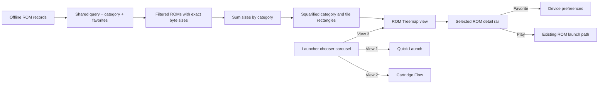

# Google TV ROM Treemap launcher view

**Status:** Implementing as launcher view 3. This extends the [Quick Launch and Cartridge Flow plan](2026-10-28-google-tv-launcher-views.md) and joins the same persistent launcher chooser carousel.

**High fidelity mockup and diagrams:** [Open the treemap plan in a browser](2026-10-28-google-tv-rom-treemap-view.html).

## Goal

Add ROM Treemap as a third way to explore the existing offline library. Every ROM is a focusable tile, grouped by category. Tile area is proportional to the ROM’s exact byte size. Reuse the shared search, category filters, favorite state, selected ROM, preferences, and existing launch path.

## Treemap geometry

The map is the full content area to the left of a fixed details rail. The rail sits outside the map, so every pixel in the map belongs to a ROM tile. For ROM (i) with size (s_i), and map rectangle (M) with area (A_M = W_M H_M):

\[
  A_i = A_M \frac{s_i}{\sum_{j \in R} s_j}
\]

where (R) is the current filtered result set. A category group (c) receives area (A_c = A_M \frac{\sum_{i\in c}s_i}{\sum_{j\in R}s_j}\). The layout packs categories, then packs their ROMs inside each category rectangle; this preserves the same global byte-to-area ratio for every ROM. Use a deterministic squarified layout to avoid long thin strips while keeping catalog order stable for equal sizes.

Labels are an overlay and do not change tile bounds. Show title and size only when they fit; every tile always has an accessible name including title, filename, category, and exact byte count. The selected tile gets a bright outline. Category colors are deterministic and repeated in the legend.

## Interaction

- The launcher carousel contains **Quick Launch**, **Cartridge Flow**, and **ROM Treemap**. Left/right moves focus through the view choices; Select activates one. The active view is persisted as `launcherView`.
- Shared category chips and search constrain all three views. Filtering or typing selects the first match and rebuilds the treemap without altering ROM records.
- D-pad arrows move to the nearest tile in that direction. At the map edges, up returns to filters, left returns to the view chooser, and right/down enters the selected-ROM actions.
- Select on a tile launches the focused ROM through the existing `launch()` function. The details rail has explicit Favorite and Play actions.
- The map reports “N ROMs · total bytes” for the current results. No matches retain Search all / Clear search recovery; one match fills the map.

## Resizing and data behavior

The treemap layout uses normalized coordinates and CSS percentages. Resizing the TV or window changes only the map’s width and height; all tile areas scale by the same factor, preserving their ratios. Recompute after catalog filters/search change, not every animation frame. Do not regenerate ROMs or screenshots.

## Acceptance criteria

1. ROM Treemap is the third option in the chooser carousel and remains selected after relaunch.
2. The map groups every matching ROM by category and uses exact `size` values to calculate tile areas.
3. The details rail does not overlap the map. Category groups and tile colors match the legend.
4. All tiles are D-pad focusable; directional movement selects the nearest tile geometrically.
5. Search, category chips, and Favorites update the map while keeping details, selection, and actions in sync.
6. Select launches the exact focused ROM; Favorite updates the same device preference as other views.
7. One-result and no-result states are useful. No tile requires a visible text label to be discoverable by assistive navigation.
8. Existing Quick Launch and Cartridge Flow behavior is unchanged.

## Implementation scope

- `android-tv/app/src/main/assets/index.html`: add the Treemap surface and detail rail.
- `android-tv/app/src/main/assets/library.js`: register view 3, compute nested squarified rectangles from `size`, and add geometric D-pad movement.
- `android-tv/app/src/main/assets/library.css`: style the map, deterministic category palette, selected tile, and responsive details rail.
- Keep `android-tv/app/src/library/assets/` synchronized for the preview page.

## Verification plan

On a Google TV remote, switch among all three views, filter by category and search, move among large and small tiles, enter the detail rail, favorite, play, and return from the pause menu. Confirm that each tile’s area ratio agrees with its byte-size ratio within layout rounding, including after resizing and filtering. Check a one-ROM catalog and an empty filter.
