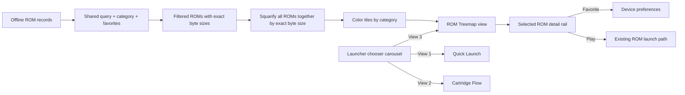

# Google TV ROM Treemap launcher view

**Status (2026-10-31):** Implemented; Will confirmed the Android chooser, palette and pause menu work. This closes their functional acceptance items by user validation. Earlier automated captures remain the evidence for their recorded devices only; Will requested Cast1/Pixel checks instead of Cast2/tablet coverage. Cast2 reconnect `J‑6dda7aff5728` failed with `transport-unavailable`, and no tablet is enrolled in the coordinator.

**Earlier validation record:** Implemented and captured on Cast1. Pixel’s final APK launch check passed in portrait, but it opened Cartridge Flow; Pixel Treemap screenshots and landscape validation remain pending. ROM Treemap is launcher view 3. The [Cast1 Treemap proof](../proof/google-tv-launcher-views-2026-10-28/cast1-rom-treemap.png) shows the final native APK’s globally squarified layout. A named palette selector is now implemented in source; build and device validation remain pending. See the [palette investigation and mockups](2026-10-29-treemap-palette-investigation.md). This extends the [Quick Launch and Cartridge Flow plan](2026-10-28-google-tv-launcher-views.md) and joins the same persistent launcher chooser carousel.

**High fidelity mockup and diagrams:** [Open the treemap plan in a browser](2026-10-28-google-tv-rom-treemap-view.html).

## Goal

Add ROM Treemap as a third way to explore the existing offline library. Every ROM is a focusable tile. Tile area is proportional to the ROM’s exact byte size, and deterministic colors identify categories. Reuse the shared search, category filters, favorite state, selected ROM, preferences, and existing launch path.

## Treemap geometry

The squarifier uses the visible map's measured width and height for every render; it never stretches coordinates calculated for a different aspect ratio. Recalculate when the view opens or the map resizes, including on phone rotation. Pack all ROMs in one pass so category boundaries cannot make the map less square, while preserving their exact proportional areas.

The map is the full content area to the left of a fixed details rail. The rail sits outside the map, so every pixel in the map belongs to a ROM tile. For ROM (i) with size (s_i), and map rectangle (M) with area (A_M = W_M H_M):

\[
  A_i = A_M \frac{s_i}{\sum_{j \in R} s_j}
\]

where (R) is the current filtered result set. A ROM’s tile area is its byte share of the map, subject only to pixel rounding. Sort tiles by size for squarification; use category color and legend to show category membership without constraining tile geometry. Ties are stable by ROM slug.

Labels are an overlay and do not change tile bounds. Show title and size only when they fit; every tile always has an accessible name including title, filename, category, and exact byte count. The selected tile gets a bright outline. Category colors are selected from named qualitative palettes and remain stable across filtering. The palette choice persists with the other launcher preferences; label ink adapts to the fill luminance.

## Interaction

- The launcher carousel contains **Quick Launch**, **Cartridge Flow**, and **ROM Treemap**. Left/right moves focus through the view choices; Select activates one. The active view is persisted as `launcherView`.
- Shared category chips and search constrain all three views. Filtering or typing selects the first match and rebuilds the treemap without altering ROM records.
- D-pad arrows move to the nearest tile in that direction. At the map edges, up returns to filters, left returns to the view chooser, and right/down enters the selected-ROM actions.
- Select on a tile launches the focused ROM through the existing `launch()` function. The details rail has explicit Favorite and Play actions.
- The map reports “N ROMs · total bytes” for the current results. No matches retain Search all / Clear search recovery; one match fills the map.
- A palette dropdown is visible only in ROM Treemap, reports curated versus extended color counts, and persists across relaunch.
- Category colors remain stable across search and filters, and light palette fills retain readable dark label ink.

## Resizing and data behavior

The treemap layout measures the visible map rectangle and uses CSS percentages derived from those exact dimensions. Resizing the TV or window reruns the squarifier for the new aspect ratio; tile areas continue to follow their exact byte ratios. Recompute after filters/search and map resizes, not every animation frame. Do not regenerate ROMs or catalog preview cards.

On phone landscape, collapse the title/search area, view carousel, and category filters into compact rows; hide the catalog subtitle and footer so the map retains most of the available height. Keep the details rail beside the map in landscape. In portrait, retain the map-above-details arrangement.

## Acceptance criteria

1. ROM Treemap is the third option in the chooser carousel and remains selected after relaunch.
2. The map includes every matching ROM, uses exact `size` values to calculate tile areas, and identifies categories with a legend and consistent tile colors.
3. The details rail does not overlap the map. Category colors match the legend.
4. All tiles are D-pad focusable; directional movement selects the nearest tile geometrically.
5. Search, category chips, and Favorites update the map while keeping details, selection, and actions in sync.
6. Select launches the exact focused ROM; Favorite updates the same device preference as other views.
7. One-result and no-result states are useful. No tile requires a visible text label to be discoverable by assistive navigation.
8. Existing Quick Launch and Cartridge Flow behavior is unchanged.

## Implementation scope

- `android/app/src/main/assets/index.html`: add the Treemap surface and detail rail.
- `android/app/src/main/assets/library.js`: compute globally squarified rectangles from `size`, assign category colors from the selected named palette, persist palette choice, and add geometric D-pad movement.
- `android/app/src/main/assets/library.css`: style the map, palette selector, selected tile, and responsive details rail.
- ~~Keep `android/app/src/library/assets/` synchronized for the preview page.~~ Removed 2026‑11‑01: that copy had drifted from `android/app/src/main/assets/` and no Gradle source set packaged it. `main/assets` is the one library UI, covered by `android/test/library-ui.test.mjs`.

## Verification plan

On a Google TV remote, switch among all three views, filter by category and search, move among large and small tiles, enter the detail rail, favorite, play, and return from the pause menu. Confirm that each tile’s area ratio agrees with its byte-size ratio within layout rounding, including after resizing and filtering. Check a one-ROM catalog and an empty filter.

Capture the ROM Treemap chooser on Cast1 in landscape and on Pixel in portrait and landscape. Store the full-resolution captures as `docs/proof/google-tv-launcher-views-2026-10-28/cast1-rom-treemap.png`, `pixel-portrait-rom-treemap.png`, and `pixel-landscape-rom-treemap.png`. The [launcher views plan](2026-10-28-google-tv-launcher-views.md#device-proof-capture-matrix) tracks the complete three-view capture matrix.
