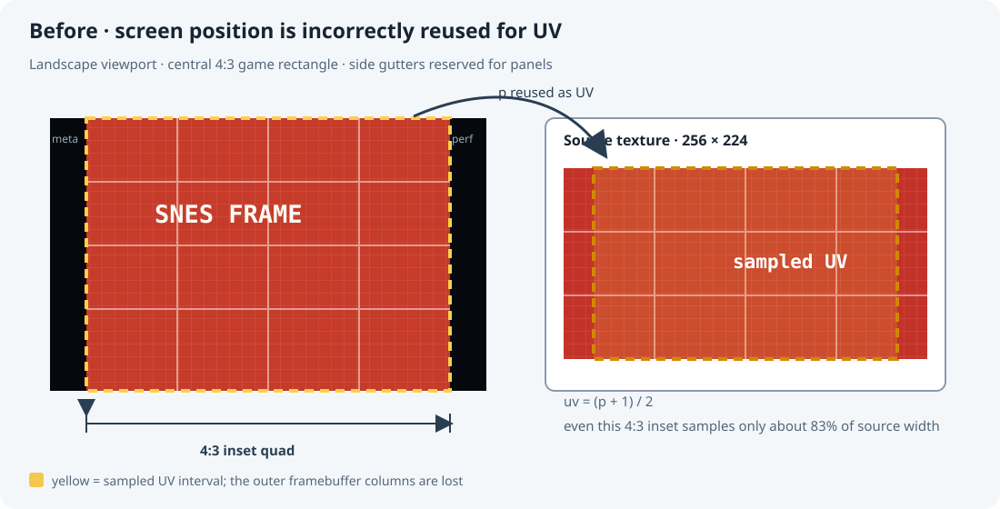
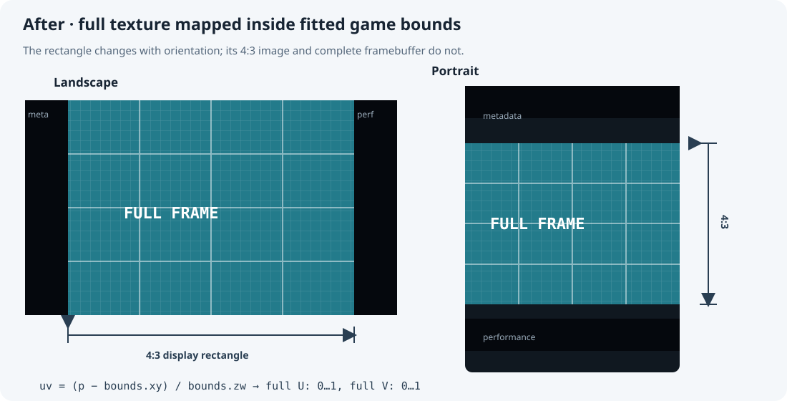

# Native SNES renderer: preserve the full framebuffer in responsive layouts

## Problem

The responsive layout computes a 4:3 game rectangle and places metadata and performance panels in the remaining device space. The native renderer then uses that rectangle’s clip-space vertex positions for **both** screen placement and texture coordinates:

```glsl
gl_Position = vec4(p, 0., 1.);
uv = (p + 1.) * .5;
```

Here `p` is already inset to leave the gutters. Therefore `uv` does not span `[0, 1]` when the game rectangle does not fill the screen. The renderer samples only part of the 256×224 framebuffer. How much it crops depends on the fitted rectangle, so the visible SNES image changes between device shapes and orientations. The attached landscape example shows the title text cut at both edges.

The problem is in the native texture mapping. The 4:3 layout rectangle and its gutter calculations are still the intended geometry.



## Correction

Keep clip-space positions for placing the quad. Pass the game rectangle’s clip-space bounds separately, then normalize each vertex position relative to those bounds:

```glsl
gl_Position = vec4(p, 0., 1.);
uv = (p - bounds.xy) / bounds.zw;
```

The native renderer supplies `bounds = (left, bottom, right - left, top - bottom)`. At the game rectangle’s left, right, bottom, and top edges, `uv` is exactly `0` or `1`, independent of the rectangle’s location or size. The fragment shader’s existing vertical flip remains unchanged.



The source framebuffer remains 256×224 samples (8:7 sample grid). The 4:3 game rectangle applies the horizontal expansion used for the traditional SNES television presentation. The fix changes which framebuffer samples are shown; it does not change the requested display aspect ratio.

## Implementation status

The native shader now receives a `bounds` uniform and calculates UVs relative to the fitted rectangle in [MainActivity.java](../../android/app/src/main/java/org/bsnesjg/tv/MainActivity.java). The Pixel nativeplayer build completed successfully as APK SHA-256 `3568f649adbcd0b8562c80763440542665df3dadd1d9ef82465a1b2791f3a874`.

The coordinator installed that APK, but the install job entered `recovery-required` while trying to restore the Pixel’s previous foreground activity. The saved foreground was Android Markup; restoration instead resumed Photo Picker. One coordinator re-add attempt hit the same restoration failure, so the Pixel remains recovery-required until that foreground cleanup can be reconciled. The shader change is built and installed, but a post-fix Pixel screenshot has not yet been verified.

## Validation

- Compare captures at the same deterministic SNES frame in portrait and landscape. The complete 256×224 source must be visible in both; only the rectangle’s position and scale may change.
- Confirm the fitted game rectangle remains 4:3, with no gutter overlap or edge crop.
- Capture on Pixel after coordinator recovery and compare the title screen against the complete source frame.
- Compare native emulation and draw metrics before and after. This adds one `glUniform4f` update and a few vertex-shader arithmetic operations per draw; it does not add framebuffer copies or fragment work.

