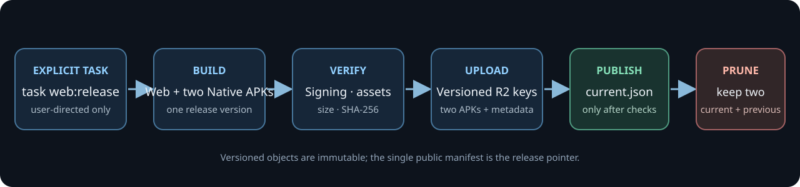
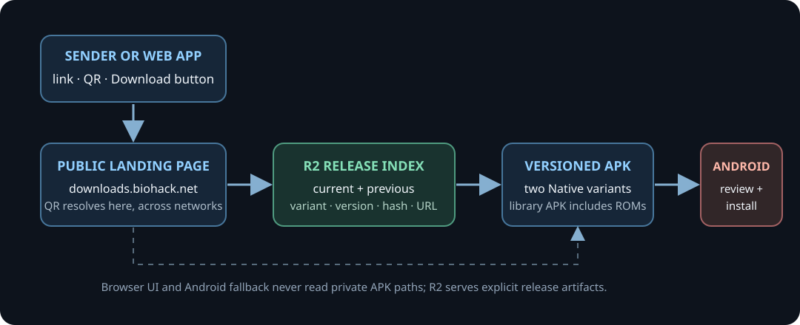

# Publish Android APK downloads to Cloudflare R2

**Status:** The 0.1.9 Native APK release is published. The Raycaster Maze player and full LLVM 65816 suite APKs are available from R2, with 0.1.8 retained as the previous release. `https://downloads.biohack.net/bsnes-jg/` redirects to the Indri product/download page; its release manifest is at `https://downloads.biohack.net/bsnes-jg/current.json`. The older `/bsnes-jg-wasm/current.json` path is kept in sync. The biohack.net SNES download panel and QR are live and open the Indri page. Future-release automation, bucket-scoped SSM credentials, the wald3n.com source listing, and device QR fallback proof remain open. The reusable player package and browser WebAssembly integration are the product; the Native APKs are example host integrations. The npm payload contains only the 32 KiB Raycaster Maze sample ROM, not the full suite. Retain exactly the current and previous example build.

## Goal

Give people a stable public HTTPS page for downloading example Android integrations when nearby transfer or the temporary same-Wi-Fi QR transfer is unavailable or unsuccessful. The R2 page must offer the current and previous example build, clearly identify the Native library and Native player examples, and state the version and SHA-256 for each file.

Make the example integrations discoverable directly from [`https://biohack.net/snes/`](https://biohack.net/snes/): add a clearly labeled Android example-build link and a scannable QR code that opens the stable R2 page. The page offers both Native APK examples, so the QR encodes the landing-page URL rather than choosing or linking to one versioned APK. The browser WebAssembly integration remains the primary web experience.

The Native library example APK bundles the ROM catalog, ROM files, and preview art. The standalone Native player example contains only the configured Raycaster Maze ROM (32 KiB); it does not package the full suite. The npm player package also includes only that one small demo ROM. The reusable browser WebAssembly player remains a web integration and is not represented as an APK.

## Current state

- The current Android build can produce four artifacts. Browser WebAssembly is the supported web integration; Android WASM APKs are comparison builds, not recommended Android integrations, and are excluded from public distribution. The public release contains only `bsnes-jg_llvm-65816-torture-test-suite-on-snes-v<version>.apk` (Native library example) and `bsnes-jg_<apkSlug>-v<version>.apk` (Native player example; `apkSlug` comes from `demo-rom.json`).
- The Native library APK includes the published ROM assets. Its payload and SHA-256 must be recorded per release. The Native player contains only its configured single-ROM build.
- Browser WASM remains a separate web target and is included in the web release; this policy does not remove it.
- `versionName` and `versionCode` are currently fixed in Gradle (`0.1.9` / `10`). Future-release automation still needs a versioning policy and must reject duplicate or non-increasing Android `versionCode` values.
- Controlled device builds currently use the local debug signing key. Public releases need a durable, backed-up release key and a single signing path so future updates install over earlier public versions.
- Gradle keeps debug signing explicit for controlled device builds and has a fail-closed durable-key path for public Native example APKs. The release keystore is stored in AWS SSM SecureString at `/indri-studio/bsnes-jg/android/release/signing-payload`; the local ignored cache is mode `0600`.
- The `bsnes-jg-downloads` bucket and `downloads.biohack.net` custom domain resolve over HTTPS. The stable `/bsnes-jg/` object redirects visitors to the Indri product/download page; the R2 manifest and versioned APKs are under that prefix. The legacy `/bsnes-jg-wasm/current.json` alias is also updated.
- Version 0.1.9 (`versionCode` 10) is published. Its Native library APK bundles the 152-ROM suite; its Native player APK bundles only the configured 32 KiB Raycaster Maze ROM. Both were verified to use the same release certificate as the 0.1.8 packages. The previous Native player build `0.1.8` used Mandelbrot and remains available for rollback. The release signing certificate is SHA-256 `1bc3d0586ff02c6be1479785652484ba70efccdfee46ce451520d221802d9a5e` (RSA 4096).

| Example APK | Package ID | Size (bytes) | SHA-256 |
|---|---|---:|---|
| `bsnes-jg_llvm-65816-torture-test-suite-on-snes-v0.1.9.apk` | `org.bsnesjg.tv.native.phase2` | 26,814,539 | `c04666f5abe7f6865b4e2cfdd695cf47c238e06a78a50a4a8e7d27e73532f88c` |
| `bsnes-jg_raycaster-maze-v0.1.9.apk` | `org.bsnesjg.tv.native` | 7,156,299 | `0d6e3583c127e6642514cee0d530213867c3ebe946799005c34f58b6f7837b76` |

Release records are tracked in [`docs/releases/`](../releases/). Both 0.1.9 public URLs were downloaded back and their exact sizes and SHA-256 hashes matched the local APKs. The 0.1.8 Native suite and Mandelbrot player were copied to the new release prefix and likewise verified.

- Public product/download page: `https://indri.studio/apps/bsnes-jg-wasm/`. The biohack.net SNES panel and QR point there; `https://downloads.biohack.net/bsnes-jg/` redirects to the same page. The `wald3n.com/open-source` listing remains pending.

## Release task contract

The 0.1.9 release was published through a reviewed one-time Wrangler upload after signature, size, and public-download hash verification. Do not repeat that manual sequence for future releases: add project-scoped secret tasks and an explicit root Task command, **`task web:release`**, as a separate follow-up. Normal local web or Android builds must not upload anything to R2. The future release task should use Task's interactive `prompt:` confirmation, publish the two Native APKs, and prune releases older than current/previous.

The release task will:

1. Build the web player and the two Native Android release APKs from the same release version. Do not package Android WASM APKs for public distribution.
2. Require the configured release signing key; fail if any APK is signed by the debug key or has a mismatched package/variant identity.
3. Inspect both APKs, verify the Native library's bundled ROM assets, calculate SHA-256 and file size, and generate release metadata.
4. Upload versioned artifacts to the dedicated R2 bucket and verify every uploaded object's size and hash.
5. Publish the manifest and download page only after the uploaded objects pass verification.
6. Prune every release older than the new current and previous versions. The task reports failure if pruning did not complete; it never treats a partially published release as success.

The exact Taskfile dependencies may call the existing Android container build and the project's web build. Public publication must remain a separate, intentional release operation rather than a side effect of `task build` or `task android-tv:build`.

Follow the existing project secret workflow: `task secrets-pull` renders the gitignored, mode-`0600` local `.env` cache from AWS SSM SecureString parameters, and Task loads that cache with its `dotenv` directive. SSM is the source of truth; `.env` is read-only generated cache. Store the account ID and R2 endpoint alongside the project-specific R2 access key ID and secret key under a project-scoped SSM prefix. The account ID should come from this cache/auth configuration; never ask the user to look it up or type it. If the bucket-scoped key pair is not provisioned, `task secrets-bootstrap` is the one-time path to seed SSM, with key values entered through hidden prompts and never printed. Publication passes the cached values to the R2 client as environment configuration; no credential appears in task arguments or logs.

Add `task web:r2:setup` for the idempotent one-time bucket/domain setup and `task web:release:check` for read-only configuration, manifest, hash, and cache-header inspection. Setup must show the project bucket and intended permissions, then ask before creating/changing resources. `task web:release` has a separate `prompt:` naming the destination and explaining the prune behavior.

```sh
# Run only when explicitly asked for a public web release.
task web:release
```

## Public object layout

Use a dedicated bucket, for example `bsnes-jg-downloads`, with the read-only custom domain `downloads.biohack.net`. Give the publishing task credentials that can write only to this bucket. Serve the small static download page and manifest from the same R2 prefix as the APKs, so the QR, version index, and APK links share one HTTPS origin. On `https://biohack.net/snes/`, add a prominent, clearly named Android APK download link and a QR code that encodes `https://downloads.biohack.net/bsnes-jg/`; keep the human-readable URL beside the QR. The QR must lead to the variant-selection page, where visitors can choose Native library or Native player and review version, size, and SHA-256. Also add a project entry on `wald3n.com/open-source` linking to both the source repository and the download page.

Proposed keys:

```text
bsnes-jg/index.html
bsnes-jg/current.json
bsnes-jg/releases/<version>/release.json
bsnes-jg/releases/<version>/bsnes-jg_llvm-65816-torture-test-suite-on-snes-v<version>.apk
bsnes-jg/releases/<version>/bsnes-jg_<demo-rom.json apkSlug>-v<version>.apk
```

There are no Android WASM APK keys. Browser WASM is the web integration; the R2 release prefix contains the download page/manifest and the two Native Android example APKs.

`current.json` is the only mutable release pointer. It lists both `current` and `previous`; each release record includes the version name, Android version code, publish timestamp, and each APK's display name, package ID, engine, player/library type, byte size, SHA-256, and versioned URL. The landing page reads this manifest to render the two Native download buttons and QR codes. Follow the established static-site cache split: mutable `index.html` and `current.json` use `Cache-Control: no-store` (or `max-age=0, must-revalidate` where a CDN requires revalidation); versioned APKs and release manifests use `public, max-age=31536000, immutable`.

Use `downloads.biohack.net/bsnes-jg/` as the proposed stable download URL. Verify the Cloudflare R2 custom-domain binding, DNS, and HTTPS certificate before enabling it in the app or treating the how-to link as live.

## Publication sequence and atomicity

Upload APKs under a new version prefix first. The versioned files can be checked before they appear in `current.json`. Download each staged public object back through the public HTTPS route and compare byte count and SHA-256 with the local build. Only after both match, publish the new release record and atomically replace `current.json` with `{current: new, previous: old-current}`. Then delete every release not named by that index.

If upload or verification fails, leave `current.json` unchanged and do not delete the old files. If index publication succeeds but pruning fails, the current and previous links still work; the task must fail with a cleanup-pending status and safely retry pruning on the next invocation. Limit pruning to the dedicated `bsnes-jg/` prefix and the versions absent from the validated current/previous manifest; never run broad sync against another project or bucket.



### Two-version retention

For each successful release, shift the old current to previous and remove the version that falls out of the pair. The release manifest is the source of truth for pruning; it must not infer versions from loose filename sorting.

### Download and QR route

The static R2 page is the public fallback for Android phone/tablet and Chromecast. Direct Android Sharesheet/Quick Share and the temporary local QR route remain the preferred transfer methods. If those routes cannot transfer the APK, the app can show a QR for the public download page; the recipient selects the Native library or Native player APK there. This public route works across different networks and delivers the latest signed release, which may be newer than the sender's currently installed APK.

The in-app public QR and the QR on `biohack.net/snes/` must encode only the stable HTTPS landing-page URL, never an APK filesystem path or the temporary LAN server address. Keep a human-readable URL beside each QR. The SNES page's download link and QR both lead to the same variant-selection page; the web app does not attempt to read an installed Android APK.



## Signing, identity, and ROM payload

- Establish one durable release signing key, owner, backup, and recovery procedure before the first public upload. Do not publish the controlled-build debug-signed APKs.
- Keep package IDs stable within each distributed variant. Increment `versionCode` monotonically and set one release `versionName` across both APKs.
- Preserve the app titles in downloaded filenames: `bsnes-jg_llvm-65816-torture-test-suite-on-snes-v<version>.apk` for the Native library example, and `bsnes-jg_<apkSlug>-v<version>.apk` for the Native player example. The current `demo-rom.json` value is `raycaster-maze`. Label both as Android Native examples on the landing page. Browser WebAssembly remains the supported browser integration; Android WASM comparison builds are not public release variants.
- Before upload, inspect both APKs. Verify that the Native library APK contains the expected catalog, ROM files, and preview cards; record the verified asset counts in `release.json`. Do not claim that the Native player includes the full ROM library.
- Report SHA-256 and byte size beside each download. After downloading, the recipient should be able to compare the advertised hash before installation.
- Android's normal installer remains responsible for the recipient's explicit install approval. The public page transfers a file; it does not install it silently.

## R2 security and operations

- Provision a dedicated R2 bucket and project-owned public custom domain. Keep bucket writes authenticated; allow anonymous reads only for the published page, manifest, and retained release objects.
- Keep the account ID, R2 endpoint, and bucket-scoped key pair in project-scoped SSM SecureString parameters; use the gitignored `.env` only as a generated local cache. Do not put credentials in the repository, task arguments, logs, or generated HTML.
- Match the existing Task conventions: one-time setup has an explicit confirmation before changing credentials or creating a bucket; publication has a `prompt:` naming the destination and explaining current/previous pruning. `task web:release:check` must remain read-only.
- Limit cleanup to `bsnes-jg/releases/` and compare candidate deletions against the two release IDs in `current.json`.
- Log the release version, APK hashes, R2 object keys, publish result, and prune result without logging credentials.
- A rollback changes the release index to point to the already-retained previous release. Do not rebuild or mutate a versioned artifact to roll back.
- Do not accept user-uploaded APKs, ROMs, or arbitrary paths in this public bucket. It is a static release distribution point only.

## Plan of work

1. Confirm `downloads.biohack.net`, choose the dedicated bucket name, and determine infrastructure/config ownership. Pull the account ID from existing SSM/cache configuration rather than asking the user for it.
2. Define and provision the durable release signing key. Keep controlled test signing separate.
3. Replace the fixed Android version fields with one version source and add monotonic version-code validation.
4. Add the two-APK inspection/manifest generation step, including the Native library ROM payload checks and SHA-256.
5. Add project-scoped `task secrets-pull` and `task secrets-bootstrap` wiring for SSM and the local `.env` cache; add `task web:r2:setup` for the project bucket/domain and least-privilege permissions.
6. Implement `task web:release` with staged upload, public HTTPS verification, manifest-last publication, two-version pruning, and retry-safe cleanup.
7. Keep `downloads.biohack.net/bsnes-jg/` as the stable entry URL, currently an HTML redirect to the Indri product/download page. Publish `current.json` and immutable current/previous release objects under the same R2 prefix.
8. The biohack.net `/snes/` panel and generated QR are live and open the Indri product/download page. Add the pending `wald3n.com/open-source` listing for the source repository and download page. Identify this repository as the emulator/player project, not as the separate packaged-upstream `bsnes-jg` APT package.
9. Add the public-download QR fallback to Android phone/tablet and Chromecast share flows. Use Quick Share for direct phone-to-phone transfer and local QR when both devices share a network; show the public QR when those routes are unavailable or fail. The sender never uploads the APK through this fallback; the recipient downloads the published copy from R2.
10. Update `docs/how-to/share-the-app.md` to the verified URL and capture proof for current/previous release links, both APK files and hashes, Native library ROM payload, biohack.net and wald3n.com links, phone and TV scans, recipient install approval, and successful removal of the older third release.

## Proof checklist

- [ ] `task web:release` builds browser WASM and two Native Android APKs from one release version; Android WASM APKs are excluded from public distribution.
- [ ] The release task refuses debug signing, duplicate/non-increasing version codes, package/variant mismatches, incomplete ROM-library APKs, and hash mismatches.
- [x] `downloads.biohack.net/bsnes-jg/` redirects to the Indri product/download page; `current.json` and all versioned APK URLs work over HTTPS without credentials.
- [x] The public page and manifest show current 0.1.9 and previous 0.1.8, both Native APKs, hashes, and sizes.
- [x] The 0.1.9 manifest was published only after both APKs had been uploaded and downloaded back with matching sizes and hashes.
- [ ] After publishing a third version, R2 contains only the current and previous release artifacts under `bsnes-jg/releases/`.
- [ ] Failure before manifest publication leaves existing current/previous downloads intact. Failure during pruning is reported and retryable.
- [x] `https://biohack.net/snes/` displays a labeled Android APK download link and QR code; both open the Indri product/download page, which lists both Native APK variants and current/previous version metadata.
- [ ] The `/snes/` QR is scannable from a second device, has an adjacent readable URL, and remains usable at desktop and mobile page widths.
- [ ] The `/snes/` APK section remains absent when `PUBLIC_ANDROID_DOWNLOAD_URL` is unset, and the build rejects a configured URL outside the verified HTTPS release page.
- [ ] `wald3n.com/open-source` links to both the project source and the public download page.
- [ ] A phone can scan the public page QR from a different network and download the selected APK.
- [ ] Chromecast offers public QR when local transfer is unavailable or unsuccessful; the QR displays a readable HTTPS URL.
- [ ] Quick Share transfers directly without internet or sender cellular data; if it and local QR are unavailable, the recipient can scan the public QR and download over mobile data without a sender upload.
- [ ] The recipient's Native library APK includes its ROM catalog and files and installs through Android's normal confirmation flow.
- [ ] The bucket, credentials, domain, and pruning scope belong only to this project.

## Open decisions

- Implement the repeatable `task web:release` workflow and least-privilege bucket-scoped SSM credentials. The stored S3 credentials returned `AccessDenied`; the 0.1.9 objects were uploaded with the authenticated Wrangler session.
- Add the public-download QR option to a future Android build and verify it on Chromecast; 0.1.9 was built before the verified download URL was configured in its BuildConfig.
- Add the project to `wald3n.com/open-source` and capture phone/TV scan and install proof.
- Verify the release-key backup and recovery procedure beyond its durable SSM SecureString storage.
