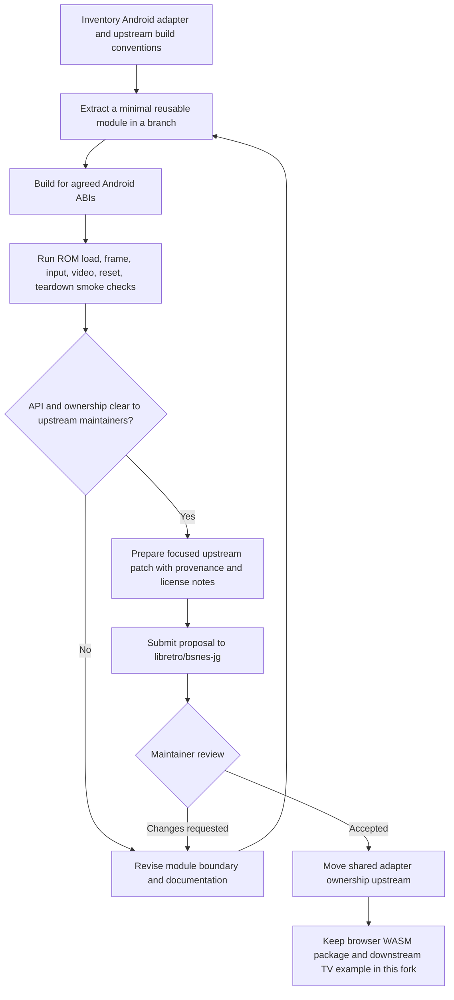

# Plan: propose a reusable Native Android frontend upstream

**Status:** Proposal draft. No upstream changes have been submitted or accepted.

## Decision

Keep the browser WebAssembly frontend and reusable browser player in `wbniv/bsnes-jg-wasm`. Propose the reusable Native Android core adapter to [`libretro/bsnes-jg`](https://github.com/libretro/bsnes-jg), where it can live beside the core it adapts. Keep this repository’s ROM catalog, TV launcher, APK sharing, benchmark screens, and release pipeline as downstream example-app code.

The human project page should identify this fork as `bsnes-jg-wasm` at `https://biohack.net/apps/bsnes-jg-wasm/`. The APK download prefix may remain `https://downloads.biohack.net/bsnes-jg/`; source identity and stable binary URLs serve different purposes.

## Candidate upstream scope

Start with the smallest reviewable integration slice:

- Android NDK/CMake build glue for compiling the upstream core as a native shared library.
- A JNI adapter for loading a ROM and required database assets, stepping one frame, resetting, setting controller input, and copying video pixels.
- A small Java API that wraps those calls without depending on the downstream WebView, catalog, or launcher.
- Build and smoke-test instructions, supported ABIs, lifecycle/threading expectations, and licensing/provenance notes.

Keep the current downstream app shell out of the first proposal. The app includes Google TV launcher presentation, ROM metadata/artwork, APK transfer, benchmarking, and project-specific verification behavior; those do not belong in the reusable core integration patch.

## Existing implementation evidence

| Concern | Current file | Upstream candidate? |
| --- | --- | --- |
| Core build and Android ABI configuration | `android-tv/app/src/main/cpp/CMakeLists.txt` | Yes, after removing downstream path assumptions |
| JNI ROM/load/frame/input/video adapter | `android-tv/app/src/main/cpp/jni.cpp` | Yes, as the first extraction target |
| Java native method declarations | `android-tv/app/src/main/java/org/bsnesjg/tv/NativeEngine.java` | Yes, after giving it a neutral package/API |
| TV launcher, ROM selector, app lifecycle | `android-tv/app/src/main/java/org/bsnesjg/tv/MainActivity.java` | No; retain as this repo’s example host |
| ROMs, catalog, screenshots, sharing, APK branding | `android-tv/app/src/main/assets/` and app resources | No; product-specific example content |

The current Java/native interface demonstrates `load`, `step`, `reset`, `setPad`, `width`, `height`, and `copyPixels`. It assumes a single active core instance and caller-managed thread ownership. Those constraints must be made explicit or replaced with a context handle before proposing it as a general API.

## Proposed integration contract

```text
Android host
  └── small Java API: load ROM/assets, step frame, reset, input, copy video
        └── JNI boundary: stable types, errors, explicit lifecycle/thread rules
              └── Native core build: upstream bsnes-jg sources + Android toolchain
```

The host owns UI, audio output, persistent saves, controller discovery/mapping, and Android lifecycle. The core adapter owns core initialization, ROM/database handoff, frame stepping, input translation, video conversion, and deterministic teardown. Do not expose private core structs or make the Java API depend on this repo’s browser player contract.

## Work sequence and review gates



1. Inspect upstream build, API, and contribution conventions before changing the adapter boundary.
2. Extract only the core-facing native module into an isolated branch; keep the current example app build working against it.
3. Verify the module on Chromecast-class ARMv7 and arm64 targets, then cover lifecycle, frame, input, and rendered pixels with reproducible smoke checks.
4. Confirm code provenance and licensing for every included source file.
5. Send a focused proposal to maintainers for review. Do not describe the integration as upstreamed until merged.

## Current limits

- No upstream checkout or working branch was found in this workspace; `vendor/bsnes-jg` is part of this repo checkout, not a separate upstream clone.
- The Android app is currently integrated directly against core headers and global core state. The right reusable boundary needs maintainer input.
- No maintainer approval, compatibility promise, or upstream release is implied by this plan.
