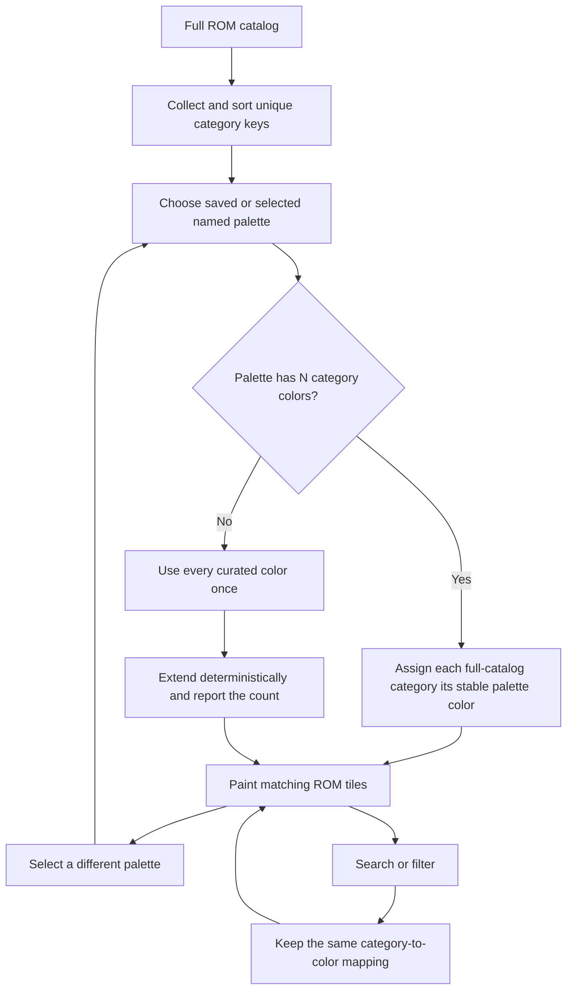

# Treemap category palette investigation

**Status (2026-10-31):** Implemented; Will confirmed the Android chooser, palette and pause menu work. This closes their functional acceptance items by user validation. Earlier automated captures remain the evidence for their recorded devices only; Will requested Cast1/Pixel checks instead of Cast2/tablet coverage. Cast2 reconnect `J‑6dda7aff5728` failed with `transport-unavailable`, and no tablet is enrolled in the coordinator.

**Earlier validation record:** Palette dropdown and curated palette previews implemented in the launcher source; build and device validation remain pending.

## Summary

ROM category is nominal data: categories have names, but no numeric order. Treemap category fills should therefore use qualitative palettes, not a sequential ramp or a rainbow hue wheel. The default is **Soft balanced**, a hand-tuned 12-color set with restrained saturation. The dropdown also offers Paul Tol bright, muted, and vibrant; Okabe–Ito; Tableau 10; ColorBrewer Set 3; and ColorBrewer Paired.

The map’s category-to-color assignment is based on the sorted set of categories in the full ROM library, not the current filtered results. Search and filters therefore do not recolor categories. The selector reports how many colors come from the chosen curated set and how many are deterministic extensions. The choice is persisted with the other ROM library preferences.

## Research findings

### Choose a palette for the data type

- **Qualitative** palettes represent unordered categories. Paul Tol separates qualitative, sequential, and diverging schemes and says the qualitative schemes are intended for categories where magnitude is irrelevant. This matches ROM categories. Use the family that expresses the data, not a generic rainbow.
- **Sequential** palettes imply a low-to-high order. **Diverging** palettes imply two extremes and a meaningful midpoint. Neither meaning exists in ROM category labels, so these families would add false meaning.
- ColorBrewer makes the user state both the number of classes and whether the data is sequential, diverging, or qualitative, and offers a color-blind-safe filter. That class-count framing is useful here: palette size must be considered against the number of categories, not the number of ROM tiles.

### Treat N as the number of categories, not records

For a palette with N category colors and hundreds of ROMs, map each category to one stable color and reuse it for every tile in that category. Do not consume a fresh color per tile. Keep the mapping stable when the user filters the catalog; otherwise the same category changes color as the visible set changes.

When the number of categories is below a palette’s designed capacity, take colors in the published order. Do not interpolate between endpoints to create extra nominal categories: interpolation creates a scale-like progression and nearby categories can become confusing. When the catalog has more categories than a selected palette, use its colors once, then add deterministic, moderately saturated colors using golden-angle hue steps. Never wrap and silently reuse colors. Clearly report the extension count.

This extension is a practical fallback, not a claim that arbitrarily many categories remain distinguishable. Color becomes a weaker identifier as N grows. Keep the category name in the focused ROM details, retain the category filters and accessible tile names, and preserve a visible selected outline. If the library grows substantially beyond the current dozen-ish categories, consider category grouping or a visible legend rather than relying on more hues.

### Preserve readable labels

Treemap tiles can be large color fields, unlike thin chart lines. A loud palette is therefore tiring, while an overly pale palette can wash out white labels. This implementation calculates the fill’s relative luminance and chooses dark or white label ink. It also keeps the selected tile’s outline and a thin tile boundary. The ColorBrewer Set 3 mockup intentionally demonstrates the need for dark ink on light swatches.

## Palette menu and examples

[Open the interactive desktop and phone mockups](2026-10-29-treemap-palette-investigation.html). They compare the same treemap geometry with the current HSL wheel, Soft balanced, Tol Muted, Tol Bright, Tol Vibrant, Okabe–Ito, Tableau 10, ColorBrewer Set 3, and ColorBrewer Paired. The N sampler shows how each choice behaves at 4, 8, 12, and 16 categories. Geometry is illustrative; changing palette never changes tile areas or order.

[Open the landscape and portrait dropdown menu mockups](2026-10-29-treemap-palette-dropdown-mockups.html). Both layouts use the artist-palette icon at the far right of the launcher row; each mockup shows the same expanded menu over the treemap.

### Menu choices

| Menu label | Designed colors | Intended use in this launcher |
| --- | ---: | --- |
| Soft balanced | 12 | Default; calm tile fields with clear category separation |
| Paul Tol · Muted | 9 | Restrained, color-vision-aware default from a published qualitative scheme |
| Paul Tol · Bright | 7 | Strong category separation for a small category count |
| Paul Tol · Vibrant | 7 | High-energy alternative; includes it as an explicit user choice |
| Okabe–Ito | 8 | Compact color-vision-friendly reference set |
| Tableau 10 | 10 | Familiar business-chart categorical set |
| ColorBrewer · Set 3 | 12 | Light, varied fields; use dark foreground text |
| ColorBrewer · Paired | 12 | Twelve colors arranged in related light/dark pairs |

For schemes smaller than N, the app shows `N categories · K curated + M extended`. The twelve-color Soft balanced option covers the current category scale without an extension. The N sampler in the HTML mockup makes the limit visible before a palette is selected.

## Interaction and implementation

- The artist-palette icon appears at the far right of the launcher-view row only while ROM Treemap is active, in both portrait and landscape/TV.
- Tapping the icon or pressing Select/Arrow Down opens the same preview menu in every orientation. Arrow keys move among menu rows; Select applies the highlighted scheme, and Back/Escape closes the menu. Arrow Left from the icon returns to ROM Treemap; Arrow Right moves to the active category filter or map.
- Changing the selection redraws fills only; it does not rerun category filtering or alter squarified rectangles.
- The selection is stored as `treemapPalette` in existing app preferences. Old preference records without that property use Soft balanced.
- Colors are calculated from all catalog category keys in stable sorted order, so search, favorites, and category filters cannot renumber the remaining categories.
- Generated extension colors do not repeat curated colors by index, and their deterministic index keeps them stable across relaunches.
- Tile label ink is chosen from fill luminance; accessibility text continues to include title, filename, category, and byte count.

## Flow

## Source ledger

| Claim used | Source and access date | Evidence and limits |
| --- | --- | --- |
| Qualitative schemes are for unordered categories; sequential and diverging encode ordered relationships. | Paul Tol, [Colour Schemes](https://sronpersonalpages.nl/~pault/), accessed 2026-10-29. | The qualitative section defines nominal data and lists the bright, high-contrast, vibrant, muted, and related schemes. Its stated color-vision properties apply to the published schemes, not the custom extension colors. |
| Tol Bright, Vibrant, and Muted have published finite category sets (7, 7, and 9 colors in the listed defaults). | Paul Tol, [Colour Schemes](https://sronpersonalpages.nl/~pault/), accessed 2026-10-29. | Hex values and intended uses are listed by scheme. Do not treat generated extension colors as part of Tol’s tested schemes. |
| Okabe–Ito is an eight-color qualitative scheme designed to remain useful across color-vision differences. | Okabe and Ito, [Color Universal Design](https://jfly.uni-koeln.de/color/), accessed 2026-10-29. | Original guidance identifies color ranges that are difficult to distinguish for some viewers. The app still includes category labels and other non-color cues. |
| A palette chooser should account for number of classes and data type, and expose color-blind-safe options. | [ColorBrewer 2.0](https://colorbrewer2.org/), accessed 2026-10-29. | The interactive control asks for number of classes, data nature, and optional color-blind-safe filtering. It is aimed at cartography; this doc applies the class-count idea to treemap categories. |
| Common categorical palettes have deliberately finite sizes; e.g. Tableau 10 has 10 colors and Paired has 12. | D3, [Categorical schemes](https://d3js.org/d3-scale-chromatic/categorical), accessed 2026-10-29. | D3 documents scheme counts. The menu uses these as references; this project does not add the D3 dependency. |

## Review and validation checklist

- [ ] Build the Native library APK and inspect the selector on Cast1 and Pixel.
- [ ] Confirm the default is Soft balanced and a chosen scheme survives app restart.
- [ ] Confirm category colors stay unchanged across `All`, Favorites, search, and individual category filters.
- [ ] Inspect label contrast with Soft balanced and the deliberately light Set 3 palette.
- [ ] Confirm the N counter distinguishes curated colors from extensions and never cycles/reuses a color.
- [ ] Confirm D-pad movement enters the icon from the Treemap view choice in portrait and landscape; Arrow Left returns to the view choice and Arrow Right moves to filters.
- [ ] Confirm the icon remains at the right of the launcher row and opens the same preview menu in portrait and landscape.
- [ ] Confirm D-pad selection, Escape/Back dismissal, outside-tap dismissal, and focus restoration in both orientations.
- [ ] Capture the same map under at least four schemes in desktop landscape and Pixel portrait.
