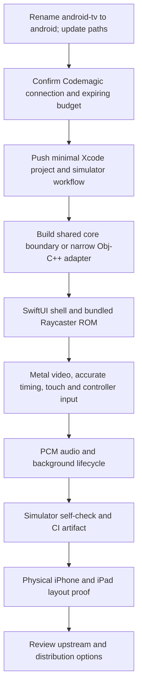

# Native iOS player integration

**Status:** **Simulator and device-SDK validation PASS (2026-10-31); physical testing blocked.** SwiftUI shell, native PCM audio, GameController input, lifecycle handling and automated touch/layout tests are implemented. The Android host has moved from `android-tv/` to `android/` with compatibility task aliases. Physical signing and testing remain blocked on signing identities and access to an iPhone; see [build and device instructions](../../ios/README.md).

**Earlier bootstrap evidence:** Codemagic builds the ARM64 iOS app with Xcode 16.4, and the iPhone 16 Simulator passes the configured 500-frame Raycaster fidelity check (`0xB200` at `0x13EA`). The captured app shows the ROM rendered through Metal with visible touch controls. See [build receipt](../proof/ios-bootstrap-2026-10-31/codemagic-result.json), [self-check](../proof/ios-bootstrap-2026-10-31/selfcheck.json), and [iPhone screenshot](../proof/ios-bootstrap-2026-10-31/iphone.png). This is an initial UIKit/Objective-C++ host, not completion of the full iOS milestone below.

The user corrected the dashboard reading to **385/500 minutes used (115 free minutes remaining)** before the successful retry. Final API elapsed-build accounting estimates **398.94/500 minutes used**, with no active builds at the check. The two player runs used **192.424 seconds total**; other projects share this account. `codemagic.yaml` now allows 30 minutes per manual M2 run for the expanded iPhone/iPad test matrix. The 398.94-minute figure was the bootstrap checkpoint, not current usage. The user explicitly rejected shortening runs merely to fit the budget: leave enough time to obtain an answer, and defer starting a run until the next UTC month when the shared allowance is too close to its limit.

### Bootstrap scope adjustment

The initial UIKit/Objective-C++ bootstrap proved Apple execution before the directory rename. The current SwiftUI shell composes the native Metal/controller view with Pause, Mute and Help. Audio uses AVAudioEngine with a bounded SPSC ring; CI enters manual offline mode before creating the mixer to avoid headless RemoteIO initialization. The adapter deliberately overlaps the small Android callback boundary; it does not claim a reusable multi-instance API.

The Apple ARM64 libco backend uses the upstream context layout and instruction sequence in a compiled `.S` file. It does not execute a data buffer or change page protections. Only ARM64 iOS/simulator builds are supported initially. The stock backend remains in the Linux smoke build.

Local adapter verification: `python3 ios/prepare.py`, then `cmake -S ios -B /tmp/bjg-ios-host-build -DCMAKE_BUILD_TYPE=Release`, `cmake --build /tmp/bjg-ios-host-build -j 4`, and `/tmp/bjg-ios-host-build/core-smoke ios/generated/demo.sfc ios/generated/bsnes-2.1.0/Database`.

Apple build commands and artifact paths are in `codemagic.yaml`. `ios/simulator-check.py` requires the ROM and offline-audio self-checks, then runs XCTest on an iPhone and iPad and exports screenshot attachments. The workflow also compiles the unsigned physical-device SDK target. A separate manual development-signing workflow is prepared but cannot be validated without credentials. Simulator artifacts cannot be installed on a physical iPhone.

Local investigation found a stale demo self-check address: the exact bundled SHA-256 matches biohack.net's published ROM, whose manifest names `0x13EA`; `0x1362` belongs to an earlier build. The independent LLVM-MOS `build/jgxcheck` returned `0xB3AF` at the old address and **PASS `0xB200` at `0x13EA` after 500 frames** for this exact bundled ROM. Corrected `demo-rom.json` and the staged demo manifest; the expected value remains unchanged. The new adapter uses entropy=0 to match jgxcheck's deterministic baseline.

Budget instruction: use the necessary free minutes, check cumulative usage before each run, and stop near the allowance until the next **UTC calendar month**. October ends at 2026-11-01 00:00 UTC (07:00 Bangkok), not 2026-10-31 00:00 UTC. Account-wide runs by other sessions share the same allowance.

### Build evidence (2026-10-31)

- Local host smoke test: **PASS**, 500 frames, `0xB200` at `0x13EA`, nonblack 512×240 native framebuffer. See [local self-check record](../proof/ios-bootstrap-2026-10-31/local-selfcheck.json).
- Codemagic app: `6ae5356ef8ef89f5624cab78`. First [build `6ae53800f8ef89f5624cadad`](https://codemagic.io/app/6ae5356ef8ef89f5624cab78/build/6ae53800f8ef89f5624cadad) ran from 00:36:21 to 00:37:14 UTC: **53.41 seconds**. Core, ARM64 assembly, and Objective-C++ compiled with Xcode 16.4; linking failed on `_CGRectZero`. Simulator checks did not execute.
- Fix committed and pushed: explicitly link CoreGraphics (plus Foundation). First-run `.xcresult` and logs are downloaded under `ios/artifacts/6ae53800f8ef89f5624cadad/` (ignored generated evidence).
- A second launch attempt was refused locally because another WorldFoundry build was active; **no second player job was created**. Recheck the actual dashboard quota and shared active builds before retrying. The API's elapsed-build estimate is not the dashboard's free-minute counter. Do not shorten the 15-minute timeout to squeeze in a retry; wait for the next UTC month if necessary.
- After the user corrected the available quota, the retry [build `6ae53afca7837523d3173c64`](https://codemagic.io/app/6ae5356ef8ef89f5624cab78/build/6ae53afca7837523d3173c64) **PASSED** in **139.014 seconds**, from 00:49:06 to 00:51:25 UTC. The other account job had finished before this run started. Core and ROM staging, app compilation/linking, simulator install/launch, fidelity test, screenshot, and artifact publication all succeeded. The downloaded simulator app ZIP and full `.xcresult` are under `ios/artifacts/6ae53afca7837523d3173c64/`; compact proof is committed under `docs/proof/ios-bootstrap-2026-10-31/`.
- Bootstrap follow-up: audio, GameController, SwiftUI, touch/lifecycle/orientation tests and the Android rename have since been implemented. Expanded CI passed as recorded below. Physical iPhone signing, audible output and hardware-controller checks remain open.

### Expanded validation (2026-10-31)

**[Codemagic build `6ae548645de5c45c009590e2`](https://codemagic.io/app/6ae5356ef8ef89f5624cab78/build/6ae548645de5c45c009590e2) PASSED** on commit `2073308`, in 509.317 seconds (8.49 minutes). App and XCTest compilation, ROM/audio self-check, iPhone/iPad UI tests, unsigned physical-iPhone SDK compilation and artifact publication all succeeded. [Compact build receipt](../proof/ios-support-2026-10-31/codemagic-result.json).

- **iPhone 16:** three XCTest cases, zero failures. All twelve touch buttons reached the core with correct masks and released; pause/background/resume, mute, Help and portrait/landscape geometry passed. [Test receipt](../proof/ios-support-2026-10-31/iphone-tests.txt), [playing portrait](../proof/ios-support-2026-10-31/iphone-playing.png), [landscape](../proof/ios-support-2026-10-31/iphone-landscape.png). The earlier XCTest portrait attachment was taken at frame 342 during the demo's blank startup; the normal-launch capture shows the picture after startup.
- **iPad Pro 11-inch (M4):** the same three cases passed with zero failures. [Test receipt](../proof/ios-support-2026-10-31/ipad-tests.txt), [portrait](../proof/ios-support-2026-10-31/ipad-portrait.png), [landscape](../proof/ios-support-2026-10-31/ipad-landscape.png). Screenshots were inspected; controls are accessible, clear of the 4:3 picture and inside safe areas.
- **Audio and ROM:** 500-frame fidelity PASS; AVAudioEngine rendered 1024 stereo frames at 48 kHz, energy 32.2547 and zero channel-sum error. UI tests also verified core PCM traversed the engine. [Self-check](../proof/ios-support-2026-10-31/audio-rom-selfcheck.json). These are offline audio checks, not audible speaker proof.
- **Linux host tests:** passed concurrent PCM ring, stereo, underflow/overflow, mute, controller masks, 60/120 Hz timing and bounded catch-up.
- **Android:** `task android:build` passed after the rename, 324 tasks and all seven configured APK checks. A concurrent Android fix corrected published ROM staging; that independent change remains owned by its session. [Build receipt](../proof/ios-support-2026-10-31/android-build.txt).
- Corrective cloud runs exposed and fixed offline-audio initialization order, missing Metal delegate methods, and the CMake app/test scheme selection. Screenshot review corrected the Metal texture channel order. Full logs, `.xcresult` bundles and simulator app ZIPs are retained under ignored `ios/artifacts/<build-id>/`.
- **Budget:** final account-wide API elapsed-time estimate is **417.21/500 minutes**, approximately **82.79 minutes remaining**, with no active jobs at 01:56:59 UTC. This estimate is not the dashboard's billing counter. No further run was started after success.
- **Still blocked:** development signing, installation on a physical iPhone, live audible output and hardware-controller testing. WorldFoundry's iOS plan records no Apple Developer Program account and no personal iPhone; the collaborator's device is not connected here. The development-signing workflow is prepared, not claimed tested. See [device instructions](../../ios/README.md).

## Goal

Add an iPhone-first, native iOS example host for the same compact Raycaster Maze ROM used by the standalone Android Native player. Reuse the vendored bsnes-jg C++ core and keep the browser integration on WebAssembly. This demonstrates a third host integration without turning the full torture-test suite into an iOS app or making the browser package depend on Apple frameworks.

The first deliverable is a development-signed app that runs on an iOS Simulator and one physical iPhone, with native rendering, touch input, lifecycle pause/resume, and a reproducible ROM fidelity check. iPad layout should adapt from the same app target. App Store distribution and a full ROM library are not part of this first milestone.

## Repository layout decision

Use sibling platform directories:

```text
android/             # existing Android/Google TV example project (renamed from android-tv/)
ios/                 # new SwiftUI iOS example app and Xcode project
native/              # shared platform-neutral C/C++ host adapter, if extraction proves useful
web/                 # WebAssembly player and ROM examples
vendor/bsnes-jg/     # pinned emulator core
```

The directory rename from `android-tv/` to `android/` is committed separately from iOS behavior. Canonical commands are `task android:build` and `task android:release-build`; `android-tv:*` aliases remain for existing callers.

## Existing implementation and reuse boundary

- `vendor/bsnes-jg/` is the pinned C++ core. Android's CMake build already compiles these same core sources.
- `android/app/src/main/cpp/jni.cpp` owns the Android integration today. It depends on `AAssetManager`, `JNIEnv`, and Android logging; those parts cannot be compiled for iOS unchanged.
- `NativeEngine.java` and `MainActivity.java` show the current Native Android frame, controller, ROM, and lifecycle contract. They are example-host code, not the iOS API.
- `demo-rom.json` names the selected standalone demo, supplies its SHA-256 and self-check, and should remain the single source of truth for the iOS sample ROM.
- The current Android host discards audio. The iOS player should provide real output through `AVAudioEngine` (or a reviewed low-latency Audio Unit path), rather than silently copying that limitation.

Before introducing `native/`, compare the current Android JNI adapter with `web/src/main.cpp` and the proposed Native Android upstream extraction. Prefer one small platform-neutral C ABI over a second independent implementation of core callbacks. Keep Android asset access/JNI and iOS bundle access/Objective-C++ in thin platform wrappers. If a shared context API requires broad changes to the global core, defer that refactor and first document the single-instance constraint instead of expanding scope.

Proposed host boundary:

```c
typedef struct bjg_host bjg_host;
bjg_host *bjg_create(const struct bjg_callbacks *callbacks);
int       bjg_load_rom(bjg_host *, const uint8_t *rom, size_t size);
void      bjg_run_frame(bjg_host *);
void      bjg_set_buttons(bjg_host *, uint16_t mask);
void      bjg_reset(bjg_host *);
int       bjg_video_info(bjg_host *, struct bjg_video_info *out);
int       bjg_copy_rgba(bjg_host *, uint8_t *dst, size_t capacity);
void      bjg_destroy(bjg_host *);
```

This is a design sketch, not a committed API. Choose concrete types after checking core callback lifetimes and buffer ownership. Keep errors explicit; do not expose private bsnes-jg structs across the ABI. Document thread ownership and whether the underlying core permits more than one active instance.

## App design

- **SwiftUI host:** app lifecycle, status/error states, accessible buttons, safe areas, orientation adaptation, and settings/help shell.
- **Objective-C++ bridge:** a small `.mm` wrapper calls the C ABI and converts Swift-friendly data types; it contains no screen layout or ROM selection policy.
- **Video:** use `MTKView` and a Metal texture updated from the latest core frame. Avoid a SwiftUI `Image` allocation per emulated frame. Preserve the full SNES picture and its traditional 4:3 display presentation; do not size it as the erroneous 8:7 sample grid.
- **Timing:** drive presentation with `CADisplayLink`, but step the emulator against monotonic elapsed time at the core's SNES frame rate (60.0988 Hz), not one core frame per display callback. Bound catch-up work and reset elapsed-time credit on pause/resume. Test 60 Hz and 120 Hz displays/simulators.
- **Audio:** send core PCM through a bounded, nonblocking ring buffer to an audio render callback. Do not allocate, lock, or call SwiftUI from the real-time audio callback. Verify sample rate/channel format and teardown ordering.
- **Input:** provide a large, optional touch D-pad and A/B/Start/Select controls; also support `GameController.framework` controllers with the same button mapping. Touch controls should respect safe areas and never cover the active SNES picture.
- **Lifecycle:** pause frame scheduling and audio when inactive/backgrounded; resume only after the view is active and buffers are valid. Teardown must stop callbacks before destroying core state.
- **Demo ROM:** bundle only the 32 KiB `raycaster.sfc` chosen through `demo-rom.json`; verify its configured SHA-256 at build/staging time. Keep slug/title/hash configurable so another small ROM can replace it without UI rewrites.
- **Distribution:** start with simulator artifacts and locally installable development-signed builds. TestFlight/App Store signing, provisioning, privacy declarations, and public listing are a later explicit release gate; store credentials only in Codemagic secure integrations, never in Git or chat.

## Codemagic build plan and expiring minutes

The initial plan had no `codemagic.yaml` or Xcode project; the bootstrap now generates the Xcode project with CMake. The latest user-reported dashboard reading is **385/500 used (115 free minutes remaining)**, with the UTC calendar month ending at **00:00 UTC, 2026-11-01**. Do not spend that shared allowance on speculative parallel pipelines. Stop near the limit and leave remaining cloud work for the next UTC month.

1. Immediately confirm this GitHub repository is connected to the intended Codemagic app/team and that the remaining minutes are visible there. Confirm the account's macOS/Xcode machine availability and workflow trigger method.
2. Add a minimal `codemagic.yaml` with one `ios-simulator` workflow. Pin a supported Xcode version explicitly. It should run the project build and unit tests for a named iPhone Simulator destination, without signing, then retain the `.xcresult` and build log as artifacts.
3. Push the skeleton as soon as it opens in Xcode; start the first Codemagic run before the minute expiry. Treat the first run as a toolchain/project validation, not as proof that gameplay works.
4. Keep a reserve for one corrective build. Avoid repetitive clean builds; use Codemagic's dependency/build caches after the first successful run.
5. If account/repository integration or macOS runner setup cannot be completed before expiry, record the exact blocker and use local Apple hardware later. Do not claim that minutes were used or that CI passed without a successful run receipt.

## Work sequence

1. **Platform naming cleanup:** rename `android-tv/` to `android/` in an isolated commit; update Taskfile task names, documentation, scripts, CI, and path references. Build the Android examples once to prove the move is mechanical.
2. **Codemagic bootstrap:** verify access and create the smallest simulator-only workflow early, as described above.
3. **Core portability audit:** identify Android-only dependencies, core global-state assumptions, audio/video/input callback ownership, and the minimum ROM database assets required by Raycaster Maze.
4. **Shared adapter decision:** extract only the stable frame/input/video/audio/ROM callback boundary if Android and iOS can both use it without forcing a broad core rewrite. Otherwise keep a narrow Objective-C++ adapter and document any deliberate overlap with JNI.
5. **iOS app shell:** add SwiftUI target, bundle the selected demo ROM with a generated hash manifest, and render a static frame before adding real-time scheduling.
6. **Playback:** implement core lifecycle, scheduler, Metal presentation, PCM audio, touch controls, and GameController mapping in small reviewable steps.
7. **Fidelity and UI proof:** run the configured `demo-rom.json` self-check on the simulator and physical iPhone; capture portrait, landscape, pause/resume, and controller evidence. Confirm iPad adapts without clipping or stretching.
8. **Documentation and release decision:** document build/run steps and known limits. Decide whether the shared native adapter should be proposed upstream alongside the Android integration; do not submit or publish without review.



## Acceptance criteria

- Android build commands and APK variants still work after the directory rename; repository search finds no stale executable path references to `android-tv/` (historical plans may retain their original context with a short note).
- Codemagic builds the simulator target and runs the automated tests from the pushed commit; logs and `.xcresult` are retained.
- The iOS app loads only the configured small ROM, passes its self-check, and renders continuously without blocking the UI or audio render thread.
- Video uses the correct 4:3 full-picture presentation with no crop/stretch; timing remains stable on 60 Hz and 120 Hz refresh.
- Touch controls and a connected GameController operate the same SNES button mapping; accessibility labels and visible focus/pressed states are present.
- Backgrounding pauses emulation/audio; foregrounding resumes without duplicate scheduler/audio callbacks or a stuck core.
- Portrait and landscape iPhone screenshots plus iPad layout evidence show no clipped controls, unreadable text, or hidden game picture.
- ROM/core provenance and license notices are included. No signing key or profile is committed.
- No App Store/TestFlight release is claimed until signing, distribution, and release checks are deliberately completed.

## Risks and deferred decisions

- The Android frontend relies on bsnes-jg global state. A reusable multi-instance C API may take more work than a thin iOS bridge; constrain the first app to one emulator instance.
- Metal texture upload and audio-ring behavior need measurement on physical hardware; simulator success alone is not performance proof.
- Codemagic's current Xcode image, workflow availability, account link, and minute counter must be checked in the account; no repo config proves those settings.
- Public iOS distribution requires Apple Developer signing/provisioning and account setup. Those credentials are outside the repo and are not part of simulator CI.
- Upstream ownership for the cross-platform native adapter is unresolved. Keep the web package and browser WASM product in this fork; coordinate the Android/iOS adapter proposal with the core maintainer before submission.
- tvOS, full 152-ROM catalog, save states, import-any-ROM UX, cloud saves, and App Store submission are outside this first iOS example.
