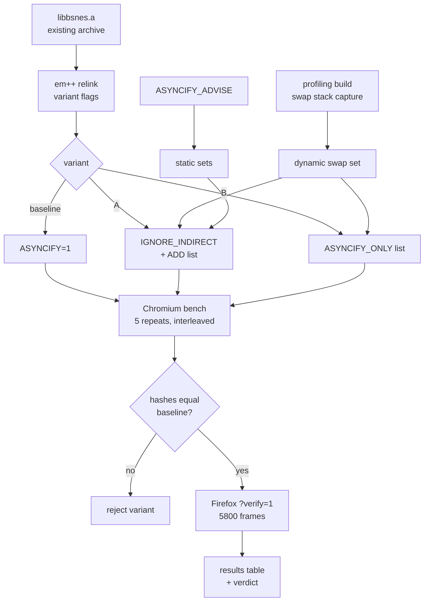

# Asyncify trim: does an instrumentation list make the WASM core faster or smaller?

**Status (2026‑11‑01):** done. No instrumentation list gives a meaningful gain (an `ASYNCIFY_REMOVE` list saves at most 3% frame time; `ONLY`/`ADD` lists trap). Superseded by the [JSPI coroutines plan](2026-11-01-jspi-coroutines.md).

TODO item: **Optional: trim Asyncify cost (size/speed) with an `ASYNCIFY_ONLY`/`ADD` list once the core's swap‑reachable call set is profiled** (`[T3]`, Polish). "Only if mobile perf needs it."

## Context

- Mobile perf now needs it. On the Pixel 8 Pro the WASM player runs at a median 23.7 ms per emulated frame (about 45 FPS) against the 16.6 ms budget, while the native core does 10.7 ms ([report](../performance/2026-10-31/pixel-phone-perf/report.md), [plan](2026-10-31-pixel-phone-perf.md)). Laptop raw WASM was 12.3 ms per frame.
- `build.sh` links `web/cores/bsnes_jg.{js,wasm}` with `-sASYNCIFY=1 -sASYNCIFY_STACK_SIZE=131072`. libco is mapped onto Emscripten fibers by `web/src/libco_emscripten.c`: `co_switch` is `emscripten_fiber_swap`, the only Asyncify import the core reaches. Every function that can be on the wasm stack when a fiber swap happens must be instrumented (it must be able to unwind and rewind). Everything else can be left alone.
- Default Asyncify is conservative: it instruments every function that can reach an async import through **direct** calls, and it assumes **every indirect call** (function pointers, virtual calls, `std::function`) can reach one. bsnes routes bus reads and writes through function‑pointer tables, so the default probably instruments most of the core.
- The experiment only re‑links. Asyncify is a link‑time `wasm-opt` pass, so variants are linked from the existing `vendor/bsnes-jg/objs/libbsnes.a` into a scratch directory. The committed `web/cores`, `dist/engine/cores`, `PROVENANCE.json` and the shas pinned in `android/app/build.gradle.kts` are not touched. Landing a winning variant is a separate decision for the user.
- Disk: `/` has about 2 GB free. All builds go to the session scratchpad on `/tmp` (tmpfs).

No visible surface: this plan produces measurements, not UI, so it has no mockups.

## Approach

1. **Baseline relink.** Link the current flags into scratch and confirm the wasm matches the committed `web/cores/bsnes_jg.wasm` byte for byte (same archive, same toolchain). If it does not match, use the relinked baseline for every comparison so both sides share one toolchain.
2. **Derive the swap‑reachable set two ways.**
    - Static: link with `-sASYNCIFY_ADVISE=1` to list what default Asyncify instruments, and again with `-sASYNCIFY_IGNORE_INDIRECT=1` to list what is reachable through direct calls only.
    - Dynamic: link a profiling build (`--profiling-funcs`) whose `emscripten_fiber_swap` import is wrapped in JS to record `new Error().stack` at every swap. Run every picker ROM (mandel‑display through 5800 frames, lzss‑gallery with input, raycaster) and take the union of wasm function names seen on a stack.
3. **Candidate lists** (at most 3 attempts):
    - **A** `-sASYNCIFY_IGNORE_INDIRECT=1 -sASYNCIFY_ADD=[…]`, where `ADD` names the functions seen dynamically that the direct‑only analysis misses (the frames that reach a swap through an indirect call). Propagation makes their callers instrumented too.
    - **B** `-sASYNCIFY_ONLY=[…]` = the dynamic union exactly. Smallest, and most fragile.
    - **C** only if A and B leave a gap.
4. **Measure.** A headless Chromium (Playwright `chromium_headless_shell`) bench page loads a chosen build directory, boots `mandel-display`, runs 5800 frames timing `_bjg_run()` only, and reports ms per frame. Five repeats per build, interleaved baseline and trimmed in one session, median and spread. Record wasm size raw and gzip `-9`.
5. **Correctness.** For each build, the bench hashes WRAM and the framebuffer at fixed frame checkpoints for each ROM with a fixed input script, and checks the mandel‑display gate value (`0x204F` at WRAM `$0200` after 5800 frames). Trimmed hashes must equal baseline hashes. Then the in‑page `?verify=1` self‑check runs in headless Firefox against a scratch copy of `web/` with the trimmed core swapped in. `npm test` runs on the untouched tree.
6. **Verdict.** Record numbers below. If the gain is clear and every gate passes, ESCALATE the landing (web/cores, dist, pinned shas, PROVENANCE, phone run). Otherwise record "no meaningful gain" or "too fragile" with the numbers.



## Verification

Run on 2026‑10‑31, laptop i7‑1185G7, headless Chromium 151.0.7922.34 (Playwright `chromium_headless_shell`), Firefox 156. The CPU sat at a flat 1.5 GHz (governor `powersave`) with a load average of 8–12 from other agents, so absolute times are about 4.5× the June figure of 12.3 ms per frame. Only the paired, same‑session ratios are meaningful. Raw files are in [../performance/2026-10-31/asyncify-trim/](../performance/2026-10-31/asyncify-trim/), and the tools are in [../performance/2026-10-31/asyncify-trim/tools/](../performance/2026-10-31/asyncify-trim/tools/).

1. Baseline relink reproduces (or is recorded against) the committed `web/cores/bsnes_jg.wasm` sha256.

    ```
    $ tools/link.sh baseline
    3903329
    1880482
    a3f5299b7fc29acb77dbdc22e56d4f45413187e6a416861c98a508b162b45172  …/builds/baseline/bsnes_jg.wasm
    54e19fd849b823d87e278438fe7ec5ccaf8e526e966c8f4e007d29ccf78cdf4d  …/builds/baseline/bsnes_jg.js
    $ sha256sum web/cores/bsnes_jg.wasm web/cores/bsnes_jg.js
    a3f5299b7fc29acb77dbdc22e56d4f45413187e6a416861c98a508b162b45172  web/cores/bsnes_jg.wasm
    54e19fd849b823d87e278438fe7ec5ccaf8e526e966c8f4e007d29ccf78cdf4d  web/cores/bsnes_jg.js
    ```
    **PASS.** The relink is byte‑identical to the committed core: same archive, same emcc 6.0.4.

2. Static and dynamic swap sets are recorded under `docs/performance/2026-10-31/asyncify-trim/` with counts.

    ```
    set-default.txt   1021 functions  (ASYNCIFY_ADVISE, default: indirect calls assumed to unwind)
    set-noind.txt       83 functions  (ASYNCIFY_ADVISE + ASYNCIFY_IGNORE_INDIRECT: direct calls only)
    set-dynamic.txt     59 functions  distinct stacks 3422, swaps 14408626, distinct functions 59
    swap-stack-roots.txt: every swap is rooted in bjg_run (13000, one per frame) or a fiber entry
                          (dynCall_vi -> co_trampoline, 14395626); none under bjg_load or bjg_reset
    ```
    **PASS.** Caveat: the dynamic names come from a `--profiling-funcs` build. Binaryen folds identical functions after the Asyncify pass, so runtime frame names can be aliases. One frame reads `SuperFamicom::CPU::writeRAM`, which no Asyncify set contains: it is a merged bus‑handler thunk. So the dynamic set cannot be fed to `ASYNCIFY_ONLY` as it stands.

3. Each candidate links, and its wasm size (raw and gzip) is recorded.

    ```
    build     raw_bytes  gzip9_bytes  list
    baseline  3903329    1880482      (none)
    wild      3705692    1844685      IGNORE_INDIRECT + ADD Processor::*, SuperFamicom::*, bfunction*, Bsnes::*, GB_*, nall::*
    remove    3635287    1829692      ASYNCIFY_REMOVE list-remove.txt (362 load-time/library functions)
    remove2   3627808    1827889      remove + 17 controller/audio functions (DSP::main, Stream::*, Gamepad::*, CPU::readCPU, CPU::joypadEdge, ...)
    glue bsnes_jg.js: baseline, remove, remove2 = 54e19fd8… (identical to committed); wild = f41b9ff9…
    ```
    **PASS.**

4. Each candidate's WRAM and framebuffer checkpoint hashes equal the baseline's for mandel‑display, lzss‑gallery and raycaster, including a cold start; mandel‑display reads `0x204F` at frame 5800.

    ```
    remove   mandel-display  frames= 5800 checkpoints= 11 video_match=True gate base=204F var=204F OK
    remove   lzss-gallery    frames= 3000 checkpoints= 12 video_match=True gate base=0 var=0 OK
    remove   raycaster       frames= 3000 checkpoints= 12 video_match=True gate base=600 var=600 OK
    remove   mandel-display  frames= 1200 checkpoints=  4 video_match=True gate base=0 var=0 OK
    ALL MATCH
    remove2  mandel-display  frames= 5800 checkpoints= 11 video_match=True gate base=204F var=204F OK
    remove2  lzss-gallery    frames= 3000 checkpoints= 12 video_match=True gate base=0 var=0 OK
    remove2  raycaster       frames= 3000 checkpoints= 12 video_match=True gate base=600 var=600 OK
    remove2  mandel-display  frames= 1200 checkpoints=  4 video_match=True gate base=0 var=0 OK
    ALL MATCH
    wild: Page.evaluate: RuntimeError: null function
        at …/builds/wild/bsnes_jg.wasm:wasm-function[1403]:0x17a755
        at Object.doRewind / finishContextSwitch / trampoline … _bjg_run   (first mandel-display frames)
    ```
    **PASS for remove and remove2; wild FAILS** (expected: its patterns missed `co_switch`, `co_trampoline`, `bjg_run` and `dynCall_vi`, so the first rewind traps). Each build gets a cold start in a fresh browser context. The last row reloads a ROM in the same page and calls `bjg_reset` at frame 600. Gallery and raycaster run a fixed input script that is a function of the frame number. Deviation: whole‑WRAM hashes are **not** compared. bsnes seeds its power‑on RAM from `clock()` (`random.cpp`), and two baseline runs gave different WRAM hashes (`c95793d6` against `369106a1`). The gate bytes at WRAM `$0200` and the framebuffer hashes at every checkpoint are deterministic, so they are the comparison.

5. Bench: five interleaved repeats per build; median and spread of ms per frame recorded in `docs/performance/2026-10-31/asyncify-trim/bench.json`.

    ```
    # separate cold pages, interleaved (bench.json), mandel-display 1500 frames, mean of frames 200+
    baseline  n=5 steady mean ms/frame: median 65.885 min 51.406 max 71.993
    remove    n=5 steady mean ms/frame: median 59.577 min 52.808 max 67.513
    remove2   n=5 steady mean ms/frame: median 59.455 min 50.658 max 67.763
    # paired lockstep (pair.json): all builds in one page, 100-frame chunks, alternating order
    remove / baseline: per-repeat median ratios [0.993, 0.948, 0.997, 0.926, 1.0] -> median 0.993; pooled chunks n=65 median 0.977 IQR 0.923-1.059
    remove2 / baseline: per-repeat median ratios [1.004, 0.872, 0.933, 0.972, 0.975] -> median 0.972; pooled chunks n=65 median 0.961 IQR 0.871-1.057
    # paired, build order reversed (pair-rev.json)
    baseline / remove2: per-repeat median ratios [1.03, 1.044, 1.011, 0.993, 0.998] -> median 1.011; pooled chunks n=65 median 1.011 IQR 0.941-1.090
    ```
    **PASS** (the measurement ran). The separate‑page spread (51–72 ms) is about 40%, far wider than any difference between builds, so the paired lockstep bench (`tools/pair.html`) was added. Paired, `remove2` is 1–3% faster than baseline, inside a chunk IQR of about ±9%. `remove` is 0–1% faster.

6. Headless Firefox `?verify=1` on the best candidate shows `✓ FIDELITY 0x204F == gate … 5800 frames`.

    ```
    {
     "badge": "✓ FIDELITY 0x204F == gate (gate jgxcheck CRC (corpus_result @ WRAM $0200), 5800 frames)",
     "cls": "badge pass",
     "ua": "Mozilla/5.0 (X11; Linux x86_64; rv:156.0) Gecko/20100101 Firefox/156.0",
     "coi": false,
     "sab": "undefined",
     "title": "bsnes-jg-player — the gate's cycle-accurate SNES core, in the browser"
    }
    ```
    **PASS** for `remove2` (wasm `3932d733…`), served from a scratch copy of `web/` with only `cores/bsnes_jg.wasm` replaced.

7. `npm test` passes.

    ```
    synced @wbniv/bsnes-jg-player@1.1.0 -> /tmp/bsnes-jg-player-smoke
    ✓ app.js  sha256 19c8187ae840… == package
    ✓ cores/PROVENANCE.json  sha256 5927ba6e4126… == package
    ✓ cores/bsnes_jg.js  sha256 54e19fd849b8… == package
    ✓ cores/bsnes_jg.wasm  sha256 e74dbd3d7160… == package
    ✓ ENGINE_VERSION  site has 1.1.0, installed package is 1.1.0
    /tmp/bsnes-jg-player-smoke matches @wbniv/bsnes-jg-player@1.1.0.
    picker ok: mandel-display, lzss-gallery
    ```
    **PASS** on the untouched tree. It checks the committed `dist/` payload, not a trimmed build, because nothing was landed.

8. `df -h /` after cleanup is no lower than before the work started (scratch removed).

    ```
    before: /dev/nvme0n1p2  469G  443G  2.2G 100% /
    after:  /dev/nvme0n1p2  469G  443G  2.1G 100% /
    this work on /: docs/performance/2026-10-31/asyncify-trim 328K, plan 8.0K, ~/tmp preview 76K
    scratch builds, web copy and Firefox profile (all on /tmp tmpfs) deleted
    ```
    **FAIL as written, not caused by this work.** This work wrote about 0.4 MB to `/`; every build went to tmpfs. The 0.1 GB drop came from other sessions writing to `~/.cache` over the same period.

## Results

| Build | Asyncify list | wasm raw | wasm gzip ‑9 | Speed vs baseline (paired) | Emulation |
|---|---|---|---|---|---|
| baseline | none (`-sASYNCIFY=1`) | 3,903,329 | 1,880,482 | 1.000 | reference |
| wild | `IGNORE_INDIRECT` + namespace `ADD` | 3,705,692 | 1,844,685 | n/a | **traps** on the first rewind |
| remove | `REMOVE` 362 load‑time/library functions | 3,635,287 (−6.9%) | 1,829,692 (−2.7%) | 0.98–0.99 | identical |
| remove2 | remove + 17 controller/audio functions | 3,627,808 (−7.1%) | 1,827,889 (−2.8%) | 0.97–0.99 | identical, Firefox gate ✓ |

**Swap‑reachable set.** A fiber swap happens only inside `bjg_run`'s dynamic extent. On the stack at that point are `bjg_run` or a fiber entry (`dynCall_vi` → `co_trampoline` → `SuperFamicom::Enter`), then the scheduler (`Scheduler::resume`/`leave`), the 65816 and SPC700 instruction handlers, `CPU::read`/`write`/`idle`/`step<N>`/`dmaEdge`/`scanline`, the bus‑handler `bfunction` thunks, and `PPU::writeIO`/`SMP::readIO`. That is 59 distinct names at runtime. Direct calls alone reach 83 functions. Default Asyncify instruments 1021, because it assumes every indirect call can unwind. Of the 1021, 248 are libc++ (`std::`), plus BML/byuuML, heuristics, cartridge loading, printf/scanf and SameBoy.

**Why there is no speed to win with a list.** Every hot function in a frame is a 65816 or SPC700 instruction handler, a bus access or a scheduler step, and each of those is genuinely on the stack at a swap, so it must stay instrumented. Most of what a list can safely drop is code that runs only while a ROM loads. Removing that saves 7% of raw wasm and does not change frame time. Dropping the per‑sample DSP and controller functions as well (`remove2`) is worth at most 1–3%, inside the noise. A smaller set needs `ASYNCIFY_IGNORE_INDIRECT` or `ASYNCIFY_ONLY`. The `wild` run shows that a list built from names breaks at once when it misses one frame. Binaryen also folds functions with identical bodies, so profiled names are not the names the pass matches. And the player accepts user ROMs with coprocessors (SA‑1, SuperFX, Super Game Boy) that the picker ROMs never exercise. An `ONLY` list is too fragile to maintain for at most a few percent.

**Verdict: no meaningful speed gain.** On the laptop a list buys at most 1–3% of frame time and 7% raw (2.8% gzip) of size. The Pixel needs a 1.4× cut, from 23.7 to 16.6 ms. A phone run of `remove2` is not justified, because a gain of at most 3% cannot close that gap. Landing `remove`/`remove2` for size alone would change only the wasm. The glue `bsnes_jg.js` stays byte‑identical, so `expectedGlueSha` would not move. It would still need `web/cores`, `dist/engine/cores`, `PROVENANCE.json` and `expectedWasmSha` updated, and that is the user's call. It is not recommended for 50 KB of gzip.

**What would actually remove the Asyncify cost** is a coroutine mechanism with no instrumentation. One option is wasm stack switching through JSPI (`-sJSPI`), if Emscripten fibers or a libco backend can be built on it. The other is a libco‑free scheduler. Both are design changes (T4), and this item did not explore them.
