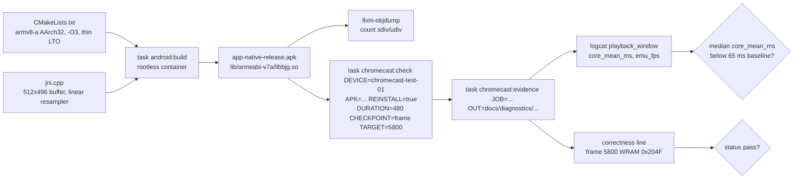
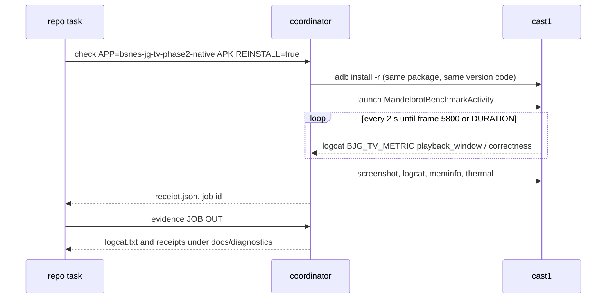

# Cast1 armeabi-v7a build tuning and support position

## Context

Cast1 (`chromecast-test-01`, Chromecast HD, Amlogic quad Cortex‑A35, 32‑bit userspace, Android 14) runs the native bsnes-jg core at about 65 ms per emulated frame, roughly 15 FPS against the 60 FPS target. Pixel 8 Pro runs the same core at about 10 ms. Evidence: every `playback_window` record in [`docs/diagnostics/coverage-followup-2026-10-31/cast1-landscape/logcat.txt`](../diagnostics/coverage-followup-2026-10-31/cast1-landscape/logcat.txt) reports `core_mean_ms` between 63 and 67 and `emu_fps` near 15.

A callgrind profile of the exact core and ROM (`vendor/bsnes-jg` 2.1.0, `android/fixture/mandel-display.sfc`) in a native x86 harness gives the per-frame budget. Instruction counts are independent of host load.

| Quantity | Value |
|---|---|
| Instructions per emulated frame | ~49 M |
| Dot-accurate PPU (`cycleBackgroundAbove`, `fetchNameTable`, `Window::run`, …) | 65–70% |
| 65816 CPU and bus | ~14% |
| SMP, DSP and the sinc audio resampler | ~7% (resampler 2%) |
| libco coroutine switching | 0.01% |
| One-time load cost in `Bus::map` | ~1.1 G instructions |

Two conclusions follow. First, even a free PPU leaves about 22 ms per frame on Cast1, above the 16.7 ms budget, so no change to this core reaches 60 FPS on Chromecast HD class hardware. Second, the plan hypothesised that the build could be made honestly faster without touching fidelity: the 32‑bit library is compiled for the ARMv7‑A baseline (software division, no ARMv8 instructions) without link-time optimisation, and it runs a sinc resampler whose output the Android host discards. **The measurement refuted this: see [Result](#result).**

The profile also exposed a latent bug: the core writes framebuffer rows up to index 127,487 in non-interlaced mode, while `android/app/src/main/cpp/jni.cpp` allocates 512×248 = 126,976 pixels. The 511-pixel (2 KB) overrun lands in the adjacent RGBA buffer today, which hides it. With interlace on, writes reach index 253,951, about 500 KB past the end. Upstream `jg.cpp` sizes the buffer 512×496.

**Support position (Will, 2026‑10‑31):** Cast1 is a correctness-and-layout device. It proves the frame‑5800 WRAM gate and the pixel-exact 4:3 layout. The 60 FPS pacing claim attaches to Pixel-class hardware and future big-core TV devices. Cast2 (Chromecast with Google TV 4K, Cortex‑A55, also 32‑bit) is expected to land near 20 FPS and does not change this.

## Approach

Three small, independently revertable changes, then one measurement run. Change 2 was built, measured and **rejected**; changes 1 and 3 are kept.

1. **Framebuffer size fix** in [`android/app/src/main/cpp/jni.cpp`](../../android/app/src/main/cpp/jni.cpp): `MaxVideoHeight` becomes 496 to match upstream `hmax`, with a comment citing the write pattern in `PPU::Screen::scanline` and a defensive check in the video callback that logs an error if the core ever reports a frame larger than the buffer.
2. **(Rejected: 0.64× slower, see Result.) 32‑bit code generation** in [`android/app/src/main/cpp/CMakeLists.txt`](../../android/app/src/main/cpp/CMakeLists.txt): for `armeabi-v7a`, add `-march=armv8-a -mfpu=neon-fp-armv8` (both Chromecasts report `ARMv8 Processor (v8l)` with `idiva idivt`), keep `-marm` for libco, and enable `-O3` for C as well as C++ plus thin LTO (`-flto=thin`) on compile and link for every ABI. The `armeabi-v7a` library then requires ARMv8-class hardware in 32‑bit mode; every Google TV device in scope is one. True ARMv7-only devices (Cortex‑A9 era) are not a target of this player.
3. **Resampler** in `jni.cpp`: pass a resampler quality that selects libsamplerate's linear converter. bsnes-jg 2.1.0 maps the public `rsqual` field as `_rsqual = 2 - rsqual` onto converter ids, so `2u - 4u` wraps to `SRC_LINEAR` (4). The Android host's audio callback discards every sample, so this is output-invisible; callgrind confirms `sinc_stereo_vari_process` disappears and `linear_vari_process` costs about 6% of what sinc did. Revisit when audio output is wired.

Profile-guided optimisation is deliberately a follow-up (see Out of scope): it needs an instrumented training APK whose `.profraw` the coordinator can pull back, and the gain should be measured after the three changes above.

The change has no visible surface: it alters compiler flags, a buffer size and a resampler mode. No mockups.

Rejected: porting a scanline "fast PPU" (large, re-baselines the parity gates, and still short of 60 FPS on Cast1) and swapping emulator cores on Cast1 (reaches 60 FPS but breaks bsnes parity with the web player).

## Diagrams

Build and measurement flow:



Order of the device job (the coordinator owns the device; this repository only submits):



## Result

Measured 2026-10-31 on Cast1 with release-signed APKs, one frame-5800 job per build. Full table, chart and caveats: [`report.md`](../performance/2026-10-31/cast1-armv7-tuning/report.md).

| Build | Median core time | Speed | Checkpoint |
|---|---|---|---|
| Baseline | 64.14 ms | 15.41 FPS | frame 5841 at 378 s, pass |
| A: ARMv8 flags only | 64.42 ms (0.996×) | 15.32 FPS | frame 5841 at 380 s, pass |
| B: `-O3` and thin LTO only | 100.09 ms (0.641×) | 9.91 FPS | frame 4769 at 480 s, missed |
| Full change 2 (A and B) | 106.14 ms (0.604×) | 9.34 FPS | frame 4497 at 480 s, missed |

`CMakeLists.txt` keeps none of the flags, only a comment recording this. The framebuffer fix and linear resampler stay. `-O3` was not separated from thin LTO.

## Cast2 measurement (2026‑11‑01)

Job `J‑0020fd86a0c0` on `chromecast-test-02` (Chromecast, Android 12, armeabi-v7a), release-signed clamp build, version 0.1.10 (code 11), cert `1bc3d058…`, `DURATION=480`. Evidence: `docs/diagnostics/cast2-armv7-measure-2026-11-01/`; comparison: `compare/summary.json` and `compare/core-ms.svg`.

| Device | Windows | Median core ms | Median FPS | p05 / p95 core ms |
|---|---|---|---|---|
| Cast1 Chromecast HD, baseline `8811ca04` | 281 | 64.14 | 15.41 | 63.28 / 65.35 |
| Cast2 Chromecast, clamp `8dc3b646` build | 446 | 44.04 | 22.41 | 43.77 / 45.62 |

- Cast2 runs the core 1.456× faster than Cast1 (median core ms), still well under the 60 FPS target (16.6 ms budget).
- `emulation_backlog_frames` is 0.0 in every window, as the catch-up clamp intends.
- The run reached ROM frame 10,773 at about 491 s and passed frame 5800 at 269 s.
- Clamp and baseline cores differ by 0.1% on Cast1, so the comparison is a device comparison.
- **Not measured:** the frame‑5800 capture, the WRAM `0x204F` gate and the 4:3 layout check were not run on Cast2.
- **The package id differs.** Cast2 carries a stale `org.bsnesjg.tv.native.phase2` signed with another key (it survived a factory reset), so `INSTALL_FAILED_UPDATE_INCOMPATIBLE` blocked four installs (evidence in the `-install-refused*` directories, untracked). This build uses id `org.bsnesjg.tv.native.phase2.cast2`, built with `BJG_GRADLE_EXTRA=-PnativeIdSuffixExtra=.cast2` (`android/app/build.gradle.kts`, `android/build-in-container.sh`). Native code, version, key and ROM are identical.
- The coordinator app `bsnes-jg-tv-phase2-native-cast2` has no `frame` checkpoint, because checkpoints are declared per package in the coordinator's root-owned `applications.json`. Adding one for the `.cast2` package would restore the automatic frame‑5800 capture; that is the administrator's change.

## Out of scope

- **PGO training build.** A `-fprofile-generate` variant of `libbjg.so`, a JNI `dumpProfile()` that writes `.profraw` after a fixed frame count, a coordinator step that pulls it from the app's files directory, and a `-fprofile-use` release build. Expected gain 10–30% on this interpreter-style code. Gate on the coordinator having a file-pull capability for a non-debuggable package.
- **Startup cost.** `Bus::map` spends about 1.1 G instructions at load, roughly 1–2 s of Cast1's time to first frame. Inherent to the core's address-map design; record it in the selector plan's startup timing rather than optimising here.
- **Unbounded catch-up credit (fixed after this plan's runs).** `emulation_backlog_frames` is the running `credit` value at the end of each one-second window (`peak_backlog_frames` is the window maximum), not a windowed peak. On Cast1 it grew monotonically for the whole run: 3 739.74 to 16 219.70 frames over 284 windows in the baseline, about 44 frames per second, which is the 60.0988 Hz target minus the 15.4 FPS the core delivers. The tuned and variant runs showed the same growth, with no decreases in any of them. A stall would have been replayed at 4 steps per callback. `MainActivity.NativeRenderer` now clamps `credit` to `MAX_CATCHUP_STEPS` (4, one callback of work) after the peak is sampled, so the missed time is dropped instead of banked. The cap is native-only: the WASM `tv-scheduler.js` has no credit cap and still recovers a stall in full, which `android/test/frame-scheduler.test.mjs` pins. Covered by that test: the Java source declares the constant and the clamp, and a JS model of the arithmetic stays bounded on a slow core and does not burst after a 10 s stall. Not covered: the Java code executing (it is not unit-testable here) and any device run; after the fix, `emulation_backlog_frames` should read at most 4 on Cast1. **Device check, 2026-10-31 (job J‑12d2458f0664, release APK `8dc3b646`, Cast1):** frame 5809 reached at 377 s, WRAM `0x204F` gate passes, median core time 64.24 ms (0.999× the baseline's 64.14 ms), and `emulation_backlog_frames` is 0.0 in all 366 windows against 3,739.74 rising to 16,219.70 in the baseline; `peak_backlog_frames` sits at 15.02 (the pre-clamp per-callback credit, 0.25 s × 60.0988). Evidence: `docs/diagnostics/cast1-armv7-tuning-2026-10-31/clamp/`.

## Verification

1. **Build the APK in the container and record its hash.**

```
$ task android:build
$ sha256sum android/app/build/outputs/apk/native/release/app-native-release.apk
```

Built four times (baseline, full, A, B) with `task android:release-build`, version 0.1.10 / code 11, all verified by the container's Gradle artifact checks (exit 0):

```
8811ca0478c4444a1f6e76d8faa1f873016a53380fbe4fc3625abd1861b2875f  baseline
640288dea47b41f8b3bfa4487b4059fa0ca8fca4536a113b2c3f3436ca4eb21f  full (A+B)
88c11c5198cf7610…  A (ARMv8 flags only)
bc847ac198f89275…  B (-O3 + thin LTO only)
Signer #1 certificate SHA-256 digest: 1bc3d0586ff02c6be1479785652484ba70efccdfee46ce451520d221802d9a5e
```

**PASS**

2. **Confirm the 32‑bit library uses hardware integer divide.** The baseline contains no `sdiv`/`udiv`. Note that the `Tag_CPU_arch` build attribute still reads "ARM v7" in the tuned library because the NDK's final link applies its own `-march=armv7-a`; the instruction count, not that tag, is the evidence.

```
$ unzip -p android/app/build/outputs/apk/native/release/app-native-release.apk lib/armeabi-v7a/libbjg.so > /tmp/libbjg-v7a.so
$ ~/android-sdk-local/ndk/26.2.11394342/toolchains/llvm/prebuilt/linux-x86_64/bin/llvm-objdump -d --triple=armv8a /tmp/libbjg-v7a.so | grep -c -E "\b(sdiv|udiv)\b"
```

```
baseline  3,068,816 bytes   0 sdiv/udiv
full      3,595,656 bytes  75 sdiv/udiv
A         3,068,160 bytes  76 sdiv/udiv
B         3,596,736 bytes   0 sdiv/udiv
```

**PASS** (the ARMv8 flags produce hardware divides, as intended).

3. **Run the Cast1 checkpoint job with the new APK.**

```
$ task chromecast:check DEVICE=chromecast-test-01 APP=bsnes-jg-tv-phase2-native APK=$PWD/android/app/build/outputs/apk/native/release/app-native-release.apk REINSTALL=true DURATION=480 CHECKPOINT=frame TARGET=5800
```

```
J-fee4970467a4 baseline  checkpoint reached  frame 5841 at 378 s
J-e9c77d56da69 A         checkpoint reached  frame 5841 at 380 s
J-5f612b5220da full      checkpoint not reached  last frame 4497 at 480 s
J-11546e56ba60 B         checkpoint not reached  last frame 4769 at 480 s
```

**FAIL** for the tuned configurations (B and full): they ran, but slower than the baseline and missed the checkpoint. The jobs themselves were clean.

**Attempt 1 (2026-10-31 15:47): FAIL, not a measurement.** Job input `ff47f1ba…` was refused with `INSTALL_FAILED_UPDATE_INCOMPATIBLE` (receipt and `adb-failure-7.json` under `docs/diagnostics/cast1-armv7-tuning-2026-10-31/`). Cast1 has the frozen `a64650ac…` APK installed, and the tuned build was signed with the debug key (`79f65b24…`, `controlledDebugSigning`). The baseline APK carries the release certificate (`1bc3d058…`, CN=bsnes-jg Android Release). Which key signed `a64650ac…` is not recorded in the repo; confirm it before rebuilding. The tuned APK must be signed with that key (`task android:release-build` needs the keystore from `task android:release-secrets-pull`), and the coordinator registration must be replaced with each APK in turn.

4. **Collect the evidence and summarise pacing against the 65 ms / 15.1 FPS baseline.**

Run with `android/tools/tuning-report.py` (same median of per-window `core_mean_ms`, 3 warm-up windows dropped) against the same-day baseline:

```
baseline: 281 windows, median 64.14 ms, 15.41 FPS
A:        364 windows, median 64.42 ms, 15.32 FPS
B:        396 windows, median 100.09 ms, 9.91 FPS
full:     375 windows, median 106.14 ms, 9.34 FPS   (0.604x)
```

**FAIL**: the tuned configuration is not faster than the 65 ms baseline.

```
$ task chromecast:evidence JOB=<job> OUT=docs/diagnostics/cast1-armv7-tuning-2026-10-31
$ python3 - <<'PY'
import json,re,statistics
rows=[json.loads(m.group(0)) for m in re.finditer(r'\{"event":"playback_window".*?\}', open('docs/diagnostics/cast1-armv7-tuning-2026-10-31/logcat.txt').read())]
rows=[r for r in rows if r.get('engine')=='native' and r.get('emu_fps',0)>0]
print(len(rows),'windows; median core_mean_ms',statistics.median(r['core_mean_ms'] for r in rows),'; median emu_fps',statistics.median(r['emu_fps'] for r in rows))
PY
```

5. **Confirm correctness is unchanged: the frame‑5800 WRAM gate passes on the tuned build.**

```
baseline: "phase":"correctness","frame":5800,"offset":1408,"expected":8271,"actual":8271,"status":"pass"
A:        "phase":"correctness","frame":5800,"offset":1408,"expected":8271,"actual":8271,"status":"pass"
B:        (no correctness record: frame 5800 never reached)
full:     (no correctness record: frame 5800 never reached)
```

**FAIL** for B and full (not evaluated); **PASS** for A, the only tuned variant that reached the frame.

```
$ grep -o '"phase":"correctness"[^}]*' docs/diagnostics/cast1-armv7-tuning-2026-10-31/logcat.txt
```

6. **Confirm the resampler mapping on the host harness (callgrind, 20 frames, default vs `2u - 4u`).**

```
$ callgrind_annotate --threshold=100 cg_bench.out | grep -E "vari_process"
$ callgrind_annotate --threshold=100 cg_bench_linear.out | grep -E "vari_process"
```

```
default (sinc):  21,495,194 ( 0.87%)  src_sinc.c:sinc_stereo_vari_process
2u - 4u (linear): 1,248,843 ( 0.05%)  src_linear.c:linear_vari_process   (no sinc_stereo_vari_process)
```

**PASS**
