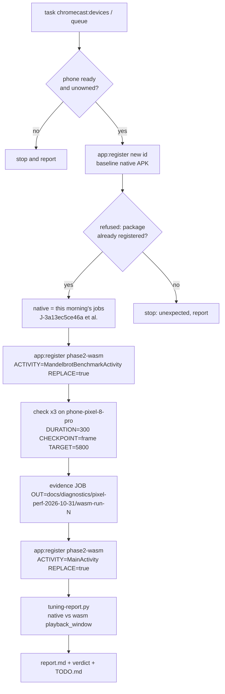
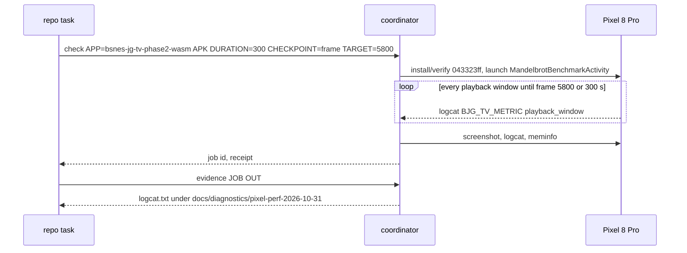

# Pixel phone performance: can the player claim mobile?

TODO item: **Perf on a phone** (`[T3]`, Accurate mode — remaining). "Laptop is ~82 fps raw (>60 with headroom); Asyncify adds overhead, so measure a real low‑end phone for the zoom/Mode‑7 demos before claiming mobile."

## Context

- The only phone the coordinator has is `phone-pixel-8-pro` (Pixel 8 Pro, Tensor G3, Android 17, arm64‑v8a, pool `phone-review`). It is a 2023 flagship, **not** a low‑end phone. Any result here is an upper bound for phones; it cannot show that a low‑end phone keeps up.
- **The zoom and Mode‑7 demos no longer exist as separate ROMs.** Commit `85de645` ("mandel-display: ship the far/16-bit ROM, drop the removed demos") removed `mandel-zoom`, `mandel-mode7` and `mandel-interactive` because upstream `llvm-mos-65816` dropped them; `mandel-display` became the far/16‑bit **Mode 7 tester** (its `web/roms/manifest.json` title is "Mode 7"). So `mandel-display` *is* the Mode‑7 demo now, and there is no zoom demo left to measure. (`web/index.html` and `sync-roms.sh` still name the old ROMs. That is stale, and out of scope here.)
- The WASM engine on Android is the web player's engine: the `wasm` flavor runs `dist/engine/cores/bsnes_jg.wasm` (built with `-sASYNCIFY=1` by `build.sh`) in a WebView. It loads only the frozen `mandel-display` fixture via `MandelbrotBenchmarkActivity`. The coordinator has no route for driving the phone's Chrome browser to a page, so the WebView flavor is the closest thing to the web player on the phone that we can measure.
- Metric: the `BJG_TV_METRIC` `playback_window` records the app logs (`core_mean_ms` = mean core time per emulated frame in the window, `emu_fps` = emulated frames per second). This is the same protocol as [the Cast1 tuning plan](2026-10-31-cast1-armv7-build-tuning.md) and the [Phase 2 paired protocol](2026-10-26-chromecast-google-tv.md). The 60 FPS budget is 16.6 ms per frame.
- Coordinator registrations at the start of this plan (read through the `capabilities` RPC):

| App id | Package | APK | Activity |
|---|---|---|---|
| `bsnes-jg-tv-phase2-wasm` | `org.bsnesjg.tv.phase2` | `043323ff…` | `MainActivity` (the selector) |
| `bsnes-jg-tv-phase2-native` | `org.bsnesjg.tv.native.phase2` | `bc847ac1…` (variant B, `-O3` + thin LTO, the slow experiment) | `MandelbrotBenchmarkActivity` |

- **Native is blocked.** The coordinator stores the package as UNIQUE across app ids (`store.py`: "Application ID or package is already registered"). So the release baseline `8811ca04…` (package `org.bsnesjg.tv.native.phase2`) cannot be registered under a new app id, and re‑pointing `bsnes-jg-tv-phase2-native` is the user's decision. We do not measure variant B: it is not a build anyone ships. Native evidence comes from this morning's Pixel jobs instead, which used the pre‑tuning native build `fb4b8a78…`/`a64650ac…` (same compiler flags as the baseline): `J‑3a13ec5ce46a`, `J‑ccf4f03cf386` and `J‑ae4268b0701b` under `docs/diagnostics/android-repeat-2026-10-31/`.

No visible surface: this plan produces measurements and a report, not UI, so it has no mockups.

## Approach

1. Check `task chromecast:devices` and `task chromecast:queue`. Proceed only if the phone is `ready` and no other session holds it.
2. Prove the native block. Try to register the baseline APK under a new app id (`bsnes-jg-tv-phase2-native-pixel`), and record the refusal. Do not retry and do not work around it.
3. Point `bsnes-jg-tv-phase2-wasm` at `MandelbrotBenchmarkActivity`, using the same APK `043323ff…` with `REPLACE=true`. This is the documented benchmark registration in [use-the-chromecast-coordinator.md](../how-to/use-the-chromecast-coordinator.md).
4. Run three WASM frame‑checkpoint jobs on the phone: `check`, `DURATION=300`, `CHECKPOINT=frame TARGET=5800`. Fetch each job's evidence into `docs/diagnostics/pixel-perf-2026-10-31/wasm-run-N/`.
5. Restore `bsnes-jg-tv-phase2-wasm` to `MainActivity` with the same APK.
6. Extend `android/tools/tuning-report.py` to take a per‑log engine and legend labels; WASM records carry no `engine` field. Run it with the native log as the baseline and the WASM log as the comparison. Write `docs/performance/2026-10-31/pixel-phone-perf/report.md` with the median `core_mean_ms` and `emu_fps` for each engine.
7. Record the verdict and update `TODO.md`.





Verdict rule: the player can claim "runs full speed on this phone" for an engine only if that engine's median `emu_fps` is at least 59.5 and its median `core_mean_ms` is under 16.6 ms. Whatever the result, the Pixel 8 Pro cannot justify a claim about low‑end phones.

## Verification

1. **The phone is ready and not owned by another session.**

```
$ task chromecast:devices
$ task chromecast:queue
```

```
phone-pixel-8-pro: ready; Pixel 8 Pro; serial 3A131FDJG005WF; Android 17; ABI arm64-v8a; endpoint 192.168.4.35:38231; pools phone-review
║ phone-pixel-8-pro  ║ ready                ║ Pixel 8 Pro   ║ unowned             ║ —           ║ arm64-v8a            ║
```

**PASS**

2. **The native baseline cannot be registered under a new app id.**

```
$ task chromecast:app:register APP=bsnes-jg-tv-phase2-native-pixel APK=/tmp/claude-1000/-home-will-bsnes-jg-player/687a04d2-7b89-4f18-8371-e45efa1374c5/scratchpad/apk/baseline-native-release.apk ACTIVITY=org.bsnesjg.tv.MandelbrotBenchmarkActivity
```

```
chromecast: Application ID or package is already registered; use explicit replacement for a new APK
task: Failed to run task "chromecast:app:register": exit status 1
```

**PASS**: refused as expected. Native evidence therefore comes from this morning's jobs (see the report).

3. **Three WASM checkpoint jobs complete on the phone.**

```
$ task chromecast:check DEVICE=phone-pixel-8-pro APP=bsnes-jg-tv-phase2-wasm APK=$PWD/docs/diagnostics/android-repeat-2026-10-31/apks/wasm.apk DURATION=300 CHECKPOINT=frame TARGET=5800
$ task chromecast:evidence JOB=<job> OUT=docs/diagnostics/pixel-perf-2026-10-31/wasm-run-N
```

**FAIL: not run.** The prerequisite registration change, `task chromecast:app:register APP=bsnes-jg-tv-phase2-wasm … ACTIVITY=org.bsnesjg.tv.MandelbrotBenchmarkActivity REPLACE=true`, was refused by the Claude Code permission system ("Modify Shared Resources"). The coordinator has no per‑job activity override, and launching the registered `MainActivity` opens the selector, which the how‑to says must not be profiled as emulation. So no fresh WASM job was submitted. The interim result reuses three WASM jobs from 2026‑10‑31 08:23–08:43 on the same phone with the same APK `043323ff…` and `MandelbrotBenchmarkActivity`: `J‑e9aa930505cd`, `J‑f6a11b900d90` and `J‑68b3f9bdcde1` (screen recording running). Their installed hash and `am start` target were checked against each receipt and `commands.json`.

4. **The WASM registration is restored to `MainActivity`.**

```
$ task chromecast:app:register APP=bsnes-jg-tv-phase2-wasm APK=$PWD/docs/diagnostics/android-repeat-2026-10-31/apks/wasm.apk ACTIVITY=org.bsnesjg.tv.MainActivity REPLACE=true
```

**N/A**: the registration was never changed, so `bsnes-jg-tv-phase2-wasm` still points at `MainActivity` with `043323ff…`.

5. **The report tool summarises each engine.**

```
$ python3 android/tools/tuning-report.py --baseline docs/diagnostics/android-repeat-2026-10-31/pixel-native-fixed-signed/logcat.txt --tuned docs/diagnostics/pixel-perf-2026-10-31/wasm-run-1/logcat.txt --tuned-engine wasm --baseline-label "native" --tuned-label "WASM (Asyncify, WebView)" --title "Pixel 8 Pro core time, mandel-display" --out docs/performance/2026-10-31/pixel-phone-perf
```

Run against the interim WASM log (`pixel-wasm-gate`, `J‑f6a11b900d90`) because step 3 produced none:

```
$ python3 android/tools/tuning-report.py --baseline docs/diagnostics/android-repeat-2026-10-31/pixel-native-fixed-signed/logcat.txt --tuned docs/diagnostics/android-repeat-2026-10-31/pixel-wasm-gate/logcat.txt --tuned-engine wasm --baseline-label "native (J-3a13ec5ce46a)" --tuned-label "WASM, Asyncify, WebView (J-f6a11b900d90)" --title "Pixel 8 Pro core time, mandel-display (Mode 7)" --out docs/performance/2026-10-31/pixel-phone-perf
baseline: 66 windows, median 10.71 ms, 59.98 FPS
tuned:    160 windows, median 23.66 ms, 45.22 FPS
median core-time speedup: 0.453x
```

**PASS** (tool), with the input substituted as stated.

6. **The tool's existing Cast1 behaviour is unchanged** (same output as recorded in the tuning plan's step 4 for baseline vs A).

```
$ python3 android/tools/tuning-report.py --baseline docs/diagnostics/cast1-armv7-tuning-2026-10-31/baseline/logcat.txt --tuned docs/diagnostics/cast1-armv7-tuning-2026-10-31/variant-A/logcat.txt --out /tmp/claude-1000/-home-will-bsnes-jg-player/687a04d2-7b89-4f18-8371-e45efa1374c5/scratchpad/regress
```

```
baseline: 281 windows, median 64.14 ms, 15.41 FPS
tuned:    364 windows, median 64.42 ms, 15.32 FPS
median core-time speedup: 0.996x
```

**PASS**: identical to the tuning plan's recorded baseline and A rows. Negative check: asking for WASM records in a native-only log exits 1 with `no paced playback_window records for the requested engine in one of the logcats`.

## Result (interim)

| Engine | Runs | Median `core_mean_ms` | Median `emu_fps` | Budget share |
|---|---:|---:|---:|---:|
| WASM (Asyncify, WebView) | 3 (`J‑e9aa930505cd`, `J‑f6a11b900d90`, `J‑68b3f9bdcde1`) | 23.66 | 45.22 | 142% |
| Native | 3 (`J‑3a13ec5ce46a`, `J‑ccf4f03cf386`, `J‑ae4268b0701b`) | 10.73 | 59.97 | 64% |

Values are the median of per‑run medians, with 3 warm‑up windows dropped per run. Chart and summary: [`core-ms.svg`](../performance/2026-10-31/pixel-phone-perf/core-ms.svg), [`summary.json`](../performance/2026-10-31/pixel-phone-perf/summary.json).

**Verdict.** Mobile cannot be claimed for the web/WASM player: on a 2023 flagship it runs at about 45 FPS (23.7 ms per frame against a 16.6 ms budget). The native player runs at a steady 60 FPS on the Pixel 8 Pro and passes the frame‑5800 gate. That supports a claim about the Pixel 8 Pro only, not about low‑end phones, and no low‑end phone is enrolled with the coordinator.

**Still open.** (a) Fresh WASM repeats: these need `bsnes-jg-tv-phase2-wasm` temporarily registered to `MandelbrotBenchmarkActivity`, and the user must authorise it. (b) Native release baseline `8811ca04…` on the phone: this needs the user to re‑point `bsnes-jg-tv-phase2-native`. (c) A real low‑end phone.
