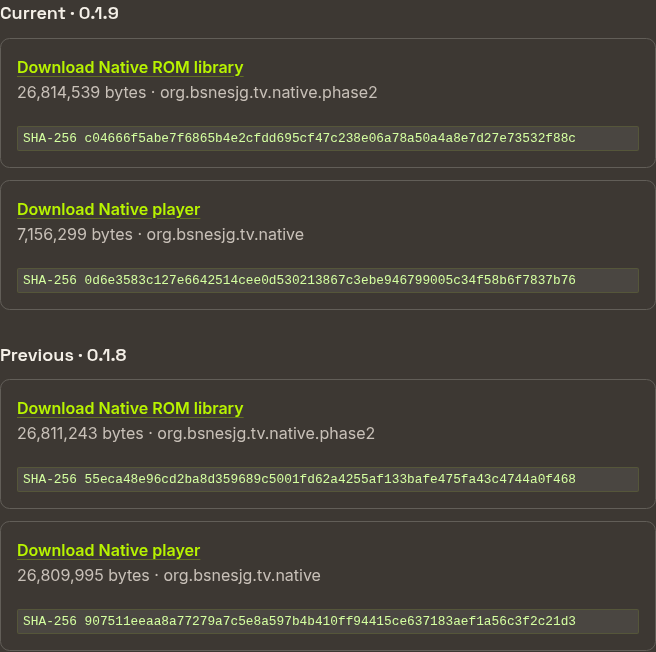
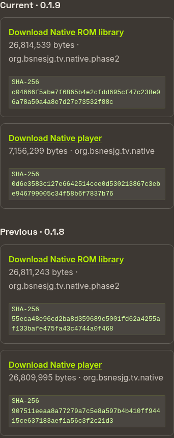

# Repeatable releases, signing, retention and sharing proof

**Status (2026-10-31):** Local implementation and full candidate preparation PASS. Release scripts, task interface, signing/payload gates, resumable publication, retention tests, TV public-QR access and consumer-page source changes are implemented. Public publication, credential provisioning and device transfer proof remain blocked/pending as recorded below.

**Outcome:** One reviewable release candidate containing the browser player and two signed Native Android examples; an explicit publication command that verifies public downloads before changing the release pointer; exactly current and previous releases after successful cleanup; verified phone and TV sharing flows.

This plan carries forward the unfinished work in [Public Android APK downloads](2026-10-28-r2-apk-public-downloads.md). It supersedes that plan's proposed release implementation sequence where details differ. Existing release history remains evidence of the earlier manual publications.

## Baseline and boundaries

Repository records, inspected 31 October 2026, identify Android current **0.1.9 / versionCode 10** and previous **0.1.8**. These are local records, not a fresh live-service audit. Coordinator releases 0.1.18/0.1.19 are unrelated to player versions.

- Reuse `task android:release-build` and `android/tools/release-signing-secrets.sh`. A durable Android release key already exists in SSM; do not generate a replacement identity.
- Preserve package IDs `org.bsnesjg.tv.native` and `org.bsnesjg.tv.native.phase2`. Verify the established signing certificate fingerprint from the retained release records.
- Public artifacts are the Native player and Native library. The player bundles the demo selected by `demo-rom.json`; the library bundles the catalog, ROM files and artwork. Browser WASM remains a separate web artifact. Android WASM comparison APKs stay outside the publication set.
- Preserve the established R2 bucket `bsnes-jg-downloads`, prefix `bsnes-jg/`, canonical product page `https://indri.studio/apps/bsnes-jg-player/`, and stable download entry `https://downloads.biohack.net/bsnes-jg/`.
- Browser package version and Android release version currently differ. Record both explicitly; do not silently change npm's version to the Android version. Use one candidate ID/source revision and consistent Android version fields across the two APKs.
- This work covers Android/web delivery. iOS signing, App Store distribution and emulator performance improvements remain separate.

## 1. Define the release candidate and task interface

Add a focused release Taskfile and scripts under `scripts/release/`; retain the existing build entry points. Proposed interface:

| Task | Contract |
|---|---|
| `task web:release:prepare VERSION=<version> VERSION_CODE=<integer>` | Build and inspect a candidate locally; produce a manifest, checksums and publication/deletion preview. No public writes. |
| `task web:release:check` | Read-only audit of configuration, public manifests, signatures/metadata, object hashes, cache headers and retained versions. |
| `task web:release CANDIDATE=<path>` | Publish the exact prepared bytes after the destination/current/previous/prune summary and explicit confirmation. No rebuilding after review. |
| `task web:release:resume CANDIDATE=<path>` | Reconcile a partial attempt using its journal; retry missing verification or cleanup without advancing versions again. |
| `task secrets-pull` | Render the ignored, mode-0600 project credential cache from SSM. |
| `task secrets-bootstrap` / `task web:r2:setup` | Explicit one-time provisioning/repair, with a concrete permission/resource diff before mutation. |

Preparation must reject a dirty source tree or explicitly capture a reproducible source snapshot; default to a clean committed revision. Record source revision, toolchain versions, browser package version, Android version name/code, demo identity/hash and library inventory hash. Pin the ROM/catalog inputs used by both builds. Eliminate unexplained version literals in `android/app/build.gradle.kts` by taking validated release inputs; ordinary development builds retain documented defaults.

**Validation:** produce the same candidate metadata from the same inputs; reject duplicate/decreasing Android codes against both APK identities and the publication history. Keep a high-water mark even if a download pointer is rolled back. Reject missing/invalid version inputs before an expensive build.

## 2. Signing and payload gates

Inspect the actual output APKs with the Android build tools before allowing publication:

- Verify signatures and the expected certificate SHA-256; reject debug signing, unsigned files, wrong package IDs and inconsistent version fields.
- Require exactly the two intended Native variants. Check supported ABIs against the build contract and inspect native-library presence.
- Verify the player contains the configured demo and its recorded hash. Verify every library catalog reference resolves to the expected ROM/artwork bytes; record counts and hashes, not merely an expected count of 152.
- Record file size and SHA-256 for every artifact and generate immutable `release.json`. Run the existing browser/core fidelity gates and appropriate Android build checks.
- Exercise recovery of the existing signing payload into a temporary protected directory and verify its certificate identity. Remove the temporary material after the check; retain only a redacted recovery receipt.

**Validation:** fixture tests reject a wrong key, debug certificate, incorrect package/version, missing ROM and modified artifact. A retained correctly signed release passes inspection. A device update from previous to the candidate preserves package identity and app preferences; use coordinator-owned installs and record any required clean-install limitation explicitly.

## 3. Project-scoped credentials

Inspect parameter names and existing configuration without exposing values. Resolve the recorded R2 `AccessDenied` problem by provisioning or correcting credentials scoped to this project's bucket. SSM remains the source of truth; credentials must not enter task arguments, logs, manifests or HTML.

Separate publication permissions from account-level bucket/domain setup permissions. The routine publisher needs the object operations required for upload, verification and retention in the dedicated bucket; it does not need domain or account administration. Derive account/endpoint configuration from the existing project configuration instead of asking for copied identifiers.

**Validation:** inspect the provider's scope configuration; verify read/write/delete using a disposable object under a dedicated validation prefix in the project bucket, then remove it. Do not probe unrelated buckets by writing to them. Check cache permissions and ignored-file rules; redact all secret-bearing output. Record scope and recovery evidence without credentials.

## 4. Publish safely and retain current/previous

Use a single-writer release lock spanning pointer publication and pruning, with explicit stale-lock recovery. Select and test the storage client's supported concurrency mechanism before implementation; a local lock alone does not serialize multiple publishing machines. Re-read the expected current pointer before committing a candidate and abort on a conflicting publisher.

1. Validate candidate hashes/signatures again and read the authoritative current/previous manifest.
2. Stage immutable APKs and `release.json` under a new version prefix. If that prefix exists, accept only byte-identical objects; never overwrite a released version with different bytes.
3. Download both APKs through the public HTTPS route and compare full SHA-256 and byte sizes. Check metadata and cache headers.
4. Publish the canonical manifest last, naming the candidate as current and the former current as previous. Update the legacy manifest alias from the same bytes and journal any alias-repair requirement. These are separate writes; do not claim multi-object atomicity.
5. Verify the public product page resolves both variants and both retained releases. Browser output is staged with provenance; deploying a consumer site remains an explicit operation with its own verification receipt.
6. Prune only recognized release objects under `bsnes-jg/releases/` excluded by the validated current/previous pair. Validate deletion paths against the fixed bucket/prefix and an allowlisted release inventory. Preserve manifests, redirects and unrelated prefixes.
7. Confirm the resulting inventory and publish a redacted release receipt. Exactly two releases is the successful steady state; interrupted cleanup may temporarily retain extra versions and must report failure with a resumable cleanup state.

**Failure behavior:** before pointer publication, the old release remains authoritative and no old release is pruned. After publication, a failure is reported as published-but-incomplete with its exact remaining work. Resume must not shift current to previous twice or delete either retained version. Maintain a journal for interrupted uploads, alias repair, page verification and pruning.

**Rollback:** repointing a download page to the retained previous build is not an Android in-place downgrade. Android may reject a lower versionCode. A corrective release intended to update installed devices needs a new, higher versionCode; document this distinction in the operator instructions.

**Validation:** storage-backed integration tests exercise three releases, upload/hash failure, concurrent publishers, interruption before/after pointer commit, alias failure and prune failure. Assert protected versions survive every failure. First prove pruning with a disposable test prefix; verify the production third-release transition only during an authorized release.

## 5. Finish public sharing and consumer pages

Wire the verified public landing URL into release builds and finish the Android **Public download QR** action. Keep it directly accessible when nearby transfer/local QR is unavailable or unsuccessful; do not depend on inferring transfer success from an Android Sharesheet callback. Explain that the public page supplies a published release which can differ from the sender's installed version.

Keep a readable HTTPS URL beside the QR, usable by touch and TV D-pad. A local transfer QR must remain clearly distinguishable from the public one. Public fallback must not upload the sender's APK or include local paths, credentials or temporary LAN addresses.

Confirm the Indri product page and biohack.net SNES panel agree with the canonical manifest. Verify the download panel's unset-configuration behavior and URL validation. Add the source/product entry to `wald3n.com/open-source` in that repository, then capture deployed evidence when publication is authorized.

## 6. Device validation and inline proof

Use this repository's `task chromecast:*` workflow for every Cast1/Pixel session: inspect devices/queue, submit the matching supported job, watch it and retrieve evidence. The coordinator owns installation, input, capture and cleanup. Unsupported interactions require coordinator support or a recorded human-assisted step; never direct ADB. Cast2/tablet availability is not a gate for this plan.

| Validation | Setup and pass condition | Proof to retain |
|---|---|---|
| TV public fallback | Cast1 shows public QR when local transfer cannot work; D-pad can select it; readable URL matches the configured landing page | Inline TV screenshot, decoded QR value, coordinator job receipt |
| Cross-network download | Recipient phone uses a different network from the sender, scans the TV/page QR and downloads the chosen Native APK | Inline recipient page screenshot, downloaded size/hash, recorded network condition |
| Local QR | Same-network transfer succeeds; expired/closed session stops serving; public fallback remains accessible | Transfer receipt and inline UI captures |
| Quick Share | Two physical Android devices transfer the APK with internet/cellular unavailable, while required local radios remain enabled | Sender/recipient captures and matching hashes; human-assisted proof if coordinator lacks support |
| Recipient install/update | Android displays its normal install confirmation; both variants launch; library assets are present; signed update preserves preferences | Inline installer/app screenshots and package/version/certificate receipt |
| Web entry points | Desktop/mobile layouts show readable URL and scannable QR; links resolve current/previous variants | Inline browser screenshots, QR decode and link/hash report |

Cast1 plus Pixel covers TV and cross-network recipient testing. Quick Share requires a second Android phone/tablet; mark that row blocked if none is available rather than substituting emulator screenshots. Do not change shared device network/security settings outside the coordinator-owned workflow. Arrange human participation for camera scans and installer confirmation where required.

Save compact, sanitized evidence under `docs/proof/release-tooling/<candidate>/`. Keep private diagnostics outside committed proof. Embed the actual screenshots **in this plan and its HTML view next to each result**, with device, date, job ID and pass/fail caption. Screenshots prove visible behavior; signatures, download hashes and cleanup receipts prove artifact integrity and publication behavior. Mockups are not validation evidence.

**Evidence status:** local download-page screenshots and candidate receipts are recorded below. Physical sharing/QR transfer screenshots remain pending; renderer screenshots are not evidence of these flows.

## Delivery order and completion criteria

1. Candidate/version model and local preparation gates.
2. Credential scope and signing recovery validation.
3. Publication/resume/retention implementation with failure tests.
4. Public QR wiring and consumer-page changes.
5. Prepare a concrete candidate and publication/deletion preview for review.
6. Publish when authorized, verify public bytes/pages, then complete device sharing and update tests.
7. Attach inline proof, reconcile the older R2 plan and sharing how-to, and close only acceptance rows backed by evidence.

Done means local preparation is repeatable, all invalid candidates are rejected, publication is resumable, current/previous retention is verified, signing continuity is preserved, and the required device flows have real evidence. A missing second recipient device or unavailable credential administration remains a named blocker, not a passing check.

## Implementation evidence — 31 October 2026

[Operator guide](../how-to/release-player.md) · [Compact checks](../proof/release-tooling/2026-10-31/implementation-checks.json).

- **PASS:** 20 publication/signing/payload tests, including three-release retention, conflicting writers, tampered bytes, failure before publication, failure after pointer commit, alias repair and pruning resume. These use an in-memory conditional-object fake; live R2 writes remain unverified.
- **PASS:** both signed candidate APKs compile at 0.1.10 / code 11. Independent inspection verifies the established release certificate, both package IDs, ARMv7/ARM64 native payloads, the selected demo and the 152-ROM library with per-file hashes.
- **PASS:** temporary recovery of the existing signing payload from SSM reproduces the retained certificate. No replacement signing key was created.
- **PASS:** browser demo WRAM selfcheck; Indri static build; nine existing wald3n open-source page tests.
- **BLOCKED:** the available Cloudflare administrative token returns HTTP 403 for account-token administration. There is no project R2 credential parameter yet. `task secrets-bootstrap` can accept a separately provisioned bucket-scoped key through hidden terminal prompts; it resolves the account ID from existing SSM configuration.
- **BLOCKED:** Cast1 jobs `J‑965e71d0c9fb` (release signing) and `J‑aedf4dab1f7e` (controlled signing) both returned `INSTALL_FAILED_UPDATE_INCOMPATIBLE` for the existing player package. No package or app data was removed. This is not a passing QR or signed-update check.
- **PENDING:** recipient camera scan/installer confirmation and a second Android device for Quick Share; no physical transfer claim is made.

### Download page: local browser validation PASS

The built Indri component renders current/previous and both APK variants from the repository manifest fixture, rejects an invalid manifest, and fits 1280 px and 390 px viewports. This is local implementation proof, not deployed-page or cross-network transfer proof. The production Worker proxy has been implemented in the sibling Indri repository; it requires a separate deployment.

[Browser check receipt](../proof/release-tooling/2026-10-31/download-page-check.json).

### Implementation choices

The credential cache is protected JSON under `.private/`, read directly by the publisher instead of shell-sourced dotenv. Publication confirmation is handled after the Python command has printed the concrete destination/prune preview; ordinary Task builds remain non-publishing. Existing bucket/domain infrastructure is checked, not recreated automatically. The known Cloudflare token lacks the administration scope to provision the new publisher credentials.

The single-writer lock uses an atomic R2 `If-None-Match` creation; pointer publication also uses `If-Match`. Crashed locks require explicit owner verification and token-based recovery. See [R2 conditional-write documentation](https://developers.cloudflare.com/r2/api/s3/api/) and [R2 credential scopes](https://developers.cloudflare.com/r2/api/tokens/), consulted 31 October 2026. Live storage-backed failure tests remain an acceptance gate before the first automated publication.

### Full candidate preparation: PASS

`task web:release:prepare VERSION=0.1.10 VERSION_CODE=11` completed from source commit `31d196c`. The verified candidate is in `.private/release/candidates/0.1.10/`: two release-signed Native APKs plus the browser package (npm version remains 1.1.0). The browser archive contains only the configured Raycaster Maze sample ROM. [Candidate metadata and exact hashes](../proof/release-tooling/2026-10-31/candidate-0.1.10.json). This is a candidate receipt, not a publication receipt; the public current/previous pointer has not been changed.

Preparation exposed and fixed a build-order coupling: Android checks the retained WASM fixture even for Native builds. It now validates/builds Android first, then rebuilds browser WASM with Emscripten 6.0.4 and packages it in an isolated temporary tree. The committed `dist/` fixture stays unchanged. Browser WRAM fidelity and package sync checks run on the newly staged payload.

Indri source commit `0380d0c` includes the dynamic current/previous listing and Worker proxy; wald3n commit `32ee637` adds the source/product entry. Both are local commits, not deployments. Wrangler dry-run compilation and the compiled proxy's success, upstream-failure and method-restriction checks pass.

Pixel job `J‑db7761e828d7` was cancelled before grant because another test session reserved the device until 06:14:40 UTC. No install or device mutation occurred in that job. Cast1 signing incompatibility, missing scoped R2 credentials, live storage-backed publication tests, site deployments and physical recipient/Quick Share evidence remain open.
