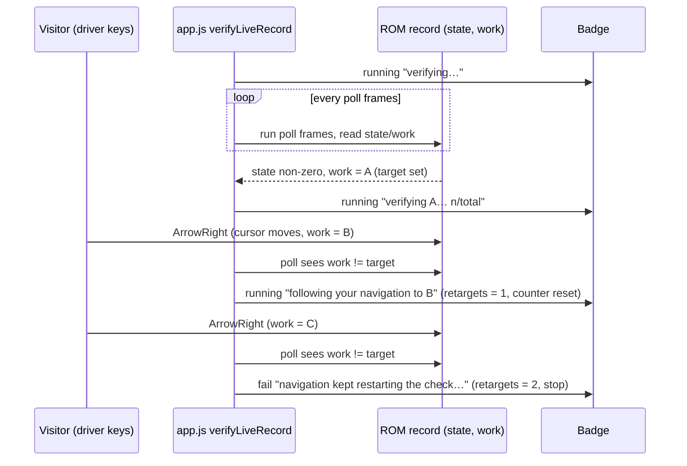
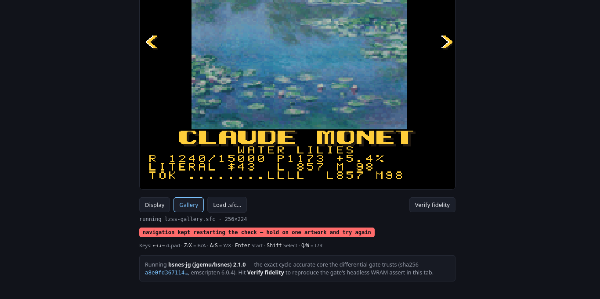

# Re-verify the retarget-once "stop" case (2nd navigation mid-poll)

**Status:** done (2026‑10‑31). Real ROM, real `web/app.js`, headless Firefox 156: the 1st retarget badge and the 2nd-navigation `fail` badge were both observed. Raw output is pasted under each verification step.

## Context

`verifyLiveRecord` in `web/app.js` is the web player's live-record fidelity self-check for the
gallery ROM. It polls the running machine's `gallery_shown` WRAM record every `poll` frames. If the
visitor navigates while the check runs (the record's `work` index changes once `state` is non-zero),
the check restarts for the new artwork. It restarts once; a second navigation hits
`if (++retargets > 1)` and shows a `fail` badge reading "navigation kept restarting the check — hold on
one artwork and try again".

The first retarget was proven live earlier (work 0 to 1, counter reset, correct title). The second was
never seen live: the earlier attempt kept losing its headless Chrome target to host memory pressure.
This plan observes both in a real browser running the real `web/app.js`.

No visible UI surface changes (the badge text already exists), so no mockups are needed.

## Approach

1. Serve `web/` with `python3 serve.py -p <port>` (plain, no special headers).
2. A new driver, `scripts/retarget-verify.py`, reuses the Marionette protocol code of
   `scripts/firefox-verify.py` against headless Firefox with a profile in `/tmp` (disk is nearly full).
3. The driver loads `/?verify=1` (the gallery ROM, whose manifest `selfcheck` has `mode: "live-record"`),
   samples the badge (`#checkresult`) and the record bytes (`window.__bjg.HEAPU8` at
   `_bjg_wram() + off`), and waits for the badge to say `verifying <title>…`. It then holds
   ArrowRight (dispatched as a `keydown`/`keyup` pair on `window`, which is what `onKey` listens for)
   to move the gallery cursor, twice, spaced so each navigation lands inside a poll window.
4. It records a timestamped badge timeline and exits non-zero unless the sequence
   `verifying…`, `verifying <A>… n/total`, `following your navigation to <B>`, then the `fail`
   badge was seen.
5. Known risk: `web/roms/lzss-gallery.sfc` may lack the `gallery_shown` record (see the comment in
   `sync-roms.sh`). If `state` never leaves 0 on the real ROM, the real page cannot reach the retarget
   branch. In that case the driver is run against a clearly labelled FALLBACK: the real `web/app.js`
   with a stubbed `Module` (`_bjg_run`, `_bjg_wram`, `HEAPU8`) that scripts `state`/`work` transitions
   ("stubbed Module, not the real ROM"), and a new open item tracks the real-ROM check.



## Verification

1. Disk and host precondition: `df -h /` and `free -m` before the run.

   ```
   $ df -h / | tail -1
   /dev/nvme0n1p2  469G  443G  2.1G 100% /
   $ free -m | sed -n 2p
   Mem:           31819       17063        2421        3830       16968       14755
   ```

   PASS (2.1 GB free, 14.7 GB available memory; no other Firefox running).

2. Start `python3 serve.py` and headless Firefox with a `/tmp` profile; run
   `python3 -I scripts/retarget-verify.py` against the real ROM; paste the badge timeline.

   The driver starts both itself (serve.py on a free port, Firefox with `--profile /tmp/retarget-ff-*`). Probe of the
   committed ROM: the `gallery_shown` record is present (`state` 0 then 1, `work` 0 then 1 then 2), so the stub
   fallback was not needed. Final run (`docs/plans/screenshots/retarget-run.txt`; full JSON in
   `retarget-timeline.json`):

   ```
   $ ulimit -c 0; python3 -I scripts/retarget-verify.py --timeout 420 --no-state-secs 60
      3.93s  [] 
     11.06s  [running] verifying… 120/24000
     16.64s  [running] verifying… 240/24000
     22.00s  [running] verifying… 360/24000
     27.36s  [running] verifying… 480/24000
     34.60s  [running] verifying… 600/24000
     39.93s  [running] verifying… 720/24000
     45.19s  [running] verifying Under the Wave off Kanagawa… 840/24000
     50.67s  [running] verifying Under the Wave off Kanagawa… 960/24000
     56.10s  [running] verifying Under the Wave off Kanagawa… 1080/24000
     61.69s  [running] verifying Under the Wave off Kanagawa… 1200/24000
     61.73s  KEY ArrowRight (held 120 ms)
     67.24s  [running] verifying Under the Wave off Kanagawa… 1320/24000
     72.78s  [running] verifying Under the Wave off Kanagawa… 1440/24000
     78.30s  [running] verifying Under the Wave off Kanagawa… 1560/24000
     83.92s  [running] verifying Under the Wave off Kanagawa… 1680/24000
     89.42s  [running] verifying Under the Wave off Kanagawa… 1800/24000
     94.78s  [running] verifying Under the Wave off Kanagawa… 1920/24000
    100.25s  [running] following your navigation to A Sunday on La Grande Jatte — 1884
    105.73s  [running] verifying A Sunday on La Grande Jatte — 1884… 120/24000
    105.78s  KEY ArrowRight (held 120 ms)
    111.32s  [running] verifying A Sunday on La Grande Jatte — 1884… 240/24000
    116.84s  [running] verifying A Sunday on La Grande Jatte — 1884… 360/24000
    122.45s  [running] verifying A Sunday on La Grande Jatte — 1884… 480/24000
    127.99s  [running] verifying A Sunday on La Grande Jatte — 1884… 600/24000
    133.67s  [running] verifying A Sunday on La Grande Jatte — 1884… 720/24000
    138.86s  [running] verifying A Sunday on La Grande Jatte — 1884… 840/24000
    144.28s  [fail] navigation kept restarting the check — hold on one artwork and try again
   record probes (t, state/work): 4.16:None/None 72.83:1/0 144.38:1/2
   matched 4/4 expected steps; presses=2; exit=0
   exit=0
   ```

   PASS.

3. Confirm the sequence contains the 1st-retarget badge ("following your navigation to …") and the
   final fail badge; confirm exit status 0 and the screenshot of the fail badge is saved under
   `docs/plans/screenshots/`.

   ```
   $ grep -E "following your navigation|kept restarting|KEY" docs/plans/screenshots/retarget-run.txt
     61.73s  KEY ArrowRight (held 120 ms)
    100.25s  [running] following your navigation to A Sunday on La Grande Jatte — 1884
    105.78s  KEY ArrowRight (held 120 ms)
    144.28s  [fail] navigation kept restarting the check — hold on one artwork and try again
   $ ls -l docs/plans/screenshots/retarget-fail.png
   -rw-rw-r-- 1 will will 93027 Oct 31 docs/plans/screenshots/retarget-fail.png
   ```

   [](screenshots/retarget-fail.png)

   PASS. Timing notes: the record's `state` becomes non-zero about 45 s in (the ROM is decoding the first
   artwork at about 20 frames/s in headless software rendering; each 120-frame poll takes about 5.5 s). ArrowRight #1
   was sent at 61.7 s (held 120 ms); the check noticed `work` 0 to 1 at the poll finishing 100.3 s (the
   ROM's own transition delay was not measured) and showed "following your navigation to A Sunday on La Grande Jatte — 1884"
   with the counter reset (`120/24000` next poll). ArrowRight #2 at 105.8 s; a later poll (144.3 s) saw `work` 2
   and showed the `fail` badge, and the loop stopped. Because each poll blocks the page's main thread for
   several seconds, the driver records badge changes with an in-page `MutationObserver`; sampling the badge from
   outside missed the "following…" badge in the first attempt (it is replaced by the next poll's text).

4. Clean up: kill Firefox and the server, delete the `/tmp` profile; `df -h /` after.

   ```
   $ ls -d /tmp/retarget-ff-* 2>&1; pgrep -a firefox
   ls: cannot access '/tmp/retarget-ff-*': No such file or directory
   $ df -h / | tail -1
   /dev/nvme0n1p2  469G  443G  2.2G 100% /
   ```

   PASS.

## Results

- The retarget-once stop case works as designed: 1st navigation restarts the check, 2nd shows
  `fail` "navigation kept restarting the check — hold on one artwork and try again". No `web/app.js` defect.
- Real ROM (`web/roms/lzss-gallery.sfc` already carries the `gallery_shown` record), not a stub.
- Rerun: `python3 -I scripts/retarget-verify.py` (about 2.5 min; exits non-zero if the sequence is not observed,
  2 if the ROM never publishes a record).
