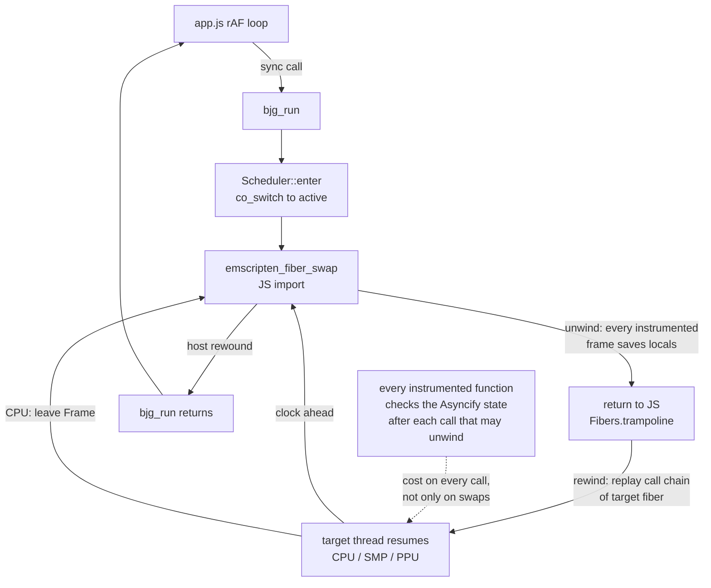
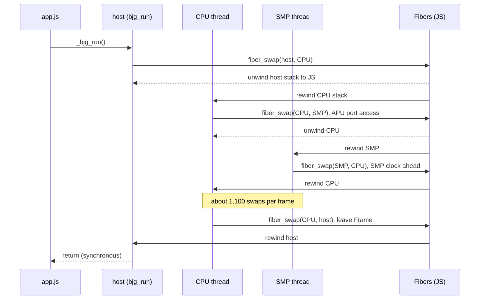
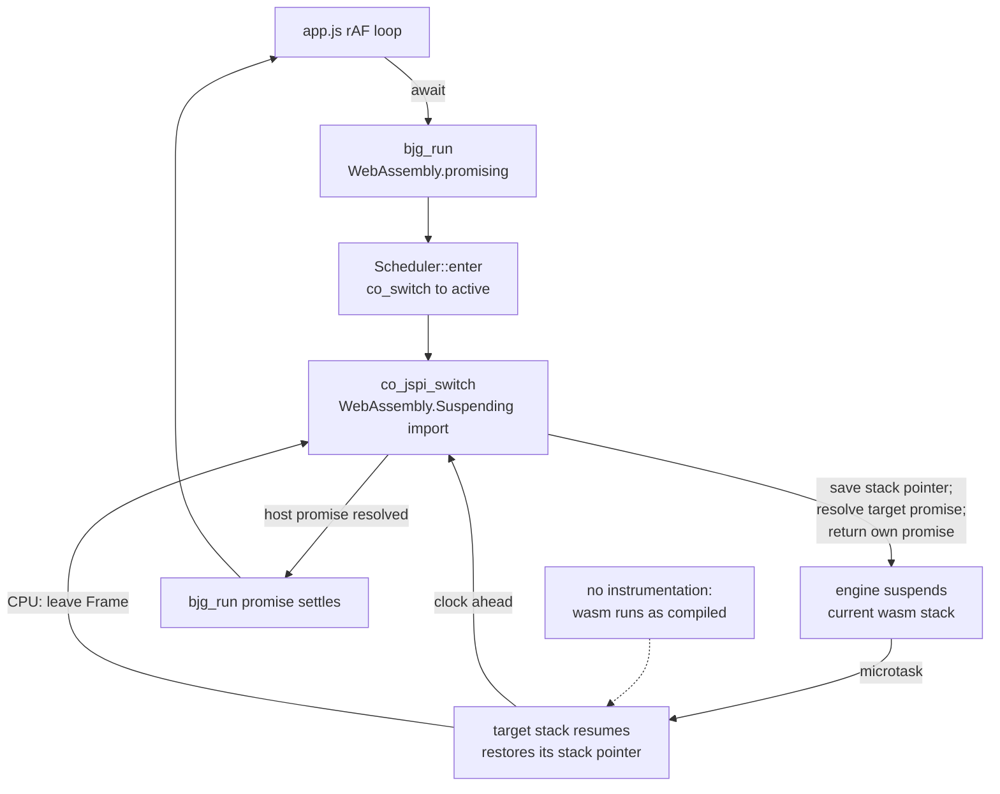
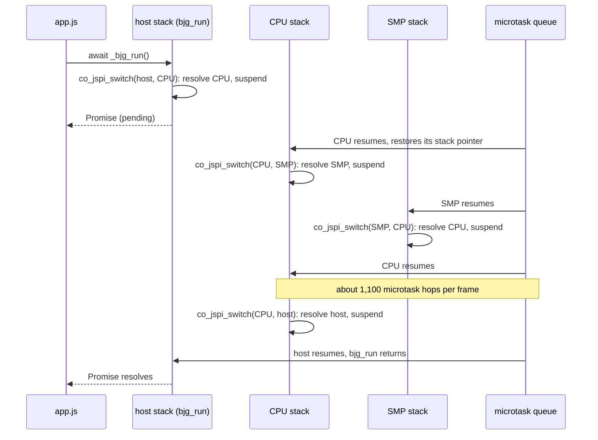

# JSPI coroutines: can a design change remove the Asyncify cost?

TODO item: **Remove the Asyncify cost with JSPI or uninstrumented coroutines** (`[T4]`). It follows [2026‑10‑31 Asyncify trim](2026-10-31-asyncify-trim.md), which ruled out instrumentation lists: an `ASYNCIFY_REMOVE` list gains at most 3% of frame time, and an `ONLY`/`ADD` list traps.

## Context

- The WASM player runs at a median 23.7 ms per emulated frame on a Pixel 8 Pro (about 45 FPS), against a 16.6 ms budget. The same core built natively runs at 10.7 ms ([report](../performance/2026-10-31/pixel-phone-perf/report.md)).
- `build.sh` links `web/cores/bsnes_jg.{js,wasm}` with `-sASYNCIFY=1 -sASYNCIFY_STACK_SIZE=131072`. `web/src/libco_emscripten.c` maps libco's `co_switch` onto `emscripten_fiber_swap`. Default Asyncify instruments 1021 functions, which is nearly the whole hot path, because bsnes routes bus accesses through function pointers.
- **How the core switches.** bsnes-jg has one libco thread each for the CPU, SMP and PPU, plus one per coprocessor. The DSP is not a thread: `SMP::synchronizeDSP` calls `dsp.main()` directly. A thread that gets ahead of another calls `scheduler.resume(other)`, which is `co_switch`. The CPU yields to the host once per frame through `scheduler.leave(Event::Frame)`. The previous experiment counted 14,408,626 swaps over 13,000 frames, which is about 1,100 swaps per frame. Every swap is rooted in `bjg_run` or a fiber entry.
- The work only re‑links. Variants are linked from a copy of the existing `vendor/bsnes-jg/objs/libbsnes.a`, with the libco member replaced, into scratch on `/tmp`. `web/cores`, `dist/`, `PROVENANCE.json` and the shas pinned in `android/app/build.gradle.kts` are not touched. Landing a winner is the user's decision.

No visible surface: this plan produces measurements, not UI, so it has no mockups.

### Today: Asyncify fibers





## Candidates

| | Candidate | What it needs | Instrumentation | Browser reach |
|---|---|---|---|---|
| a | JSPI (`-sJSPI`) with a new libco backend | Emscripten 6.0.4 fibers have **no** JSPI path (`emscripten_fiber_swap` is defined only under `ASYNCIFY == 1`, `src/lib/libasync.js`), so a custom backend is needed: each libco thread is its own JSPI stack, and `co_switch` suspends on a promise and resolves the target's promise | none | Chromium only so far: see [Browser support](#browser-support) |
| b | Uninstrumented scheduler: CPU, SMP and PPU as state machines or run‑to‑yield calls | A rewrite of the vendored core's three processor cores. They yield in the middle of an instruction (at a bus access), so they cannot be plain calls without changing the order of synchronisation | none | all browsers |
| c1 | WebAssembly stack switching (WasmFX `cont.new`/`resume`/`suspend`) | No clang or Emscripten support; behind flags in V8 | none | none by default |
| c2 | One Web Worker per thread, handing off with `Atomics.wait`/`notify` | `SharedArrayBuffer`, so the page must be cross‑origin isolated, and it is not (`coi: false`). About 1,100 cross‑thread hand‑offs per frame | none | all, with COOP/COEP |

Rejected without a build:

- **(b)** changes the vendored core, which is pinned to the exact sha256 the llvm‑mos‑65816 differential gate trusts. It also needs a cycle‑stepped rewrite of the 65816, SPC700 and PPU. That is a product decision, not an experiment. ESCALATE if (a) fails.
- **(c1)** ships in no browser by default.
- **(c2)** costs at least one futex wake per hand‑off, which is tens of microseconds. At 1,100 hand‑offs per frame that exceeds the whole 16.6 ms budget before any emulation runs, and it also needs COOP/COEP headers on every host site.

So (a) is the one to build and measure.

### Candidate (a): JSPI libco backend





Design points:

- **Stack pointer.** JSPI switches the engine's wasm stack but not Emscripten's linear‑memory stack (the `__stack_pointer` global). The backend saves it in the thread record before suspending and restores it, with its limits, right after the import returns. A new thread starts in a microtask that sets its stack pointer to the top of its own 1 MiB stack, then calls the promising export `co_jspi_enter`.
- **Host.** Each `bjg_run` is a new promising call, so the host is a new engine stack every frame. libco's primary record is reused, and only its promise changes.
- **`co_derive`/`co_delete`** drop the thread's pending resolver. The suspended engine stack is then unreachable and is garbage‑collected.
- **API change.** `_bjg_run` returns a `Promise`. Every caller in `web/app.js` (four sites) would have to `await` it, and so would the Android WebView harness. This experiment patches only scratch copies of the bench pages and `web/`.
- **Expected trade.** The per‑call Asyncify checks vanish, but each swap becomes a promise resolution, a microtask and an engine stack switch. With 1,100 swaps per frame, the result depends on what one hop costs, which only a measurement shows.

## Browser support

| Browser | JSPI | Source |
|---|---|---|
| Chrome 154.0.8037.57 (installed) | ✓ suspend and resume work | `tools/jspi-probe.html`, run on 2026‑11‑01 |
| Chromium 151.0.7922.34 headless shell (Playwright) | ✓ | same |
| Firefox 156.0.1 (installed) | ✓ | same, through `scripts/firefox-verify.py` |
| Chrome, Edge and Chrome Android | since 137 (2025‑05‑27) | [web‑features: wasm‑jspi](https://web-platform-dx.github.io/web-features-explorer/features/wasm-jspi) |
| Firefox and Firefox Android | since 153 (2026‑07‑21) | same |
| Safari and Safari on iOS | since 27 (2026‑09‑14) | same. The tracking bug was [WebKit 283054](https://bugs.webkit.org/show_bug.cgi?id=283054). **Not verified here**: no Safari or Apple device is available to this session |

JSPI became Baseline "newly available" on 2026‑09‑14, so it is only seven weeks old in Safari. Every iPhone and iPad still on iOS 26 or older, every Mac on Safari 26 or older, Firefox 152 or older and Chromium 136 or older has no `WebAssembly.Suspending`. A JSPI‑only core would leave all of those with no working player, and on iOS every browser is WebKit. **A JSPI core therefore needs the Asyncify core as a fallback**, chosen at load time by `typeof WebAssembly.Suspending === "function"`. The Android app's WebView is Chromium and follows the Chrome version, but it was not checked on the device, because device access is out of scope for this work.

## Approach

1. Write `tools/libco_jspi.c` and `tools/libco_jspi.js`. Compile the C file to `libco.o`, replace that member in a scratch copy of `libbsnes.a`, and link with `-sJSPI -sJSPI_EXPORTS=['bjg_run','co_jspi_enter']` plus `--js-library`. Re‑link the baseline with `tools/link.sh` from the trim plan.
2. Teach the trim bench tools (`bench.html`, `pair.html`) to `await` `_bjg_run` when it returns a promise. That changes nothing for the baseline, which returns `undefined`.
3. Measure: five repeats, interleaved, in one session (`pair.py` paired lockstep, plus `drive.py time`). Record median, spread, wasm raw and `gzip -9`.
4. Fidelity: `drive.py check` on both builds, then `cmp.py`: mandel‑display `0x204F` at frame 5800, and framebuffer hashes equal at every checkpoint for every picker ROM with a fixed input script. Then `?verify=1` in headless Firefox (`scripts/firefox-verify.py`) and in Chromium, against a scratch copy of `web/` whose `app.js` awaits `_bjg_run`.
5. Verdict, with the browser‑support consequence.

## Verification

Run on 2026‑11‑01 on the laptop (i7‑1185G7), with every build linked by emcc 6.0.4 from the main checkout's `libbsnes.a`. The CPU governor was `powersave`, and other agents kept the load average between 5 and 27, so absolute times are inflated and swing between repeats. Only paired, same‑session ratios are meaningful. Raw files are in [../performance/2026-11-01/jspi-coroutines/](../performance/2026-11-01/jspi-coroutines/), and the tools are in its `tools/` directory.

1. JSPI availability is probed in the installed Chrome, the Playwright headless Chromium and Firefox 156, and Safari's status is cited from documentation.

    ```
    $ python3 tools/probe.py smoke jspi 300
    {"browser": "headless-shell", "version": "151.0.7922.34", "probe": "✓ JSPI Suspending=function promising=function suspend-resume=42", ...}
    {"browser": "google-chrome", "version": "154.0.8037.57", "probe": "✓ JSPI Suspending=function promising=function suspend-resume=42", ...}
    $ python3 -I scripts/firefox-verify.py http://127.0.0.1:8177/jspi-probe.html ff-probe.png
    { "badge": "✓ JSPI Suspending=function promising=function suspend-resume=42",
      "ua": "Mozilla/5.0 (X11; Linux x86_64; rv:156.0) Gecko/20100101 Firefox/156.0", "coi": false, ... }
    web-features wasm-jspi: Chrome/Edge/Chrome Android 137 (2025-05-27), Firefox 153 (2026-07-21),
                            Safari and Safari iOS 27 (2026-09-14); Baseline newly available 2026-09-14
    ```
    **PASS.** All three installed browsers run a real suspend and resume. The Safari figure comes from documentation only (see [Browser support](#browser-support)).

2. The JSPI build links with no Asyncify pass (no `asyncify_*` exports), and its wasm size, raw and `gzip -9`, is recorded beside a baseline relink.

    ```
    $ REPO=/home/will/bsnes-jg-player OUT=/tmp/jspi-coro ../2026-10-31/asyncify-trim/tools/link.sh baseline
    a3f5299b7fc29acb77dbdc22e56d4f45413187e6a416861c98a508b162b45172  /tmp/jspi-coro/builds/baseline/bsnes_jg.wasm   (== committed web/cores/bsnes_jg.wasm)
    $ tools/link-jspi.sh jspi
    em++: warning: -sJSPI (ASYNCIFY=2) is still experimental [-Wexperimental]
    $ grep -o counts in the glue
    baseline: asyncify_start_unwind refs in glue: 4, emscripten_fiber_swap refs: 3, Suspending refs: 0
    jspi: asyncify_start_unwind refs in glue: 0, emscripten_fiber_swap refs: 0, Suspending refs: 1
    jspi wasm imports: co_jspi_forget,co_jspi_switch
    $ tools/sizes.sh baseline jspi baseline-seed jspi-seed pp-asyncify pp-jspi
    build           raw_bytes  gzip9_bytes    glue_js  wasm_sha256
    baseline          3903329      1880482      73360  a3f5299b7fc29acb77dbdc22e56d4f45413187e6a416861c98a508b162b45172
    jspi              3285035      1753877      68222  0a3a6ffe701cc6ee15d777750229344f49f31580002e613c28b78a54573566ea
    baseline-seed     3903082      1880348      72928  033708a44409805cb9d3caebbc7e3667d2b488200b3586902e515f121f15cf45
    jspi-seed         3284761      1753766      67778  b5fad3dc1fd0d90314fcaa02fe6e6695b8f44a7af02a10de9eb6319ff6fa4f7e
    ```
    **PASS.** Deviation: at `-O3`, Emscripten minifies wasm import and export names, so the baseline's own export list shows no `asyncify_*` either. The check was therefore made on the JS glue, which names the Asyncify runtime calls it drives. The JSPI build has none and wraps one import in `WebAssembly.Suspending`. JSPI wasm is 15.8% smaller raw and 6.7% smaller gzipped (−126,605 bytes).

3. `drive.py check` gives mandel‑display `0x204F` at frame 5800, and `cmp.py` reports `ALL MATCH` against the baseline for every picker ROM.

    ```
    $ python3 ../2026-10-31/asyncify-trim/tools/drive.py check baseline,jspi > check-baseline-jspi.json
    $ python3 ../2026-10-31/asyncify-trim/tools/cmp.py check-baseline-jspi.json check-baseline-jspi.json baseline jspi
    jspi     mandel-display  frames= 5800 checkpoints= 11 video_match=True gate base=204F var=204F OK
    jspi     lzss-gallery    frames= 3000 checkpoints= 12 video_match=True gate base=0 var=0 OK
    jspi     raycaster       frames= 3000 checkpoints= 12 video_match=True gate base=600 var=600 OK
    jspi     mandel-display  frames= 1200 checkpoints=  4 video_match=True gate base=0 var=0 OK
    ALL MATCH
    # stricter: both builds linked with tools/seed.c (constant clock(), so power-on RAM is deterministic)
    $ python3 tools/seedcmp.py check-seed.json baseline-seed jspi-seed baseline-seed
    baseline-seed vs baseline-seed mandel-display  frames= 5800 checkpoints= 11 wram_match=True video_match=True gate base=204F var=204F OK
    baseline-seed vs baseline-seed lzss-gallery    frames= 3000 checkpoints= 12 wram_match=True video_match=True gate base=0 var=0 OK
    baseline-seed vs baseline-seed raycaster       frames= 3000 checkpoints= 12 wram_match=True video_match=True gate base=600 var=600 OK
    baseline-seed vs baseline-seed mandel-display  frames= 1200 checkpoints=  4 wram_match=True video_match=True gate base=0 var=0 OK
    baseline-seed vs baseline-seed: ALL MATCH
    baseline-seed vs jspi-seed mandel-display  frames= 5800 checkpoints= 11 wram_match=True video_match=True gate base=204F var=204F OK
    baseline-seed vs jspi-seed lzss-gallery    frames= 3000 checkpoints= 12 wram_match=True video_match=True gate base=0 var=0 OK
    baseline-seed vs jspi-seed raycaster       frames= 3000 checkpoints= 12 wram_match=True video_match=True gate base=600 var=600 OK
    baseline-seed vs jspi-seed mandel-display  frames= 1200 checkpoints=  4 wram_match=True video_match=True gate base=0 var=0 OK
    baseline-seed vs jspi-seed: ALL MATCH
    ```
    **PASS.** Each build gets a cold start in a fresh browser context. The last row reloads a ROM in the same page and calls `bjg_reset` at frame 600, which exercises `co_derive` on suspended JSPI stacks. Gallery and raycaster run the fixed input script. The trim plan could compare whole WRAM only through the gate bytes, because bsnes seeds RAM from `clock()`. The `seed.o` builds make the seed constant, and then WRAM hashes are equal at all 39 checkpoints, both between two baseline runs and between baseline and JSPI.

4. Paired bench: five interleaved repeats in one session. The ratio of JSPI to baseline is reported with its median and spread.

    ```
    $ tools/bench-all.sh baseline,jspi 5 1500       # pair.py, then drive.py time, then pingpong.py
    0 ['0', '0'] baseline: mean 51.39 ms, median ratio 1.0000 | jspi: mean 28.36 ms, median ratio 0.5422
    1 ['0', '0'] baseline: mean 48.40 ms, median ratio 1.0000 | jspi: mean 26.50 ms, median ratio 0.5506
    2 ['0', '0'] baseline: mean 54.89 ms, median ratio 1.0000 | jspi: mean 30.71 ms, median ratio 0.5542
    3 ['0', '0'] baseline: mean 63.03 ms, median ratio 1.0000 | jspi: mean 33.26 ms, median ratio 0.5281
    4 ['0', '0'] baseline: mean 93.15 ms, median ratio 1.0000 | jspi: mean 52.98 ms, median ratio 0.5787
    jspi / baseline: per-repeat median ratios [0.542, 0.551, 0.554, 0.528, 0.579] -> median 0.551; pooled chunks n=65 median 0.549 IQR 0.510-0.595; ms/frame jspi median 30.71 [26.50-52.98] baseline median 54.89 [48.40-93.15]
    # separate cold pages, interleaved (bench.json), mandel-display 1500 frames, mean of frames 200+
    baseline  n=5 steady mean ms/frame: median 58.245 min 49.111 max 88.947 | per-frame median: median 56.500 | vs first +0.0% | gate {'0'}
    jspi      n=5 steady mean ms/frame: median 33.521 min 29.367 max 62.442 | per-frame median: median 32.900 | vs first -42.4% | gate {'0'}
    # libco switch microbenchmark: host <-> one coroutine, 400,000 switches per run, ns per switch
    {"chromium": "151.0.7922.34", "median": {"pp-asyncify": 802.5, "pp-jspi": 676.5}}
    ```
    **PASS.** With JSPI, a frame costs 0.551 of the baseline's (1.81× faster). Every repeat lands between 0.528 and 0.579, while machine load moved absolute times by 2×. A JSPI switch, including its promise and microtask hop, costs no more than an Asyncify unwind and rewind on a shallow stack (677 ns against 803 ns). At about 1,100 switches per frame that is roughly 0.75 ms, or 2–3% of a JSPI frame. So almost all of Asyncify's cost was the instrumentation on every call, not the swaps.

5. `?verify=1` passes in headless Chromium and in headless Firefox, wherever the browser supports JSPI.

    ```
    $ python3 -I scripts/firefox-verify.py "http://127.0.0.1:8177/web-jspi/?verify=1" ff-verify-jspi.png
    { "badge": "✓ FIDELITY 0x204F == gate (gate jgxcheck CRC (corpus_result @ WRAM $0200), 5800 frames)",
      "cls": "badge pass", "ua": "Mozilla/5.0 (X11; Linux x86_64; rv:156.0) Gecko/20100101 Firefox/156.0", "coi": false, ... }
    $ tools/gate-all.sh        # tools/chromium-verify.py on web-jspi (JSPI core) and web-base (committed core)
    web-jspi headless 151.0.7922.34  "✓ FIDELITY 0x204F == gate (... 5800 frames)"  seconds 240.9  pageerrors []
    web-jspi Chrome   154.0.8037.57  "✓ FIDELITY 0x204F == gate (... 5800 frames)"  seconds 294.3  pageerrors []
    web-base headless 151.0.7922.34  "✓ FIDELITY 0x204F == gate (... 5800 frames)"  seconds 481.1  pageerrors []
    web-base Chrome   154.0.8037.57  "✓ FIDELITY 0x204F == gate (... 5800 frames)"  seconds 458.8  pageerrors []
    ```
    **PASS** in Firefox 156, Chromium 151 and Chrome 154. `web-jspi` is a scratch copy of `web/` with the JSPI core and an `app.js` rewritten by `tools/app-jspi-patch.py`, which sends every core call through an awaited `runCore()`. In the same browser, the in‑page self‑check takes 0.50× and 0.64× of the committed core's wall time. `web-base` is the unmodified `web/` with the committed core, as a control.

6. `df -h /` is recorded before and after.

    ```
    before: /dev/nvme0n1p2  469G  443G  1.9G 100% /
    after:  /dev/nvme0n1p2  469G  440G  4.9G  99% /
    this work on /: docs/performance/2026-11-01/jspi-coroutines ~150K, plan ~20K; builds, web copies and profiles on /tmp tmpfs
    ```
    **PASS.** Free space rose because other sessions cleaned up. This work wrote under 0.2 MB to `/`.

Deviations from the brief: `ulimit -v` caps were not used, because Chromium dies at launch (`SIGTRAP`) under a 16 GB address‑space cap. The V8 sandbox and the wasm guard regions reserve far more virtual memory than that. Runs used `ulimit -c 0` only. No phone run was made, because device access is out of scope.

## Results

| Build | Coroutines | wasm raw | wasm gzip ‑9 | Paired ms/frame, median [min–max] | Ratio to baseline (paired) | Fidelity |
|---|---|---|---|---|---|---|
| baseline | Asyncify fibers (`-sASYNCIFY=1`) | 3,903,329 | 1,880,482 | 54.89 [48.40–93.15] | 1.000 | reference |
| jspi | JSPI libco backend (`-sJSPI`) | 3,285,035 (−15.8%) | 1,753,877 (−6.7%) | 30.71 [26.50–52.98] | **0.551**, IQR 0.510–0.595 | WRAM and video equal at all 39 checkpoints; `?verify=1` ✓ in Firefox 156, Chromium 151 and Chrome 154 |

**Projection, not a measurement.** If the laptop ratio carries over to the phone's V8, the Pixel 8 Pro's 23.7 ms per frame becomes about 13.0 ms (12.1–14.1 ms across the IQR). That is under the 16.6 ms budget, and about 1.2× the native 10.7 ms. Only a phone run can confirm it.

## Verdict

**Viable only with a fallback.** A JSPI libco backend removes Asyncify entirely. The emulation stays bit‑identical (WRAM and framebuffer at every checkpoint, and the 5800‑frame gate in three browsers), a frame takes 0.55× as long, and the wasm shrinks by 127 KB gzipped. JSPI reached Safari and iOS only in version 27 (2026‑09‑14), and Firefox in 153, so older Safari, every iOS 26 device and older Firefox and Chromium would have no player. The JSPI core must ship beside the Asyncify core, chosen by `typeof WebAssembly.Suspending === "function"`.

What landing would take. This is the user's call, and nothing below is done:

- A build step that produces both cores: today's `build.sh` link, plus the JSPI link with `libco_jspi.{c,js}` moved to `web/src/`.
- Core selection in `app.js`, and the async `_bjg_run` at all four call sites: the rAF loop, `verify`, `verifyLiveRecord` and the TV `benchmark` hook. Plus in‑flight guarding so that no export runs while a frame is suspended.
- `dist/` and the npm package carrying both cores. `PROVENANCE.json`, `expectedWasmSha` and `expectedGlueSha`, and the shas pinned in `android/app/build.gradle.kts`, all gain a second core.
- The Android WebView path and the TV/Cast harness awaiting `_bjg_run`.
- A Pixel run, to replace the projection with a measurement.
- Emscripten still labels `-sJSPI` experimental.

**Not verified here.**

- Safari 27 and iOS 27: documentation only.
- Any phone or WebView.
- `verifyLiveRecord` (lzss‑gallery's live check) and the TV `benchmark` hook under the patched `app.js`: `?verify=1` drives mandel‑display's power‑on check.
- Coprocessor ROMs (SA‑1, SuperFX, Super Game Boy). The JSPI backend has no per‑function list, so it is not fragile the way an `ONLY` list is, but no such ROM was run.
- Memory over many ROM reloads. Abandoned suspended stacks are left to the garbage collector.
