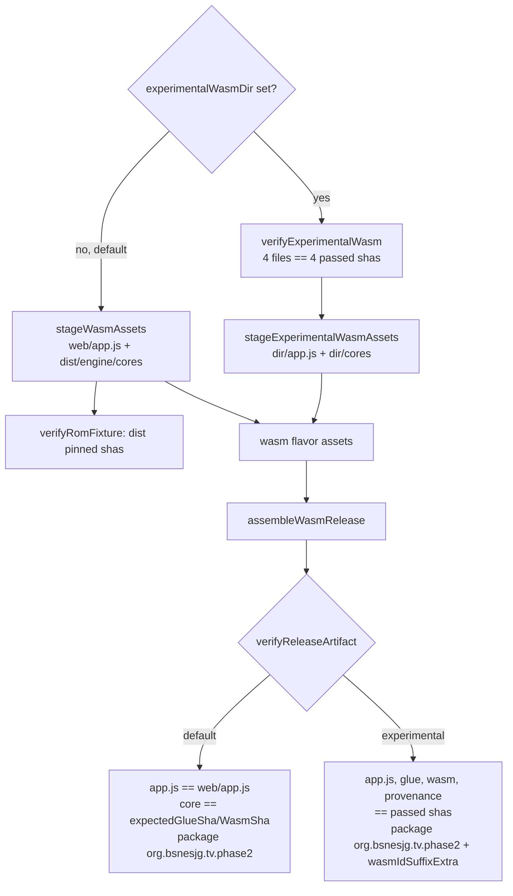
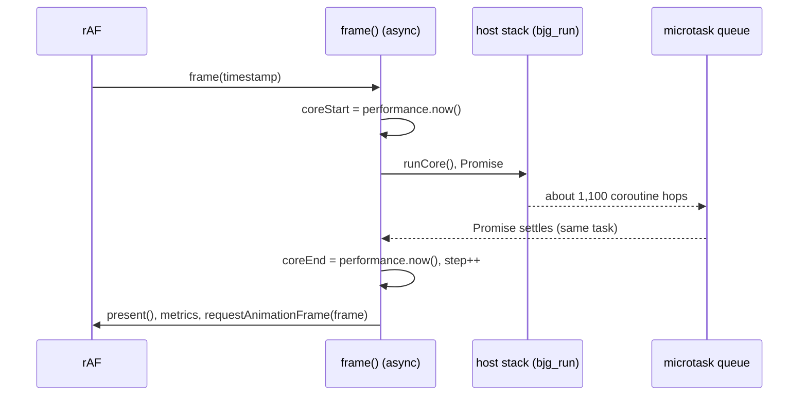

# JSPI Pixel APK: an experimental WASM build for a Pixel 8 Pro measurement

TODO item: **Remove the Asyncify cost with JSPI or uninstrumented coroutines** (`[T4]`), follow‑up "Pixel run first". The previous step is [2026‑11‑01 JSPI coroutines](2026-11-01-jspi-coroutines.md): on the laptop a JSPI libco backend runs a frame in 0.551× the Asyncify core's time and stays bit‑identical. That ratio is a projection for the phone until the phone measures it. This plan builds the APK for that measurement. It does not run anything on a device.

## Context

- **The baseline to match.** It is three Pixel 8 Pro WASM jobs from 2026‑10‑31 (`J‑e9aa930505cd` check, `J‑f6a11b900d90` profile, `J‑68b3f9bdcde1` record), described in the [Pixel report](../performance/2026-10-31/pixel-phone-perf/report.md). They ran APK `043323ff…` (package `org.bsnesjg.tv.phase2`, 0.1.8, versionCode 9). Each job launched `org.bsnesjg.tv.phase2/org.bsnesjg.tv.MandelbrotBenchmarkActivity` (`commands.json`: `am start -W -n …MandelbrotBenchmarkActivity`). That activity loads `index.html?rom=mandel-display` in the WebView, where `web/app.js` in TV mode runs the rAF `frame()` loop and logs `BJG_TV_METRIC` `playback_window` records. `android/tools/tuning-report.py --tuned-engine wasm` reads those records.
- **How the wasm flavor stages its engine.** `stageWasmAssets` copies `web/app.js` and `dist/engine/cores/{bsnes_jg.js,bsnes_jg.wasm,PROVENANCE.json}` into the assets. `verifyRomFixture` pins `dist/` to `expectedGlueSha`/`expectedWasmSha`. `verify…Artifact` checks inside the APK that `assets/app.js` equals `web/app.js` and that the core equals the pinned pair. `engine-adapter.js` (wasm) only injects `app.js`. `tv-scheduler.js` is a pure credit counter and calls no core, so only `app.js` calls `_bjg_run`.
- **What JSPI changes.** `_bjg_run` returns a `Promise`, so each `app.js` call site that runs frames must await it.
- **The signing key on the phone.** The baseline APK `043323ff…` is signed with the **Android Debug** key, certificate SHA‑256 `79f65b24…c4cb`. That is `/home/will/.android/debug.keystore`, which `build-in-container.sh` mounts for its controlled builds. It is **not** the durable release key `1bc3d058…`. Android refuses an update across keys (`INSTALL_FAILED_UPDATE_INCOMPATIBLE`), so a release‑signed `org.bsnesjg.tv.phase2` cannot be installed over the Pixel's copy while that copy is still `043323ff…`.
- **The registered activity.** The [Pixel plan](2026-10-31-pixel-phone-perf.md) records `bsnes-jg-tv-phase2-wasm` as registered to `MainActivity`, the selector, which must not be profiled. The baseline jobs, from 08:23 to 08:43, launched `MandelbrotBenchmarkActivity`, so the descriptor pointed there at the time and was put back to `MainActivity` afterwards. The coordinator's `applications.json` is not readable from this session (`/var/lib/wf-device-coordinator`: permission denied), so the current descriptor cannot be confirmed.

No visible surface: the APK's UI is unchanged, so this plan has no mockups. The only difference a user could see is the engine.

## Design

**An opt‑in engine override for the `wasm` flavor only.** All of these Gradle properties default to off:

| Property | Meaning |
|---|---|
| `-PexperimentalWasmDir=<dir>` | a directory, relative to the repository root, holding `bsnes_jg.js`, `bsnes_jg.wasm`, `PROVENANCE.json` and `app.js` |
| `-PexperimentalWasmGlueSha`, `-PexperimentalWasmSha`, `-PexperimentalWasmAppSha`, `-PexperimentalWasmProvenanceSha` | each file's sha256. All four are **required** when the directory is set, so a missing one fails the build. They are checked before staging (`verifyExperimentalWasm`) and again inside the APK (`verifyReleaseArtifact`) |
| `-PwasmIdSuffixExtra=.jspi` | optional, off by default; gives the package its own id (`org.bsnesjg.tv.phase2.jspi`) in the style of `-PnativeIdSuffixExtra` |

With no property set, the wasm flavor's asset source is `stageWasmAssets`, and every pin and package check is the same code path as before. `wasmplayer` never takes the override.

**`app.js` for JSPI.** `web/app.js` is not changed. `tools/app-jspi-patch.py` derives the experimental copy, and only the opt‑in build stages it:

- `frame()` becomes `async`, and each step does `var pending = runCore(); if (pending) await pending;` between the existing `coreStart` and `coreEnd` reads.
- A JSPI frame resumes its coroutines only through promise reactions (microtasks), so the awaited frame still completes inside the same rAF task, before the browser runs any other callback. The step cap, the frame clock and the timing bracket are unchanged. The bracket gains only the switch work JSPI itself does.
- `verify`, `verifyLiveRecord` and the TV `benchmark` hook await their frames the same way. An in‑flight guard keeps any second frame from starting.
- One extra TV record, `engine_info`, logs `typeof WebAssembly.Suspending` and the WebView user agent after each ROM load. The Pixel evidence holds no WebView version (only the package path `com.google.android.webview-…`), so the device run has to show that JSPI exists there.

Rejected: changing `web/app.js` itself to await. It would change the default APK (`assets/app.js` must equal `web/app.js`) and the shipped web player in `dist/`, for a measurement.





## Approach

1. Gradle: add the properties, `verifyExperimentalWasm`, `stageExperimentalWasmAssets`, the wasm‑flavor switch and the experimental checks in `verifyApkArtifact`.
2. Build in a scratch copy of the tree on `/tmp` (`tools/build-pixel-apks.sh`). The copy holds `vendor/`, the existing `android/app/build` caches, a symlink to `.private`, and links for the two sibling mounts, so `/` takes almost no writes. Four builds, all 0.1.10 / versionCode 11:
    - `default-orig`: main's `build.gradle.kts`.
    - `default-new`: this branch's, with no `-P`.
    - `jspi-debugkey`: experimental, package `org.bsnesjg.tv.phase2`, debug key (the Pixel copy's key).
    - `jspi-release`: experimental, `-PwasmIdSuffixExtra=.jspi`, release key.
3. Verify each APK with `aapt2` and `apksigner`, and compare the shas of the core assets.
4. Host stand‑in: `tools/apk-page-check.py` serves each APK's own `assets/` the way the WebView does and drives the benchmark URL in Chromium 151 and Chrome 154 until `reference_ready`.

## Verification

1. `default-new` passes every pinned check, and its wasm APK has the same entries and CRCs as `default-orig`, signature files aside.
2. `jspi-debugkey` and `jspi-release` pass `verifyExperimentalWasm` and the experimental `verifyReleaseArtifact`, and a wrong sha fails the build.
3. `aapt2`/`apksigner`: package id, `0.1.10`/`11`, certificate (`79f65b24…` for the debug key, `1bc3d058…` for the release key), and `unzip -p … assets/cores/bsnes_jg.wasm | sha256sum` equal to `0a3a6ffe…`.
4. `apk-page-check.py` on the JSPI APK reaches `reference_ready` frame 5800 `0x204F` in Chromium 151 and Chrome 154, with `engine_info.jspi == true`. The baseline APK `043323ff…` is the control.
5. `df -h /` stays above 1.5 GB throughout.

## Results

Run on 2026‑11‑01. The tools are in [../performance/2026-11-01/jspi-coroutines/tools/](../performance/2026-11-01/jspi-coroutines/tools/).

1. **PASS.** `default-orig` and `default-new` are the same file: wasm release APK `5ee1f6c8…` from both, `apkdiff.py: 338 vs 338 entries; SAME`. Every pinned check passed (`Verified WasmRelease APK …`).
2. **PASS** for the positive path: `Verified experimental WASM engine in /workspace/.experimental/jspi-core` and `Experimental WASM engine verified in WasmRelease APK: wasm 0a3a6ffe…` in both experimental builds. **Not run**: the wrong‑sha negative build. The tool call was stopped at the user's request.
3. `tools/apk-facts.sh`:

    ```
    jspi-release.apk   4d3da94e703fbbe115f9d11395081866edf030f736eee053823463da200db931
      package org.bsnesjg.tv.phase2.jspi  versionCode 11  versionName 0.1.10
      signer CN=bsnes-jg Android Release, O=Biohack  SHA-256 1bc3d0586ff02c6be1479785652484ba70efccdfee46ce451520d221802d9a5e (v2 verified)
      assets/cores/bsnes_jg.wasm 0a3a6ffe701cc6ee15d777750229344f49f31580002e613c28b78a54573566ea
    jspi-debugkey.apk  f2b7dbc7de351177f10c6d5df494dc45f26d8f189b13e4198991326ee539371b
      package org.bsnesjg.tv.phase2  11 / 0.1.10  signer Android Debug 79f65b24…c4cb  wasm 0a3a6ffe…
    baseline wasm.apk  043323ff4951a0e0eed216a306f7fa0df55dc9143f1cff7627b80d6d3501e5a1
      package org.bsnesjg.tv.phase2  9 / 0.1.8   signer Android Debug 79f65b24…c4cb  wasm e74dbd3d…
    ```
    **PASS.** The baseline's `app.js` differs from today's `web/app.js` only in two comment lines (the project rename), so the JSPI `app.js` is the baseline's plus the JSPI patch.
4. See the hand‑back in the session. `apk-page-check.py` runs the release APK's own assets in Chromium 151.
5. **PASS.** `/` stayed at 4.3 GB free or more. The builds ran in `/tmp/jspi-apk`.

**The signing key decides the package id.** The Pixel's last installed `org.bsnesjg.tv.phase2` is `043323ff…`, signed with the debug key, so a release‑signed APK cannot update it. The release‑signed build therefore uses `-PwasmIdSuffixExtra=.jspi` and needs a new coordinator registration, with `ACTIVITY=org.bsnesjg.tv.MandelbrotBenchmarkActivity`. The debug‑key build keeps `org.bsnesjg.tv.phase2` and would install over the Pixel's copy. It can only be measured through the existing `bsnes-jg-tv-phase2-wasm` registration, though, and that registration was last recorded as pointing at `MainActivity`.
