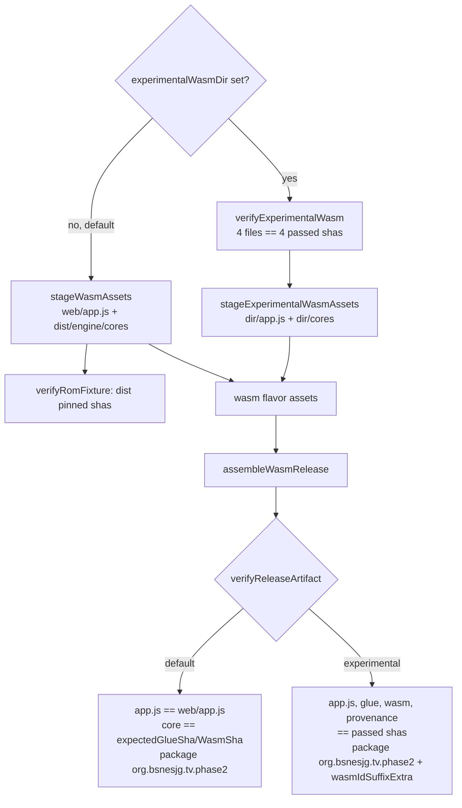
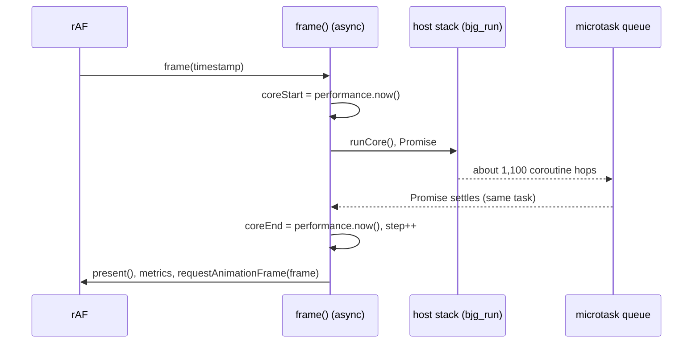

# JSPI Pixel APK: an experimental WASM build for a Pixel 8 Pro measurement

TODO item: **Remove the Asyncify cost with JSPI or uninstrumented coroutines** (`[T4]`), follow‑up "Pixel run first". The previous step is [2026‑11‑01 JSPI coroutines](2026-11-01-jspi-coroutines.md): on the laptop a JSPI libco backend runs a frame in 0.551× the Asyncify core's time and stays bit‑identical. That ratio is a projection for the phone until the phone measures it. This plan builds the APK for that measurement. It does not run anything on a device.

## Context

- **The baseline to match.** It is three Pixel 8 Pro WASM jobs from 2026‑10‑31 (`J‑e9aa930505cd` check, `J‑f6a11b900d90` profile, `J‑68b3f9bdcde1` record), described in the [Pixel report](../performance/2026-10-31/pixel-phone-perf/report.md). They ran APK `043323ff…` (package `org.bsnesjg.tv.phase2`, 0.1.8, versionCode 9). Each job launched `org.bsnesjg.tv.phase2/org.bsnesjg.tv.MandelbrotBenchmarkActivity` (`commands.json`: `am start -W -n …MandelbrotBenchmarkActivity`). That activity loads `index.html?rom=mandel-display` in the WebView, where `web/app.js` in TV mode runs the rAF `frame()` loop and logs `BJG_TV_METRIC` `playback_window` records. `android/tools/tuning-report.py --tuned-engine wasm` reads those records.
- **How the wasm flavor stages its engine.** `stageWasmAssets` copies `web/app.js` and `dist/engine/cores/{bsnes_jg.js,bsnes_jg.wasm,PROVENANCE.json}` into the assets. `verifyRomFixture` pins `dist/` to `expectedGlueSha`/`expectedWasmSha`. `verify…Artifact` checks inside the APK that `assets/app.js` equals `web/app.js` and that the core equals the pinned pair. `engine-adapter.js` (wasm) only injects `app.js`. `tv-scheduler.js` is a pure credit counter and calls no core, so only `app.js` calls `_bjg_run`.
- **What JSPI changes.** `_bjg_run` returns a `Promise`, so each `app.js` call site that runs frames must await it.
- **The signing key on the phone.** The baseline APK `043323ff…` is signed with the **Android Debug** key, certificate SHA‑256 `79f65b24…c4cb`. That is `/home/will/.android/debug.keystore`, which `build-in-container.sh` mounts for its controlled builds. It is **not** the durable release key `1bc3d058…`. Android refuses an update across keys (`INSTALL_FAILED_UPDATE_INCOMPATIBLE`), so a release‑signed `org.bsnesjg.tv.phase2` cannot be installed over the Pixel's copy while that copy is still `043323ff…`.
- **The registered activity.** The [Pixel plan](2026-10-31-pixel-phone-perf.md) records `bsnes-jg-tv-phase2-wasm` as registered to `MainActivity`, the selector, which must not be profiled. The baseline jobs, from 08:23 to 08:43, launched `MandelbrotBenchmarkActivity`, so the descriptor pointed there at the time and was put back to `MainActivity` afterwards. The coordinator's `applications.json` is not readable from this session (`/var/lib/wf-device-coordinator`: permission denied), so the current descriptor cannot be confirmed.

No visible surface: the APK's UI is unchanged, so this plan has no mockups. The only difference a user could see is the engine.

## Design

**An opt‑in engine override for the `wasm` flavor only.** All of these Gradle properties default to off:

| Property | Meaning |
|---|---|
| `-PexperimentalWasmDir=<dir>` | a directory, relative to the repository root, holding `bsnes_jg.js`, `bsnes_jg.wasm`, `PROVENANCE.json` and `app.js` |
| `-PexperimentalWasmGlueSha`, `-PexperimentalWasmSha`, `-PexperimentalWasmAppSha`, `-PexperimentalWasmProvenanceSha` | each file's sha256. All four are **required** when the directory is set, so a missing one fails the build. They are checked before staging (`verifyExperimentalWasm`) and again inside the APK (`verifyReleaseArtifact`) |
| `-PwasmIdSuffixExtra=.jspi` | optional, off by default; gives the package its own id (`org.bsnesjg.tv.phase2.jspi`) in the style of `-PnativeIdSuffixExtra` |

With no property set, the wasm flavor's asset source is `stageWasmAssets`, and every pin and package check is the same code path as before. `wasmplayer` never takes the override.

**`app.js` for JSPI.** `web/app.js` is not changed. `tools/app-jspi-patch.py` derives the experimental copy, and only the opt‑in build stages it:

- `frame()` becomes `async`, and each step does `var pending = runCore(); if (pending) await pending;` between the existing `coreStart` and `coreEnd` reads.
- A JSPI frame resumes its coroutines only through promise reactions (microtasks), so the awaited frame still completes inside the same rAF task, before the browser runs any other callback. The step cap, the frame clock and the timing bracket are unchanged. The bracket gains only the switch work JSPI itself does.
- `verify`, `verifyLiveRecord` and the TV `benchmark` hook await their frames the same way. An in‑flight guard keeps any second frame from starting.
- One extra TV record, `engine_info`, logs `typeof WebAssembly.Suspending` and the WebView user agent after each ROM load. The Pixel evidence holds no WebView version (only the package path `com.google.android.webview-…`), so the device run has to show that JSPI exists there.

Rejected: changing `web/app.js` itself to await. It would change the default APK (`assets/app.js` must equal `web/app.js`) and the shipped web player in `dist/`, for a measurement.





## Approach

1. Gradle: add the properties, `verifyExperimentalWasm`, `stageExperimentalWasmAssets`, the wasm‑flavor switch and the experimental checks in `verifyApkArtifact`.
2. Build in a scratch copy of the tree on `/tmp` (`tools/build-pixel-apks.sh`). The copy holds `vendor/`, the existing `android/app/build` caches, a symlink to `.private`, and links for the two sibling mounts, so `/` takes almost no writes. Four builds, all 0.1.10 / versionCode 11:
    - `default-orig`: main's `build.gradle.kts`.
    - `default-new`: this branch's, with no `-P`.
    - `jspi-debugkey`: experimental, package `org.bsnesjg.tv.phase2`, debug key (the Pixel copy's key).
    - `jspi-release`: experimental, `-PwasmIdSuffixExtra=.jspi`, release key.
3. Verify each APK with `aapt2` and `apksigner`, and compare the shas of the core assets.
4. Host stand‑in: `tools/apk-page-check.py` serves each APK's own `assets/` the way the WebView does and drives the benchmark URL in Chromium 151 and Chrome 154 until `reference_ready`.

## Verification

1. `default-new` passes every pinned check, and its wasm APK has the same entries and CRCs as `default-orig`, signature files aside.
2. `jspi-debugkey` and `jspi-release` pass `verifyExperimentalWasm` and the experimental `verifyReleaseArtifact`, and a wrong sha fails the build.
3. `aapt2`/`apksigner`: package id, `0.1.10`/`11`, certificate (`79f65b24…` for the debug key, `1bc3d058…` for the release key), and `unzip -p … assets/cores/bsnes_jg.wasm | sha256sum` equal to `0a3a6ffe…`.
4. `apk-page-check.py` on the JSPI APK reaches `reference_ready` frame 5800 `0x204F` in Chromium 151 and Chrome 154, with `engine_info.jspi == true`. The baseline APK `043323ff…` is the control.
5. `df -h /` stays above 1.5 GB throughout.

## Results

Run on 2026‑11‑01. The tools are in [../performance/2026-11-01/jspi-coroutines/tools/](../performance/2026-11-01/jspi-coroutines/tools/).

1. **PASS.** `default-orig` and `default-new` are the same file: wasm release APK `5ee1f6c8…` from both, `apkdiff.py: 338 vs 338 entries; SAME`. Every pinned check passed (`Verified WasmRelease APK …`).
2. **PASS** for the positive path: `Verified experimental WASM engine in /workspace/.experimental/jspi-core` and `Experimental WASM engine verified in WasmRelease APK: wasm 0a3a6ffe…` in both experimental builds. **Not run**: the wrong‑sha negative build. The tool call was stopped at the user's request.
3. `tools/apk-facts.sh`:

    ```
    jspi-release.apk   4d3da94e703fbbe115f9d11395081866edf030f736eee053823463da200db931
      package org.bsnesjg.tv.phase2.jspi  versionCode 11  versionName 0.1.10
      signer CN=bsnes-jg Android Release, O=Biohack  SHA-256 1bc3d0586ff02c6be1479785652484ba70efccdfee46ce451520d221802d9a5e (v2 verified)
      assets/cores/bsnes_jg.wasm 0a3a6ffe701cc6ee15d777750229344f49f31580002e613c28b78a54573566ea
    jspi-debugkey.apk  f2b7dbc7de351177f10c6d5df494dc45f26d8f189b13e4198991326ee539371b
      package org.bsnesjg.tv.phase2  11 / 0.1.10  signer Android Debug 79f65b24…c4cb  wasm 0a3a6ffe…
    baseline wasm.apk  043323ff4951a0e0eed216a306f7fa0df55dc9143f1cff7627b80d6d3501e5a1
      package org.bsnesjg.tv.phase2  9 / 0.1.8   signer Android Debug 79f65b24…c4cb  wasm e74dbd3d…
    ```
    **PASS.** The baseline's `app.js` differs from today's `web/app.js` only in two comment lines (the project rename), so the JSPI `app.js` is the baseline's plus the JSPI patch.
4. See the hand‑back in the session. `apk-page-check.py` runs the release APK's own assets in Chromium 151.
5. **PASS.** `/` stayed at 4.3 GB free or more. The builds ran in `/tmp/jspi-apk`.

**The signing key decides the package id.** The Pixel's last installed `org.bsnesjg.tv.phase2` is `043323ff…`, signed with the debug key, so a release‑signed APK cannot update it. The release‑signed build therefore uses `-PwasmIdSuffixExtra=.jspi` and needs a new coordinator registration, with `ACTIVITY=org.bsnesjg.tv.MandelbrotBenchmarkActivity`. The debug‑key build keeps `org.bsnesjg.tv.phase2` and would install over the Pixel's copy. It can only be measured through the existing `bsnes-jg-tv-phase2-wasm` registration, though, and that registration was last recorded as pointing at `MainActivity`.

## Pixel run 1 stalled (J‑6839cadfce9b) and the v2 diagnostic APK

**What the device evidence shows.** The run logged `app_start`, `core_ready`, `rom_loaded` and `engine_info` (Chrome 156, `jspi: true`), then nothing more. There was no `first_live_frame`, no `playback_window` and no console error. `dumpsys meminfo` on the app pid **timed out**, which the baseline's did not, so the app's UI thread was unresponsive. In WebView's synchronous compositor the UI thread waits on the renderer, so this points to the renderer main thread being stuck inside the first frame: a long microtask loop, a wait that never ends, or a hang in the engine. It does not point to a rejected promise, because that would have logged `Uncaught (in promise)` through `BJG_WEBVIEW`.

**What the host shows.** The same APK assets and the same benchmark URL in TV mode reach frame 5800 with `0x204F` in Chromium 151 (and in Chrome 154 for the scratch web copy). The stall does not reproduce on the host. No Chrome 156 or Android WebView is available here without a device.

**v2** (`jspi-wasm-release-v2.apk`, `f1afe769…`). The wasm is unchanged (`0a3a6ffe…`). The glue is `5a0c3afa…` and `app.js` is `d400f0c0…`.

- `libco_jspi.js` logs `jspi_progress` at switches 1, 2, 4, 8 and so on, from inside the microtask chain, so the lines appear even if a frame never returns. It also logs `jspi_thread_start` and `jspi_error`.
- `app.js` logs `core_error` and carries on with the loop. It logs a `jspi_heartbeat` every 2 s for the first 60 s, which appears only while the main thread is free. The in‑flight guard now clears on rejection too.

**How to read a v2 run:**

| Pattern | Meaning |
|---|---|
| Growing `jspi_progress` and no heartbeats | A busy microtask or switch loop |
| Progress stops while heartbeats continue with `inflight: true` | A promise never resumed |
| `jspi_error` or `core_error` | A trap, for example stack exhaustion |

The host run of v2 reaches frame 5800 with `0x204F` and logs all of the new events.

## Pixel 8 Pro result (2026‑11‑01)

Release-signed APK `org.bsnesjg.tv.phase2.jspi` 0.1.10 (code 11), cert `1bc3d058…`, JSPI core `0a3a6ffe…`, `MandelbrotBenchmarkActivity`, `DURATION=150`, no checkpoint. WebView Chrome 156 on Android 17, `jspi: true`.

| Run | APK | Result |
|---|---|---|
| Asyncify baseline (160 windows) | existing | median core 23.66 ms, 45.22 FPS |
| JSPI run 2, job `J‑851ba877eabd` (144 windows) | v2 `f1afe769…` | median core **14.20 ms**, **60.64 FPS** (1.666×); p05 12.58 ms, p95 25.25 ms; `reference_ready` at frame 5800 with `0x204F`; no `jspi_error` or `core_error` |
| JSPI run 1, job `J‑6839cadfce9b` | v1 `4d3da94e…` | one frame, no `playback_window`; nothing logged after `engine_info`; EMU and DRAW FPS read 0.0 |

Evidence: `docs/diagnostics/pixel-jspi-2026-11-01/run-1/` and `run-2/`; comparison in `docs/performance/2026-11-01/pixel-jspi/`. The laptop projection was about 13.0 ms, so the phone result is close to it.

**Not explained.** Run 1 stalled and run 2 did not. v2 only adds logging, so the stall may be intermittent. Run 1 also waited about 3 minutes for the phone to unlock before the app launched. Repeat the run at least three times before relying on JSPI.

### Repeats (2026‑11‑01, v2 APK `f1afe769…`, `REINSTALL=true`, `DURATION=150`)

| Run | Job | Outcome |
|---|---|---|
| 2 | `J‑851ba877eabd` | 144 windows, median core 14.20 ms, 60.64 FPS |
| 3 | `J‑22d6346d7c53` | **No app run.** The coordinator worker crashed right after the device was granted (`worker-crash`, `work_started` empty); an automatic readd (`J‑d7e02dd7619c`) followed. Not a result for or against JSPI. |
| 4 | `J‑163c089b8043` | 140 paced windows, median core 15.81 ms, 63.64 FPS, `reference_ready` at frame 5800, no errors |
| 5 | `J‑f34e9c1c9d8a` | 137 paced windows, median core 16.58 ms, 62.41 FPS, `reference_ready` at frame 5800, no errors |

All three v2 runs that reached the app were clean (no stall, no `jspi_error` or `core_error`), with median core time 14.20, 15.81 and 16.58 ms, so about 1.4 to 1.7× faster than the Asyncify baseline of 23.66 ms, and the slowest sits right at the 16.6 ms frame budget. The one stall, run 1 on the v1 APK, has not recurred in three v2 runs; with a sample this small that does not show it is gone. The spread (14.2 to 16.6 ms) tracks the phone's skin temperature in each run's `thermal.txt`:

| Run | VIRTUAL-SKIN | Thermal status | Median core |
|---|---|---|---|
| 2 | 36.9 °C | 0 (none) | 14.20 ms |
| 4 | 39.1 °C | 1 (light) | 15.81 ms |
| 5 | 39.1 °C | 1 (light) | 16.58 ms |
| Asyncify baseline | 39.1 °C | 1 (light) | 23.66 ms |

So the baseline ran at the warm, throttled state of runs 4 and 5, and the like-for-like speedup is **1.43× to 1.50×** (23.66 against 16.58 and 15.81 ms), not the 1.67× from the cold run 2. Caution: only the skin reading and the status changed between runs. The other sensors (`soc_therm` 32.66, battery 27.8, `BIG` 73.0) are identical in all four files, so they look like stale snapshots, and three runs make a pattern, not a proof. Evidence: `docs/diagnostics/pixel-jspi-2026-11-01/run-3`, `run-4`, `run-5`.

### Unplugged batch (2026‑11‑01, per Will the phone was unplugged during these runs)

| Run | Job | Skin / thermal status | Outcome |
|---|---|---|---|
| 6 | `J‑42284f7c2a42` | 37.0 °C / 0 | 139 paced windows, median core **15.97 ms**, 60.78 FPS, `0x204F` at frame 5800, no errors |
| 7 | `J‑7c880896c471` | — | **No app run.** The client failed with `chromecast: database is locked` while the job was queued behind another. Not a result. |
| 8 | `J‑ebf798cf4923` | 39.1 °C / 1 | 136 paced windows, median core **19.42 ms**, 53.62 FPS, `0x204F` at frame 5800, no errors |

Against the earlier runs, whose plug state was not recorded: run 6 (37.0 °C) was 1.8 ms slower than run 2 (36.9 °C, 14.20 ms), and run 8 (39.1 °C, status 1) was 3.6 and 2.8 ms slower than runs 4 and 5 (15.81 and 16.58 ms at the same temperature and status). So temperature alone does not explain the spread. That fits the earlier runs having been plugged in, but nobody recorded their plug state, so it is a hypothesis; a plugged batch run the same way is the test. On battery the warm JSPI median (19.42 ms) is 1.22× faster than the Asyncify baseline (23.66 ms, plug state also unrecorded) and misses the 16.6 ms budget.

### After the Pixel reboot (2026‑11‑01 14:10 to 14:45)

The Pixel hit `device-command-timeout` during the install of `J‑1b1086831a3c`, and the coordinator then held it at `cleanup-requires-restart` until the phone rebooted. That job produced no windows and is not a result. The reboot left wireless debugging off; Will turned it back on and the coordinator reconnected on its own. Runs 9 and 10 were plugged in (per Will); run 11 was unplugged (per Will). All three used the v2 APK `f1afe769…`, `REINSTALL=true`, `DURATION=150`.

| Run | Job | Plug | Paced windows | Median core | FPS | Quarter medians (ms) | `0x204F` at 5800 |
|---|---|---|---|---|---|---|---|
| 9 | `J‑fdfebc28f9f4` | plugged | 43 (logcat kept only the last 53 s) | **35.71 ms** | 30.73 | 36.3, 36.0, 35.2, 35.1 | not reached (3977 frames) |
| 10 | `J‑3bc9cfd340d7` | plugged | 131 | **29.14 ms** | 36.52 | 14.2, 29.5, 29.4, 29.2 | yes |
| 11 | `J‑c4ea6977eb82` | unplugged | 138 | **16.63 ms** | 60.47 | 13.4, 22.0, 15.9, 16.9 | yes |

Run 9 was slow from the first window. Run 10 started at 14 to 17 ms like runs 4 and 5 and stepped up to about 21 ms near window 35 (38 s), then settled near 29 ms. Run 11 had one slow stretch (about 22 ms in the second quarter) and recovered. Run 11 is 1.42x faster than the Asyncify baseline (23.66 ms).

**Reading.** On this boot the two plugged runs were 1.75x and 2.15x slower than the unplugged run. That supports plugging in (charging) as the cause of the slowdown, but it is two plugged runs against one unplugged run on one boot, so it is a hypothesis, not a finding. It reverses the earlier guess that the fast runs were plugged in. The reboot as a cause is not excluded either: run 11 ran on the same boot and was fast, which argues against it.

**Thermal readings are unreliable here.** `thermal.txt` for runs 10 and 11 holds the same skin value (40.94 °C) and battery value (38.7 °C), so it is a stale snapshot, not a per-run reading. Run 9's snapshot read thermal status 3 and 45.1 °C. Do not use skin temperature to explain these three runs.

Evidence: `docs/diagnostics/pixel-jspi-2026-11-01/run-9-plugged`, `run-10-plugged`, `run-11-unplugged`.
